# FACULTAD DE INGENIERÍA
**CARRERA: INGENIERÍA DE SISTEMAS**  
**MODALIDAD DE GRADUACIÓN: PROYECTO DE GRADO**

---

# SISTEMA DE ANÁLISIS BIOMECÁNICO DE TÉCNICAS DE JIU JITSU BRASILEÑO MEDIANTE INTELIGENCIA ARTIFICIAL PARA LA ACADEMIA CORPO E MENTE

**Santiago Borda Zambrana**

**Santa Cruz de la Sierra - Bolivia**  
**2026**

---

# FACULTAD DE INGENIERÍA
**CARRERA: INGENIERÍA DE SISTEMAS**  
**MODALIDAD DE GRADUACIÓN: PROYECTO DE GRADO**

## SISTEMA DE ANÁLISIS BIOMECÁNICO DE TÉCNICAS DE JIU JITSU BRASILEÑO MEDIANTE INTELIGENCIA ARTIFICIAL PARA LA ACADEMIA CORPO E MENTE

*Proyecto de Grado para optar al título de Licenciado en Ingeniería de Sistemas*

**Santiago Borda Zambrana**  
**Reg.: 2021210057**

**Santa Cruz de la Sierra - Bolivia**  
**2026**

---

## AGRADECIMIENTOS

Agradezco a Dios por traerme a este mundo fuerte y saludable.

A mi madre que gracias a su amor incondicional y su esfuerzo pude estudiar.

A mi abuela por alimentarme y tener siempre un plato de comida.

A mis tíos por sus palabras y experiencias vividas para que aprenda.

Al Jiu-Jitsu Brasileño, por enseñarme a afrontar los miedos, seguir incluso cuando no se ve el avance, saber lidiar con la sensación de la derrota y sobre todo a no rendirme y aprender.

*Un cinturón negro fue un cinturón blanco que nunca se rindió.*

---

## TABLA DE CONTENIDO

* **Capítulo I: Definición del Proyecto de Investigación**
  * 1.1. Definición del Problema
    * 1.1.1. Situación Problemática
    * 1.1.2. Situación Deseada
    * 1.1.3. Objeto de Investigación
    * 1.1.4. Alcance
    * 1.1.5. Justificación
  * 1.2. Objetivos
    * 1.2.1. Objetivo General
    * 1.2.2. Objetivos Específicos
  * 1.3. Metodología
* **Capítulo II: Descripción de la Empresa**
  * 2.1. Identidad y Estructura Operativa
  * 2.2. Servicios Ofrecidos
  * 2.3. Sistema de Grados y Progreso del Alumno
  * 2.4. Flujo Operativo Actual y Problemática Detectada
* **Capítulo III: Marco Teórico**
  * 3.1. Estimación de Pose, Profundidad y Segmentación con YOLOv26
    * 3.1.1. ¿Qué es YOLOv26?
    * 3.1.2. Modelos Seleccionados: YOLOv26-pose, YOLOv26-depth y YOLOv26-seg
    * 3.1.3. Justificación de la Elección y Prueba Empírica de Segmentación
    * 3.1.4. Aprendizaje Continuo (Data Flywheel) con YOLOv26x-pose
    * 3.1.5. Comparativa frente a otras opciones
  * 3.2. Infraestructura de Cómputo Acelerado Local: Apple Silicon (MLX y MPS)
    * 3.2.1. ¿Qué es Apple Silicon y la Memoria Unificada (MLX / MPS)?
    * 3.2.2. Modelo de Acceso y Costos (Frente a Google Colab)
    * 3.2.3. Justificación de la Elección y Descarte de Google Colab
    * 3.2.4. Comparativa frente a otras opciones
  * 3.3. Vectorización Multimodal y Reordenamiento: Qwen3-VL-Embedding y Qwen3-VL-Reranker
    * 3.3.1. ¿Qué son Qwen3-VL-Embedding y Qwen3-VL-Reranker?
    * 3.3.2. Modelos Seleccionados (Búsqueda en Dos Etapas)
    * 3.3.3. Justificación de la Elección
    * 3.3.4. Comparativa frente a otras opciones
  * 3.4. Base de Datos Vectorial: Qdrant
    * 3.4.1. ¿Qué es Qdrant?
    * 3.4.2. Modelo de Acceso y Costos
    * 3.4.3. Justificación de la Elección
    * 3.4.4. Comparativa frente a otras opciones
  * 3.5. Lenguaje de Programación: Python
    * 3.5.1. ¿Qué es Python?
    * 3.5.2. Costo
    * 3.5.3. Justificación de la Elección
    * 3.5.4. Comparativa frente a otras opciones
  * 3.6. Contenerización y Despliegue: Docker
    * 3.6.1. ¿Qué es Docker?
    * 3.6.2. Costo
    * 3.6.3. Justificación de la Elección
    * 3.6.4. Comparativa frente a otras opciones
  * 3.7. Capa de API Automática: PostgREST
    * 3.7.1. ¿Qué es PostgREST?
    * 3.7.2. Costo
    * 3.7.3. Justificación de la Elección
    * 3.7.4. Comparativa frente a otras opciones
  * 3.8. Framework de Backend: FastAPI
    * 3.8.1. ¿Qué es FastAPI?
    * 3.8.2. Costo
    * 3.8.3. Justificación de la Elección
    * 3.8.4. Comparativa frente a otras opciones
  * 3.9. Base de Datos Relacional: PostgreSQL con Row Level Security (RLS)
    * 3.9.1. ¿Qué es PostgreSQL y RLS?
    * 3.9.2. Costo
    * 3.9.3. Justificación de la Elección
    * 3.9.4. Comparativa frente a otras opciones
  * 3.10. Frontend: React 19 + Vite (Mobile-First y Proxy Inverso)
    * 3.10.1. ¿Qué es React y Vite?
    * 3.10.2. Costo
    * 3.10.3. Justificación de la Elección
    * 3.10.4. Comparativa frente a otras opciones
  * 3.11. Geolocalización y Mapas: Leaflet.js + OpenStreetMap (Nominatim)
    * 3.11.1. ¿Qué son Leaflet y OpenStreetMap?
    * 3.11.2. Costo
    * 3.11.3. Justificación de la Elección
    * 3.11.4. Comparativa frente a otras opciones
  * 3.12. Pruebas de Software: Pytest y Playwright
    * 3.12.1. ¿Qué son Pytest y Playwright?
    * 3.12.2. Costo
    * 3.12.3. Justificación de la Elección
    * 3.12.4. Comparativa frente a otras opciones
  * 3.13. Inteligencia Artificial: Conceptos Básicos
    * 3.13.1. ¿Qué es la Inteligencia Artificial y la Visión por Computadora?
    * 3.13.2. ¿Qué es RAG (Generación Aumentada por Recuperación)?
  * 3.14. Motor de Inferencia Generativa: Qwen3-VL-Instruct-4B (Local en MLX)
    * 3.14.1. ¿Qué es Qwen3-VL-Instruct?
    * 3.14.2. Modelo Seleccionado: Qwen3-VL-Instruct-4B (4 bits) e Ingesta Multimodal Triple
    * 3.14.3. Costo, Accesibilidad y Control contra Alucinaciones (Juez de IA)
    * 3.14.4. Comparativa frente a otras opciones (y descarte de Google Gemini)
  * 3.15. Exposición Segura a Internet: Cloudflare Tunnel (`cloudflared`)
    * 3.15.1. ¿Qué es Cloudflare Tunnel?
    * 3.15.2. Costo
    * 3.15.3. Justificación de la Elección y Mitigación del Límite de 100 MB
    * 3.15.4. Comparativa frente a otras opciones
  * 3.16. Seguridad y Control de Acceso: Modelo "Pase de Tatami"
    * 3.16.1. ¿Qué es el Modelo "Pase de Tatami"?
    * 3.16.2. Costo
    * 3.16.3. Justificación de la Elección y Ciberseguridad Defensiva
    * 3.16.4. Comparativa frente a otras opciones
* **Capítulo IV: Especificación de Requisitos de Software (IEEE 830)**
  * 4.1. Introducción
    * 4.1.1. Propósito
    * 4.1.2. Alcance
    * 4.1.3. Definiciones, Acrónimos y Abreviaturas
    * 4.1.4. Referencias
    * 4.1.5. Visión General
  * 4.2. Descripción General
    * 4.2.1. Perspectiva del Producto
    * 4.2.2. Funciones del Producto
    * 4.2.3. Características de los Usuarios
    * 4.2.4. Restricciones
    * 4.2.5. Suposiciones y Dependencias
  * 4.3. Requisitos Específicos
    * 4.3.1. Requisitos Funcionales (RF)
    * 4.3.2. Requisitos No Funcionales (RNF)
    * 4.3.3. Requisitos de Interfaz
    * 4.3.4. Requisitos de Datos
  * 4.4. Identificación de Casos de Uso y Trazabilidad
  * 4.5. Modelo de Dominio
* **Capítulo V: Análisis y Diseño Orientado a Objetos**
  * 5.1. Caso de Uso 1: Iniciar Sesión y Registro de Usuarios (UC-01)
  * 5.2. Caso de Uso 2: Analizar Técnica y Generar Feedback Biomecánico (UC-02)
  * 5.3. Caso de Uso 3: Gestionar Técnicas y Videos de Referencia (UC-03)
  * 5.4. Caso de Uso 4: Gestionar Teoría RAG (UC-04)
  * 5.5. Caso de Uso 5: Ver Progreso de Alumnos (UC-05)
  * 5.6. Caso de Uso 6: Activar Pase de Tatami (UC-06)
  * 5.7. Caso de Uso 7: Gestionar Sucursales y Coordenadas Geográficas (UC-07)
  * 5.8. Caso de Uso 8: Entrar como otro Usuario / Impersonificación (UC-08)
  * 5.9. Diagramas de Arquitectura Consolidada del Sistema Completo
    * 5.9.1. Diagrama de Casos de Uso del Sistema Completo
    * 5.9.2. Diagrama de Actividad con Carriles del Sistema Completo (Flujo Principal UC-02)
    * 5.9.3. Diagrama de Clases del Sistema Completo
* **Capítulo VI: Desarrollo**
  * 6.1. Introducción al Proceso de Construcción
  * 6.2. Herramientas de Desarrollo, Licencias y Software Utilizado
    * 6.2.1. Entorno de Desarrollo e IA Asistida
    * 6.2.2. Infraestructura de Cómputo y Hardware
    * 6.2.3. Stack de Software de Producción
    * 6.2.4. Herramientas de Modelado y Documentación
    * 6.2.5. Repositorio de Habilidades de Ciberseguridad
  * 6.3. Estructura del Repositorio
  * 6.4. Gestión de Configuración y Entornos
  * 6.5. Internacionalización (i18n) y Localización
  * 6.6. Validación Empírica del Data Flywheel (Human-in-the-Loop)
  * 6.7. Deuda Técnica Registrada en Desarrollo
* **Capítulo VII: Pruebas**
  * 7.1. Estrategia de Aseguramiento de Calidad
  * 7.2. Pruebas Unitarias e Integración (Pytest)
  * 7.3. Pruebas E2E con Playwright
  * 7.4. Pruebas de Rendimiento y Benchmarks
  * 7.5. Pruebas de Regresión y Puntos de Restauración (Rollback)
  * 7.6. Pruebas de Estrés y Casos Límite
  * 7.7. Deuda Técnica en Pruebas
* **Capítulo VIII: Seguridad**
  * 8.1. Modelo de Amenazas y Superficie de Ataque
  * 8.2. Marco de Auditoría: `briiirussell/cybersecurity-skills`
  * 8.3. Controles de Seguridad Implementados
  * 8.4. Gestión de Secretos y Configuración
  * 8.5. Hardening de Producción
  * 8.6. Deuda de Seguridad Registrada
  * 8.7. Recomendaciones Futuras
* **Referencias Bibliográficas**
# Capítulo I: Definición del Proyecto de Investigación

## 1.1. Definición del Problema

### 1.1.1. Situación Problemática
En el aprendizaje del Jiu-Jitsu Brasileño, la corrección de los movimientos es fundamental. Una mala postura no solo hace que la técnica falle, sino que puede provocar lesiones graves. Sin embargo, en academias con muchos alumnos, los profesores no pueden dedicar el tiempo suficiente a corregir uno por uno durante la clase.

Además, cuando el alumno practica por su cuenta o fuera del horario de clase, no tiene a quién preguntarle si está haciendo el movimiento correctamente. Actualmente, el alumno depende de su propia percepción o de la ayuda de compañeros que a veces no tienen la experiencia suficiente para detectar errores sutiles pero importantes en la biomecánica del cuerpo.

### 1.1.2. Situación Deseada
Imaginemos un "entrenador virtual" disponible las 24 horas del día. El alumno graba su técnica con la cámara de su celular, sube el video a la plataforma y recibe un informe sobre su técnica.

Este sistema le dice exactamente qué parte de su cuerpo estuvo mal posicionada (por ejemplo, "tu cadera está muy alta") y le explica cómo corregirla, basándose en la técnica perfecta de su propio profesor. Todo esto de forma automática, objetiva y en su idioma preferido (español o portugués).

### 1.1.3. Objeto de Investigación
El objeto de este proyecto es el desarrollo de un sistema informático (una plataforma web) que utiliza Inteligencia Artificial para analizar los movimientos de los alumnos de Jiu-Jitsu. El sistema compara el video del alumno con el video de referencia de un profesor experto, detecta las diferencias físicas y genera consejos personalizados para mejorar la técnica.

### 1.1.4. Alcance
El proyecto abarca la creación de una plataforma web completa para la red de academias "Corpo e Mente".

* **Para los alumnos:** Permite subir videos, elegir a su profesor y la técnica a evaluar, y recibir el análisis.
* **Para los profesores:** Permite subir sus propios videos de referencia (el "patrón de oro"), escribir recomendaciones directas y agregar manuales o teorías que la Inteligencia Artificial usará para dar los consejos.
* **Para los administradores:** Permite gestionar las distintas sucursales de la academia a nivel internacional.

**Aclaración importante:** El sistema no busca reemplazar al profesor humano, sino ser una herramienta de apoyo para acelerar el aprendizaje. Su enfoque es 100% deportivo y pedagógico.

### 1.1.5. Justificación
Este proyecto es de gran utilidad porque:

* **Acelera el aprendizaje:** El alumno recibe retroalimentación inmediata fuera del horario de clase.
* **Previene lesiones:** Al corregir malas posturas a tiempo, se protege la integridad física del practicante.
* **Estandariza la enseñanza:** Permite que la academia "Corpo e Mente" mantenga un mismo nivel de calidad técnica en todas sus sucursales alrededor del mundo.
* **Uso inteligente de recursos:** Aprovecha modelos de Inteligencia Artificial optimizados para funcionar de manera local y eficiente, lo que significa que la academia no necesita pagar suscripciones mensuales costosas en la nube ni licencias por uso para tener un sistema de análisis de movimiento de primer nivel.

## 1.2. Objetivos

### 1.2.1. Objetivo General
Desarrollar una plataforma web basada en Inteligencia Artificial que permita a los alumnos de la academia "Corpo e Mente" analizar sus técnicas de Jiu-Jitsu Brasileño, comparándolas con un modelo de referencia para recibir retroalimentación biomecánica clara, objetiva y personalizada.

### 1.2.2. Objetivos Específicos
* Crear una plataforma fácil de usar donde los alumnos puedan subir sus videos y los profesores puedan guardar sus técnicas de referencia y manuales de ayuda.
* Implementar inteligencia artificial que pueda "leer" el video del alumno, identificar las partes de su cuerpo (esqueleto en 3D) y detectar en qué momento exacto comete un error en comparación con el profesor.
* Lograr que el sistema lea y comprenda los manuales, imágenes técnicas y consejos subidos por los profesores para dar retroalimentación que suene como un verdadero maestro, adaptada al idioma del alumno (español o portugués).
* Asegurar que el sistema pueda manejar varias sucursales de la academia al mismo tiempo, manteniendo la privacidad de los datos y el control de los roles (alumno, profesor, administrador).

## 1.3. Metodología
Para construir este sistema, no se utilizará el método tradicional de pasar meses diseñando en papel antes de escribir una sola línea de código. En su lugar, se aplicará el **Proceso Unificado Ágil (basado en la metodología de Craig Larman)**.

En palabras simples, esto significa que el proyecto se construye en "ciclos" o "entregas cortas" llamadas iteraciones. En lugar de intentar hacer todo el sistema de una vez, se divide el trabajo en partes pequeñas y funcionales guiadas por pruebas reales (evidencia empírica). Por ejemplo:

* **Primer ciclo:** Crear el sistema de inicio de sesión, seguridad y registro de usuarios.
* **Segundo ciclo:** Lograr que el sistema permita subir y guardar videos de técnicas.
* **Tercer ciclo:** Conectar la Inteligencia Artificial para que analice los videos, mida la profundidad y genere consejos basados en los libros del profesor.
* **Cuarto ciclo:** Optimizar la seguridad para internet (Cloudflare), perfeccionar el diseño para teléfonos celulares y asegurar que el sistema mejore continuamente.

Al final de cada ciclo, se tiene una parte del sistema que ya funciona y se puede probar con datos reales. Esto permite detectar errores rápidamente, descartar tecnologías que fallan en la práctica y asegurar que el producto final sea exactamente lo que los usuarios necesitan en el tatami, minimizando el riesgo de fracaso del proyecto.

*Figura 1: Distribución de esfuerzos en las fases e iteraciones del Proceso Unificado Ágil.*

---

# Capítulo II: Descripción de la Empresa

## 2.1. Identidad y Estructura Operativa
La empresa objeto de estudio es **Corpo e Mente**, una organización internacional dedicada a la enseñanza y difusión del Jiu-Jitsu Brasileño. Para el desarrollo de este proyecto, la entidad legal y operativa que avala la investigación es **Corpo e Mente Bolivia**.

Es fundamental aclarar que Corpo e Mente opera bajo un modelo de infraestructura compartida. La academia física que alberga las instalaciones, gestiona la cobranza a los alumnos y administra los pagos al personal docente es **Knock Out Training Center** (ver Figura 2). Sin embargo, Knock Out actúa exclusivamente como proveedor de infraestructura y servicios administrativos básicos; no tiene participación en la toma de decisiones técnicas, pedagógicas ni estratégicas de Corpo e Mente.

La dirección técnica y académica recae totalmente en **Miguel Baigorria**, cinturón negro de Jiu-Jitsu Brasileño, quien es el responsable de la sucursal y quien firmó la carta de autorización para este proyecto de grado. Su liderazgo garantiza que, aunque la ubicación física sea compartida, la identidad y los estándares de Corpo e Mente se mantengan intactos e independientes (ver Figura 3).

*Figura 2: Logotipo oficial de Knock Out Training Center, sede física de operaciones.*  
*Figura 3: Logotipo oficial de Corpo e Mente Jiu-Jitsu.*

## 2.2. Servicios Ofrecidos
Corpo e Mente Bolivia ofrece un portafolio de servicios orientados tanto al practicante recreativo como al competidor de alto rendimiento. Los principales servicios son:

* **Clases Grupales:** Entrenamientos regulares dirigidos por instructores certificados, enfocados en la técnica, la condición física y la defensa personal. Las clases están estructuradas según el nivel de cinturón del alumno.
* **Entrenamiento para Campeonatos:** Sesiones especializadas de sparring (combate de entrenamiento) y preparación táctica para alumnos que desean competir a nivel regional o nacional.
* **Exámenes de Grado:** Evaluaciones formales donde los alumnos demuestran su dominio técnico y físico para ascender en el sistema de cinturones. Estas evaluaciones son supervisadas directamente por el Maestro Miguel Baigorria.
* **Organización de Torneos:** Corpo e Mente Bolivia planifica y ejecuta torneos internos y abiertos, fomentando la competencia sana y el intercambio técnico entre academias.

## 2.3. Sistema de Grados y Progreso del Alumno
El núcleo del servicio educativo de Corpo e Mente es el sistema de graduación del Jiu-Jitsu Brasileño. Este sistema no solo mide el tiempo de práctica, sino el dominio técnico, la capacidad de aplicación en combate y la madurez del practicante.

Como se observa en la Figura 4, el progreso se divide en cinco niveles principales para adultos, cada uno con objetivos claros y tiempos estimados de permanencia:

* **Cinturón Blanco (1-2 años):** Fase de supervivencia y fundamentos. El objetivo es aprender a escapar de posiciones dominantes y entender la mecánica básica.
* **Cinturón Azul (2-4 años):** Dominio de técnicas básicas y comienzo de encadenamiento de movimientos. El alumno comienza a desarrollar su propio estilo de juego.
* **Cinturón Morado (4-7 años):** Nivel avanzado. Se espera un gran repertorio técnico y la capacidad de enseñar a blancos y azules. Es la fase de refinamiento estratégico.
* **Cinturón Marrón (7-10 años):** Nivel experto. Preparación final para la maestría, con un dominio casi completo de los detalles técnicos y transiciones.
* **Cinturón Negro (10+ años):** Maestría y liderazgo. Representa un profundo conocimiento del arte y la responsabilidad de contribuir a la comunidad y formar nuevos instructores.

Adicionalmente, el sistema incluye rayas (grados) en la punta del cinturón para marcar el progreso dentro de cada nivel, y una escala específica de colores (blanco, gris, amarillo, naranja, verde) para menores de 16 años, adaptada a su desarrollo físico y cognitivo.

*Figura 4: Guía oficial de Cinturones en Jiu-Jitsu Brasileño: Rango, Tiempo y Significado.*

## 2.4. Flujo Operativo Actual y Problemática Detectada
*Figura 5: Diagrama de flujo operativo actual de la academia.*

---

# Capítulo III: Marco Teórico

## 3.1. Estimación de Pose, Profundidad y Segmentación con YOLOv26

### 3.1.1. ¿Qué es YOLOv26?
YOLO (acrónimo en inglés de *You Only Look Once*, que significa "Solo miras una vez") es una familia de algoritmos de inteligencia artificial de vanguardia, desarrollada y mantenida por Ultralytics (Ultralytics, 2026), especializada en la detección de objetos y el análisis de imágenes en tiempo real.

A diferencia de los sistemas tradicionales que analizan una imagen múltiples veces por partes, la arquitectura YOLO procesa toda la imagen en un solo paso, lo que la convierte en una de las tecnologías más rápidas y eficientes del mercado. La versión 26 representa la evolución más reciente de este ecosistema, incorporando en un mismo paquete capacidades avanzadas como la estimación de pose humana (esqueleto), la estimación de profundidad (3D) y la segmentación de siluetas a nivel de píxel.

### 3.1.2. Modelos Seleccionados: YOLOv26-pose, YOLOv26-depth y YOLOv26-seg
Para este proyecto, se utilizan cuatro modelos complementarios dentro del ecosistema YOLOv26 (almacenados de forma organizada en la carpeta `storage/models/` del sistema):

* **`yolo26n-pose.pt` (Modelo Principal de Pose):** En su versión "nano" (la más ligera y rápida), está entrenado para identificar y rastrear 17 puntos clave anatómicos (articulaciones como hombros, codos, muñecas, caderas, rodillas y tobillos) en cada fotograma de un video, generando un "esqueleto" digital del practicante en los ejes X e Y.
* **`yolo26n-depth.pt` (Modelo de Profundidad 3D):** Mientras que el modelo de pose dice dónde está una articulación a lo ancho y alto de la pantalla (ejes X e Y), este modelo calcula qué tan lejos o cerca está cada parte del cuerpo respecto a la cámara (eje Z). Esto permite saber quién está encima o debajo durante una llave en el suelo, resolviendo cuando un brazo o pierna tapa a otro (oclusiones).
* **`yolo26n-seg.pt` (Modelo Opcional de Segmentación):** Recorta la silueta exacta de cada luchador píxel por píxel antes de buscar sus articulaciones. Se incorporó en el código mediante un interruptor configurable (`USE_SEGMENTATION`) para evaluar si ayudaba a separar cuerpos muy entrelazados.
* **`yolo26x-pose.pt` (Modelo Maestro para Aprendizaje Continuo):** Es la versión "extra grande" y más potente de la familia. No se usa durante la consulta normal del alumno porque es más pesada, sino que trabaja en segundo plano como un "maestro revisor" que enseña automáticamente al modelo ligero cuando aparece un video difícil.

### 3.1.3. Justificación de la Elección y Prueba Empírica de Segmentación
La selección de YOLOv26 se fundamenta en cinco pilares clave validados con pruebas reales siguiendo la metodología de Craig Larman:

1. **Velocidad y Eficiencia:** La versión "nano" está optimizada para ejecutarse con un consumo mínimo de recursos, alcanzando **95.2 fotogramas por segundo (FPS)** en la computadora local. Procesar un video completo de 15 segundos toma apenas 9.4 segundos.
2. **Precisión en el Suelo (Tatami):** A diferencia de otras alternativas (como MediaPipe de Google, que asume que la persona está de pie), YOLOv26 mantiene una alta precisión cuando los cuerpos están en el suelo, invertidos o usando kimono (*gi*).
3. **Desambiguación en 3D con Profundidad:** En las pruebas con videos reales de la academia, la combinación de pose + profundidad (`yolo26n-depth.pt`) logró resolver **163 oclusiones severas** (cruces de extremidades en el suelo) manteniendo la velocidad por encima de los 92 FPS.
4. **Decisión Basada en Evidencia sobre la Segmentación (`USE_SEGMENTATION=False`):** Siguiendo el rigor de Larman, se probó si recortar la silueta con `yolo26n-seg.pt` antes de detectar el esqueleto mejoraba un video real de guardia cerrada (897 fotogramas). La prueba demostró que la mejora al detectar dos personas fue de apenas **+1.78%** (16 fotogramas), sin superar la meta mínima del 5%, pero haciendo el sistema **3.5 veces más lento** (bajando de 95.2 FPS a 27.1 FPS). Por ello, se dejó desactivada por defecto en producción, priorizando la velocidad para el alumno.
5. **Costo Cero:** Los modelos de Ultralytics son de código abierto y gratuitos para uso académico y de investigación, sin cobros por API ni licencias.

Tabla 1
*Prueba experimental entre Pose Directa vs. Segmentación + Pose*

| Métrica Evaluada | YOLO26-Pose Directo (Activo) | YOLO-Seg + Pose (`USE_SEGMENTATION=True`) | Resultado / Decisión |
| :--- | :--- | :--- | :--- |
| **Fotogramas analizados** | 897 frames | 897 frames | Video real de Guardia Cerrada |
| **Detección de 2 personas** | 255 frames (28.4%) | 271 frames (30.2%) | Solo +1.78% de diferencia |
| **Cobertura total de rastreo** | 100.0% | 100.0% | Sin mejora adicional |
| **Confianza del esqueleto** | 0.8006 | 0.7388 | Pierde precisión al recortar |
| **Velocidad y Tiempo Total** | **95.2 FPS (9.42 seg)** | **27.1 FPS (33.10 seg)** | **Pose Directo es 3.5x más rápido** |

*Nota.* Elaboración propia (2026).

### 3.1.4. Aprendizaje Continuo (Data Flywheel) con YOLOv26x-pose
Para que la Inteligencia Artificial sea cada vez más inteligente con los videos propios de la academia sin tener que etiquetar fotos a mano, se implementó un ciclo de mejora continua llamado **Data Flywheel (Volante de Datos)**:

1. **Captura de Casos Difíciles:** Si durante el análisis de un video el modelo rápido (`yolo26n-pose.pt`) tiene dudas en algún fotograma (confianza menor a 0.65), guarda esa imagen automáticamente en una carpeta especial (`uncertainty_frames/`).
2. **Auto-enseñanza (Maestro-Estudiante):** Fuera de horario, el modelo gigante y experto (`yolo26x-pose.pt`) revisa esas imágenes difíciles y marca dónde estaban realmente las articulaciones.
3. **Memoria Equilibrada (Replay Buffer 70/30):** Para que el modelo no olvide las posiciones básicas al aprender las difíciles, se entrena mezclando un 70% de poses clásicas (Gold Standard) con un 30% de poses nuevas (Flywheel).
4. **Filtro de Calidad (Gatekeeper):** El nuevo modelo solo reemplaza al anterior si demuestra en un examen automático tener una precisión igual o mayor al 85%.

### 3.1.5. Comparativa frente a otras opciones
Para garantizar que el sistema funcione de manera óptima en el entorno específico del Jiu-Jitsu Brasileño, se evaluaron varias tecnologías de estimación de pose disponibles en el mercado.

Tabla 2
*Comparativa de tecnologías de estimación de pose humana*

| Tecnología | Velocidad y Eficiencia | Resistencia a Oclusiones (Kimono / Cuerpos superpuestos) | Desempeño en Suelo (Jiu-Jitsu) | Profundidad 3D Nativa | Costo y Accesibilidad |
| :--- | :--- | :--- | :--- | :--- | :--- |
| **Ultralytics YOLO26 (Seleccionada)** | **Muy alta (95+ FPS en equipo local)** | **Excelente (Entrenada para ropa deportiva y contacto estrecho)** | **Excelente (Funciona en cualquier orientación o ángulo)** | **Sí (`yolo26n-depth` integrado)** | **Gratuita (Código abierto, sin licencias de pago)** |
| Google MediaPipe | Alta (60+ FPS) | Media (Pierde el rastreo con telas holgadas o cuerpos entrelazados) | Baja (Optimizada principalmente para personas de pie) | Parcial (Aproximada, sin mapa denso) | Gratuita, pero limitada para este contexto |
| OpenPose (CMU) | Baja (15 FPS en GPU, muy lenta en CPU) | Alta | Buena, pero demasiado lenta para un análisis ágil | No (Requiere cámaras especiales) | Gratuita (uso académico), pero exige hardware muy costoso |
| AlphaPose | Media (20 FPS en GPU) | Alta | Media (Requiere configuración compleja de servidores) | No nativa | Gratuita, pero difícil de implementar y mantener |

*Nota.* Elaboración propia (2026).

---

## 3.2. Infraestructura de Cómputo Acelerado Local: Apple Silicon (MLX y MPS)

### 3.2.1. ¿Qué es Apple Silicon y la Memoria Unificada (MLX / MPS)?
Apple Silicon es la arquitectura de procesadores de alto rendimiento (serie M) que integra en un mismo chip el procesador principal (CPU), la tarjeta gráfica aceleradora (GPU) y el motor neuronal de Inteligencia Artificial, compartiendo un único bloque de **Memoria Unificada (24 GB de RAM)**.

A diferencia de las computadoras tradicionales donde la tarjeta gráfica tiene poca memoria propia y pierde tiempo copiando datos de un lado a otro, en Apple Silicon todos los modelos de IA leen los videos y textos directamente desde el mismo lugar de la memoria a altísima velocidad, utilizando dos tecnologías gratuitas:

* **MPS (Metal Performance Shaders):** Acelera el análisis de video de YOLOv26 directamente en los núcleos gráficos del equipo.
* **Apple MLX:** Es el motor oficial creado por Apple para ejecutar modelos de lenguaje y visión (como Qwen3-VL) a máxima velocidad y con bajo consumo de memoria.

### 3.2.2. Modelo de Acceso y Costos (Frente a Google Colab)
Al ejecutar toda la Inteligencia Artificial directamente en el equipo local de la academia mediante Apple Silicon, el **costo operativo mensual es de $0 USD**:

* **Inferencia Local en Apple Silicon (Seleccionada):**
  * **Costo mensual:** $0 (sin suscripciones, sin cobros por minuto ni por cantidad de videos).
  * **Disponibilidad:** 24/7 sin cortes de sesión ni límites de horario.
* **Alternativa Evaluada en Fases Iniciales (Google Colab en la Nube):**
  * Aunque Google Colab ofrece una capa gratuita con tarjetas NVIDIA T4, impone desconexiones automáticas por inactividad, límites diarios de uso y bloqueos cuando se intenta usar como servidor continuo para una aplicación web, obligando en la práctica a pagar planes mensuales (Colab Pro de $9.99 a $49.99 USD/mes).

### 3.2.3. Justificación de la Elección y Descarte de Google Colab
En las primeras iteraciones del proyecto se probó Google Colab como motor remoto, pero siguiendo la metodología de Craig Larman fue descartado y reemplazado por la ejecución 100% local en Apple Silicon por cuatro razones contundentes:

1. **Sin Desconexiones en Media Clase:** Google Colab cierra la sesión si se apaga la pestaña o tras pocas horas de uso. Con el procesamiento local en Apple Silicon, el sistema está siempre listo cuando el alumno o el profesor lo necesitan.
2. **Velocidad Inmediata (Sin Doble Subida de Video):** Con Colab, el video tenía que subir primero al servidor y luego enviarse por internet hasta los centros de datos de Google, tardando más de un minuto. Al procesar localmente, la lectura del video es instantánea.
3. **Privacidad Total de los Alumnos:** Los videos de los practicantes (incluyendo niños y jóvenes de la academia) se analizan dentro de la computadora de la academia y nunca se suben a servidores externos de terceros.
4. **Convivencia de Todos los Modelos en 24 GB:** Gracias a la memoria unificada y la compresión a 4 bits de MLX, los modelos de YOLO, el buscador de manuales y el generador de consejos funcionan juntos consumiendo aproximadamente ~9 GB de memoria unificada en pico (Qwen consume ~8.55 GB y YOLO nano una fracción mínima).

### 3.2.4. Comparativa frente a otras opciones

Tabla 3
*Comparativa de Infraestructuras de Cómputo para Inferencia de IA*

| Plataforma / Opción | Hardware Utilizado | Costo Operativo Mensual | Estabilidad y Disponibilidad | Privacidad de los Videos | Idoneidad para el Proyecto |
| :--- | :--- | :--- | :--- | :--- | :--- |
| **Apple Silicon Local con MLX y MPS (Seleccionada)** | **Chip serie M (24 GB Memoria Unificada)** | **$0 USD (Gratuito / Sin pagos recurrentes)** | **Total (24/7 sin cierres de sesión ni bloqueos)** | **Máxima (Los videos no salen de la academia)** | **Excelente (Rápido, privado y sin costos mensuales)** |
| Google Colab (Descartada tras pruebas) | NVIDIA Tesla T4 en la nube | Gratuito con cortes o $10-$50 USD/mes | Baja (Se desconecta sola y caduca el enlace) | Baja (Videos subidos a servidores externos) | Regular (Útil para prototipos, inviable en uso real diario) |
| Servidor Cloud Dedicado (AWS / Google Cloud) | Instancias GPU alquiladas | Alto ($150 - $400 USD al mes continuo) | Alta | Media | Baja (Fuera del presupuesto de una academia deportiva) |
| PC de Escritorio con GPU Gamer (RTX 4090) | Tarjeta dedicada de alto consumo | Alto costo inicial ($2,000+ USD) y eléctrico | Alta | Máxima | Media (Demasiado ruidoso, grande y costoso) |

*Nota.* Elaboración propia (2026).

---

## 3.3. Vectorización Multimodal y Reordenamiento: Qwen3-VL-Embedding y Qwen3-VL-Reranker

### 3.3.1. ¿Qué son Qwen3-VL-Embedding y Qwen3-VL-Reranker?
La familia **Qwen3-VL** (desarrollada por Alibaba Cloud Qwen Team, 2025) es una tecnología de Inteligencia Artificial de última generación que entiende al mismo tiempo texto e imágenes (Visión y Lenguaje). En este sistema se utilizan dos herramientas hermanas que trabajan en equipo para buscar información dentro de los manuales PDF subidos por los profesores:

* **Qwen3-VL-Embedding:** Convierte tanto los párrafos de los libros de Jiu-Jitsu como las fotografías y diagramas de las técnicas en listas de números llamadas "vectores" (de 2048 dimensiones), ubicando los conceptos parecidos cerca unos de otros.
* **Qwen3-VL-Reranker (Reordenador de Precisión):** Es un segundo filtro experto que toma los resultados encontrados por el primer modelo, compara a fondo la foto del error del alumno contra cada página del manual y las ordena de la más útil a la menos útil.

### 3.3.2. Modelos Seleccionados (Búsqueda en Dos Etapas)
Para lograr que los consejos teóricos sean exactos sin hacer lento el sistema, se implementaron ambos modelos de 2 mil millones de parámetros (`2B`) optimizados en **Apple MLX** trabajando en dos etapas:

1. **Etapa 1 - Búsqueda Rápida (`Qwen3-VL-Embedding-2B`):** Busca en milisegundos dentro de la base de datos vectorial los 10 fragmentos o páginas de manuales que más se parecen a la técnica y al error del alumno.
2. **Etapa 2 - Filtro Experto (`Qwen3-VL-Reranker-2B`):** Revisa con lupa esos 10 candidatos comparando imagen y texto al mismo tiempo, y selecciona únicamente los **3 fragmentos más exactos** para entregárselos al redactor de consejos.

### 3.3.3. Justificación de la Elección
La decisión de utilizar esta dupla de modelos Qwen3-VL se basa en cuatro pilares fundamentales:

1. **Capacidad Multimodal Real (Texto + Foto):** Los manuales de Jiu-Jitsu están llenos de fotografías paso a paso. Estos modelos entienden tanto las explicaciones escritas como las fotos de los libros, relacionándolas directamente con el fotograma donde el alumno falló.
2. **Eliminación de Confusiones entre Técnicas Parecidas:** En Jiu-Jitsu muchas posiciones se ven similares por el kimono. El segundo filtro (*Reranker*) evita que el sistema confunda, por ejemplo, un "escape de 100 kilos" con un "pasaje de guardia", garantizando consejos 100% pertinentes.
3. **Excelente Dominio de Español y Portugués:** Reconoce con total naturalidad los términos técnicos del arte marcial en ambos idiomas (*guardia cerrada / guarda fechada*, *raspado / raspagem*, *pasaje / passagem*).
4. **Costo Cero y Ejecución Local:** Ambos modelos son de código abierto y corren gratuitamente dentro de la memoria del equipo local sin pagar por uso.

### 3.3.4. Comparativa frente a otras opciones

Tabla 4
*Comparativa de Modelos de Búsqueda y Vectorización Multimodal*

| Tecnología | Capacidad Multimodal (Texto + Imagen) | Incluye Segundo Filtro (Reranker) | Soporte Español / Portugués | Costo de Uso | Ejecución Local en Mac |
| :--- | :--- | :--- | :--- | :--- | :--- |
| **Qwen3-VL Embedding + Reranker (Seleccionada)** | **Sí (Nativo y de alta precisión)** | **Sí (Doble etapa para máxima exactitud)** | **Excelente (Entiende jerga de BJJ)** | **Gratuito (Open Source)** | **Nativa y ultrarrápida en MLX** |
| OpenAI text-embedding-3 | No (Solo entiende texto, ignora fotos) | No nativo | Excelente | De pago (por millón de palabras) | No (Requiere internet y pago) |
| BGE-M3 (BAAI) | Limitado (Enfocado en texto) | Sí (Solo para texto) | Bueno | Gratuito (Open Source) | Media (Más pesado) |
| CLIP (OpenAI) | Sí (Básico) | No | Regular (Sesgado al inglés) | Gratuito (Open Source) | Sí, pero impreciso en artes marciales |

*Nota.* Elaboración propia (2026).

---

## 3.4. Base de Datos Vectorial: Qdrant

### 3.4.1. ¿Qué es Qdrant?
Qdrant es un motor de búsqueda por similitud de vectores y una base de datos vectorial de código abierto basada en grafos HNSW (Malkov & Yashunin, 2018; Qdrant, 2026). A diferencia de una base de datos tradicional (como PostgreSQL) que busca coincidencias exactas de nombres o fechas, Qdrant está diseñada para buscar "significados" o patrones matemáticos parecidos.

En el contexto de este proyecto, Qdrant almacena dos cosas fundamentales: los "vectores biomecánicos" que representan el movimiento de referencia del profesor y los "vectores de conocimiento" extraídos de los manuales PDF y las enseñanzas de la academia. Además, permite adjuntar etiquetas o metadatos (llamados *payloads*) a cada vector, como el ID de la técnica o el cinturón, para afinar las búsquedas.

### 3.4.2. Modelo de Acceso y Costos
Qdrant opera bajo un modelo de código abierto (licencia Apache 2.0), lo que lo hace completamente gratuito para su auto-alojamiento (*self-hosting*).

Para este proyecto, Qdrant se ejecuta de forma local utilizando un contenedor Docker (`corpocmente_qdrant`), lo que elimina por completo cualquier costo de licencia, suscripción o pago por uso. Sus datos quedan guardados de forma segura en la carpeta local `data/qdrant`.

### 3.4.3. Justificación de la Elección
La decisión de utilizar Qdrant como el motor de almacenamiento y búsqueda vectorial se basa en cuatro ventajas técnicas decisivas:

1. **Filtrado Inteligente por Metadatos (Payload-Aware Filtering):** Permite aplicar filtros (por ejemplo, "buscar solo fragmentos que pertenezcan a la técnica X") durante el recorrido mismo de la búsqueda. Esto garantiza respuestas en menos de 5 milisegundos sin perder precisión.
2. **Búsqueda Híbrida (Significado + Palabras Clave):** Combina la búsqueda por significado visual/conceptual con palabras exactas del Jiu-Jitsu, asegurando encontrar siempre la página correcta del manual.
3. **Eficiencia y Rendimiento en Rust:** Qdrant está escrito en el lenguaje de programación Rust, lo que le otorga un manejo de memoria sumamente ligero y estable, consumiendo mucha menos memoria RAM que otras alternativas.
4. **Costo Operativo Cero:** Se ejecuta en la misma máquina local que el backend sin costo alguno.

### 3.4.4. Comparativa frente a otras opciones

Tabla 5
*Comparativa de Motores de Búsqueda Vectorial*

| Tecnología | Lenguaje Base | Filtrado por Metadatos | Complejidad de Instalación | Consumo de Memoria | Costo Operativo |
| :--- | :--- | :--- | :--- | :--- | :--- |
| **Qdrant (Seleccionada)** | **Rust** | **Nativo en el índice (HNSW)** | **Baja (Un solo contenedor Docker)** | **Muy Bajo** | **Gratuito (Open Source)** |
| Milvus | Go / C++ | Pre-filtrado o Post-filtrado | Alta (Requiere múltiples microservicios) | Alto | Gratuito, pero exige mucho hardware |
| Weaviate | Go | Filtrado invertido | Media | Medio-Alto | Gratuito (Open Source) |
| Pinecone | Propietario | Nativo | Nula (En la nube) | Nulo localmente | De pago mensual según uso |
| FAISS (Meta) | C++ / Python | No tiene (Es solo una librería sin base de datos) | Media (Obliga a programar el guardado desde cero) | Bajo | Gratuito (Open Source) |

*Nota.* Elaboración propia (2026).

---

## 3.5. Lenguaje de Programación: Python

### 3.5.1. ¿Qué es Python?
Python es un lenguaje de programación de alto nivel, interpretado y de propósito general (Python Software Foundation, 2026). Se caracteriza por tener una sintaxis muy limpia y legible, lo que permite a los desarrolladores escribir código que se asemeja al lenguaje humano, facilitando su comprensión, auditoría y mantenimiento.

### 3.5.2. Costo
Python es 100% gratuito y de código abierto (*Open Source*). No existen licencias de uso, costos de suscripción ni limitaciones para su uso en proyectos académicos o comerciales.

### 3.5.3. Justificación de la Elección
La elección de Python como lenguaje principal del backend y de todo el pipeline de Inteligencia Artificial se basa en tres pilares fundamentales:

1. **Ecosistema Líder en Inteligencia Artificial:** Es el lenguaje estándar indiscutible en el mundo de la IA y la visión por computadora. Todas las herramientas centrales del proyecto (Ultralytics YOLO26, Apple MLX, PyTorch, OpenCV y Qdrant Client) tienen su soporte nativo y directo en Python.
2. **Desarrollo Ágil e Iterativo:** Permite construir, probar y mejorar funcionalidades complejas en ciclos cortos, alineándose perfectamente con la metodología ágil de Craig Larman.
3. **Legibilidad y Mantenibilidad:** Su sintaxis clara y organizada en capas facilita que el código del proyecto de grado sea limpio, modular y fácil de mantener en el futuro.

### 3.5.4. Comparativa frente a otras opciones

Tabla 6
*Comparativa de Lenguajes de Programación para el Proyecto*

| Lenguaje | Curva de Aprendizaje | Ecosistema de IA / Visión por Computadora | Integración con Apple MLX y YOLO | Velocidad de Desarrollo |
| :--- | :--- | :--- | :--- | :--- |
| **Python (Seleccionado)** | **Baja (Muy legible)** | **Nativo y Líder indiscutible** | **Directa y oficial** | **Muy Alta** |
| Node.js (JavaScript) | Media | Limitado (Requiere puentes externos a Python) | Inexistente de forma nativa | Alta |
| Java | Alta (Verboso) | Bueno para empresas, rezagado en IA moderna | Muy compleja | Media |
| C++ | Muy Alta (Complejo) | Excelente velocidad, pero muy lento de programar | Baja productividad para web | Baja |

*Nota.* Elaboración propia (2026).

---

## 3.6. Contenerización y Despliegue: Docker

### 3.6.1. ¿Qué es Docker?
Docker es una plataforma de software que utiliza "contenedores" para empaquetar los servicios (Docker Inc., 2026) de una aplicación junto con todas sus dependencias (librerías, configuraciones y sistema base) en una sola unidad estandarizada. Esto garantiza que las bases de datos y servicios se ejecuten de manera rápida, confiable e idéntica sin importar en qué computadora se instalen.

### 3.6.2. Costo
El motor de Docker (*Docker Engine*) y *Docker Compose* son 100% gratuitos y de código abierto. Docker Desktop cuenta con licencia gratuita para uso personal, educativo y proyectos de investigación, cubriendo perfectamente el alcance de esta tesis.

### 3.6.3. Justificación de la Elección
1. **Eliminación del "En mi máquina sí funcionaba":** Garantiza que la base de datos relacional (`corpocmente_postgres`), la capa de seguridad API (`corpocmente_postgrest`) y la base de datos vectorial (`corpocmente_qdrant`) funcionen exactamente igual en cualquier equipo sin configuraciones manuales propensas a errores.
2. **Persistencia Segura de Datos:** Mediante volúmenes conectados a la carpeta local `data/`, Docker asegura que aunque los contenedores se apaguen o reinicien, ningún usuario, técnica ni evaluación se pierda jamás.
3. **Arranque Automatizado en Segundos:** Combinado con el script de inicio del proyecto (`./scripts/start.sh`), toda la infraestructura se verifica y levanta automáticamente con un solo comando.

### 3.6.4. Comparativa frente a otras opciones

Tabla 7
*Comparativa de Tecnologías de Contenerización y Despliegue*

| Tecnología | Consumo de Recursos | Nivel de Aislamiento | Facilidad de Configuración |
| :--- | :--- | :--- | :--- |
| **Docker + Docker Compose (Seleccionado)** | **Bajo (Comparte el núcleo del sistema)** | **Alto (Procesos aislados y seguros)** | **Muy Alta (Un solo archivo `docker-compose.yml`)** |
| Máquina Virtual (VM) | Muy Alto (Duplica todo el sistema operativo) | Muy Alto | Baja (Lenta y pesada de iniciar) |
| Instalación Manual Directa | Nulo (Nativo) | Nulo (Riesgo de mezclar versiones y dañar el sistema) | Muy Baja (Difícil de replicar en otra computadora) |

*Nota.* Elaboración propia (2026).

---

## 3.7. Capa de API Automática: PostgREST

### 3.7.1. ¿Qué es PostgREST?
PostgREST es un servidor web independiente y de código abierto (PostgREST, 2026) que se conecta directamente a una base de datos PostgreSQL y la convierte automáticamente en una API RESTful completa, rápida y segura. En lugar de escribir código manual repetitivo para cada consulta básica a las tablas, PostgREST expone las operaciones autorizadas de la base de datos a través de HTTP.

### 3.7.2. Costo
PostgREST es 100% gratuito y de código abierto (desarrollado en el lenguaje Haskell). No tiene costos de licencia ni modelos de suscripción.

### 3.7.3. Justificación de la Elección
1. **Seguridad por Diseño (Row Level Security):** PostgREST trabaja de la mano con el motor de PostgreSQL verificando los tokens de seguridad JWT. Esto garantiza que las reglas de acceso por rol y sucursal se cumplan directamente en la base de datos.
2. **Ejecución de Funciones Seguras (RPC):** Permite invocar procedimientos almacenados en la base de datos (como el cambio de sucursal o el registro seguro de evaluaciones) con validación estricta de permisos.
3. **Rendimiento Ultrarrápido:** Al estar compilado en Haskell y comunicarse directamente con PostgreSQL, responde en escasos milisegundos consumiendo menos de 30 MB de memoria RAM.

### 3.7.4. Comparativa frente a otras opciones

Tabla 8
*Comparativa de Tecnologías para Capa de Datos REST*

| Tecnología | Cantidad de Código Repetitivo | Gestión de Seguridad (RLS) | Rendimiento y Consumo |
| :--- | :--- | :--- | :--- |
| **PostgREST (Seleccionado)** | **Mínimo (Automatiza el acceso a tablas y vistas)** | **Nativa y robusta (Delegada a PostgreSQL)** | **Muy Alto y muy ligero en RAM** |
| Consultas SQL Manuales en Todo el Backend | Alto (Se debe programar cada lectura y filtro a mano) | Manual (Mayor riesgo de olvidos o errores humanos) | Medio |
| Hasura (Alternativa GraphQL) | Bajo | Bueno, pero añade complejidad GraphQL innecesaria | Alto, pero consume mucha más memoria RAM |

*Nota.* Elaboración propia (2026).

---

## 3.8. Framework de Backend: FastAPI

### 3.8.1. ¿Qué es FastAPI?
FastAPI es un framework moderno y de alto rendimiento para construir APIs en Python (Ramírez, 2026). Se destaca por ser asíncrono (puede atender múltiples peticiones al mismo tiempo sin bloquearse) y por utilizar la librería **Pydantic** para validar automáticamente que todos los datos que entran y salen del sistema tengan el formato correcto y seguro.

### 3.8.2. Costo
Es 100% gratuito y de código abierto (licencia MIT). No tiene costos de licencia ni restricciones de uso.

### 3.8.3. Justificación de la Elección
1. **Integración Nativa con la IA Local:** Al estar escrito en Python, se conecta directamente y sin fricción con los modelos de YOLOv26, Apple MLX y Qdrant dentro del mismo servidor.
2. **Validación Estricta de Datos y Seguridad:** Gracias a Pydantic y a sus filtros de seguridad integrados, bloquea automáticamente nombres de usuario mal formados (con espacios o símbolos prohibidos) y protege al servidor contra excesos de peticiones (*Rate Limiting*).
3. **Transmisión Fluida de Videos:** Sirve de forma directa y rápida tanto los videos de referencia de los profesores como los videos grabados por los alumnos para su reproducción inmediata en el navegador.

### 3.8.4. Comparativa frente a otras opciones

Tabla 9
*Comparativa de Frameworks de Backend*

| Framework | Lenguaje | Rendimiento (Asincronía) | Validación Automática de Datos | Integración con IA |
| :--- | :--- | :--- | :--- | :--- |
| **FastAPI (Seleccionado)** | **Python** | **Nativa y Muy Alta** | **Sí (Integrada con Pydantic)** | **Directa y nativa** |
| Django | Python | Tradicional (Más pesado y rígido) | Parcial (Mediante formularios propios) | Directa, pero con demasiada carga extra |
| Express.js | JavaScript | Alta | Manual (Requiere librerías externas) | Indirecta (Difícil de conectar con YOLO/MLX) |
| Flask | Python | Básica (Síncrona por defecto) | Manual | Directa, pero requiere armar todo desde cero |

*Nota.* Elaboración propia (2026).

---

## 3.9. Base de Datos Relacional: PostgreSQL con Row Level Security (RLS)

### 3.9.1. ¿Qué es PostgreSQL y RLS?
PostgreSQL es un sistema de gestión de bases de datos relacional de nivel empresarial con soporte avanzado para Row Level Security (The PostgreSQL Global Development Group, 2026), reconocido mundialmente por su estabilidad y cumplimiento estricto de las reglas ACID (garantizando que los registros de usuarios, técnicas y evaluaciones nunca se pierdan ni se corrompan).

**Row Level Security (RLS)** es una función de seguridad avanzada de PostgreSQL que permite restringir el acceso a filas específicas de una tabla según quién sea el usuario que consulta. Por ejemplo, asegura que un alumno solo pueda ver sus propias evaluaciones y un profesor gestione únicamente a los alumnos de su propia sucursal.

### 3.9.2. Costo
Es 100% gratuito y de código abierto (licencia PostgreSQL).

### 3.9.3. Justificación de la Elección
1. **Aislamiento Multi-Sucursal e Historial Inmutable:** Gracias al diseño de la base de datos, múltiples sucursales de "Corpo e Mente" conviven de forma ordenada. Además, cuando se registra una evaluación, la sucursal del alumno queda congelada históricamente en ese registro: si en el futuro el alumno se muda a otra sede, sus evaluaciones pasadas siguen perteneciendo al historial estadístico de la sede donde las realizó.
2. **Diseño de Datos Limpio y Normalizado (3NF):** Siguiendo las buenas prácticas de ingeniería de bases de datos (Mannino, 2018), la información se organiza sin duplicados en tablas bien relacionadas (`usuarios`, `sucursales`, `tecnicas`, `patrones_referencia`, `evaluaciones_alumnos`).
3. **Seguridad Criptográfica:** Utiliza funciones seguras de encriptación (`bcrypt` / `pgcrypto`) para proteger las contraseñas de todos los usuarios.

### 3.9.4. Comparativa frente a otras opciones

Tabla 10
*Comparativa de Bases de Datos Relacionales y No Relacionales*

| Base de Datos | Tipo | Seguridad por Fila (RLS) | Integridad de Datos (ACID) |
| :--- | :--- | :--- | :--- |
| **PostgreSQL 16 (Seleccionada)** | **Relacional** | **Nativa y Robusta (RLS)** | **Total** |
| MySQL / MariaDB | Relacional | Limitada (Requiere programarla manualmente en la aplicación) | Total |
| MongoDB | No Relacional (Documentos) | Básica | Parcial (Menos estricta en relaciones complejas) |
| SQLite | Relacional (Archivo simple) | No tiene | Baja cuando varios usuarios entran al mismo tiempo |

*Nota.* Elaboración propia (2026).

---

## 3.10. Frontend: React 19 + Vite (Mobile-First y Proxy Inverso)

### 3.10.1. ¿Qué es React y Vite?
**React** es la biblioteca de JavaScript desarrollada por Meta Open Source (2026) líder en el mundo para construir interfaces de usuario modernas, rápidas y basadas en componentes reutilizables (botones, reproductores de video, modales y tablas). **Vite** es la herramienta de construcción y servidor web de última generación que carga y actualiza la aplicación de manera casi instantánea.

### 3.10.2. Costo
Ambas son tecnologías 100% gratuitas y de código abierto (licencia MIT).

### 3.10.3. Justificación de la Elección
1. **Diseño Pensado para el Celular en el Tatami (Mobile-First):** En una clase real de Jiu-Jitsu nadie camina con una computadora portátil sobre la colchoneta; tanto el profesor como los alumnos usan su celular. Por ello, toda la interfaz fue construida con botones amplios y fáciles de tocar (mínimo de 44 píxeles), menú adaptable y pantallas que se ajustan perfectamente a cualquier teléfono móvil, tablet o computadora.
2. **Reproducción de Video e Iconografía Profesional:** Permite ver el video de la técnica, pausar en el momento del error, leer la teoría del profesor en ventanas claras y utilizar íconos vectoriales limpios (SVG) de alta nitidez.
3. **Proxy Inverso Integrado (Sin Errores de Red):** Vite fue configurado como una "puerta única de entrada" (*Proxy Inverso*). Todas las consultas de datos (`/api`) y los videos (`/static`) pasan por el mismo canal del frontend, evitando bloqueos de seguridad del navegador (conocidos como errores de CORS) tanto en la red local como al conectarse desde internet.
4. **Cambio de Idioma Instantáneo y Persistente (Español / Portugués):** El usuario puede elegir su idioma preferido en cualquier momento y el sistema recuerda su elección tanto en su navegador como en su perfil de base de datos, incluso si recarga la página.

### 3.10.4. Comparativa frente a otras opciones

Tabla 11
*Comparativa de Tecnologías de Frontend*

| Tecnología | Velocidad de Carga y Desarrollo | Adaptación a Móviles (Mobile-First) | Facilidad para Manejo de Video y Proxy | Ecosistema y Comunidad |
| :--- | :--- | :--- | :--- | :--- |
| **React 19 + Vite (Seleccionado)** | **Ultrarrápida** | **Excelente y flexible** | **Muy Alta (Proxy inverso nativo en `vite.config.js`)** | **Líder indiscutible de la industria** |
| Angular | Lenta / Pesada | Media (Más rígida) | Media | Amplia pero compleja |
| Vue.js + Vite | Ultrarrápida | Buena | Alta | Creciente, pero menor que React |
| Next.js | Media | Buena | Compleja para servidores locales de IA | Amplio, pero innecesariamente pesado para este caso |

*Nota.* Elaboración propia (2026).

---

## 3.11. Geolocalización y Mapas: Leaflet.js + OpenStreetMap (Nominatim)

### 3.11.1. ¿Qué son Leaflet y OpenStreetMap?
**Leaflet.js** es una biblioteca de JavaScript ligera y de código abierto para mostrar mapas interactivos en la web. **OpenStreetMap (OSM)** es el "Wikipedia de los mapas", una base de datos geográfica mundial, colaborativa y libre. **Nominatim** es su servicio gratuito de búsqueda que convierte coordenadas (latitud y longitud) en nombres de calles, ciudades y países legibles.

### 3.11.2. Costo
100% gratuitos. No requieren claves secretas de pago (*API Keys*) ni exigen registrar una tarjeta de crédito, a diferencia de las soluciones comerciales.

### 3.11.3. Justificación de la Elección
1. **Cero Costo Operativo:** Permiten que el administrador de "Corpo e Mente" registre sucursales en cualquier ciudad o país pegando un enlace de ubicación o haciendo clic en el mapa, obteniendo la dirección automáticamente sin pagar un solo centavo a Google Maps.
2. **Privacidad y Soberanía:** Al no depender de un proveedor publicitario comercial, no se rastrea la ubicación de los alumnos ni de las sedes.
3. **Ligereza en Celulares:** Leaflet pesa apenas 42 KB, por lo que el mapa de sucursales carga al instante incluso con datos móviles lentos.

### 3.11.4. Comparativa frente a otras opciones

Tabla 12
*Comparativa de Servicios de Mapas Digitales*

| Servicio de Mapas | Costo | Requiere Tarjeta de Crédito / API Key | Facilidad de Integración |
| :--- | :--- | :--- | :--- |
| **Leaflet + OpenStreetMap (Seleccionado)** | **Gratuito ($0)** | **No** | **Alta y muy ligera** |
| Google Maps Platform | De pago por cantidad de visitas | Sí (Obligatoria para activar el mapa) | Alta, pero con riesgo de cobros inesperados |
| Mapbox | Freemium (Con límites gratuitos bajos) | Sí | Alta |

*Nota.* Elaboración propia (2026).

---

## 3.12. Pruebas de Software: Pytest y Playwright

### 3.12.1. ¿Qué son Pytest y Playwright?
Para garantizar que el sistema no tenga fallos ocultos (siguiendo la regla de "Cero Falsos Positivos" de Craig Larman), se utilizan dos herramientas complementarias de pruebas automáticas:

* **Pytest:** Es la herramienta estándar en Python para probar la lógica interna del servidor (cálculos matemáticos del esqueleto, seguridad de contraseñas, bases de datos y filtros de IA).
* **Playwright:** Es una tecnología moderna creada por Microsoft que abre un navegador web real de forma automática, hace clic en los botones como si fuera un usuario humano, sube videos, cambia el idioma y toma capturas de pantalla para comprobar que la página se vea y funcione perfectamente.

### 3.12.2. Costo
Ambas herramientas son 100% gratuitas y de código abierto (licencias MIT y Apache 2.0).

### 3.12.3. Justificación de la Elección
1. **Verificación Real de Punta a Punta (132 Pruebas Superadas + Navegador Real):** Pytest comprueba en pocos segundos 132 escenarios unitarios y de integración del backend (`docs/PlanEvaluacionIteraciones.md`), mientras que Playwright certifica que los videos realmente se reproduzcan en pantalla y que los formularios bloqueen datos inválidos.
2. **Pruebas en Pantallas de Celular, Tablet y Computadora:** Playwright simula automáticamente distintos tamaños de pantalla para asegurar que ningún botón quede cortado o inaccesible en los teléfonos de los alumnos.
3. **Prevención de Errores al Actualizar (Regresión):** Cada vez que se mejora una parte del sistema, las pruebas automáticas verifican que nada de lo que ya funcionaba se haya roto.

### 3.12.4. Comparativa frente a otras opciones

Tabla 13
*Comparativa de Herramientas de Pruebas de Software*

| Herramienta | Qué Prueba | Comprueba Videos y Pantalla Real | Facilidad y Velocidad |
| :--- | :--- | :--- | :--- |
| **Pytest + Playwright (Seleccionadas)** | **Todo el sistema (Servidor + Pantalla web real)** | **Sí (Toma fotos reales de la pantalla y verifica videos)** | **Muy Alta y 100% automatizada** |
| Unittest (Nativo de Python) | Solo código interno del servidor | No (No abre navegadores) | Media (Código más largo y tedioso) |
| Cypress | Solo la parte visual del navegador | Sí, pero más pesado en memoria | Media |
| Pruebas Manuales a Mano | Todo el sistema | Sí, pero depende del cansancio humano | Baja (Lenta y propensa a olvidar detalles) |

*Nota.* Elaboración propia (2026).

---

## 3.13. Inteligencia Artificial: Conceptos Básicos

### 3.13.1. ¿Qué es la Inteligencia Artificial y la Visión por Computadora?
La **Inteligencia Artificial (IA)** es la rama de la ingeniería que permite a las computadoras realizar tareas que normalmente requieren cognición e inteligencia humana (Russell & Norvig, 2021), tales como ver, comprender el lenguaje y analizar movimientos. A diferencia de un programa tradicional que solo sigue reglas fijas, la IA identifica patrones complejos a partir de la experiencia.

Dentro de la IA, la **Visión por Computadora** es la especialidad que le permite a la máquina "ver" un video cuadro por cuadro y localizar dónde están las articulaciones del cuerpo humano, mientras que los **Modelos de Visión y Lenguaje (VLM)** son capaces de observar una imagen deportiva y redactar una explicación clara en español o portugués como lo haría un instructor.

### 3.13.2. ¿Qué es RAG (Generación Aumentada por Recuperación)?
Cuando un modelo de Inteligencia Artificial responde solo de memoria, corre el riesgo de "alucinar" (inventar datos o consejos falsos que en un deporte de contacto podrían causar una lesión).

**RAG** (por sus siglas en inglés *Retrieval-Augmented Generation*) es la técnica que soluciona este problema: antes de que la IA escriba un consejo para el alumno, el sistema busca primero las páginas exactas de los manuales PDF y los apuntes oficiales subidos por el profesor de la academia, y obliga a la IA a redactar su consejo basándose únicamente en esa teoría verificada.

---

## 3.14. Motor de Inferencia Generativa: Qwen3-VL-Instruct-4B (Local en MLX)

### 3.14.1. ¿Qué es Qwen3-VL-Instruct?
Qwen3-VL-Instruct es un modelo avanzado de Inteligencia Artificial multimodal (Visión y Lenguaje) creado por Alibaba Cloud Qwen Team (2025). Su función es actuar como el "redactor pedagógico" del sistema: puede mirar simultáneamente el fotograma donde el alumno cometió el error, leer las páginas del manual de Jiu-Jitsu y redactar un informe claro, respetuoso y preciso explicando cómo mejorar la postura.

### 3.14.2. Modelo Seleccionado: Qwen3-VL-Instruct-4B (4 bits) e Ingesta Multimodal Triple
Para este proyecto se seleccionó el modelo **`Qwen3-VL-Instruct-4B`** comprimido a 4 bits para correr localmente sobre **Apple MLX**.

Su mayor fortaleza en nuestra plataforma es que realiza una **Ingesta Multimodal Triple** (combina tres fuentes de información al mismo tiempo para dar su respuesta):

1. **La Evidencia Visual y Biomecánica:** Recibe la imagen del momento exacto del error junto con los nombres de las articulaciones fallidas traducidas al idioma del alumno (por ejemplo, *"Rodilla Izquierda"* o *"Joelho Esquerdo"*, nunca en inglés).
2. **La Teoría de los Manuales (RAG):** Recibe los 3 fragmentos más importantes de los libros PDF seleccionados por el Reranker.
3. **El Mensaje Directo del Profesor (`mensaje_profesor`):** Recibe las indicaciones o secretos técnicos que el propio profesor escribió para esa técnica en la plataforma, dándole máxima prioridad pedagógica. Dicho texto se persiste además en Qdrant bajo el metadato formal `fuente_tipo='instructor_message'` mediante el servicio `instructor_message_ingestion.py`.

### 3.14.3. Costo, Accesibilidad y Control contra Alucinaciones (Juez de IA)
* **Costo Cero y Sin Límites:** Al ejecutarse en la propia computadora de la academia con Apple MLX, no cobra por palabra generada ni tiene límites de consultas diarias.
* **Control de Calidad Automático (*LLM-as-a-Judge*):** Antes de mostrarle el consejo al alumno, un "Juez Interno" revisa automáticamente que la respuesta no invente páginas inexistentes y sea fiel a la teoría del profesor (exigiendo una fidelidad mayor al 85%). Si detecta cualquier invención o si el modelo tarda demasiado, el sistema activa un **respaldo seguro (*Graceful Fallback*)**, entregando al instante el reporte biomecánico exacto con las articulaciones a corregir sin fallar jamás frente al usuario.

### 3.14.4. Comparativa frente a otras opciones (y descarte de Google Gemini)
En las primeras etapas del documento se consideró usar la API en la nube de *Google Gemini 2.5 Flash Lite*. Sin embargo, fue reemplazada definitivamente por **Qwen3-VL-Instruct-4B Local** porque las APIs gratuitas en la nube imponían límites de uso, enviaban las fotos de los alumnos fuera de la academia y en ocasiones mezclaban palabras en inglés en medio de las correcciones.

Tabla 14
*Comparativa de Motores Generativos para Retroalimentación Deportiva*

| Modelo / Proveedor | Dónde se Ejecuta | Privacidad de Fotos y Videos | Costo Operativo | Control de Idioma (ES/PT) y Citas | Ideal para... |
| :--- | :--- | :--- | :--- | :--- | :--- |
| **Qwen3-VL-Instruct-4B en MLX (Seleccionado)** | **100% Local en la Academia** | **Total (Nada sale a internet)** | **Gratuito ($0 y sin límites)** | **Excelente (Con Juez de IA y traducción articular)** | **Producción real, privada y sostenible en la academia** |
| Google Gemini 2.5 Flash Lite (Descartado) | Nube externa de Google | Baja (Envía fotos a servidores externos) | Capa gratuita con bloqueos / Pago por uso | Regular (A veces respondía partes del cuerpo en inglés) | Prototipos rápidos que dependen de internet |
| GPT-4o (OpenAI) | Nube externa de OpenAI | Baja | Alto (Pago obligatorio por cada consulta) | Excelente | Empresas con alto presupuesto mensual |
| Llama 3 Texto (Meta) | Local | Total | Gratuito | Bueno, pero no ve imágenes en su versión simple | Chatbots de solo texto sin análisis visual |

*Nota.* Elaboración propia (2026).

---

## 3.15. Exposición Segura a Internet: Cloudflare Tunnel (`cloudflared`)

### 3.15.1. ¿Qué es Cloudflare Tunnel?
Cloudflare Tunnel (mediante su herramienta oficial `cloudflared`) es una tecnología de red que permite conectar de forma segura el servidor local de la academia con internet sin necesidad de abrir puertos peligrosos en el router del gimnasio ni contratar direcciones IP fijas costosas.

Funciona creando un "túnel cifrado saliente" desde la computadora local hacia la red mundial de Cloudflare, generando un enlace web seguro con candado `https://` (por ejemplo, mediante dominios temporales gratuitos `*.trycloudflare.com` o dominios propios) para que los alumnos puedan entrar desde sus celulares usando sus datos móviles o desde sus casas.

### 3.15.2. Costo
El uso de Cloudflare Tunnel en su modalidad *Quick Tunnels* (`trycloudflare.com`) es **100% gratuito**, sin necesidad de comprar un dominio web ni registrar tarjetas de crédito.

### 3.15.3. Justificación de la Elección y Mitigación del Límite de 100 MB
1. **Seguridad Total sin Abrir Puertos:** El router de la academia permanece cerrado frente a ataques externos; nadie puede escanear ni atacar directamente la red del gimnasio.
2. **Candado HTTPS Automático:** Protege las contraseñas y los videos que suben los alumnos desde su celular mediante cifrado SSL/TLS de nivel bancario.
3. **Control Inteligente del Límite de 100 MB:** La capa gratuita de Cloudflare permite subir archivos de hasta 100 MB por envío. Para que ningún alumno sufra un error al subir un video muy pesado, la plataforma revisa el peso del video en el celular antes de enviarlo (alertando si supera el límite permitido) y, si el alumno está conectado al Wi-Fi interno de la academia, permite comunicación local directa a máxima velocidad.

### 3.15.4. Comparativa frente a otras opciones

Tabla 15
*Comparativa de Tecnologías para Acceso Remoto desde Internet*

| Tecnología | Requiere Abrir Puertos en el Router | Protección HTTPS Automática | Límites en Versión Gratuita | Costo |
| :--- | :--- | :--- | :--- | :--- |
| **Cloudflare Tunnel (Seleccionada)** | **No (100% seguro)** | **Sí (Incluida)** | **Amplio (Hasta 100 MB por subida de video)** | **Gratuito ($0)** |
| Ngrok (Versión Gratuita) | No | Sí | Muy restrictivo (Pocas conexiones por minuto y avisos molestos) | Gratuito muy limitado / Pago mensual |
| Tailscale / VPN | No | Sí | Obliga a cada alumno a instalar y configurar una App VPN en su celular | Gratuito hasta pocos usuarios |
| Abrir Puertos en el Router (Port Forwarding) | Sí (Alto riesgo de hackeo a la academia) | No (Complejo de configurar) | Bloqueado por la mayoría de empresas de internet en Bolivia (CGNAT) | Exige pagar IP pública fija al proveedor |

*Nota.* Elaboración propia (2026).

---

## 3.16. Seguridad y Control de Acceso: Modelo "Pase de Tatami"

### 3.16.1. ¿Qué es el Modelo "Pase de Tatami"?
En Bolivia y Latinoamérica, la mayoría de los alumnos de una academia deportiva pagan su mensualidad en efectivo en recepción, por transferencia bancaria local o mediante código QR (y no poniendo una tarjeta de crédito internacional en internet).

El **"Pase de Tatami"** es el sistema de control de acceso creado específicamente para la realidad de "Corpo e Mente":

1. Cuando un alumno nuevo se registra en la aplicación, su cuenta nace en estado **`pendiente`** (puede entrar a ver la plataforma, pero aún no puede gastar recursos de Inteligencia Artificial).
2. Cuando el alumno paga su mensualidad en la academia, el profesor o administrador toca un botón desde su celular y activa su **"Pase de Tatami"**, pasando su estado a **`activo`** por **30 días exactos**.
3. Al cumplirse los 30 días, el sistema cambia automáticamente su estado a **`expirado`**, conservando todo su historial de progreso intacto pero solicitando la renovación de su mensualidad para volver a analizar nuevos videos.

### 3.16.2. Costo
Tiene un costo de **$0 en comisiones bancarias**. Al no depender de pasarelas extranjeras como Stripe o PayPal, la academia recibe el 100% del pago de sus alumnos sin descuentos por transacción.

### 3.16.3. Justificación de la Elección y Ciberseguridad Defensiva
Además del control de membresías mediante el Pase de Tatami, el sistema fue blindado siguiendo estándares profesionales de ciberseguridad defensiva (OWASP Foundation, 2025):

1. **Adaptación Real al Gimnasio:** Permite cobrar en efectivo o QR sin excluir a los alumnos que no tienen tarjeta de crédito internacional.
2. **Protección contra Ataques de Fuerza Bruta (Rate Limiting):** Si alguien intenta adivinar contraseñas o saturar el servidor enviando muchas peticiones seguidas, el sistema lo bloquea automáticamente devolviendo el código de seguridad `HTTP 429`.
3. **Secretos y Credenciales Protegidas:** Las llaves criptográficas de sesión (JWT) se manejan mediante variables de entorno seguras y nunca quedan expuestas en el código fuente.
4. **Cero Datos Basura en Producción:** La base de datos y el catálogo operan limpios de cuentas de prueba mediante la ejecución controlada del script `reset_production.sql` (que ejecuta `TRUNCATE` en tablas transaccionales y preserva únicamente las cuentas oficiales de staff y las tres sucursales), verificado empíricamente por la suite `verify_iter_4h.py` al constatar un catálogo inicial vacío `[]`.

### 3.16.4. Comparativa frente a otras opciones

Tabla 16
*Comparativa de Modelos de Control de Suscripción para la Academia*

| Modelo de Control | Acepta Efectivo y QR Local | Comisiones por Cobro | Bloqueo Automático a los 30 Días | Facilidad para el Profesor |
| :--- | :--- | :--- | :--- | :--- |
| **Modelo "Pase de Tatami" (Seleccionado)** | **Sí (Totalmente adaptado a Bolivia y Brasil)** | **0% (Sin intermediarios)** | **Sí (Automático en la base de datos)** | **Muy Alta (Se activa con un toque desde el celular)** |
| Pasarela Internacional (Stripe / PayPal) | No (Exige tarjeta internacional) | 3.5% a 5% de descuento por cada pago | Sí | Compleja (Trámites bancarios e impuestos externos) |
| Plataforma Abierta sin Control | No aplica | 0% | No (Cualquier persona externa usaría la IA gratis) | Mala (Injusto para los alumnos que sí pagan su mes) |
| Cuaderno o Planilla de Papel | Sí | 0% | No (No conecta con el sistema de Inteligencia Artificial) | Baja (Fácil de olvidar quién tiene acceso activo) |

*Nota.* Elaboración propia (2026).

---

# Capítulo IV: Especificación de Requisitos de Software (IEEE 830)

## 4.1. Introducción
Este capítulo presenta la Especificación de Requisitos de Software (ERS) del Sistema de Análisis Biomecánico de Técnicas de Jiu-Jitsu Brasileño. Su estructura sigue las directrices del estándar IEEE 830 (IEEE, 1998), garantizando que los requisitos sean completos, consistentes y verificables.

### 4.1.1. Propósito
El propósito de este documento es definir de manera clara y sencilla los requisitos funcionales y no funcionales del sistema de análisis biomecánico para la academia "Corpo e Mente". Este documento sirve como acuerdo formal entre los desarrolladores del proyecto y las partes interesadas, y servirá como base para el diseño, la implementación y las pruebas del software.

### 4.1.2. Alcance
El sistema a desarrollar es una plataforma web que permite a los alumnos de Jiu-Jitsu Brasileño subir videos de sus ejecuciones técnicas. El sistema utiliza Inteligencia Artificial (ejecutada de forma local y privada en la computadora de la academia) para comparar el movimiento del alumno con un video de referencia de su profesor, calculando un porcentaje de similitud y generando consejos de corrección automáticos en español o portugués. El sistema soporta múltiples sucursales y gestiona los perfiles de alumnos, profesores y administradores.

### 4.1.3. Definiciones, Acrónimos y Abreviaturas
* **RAG:** Técnica de Inteligencia Artificial que permite a la computadora buscar respuestas exactas dentro de los libros y manuales PDF antes de responder, evitando que invente información.
* **YOLO:** Tecnología de visión por computadora que permite "ver" y ubicar las articulaciones del cuerpo humano (esqueleto) en un video.
* **Qdrant:** Base de datos especializada que guarda la información de los libros y videos para que la computadora los encuentre rápidamente por su significado.
* **JWT:** Un sistema de seguridad (token) que asegura que la persona que entra a la plataforma es realmente quien dice ser.
* **Pase de Tatami:** Sistema de control de acceso donde el profesor activa la cuenta del alumno por 30 días tras verificar su pago en la recepción de la academia.
* **Apple MLX:** Motor de Apple que permite que los modelos de Inteligencia Artificial funcionen de forma ultrarrápida en las computadoras Mac.

### 4.1.4. Referencias
* IEEE Std 830-1998. IEEE Recommended Practice for Software Requirements Specifications.
* Larman, C. (2004). Applying UML and Patterns: An Introduction to Object-Oriented Analysis and Design and Iterative Development.
* Mannino, M. V. (2004). Database Design, Application Development, and Administration.

### 4.1.5. Visión General
El resto de este documento se organiza de la siguiente manera: la Sección 4.2 describe el contexto general del producto, sus usuarios y restricciones. La Sección 4.3 detalla los requisitos específicos. La Sección 4.4 presenta los casos de uso, y la Sección 4.5 muestra el Modelo de Dominio del sistema.

## 4.2. Descripción General

### 4.2.1. Perspectiva del Producto
El sistema es una plataforma web nueva e independiente. No reemplaza al profesor, sino que actúa como una herramienta de apoyo disponible las 24 horas.

A diferencia de otros sistemas que envían los videos a internet para ser analizados, este sistema realiza todo el procesamiento de Inteligencia Artificial de forma local (dentro de la computadora de la academia), garantizando la máxima privacidad de los alumnos. Para que los usuarios puedan conectarse desde sus casas o celulares con datos móviles, el sistema se apoya en un túnel de internet seguro (Cloudflare Tunnel) que no requiere abrir puertas peligrosas en el router del gimnasio.

### 4.2.2. Funciones del Producto
El sistema proporcionará las siguientes funciones:
* **Inicio de Sesión y Control de Roles:** Acceso seguro para Alumnos, Profesores y Administradores.
* **Gestión del Catálogo de Técnicas:** Los profesores pueden crear, editar y eliminar técnicas de Jiu-Jitsu.
* **Carga de Videos y Filtro Anti-SPAM:** Los alumnos suben un video y la Inteligencia Artificial verifica que realmente sea una técnica de Jiu-Jitsu.
* **Análisis Biomecánico:** La computadora compara el esqueleto del alumno con el del profesor para detectar el error exacto en el movimiento.
* **Consejos Inteligentes:** Generación de explicaciones y correcciones personalizadas basadas en los manuales subidos por la academia (RAG).
* **Control de Suscripciones (Pase de Tatami):** Los profesores activan la cuenta de los alumnos por 30 días luego de verificar su pago en la academia.
* **Administración de Sucursales:** Los administradores gestionan las distintas sedes de la academia en el mapa.

### 4.2.3. Características de los Usuarios
* **Alumno:** Persona que practica Jiu-Jitsu. Su objetivo es recibir consejos claros para mejorar. Necesita una pantalla muy sencilla y fácil de usar desde su celular.
* **Profesor:** Instructor de la academia. Es quien sube los videos perfectos de las técnicas (patrón de oro), escribe consejos en la plataforma y activa el "Pase de Tatami" a sus alumnos tras verificar su pago.
* **Administrador:** Dueño o gerente de la academia. Se encarga de configurar el sistema, registrar las sucursales en el mapa y dar soporte técnico a los usuarios.

### 4.2.4. Restricciones
* **Restricción de Hardware:** El sistema está diseñado para funcionar en una computadora Apple Mac con chip M-series (24 GB de memoria). Todo el procesamiento pesado recae en esta máquina, sin necesidad de servidores en la nube de pago.
* **Restricción de Presupuesto:** El uso de herramientas e Inteligencia Artificial es 100% gratuito (código abierto), eliminando los costos mensuales de licencias o cobros por uso de API.
* **Restricción de Conexión:** Para que los alumnos accedan desde sus teléfonos, el sistema depende de un enlace de internet seguro a través de Cloudflare Tunnel.

### 4.2.5. Suposiciones y Dependencias
* Se asume que los videos subidos tienen buena luz y el alumno se ve completo para que la Inteligencia Artificial pueda reconocer sus articulaciones.
* Se asume que la computadora local de la academia (Mac) está encendida y conectada a internet durante el horario de funcionamiento.
* Se asume que la academia proporcionará los videos de los profesores y los libros en PDF para alimentar el conocimiento del sistema.

## 4.3. Requisitos Específicos

### 4.3.1. Requisitos Funcionales (RF)
Los requisitos funcionales se agrupan por módulo y se identifican con un código único para su trazabilidad.

**Módulo de Autenticación y Usuarios**
* **RF-01:** El sistema debe permitir a los usuarios iniciar sesión con su nombre de usuario (sin espacios) o correo electrónico, y su contraseña.
* **RF-02:** El sistema debe permitir el registro de nuevos usuarios seleccionando su perfil de "Alumno" o "Profesor", asociándolos a una sucursal.
* **RF-03:** El sistema debe permitir al Administrador "entrar como" cualquier otro usuario para soporte técnico, mostrando un banner defensivo en pantalla (*Nota de trazabilidad: La emisión del token JWT con claim `impersonator_admin_id` y el frontend están implementados; la re-autenticación obligatoria por contraseña y la tabla física de auditoría quedan registradas como deuda técnica priorizada*).

**Módulo de Gestión de Técnicas y Conocimiento**
* **RF-04:** El sistema debe permitir a los Profesores crear, editar y eliminar técnicas del catálogo.
* **RF-05:** El sistema debe permitir a los Profesores subir un video de referencia (patrón de oro) para cada técnica.
* **RF-06:** El sistema debe permitir a los Profesores escribir un mensaje personalizado para sus alumnos y subir manuales en PDF (con texto e imágenes) para que la Inteligencia Artificial los lea y los use al dar consejos.

**Módulo de Análisis Biomecánico**
* **RF-07:** El sistema debe permitir al Alumno seleccionar un profesor de su sucursal y la técnica que desea evaluar.
* **RF-08:** El sistema debe permitir subir un video en formatos comunes (MP4, MOV, WebM).
* **RF-09:** El sistema debe validar que el video sea de Jiu-Jitsu (filtro anti-spam), rechazando videos de otros deportes.
* **RF-10:** El sistema debe extraer el esqueleto en 3D del alumno y compararlo con el esqueleto del profesor.
* **RF-11:** El sistema debe calcular un porcentaje de similitud de 0 a 100% entre el alumno y el profesor.
* **RF-12:** Si el porcentaje es menor al 85%, el sistema debe generar una corrección escrita por la IA, citando la página exacta del libro del profesor. Si es mayor o igual a 85%, mostrará un mensaje de felicitación (sin gastar recursos de IA).

**Módulo de Progreso y Administración (Pase de Tatami)**
* **RF-13:** El sistema debe permitir al Profesor ver la lista de alumnos de su sucursal y su historial de evaluaciones.
* **RF-14:** El sistema debe permitir al Profesor activar el "Pase de Tatami" de un alumno por 30 días. Si el alumno no es renovado a tiempo, su cuenta se marcará como "expirada" y no podrá analizar nuevos videos hasta que el profesor vuelva a activarlo.
* **RF-15:** El sistema debe permitir al Administrador crear, editar y eliminar sucursales usando un mapa interactivo para capturar la ubicación.

### 4.3.2. Requisitos No Funcionales (RNF)

**Rendimiento**
* **RNF-01:** La plataforma web debe cargar en menos de 2 segundos.
* **RNF-02:** El análisis de Inteligencia Artificial debe completarse en un máximo de 30 segundos usando el procesamiento local (Apple Silicon).
* **RNF-03:** Las búsquedas en los libros y manuales deben ser casi instantáneas (menos de 5 milisegundos).

**Seguridad y Privacidad**
* **RNF-04:** Todas las contraseñas deben guardarse encriptadas para que nadie pueda leerlas.
* **RNF-05:** Ningún video o imagen de los alumnos debe ser enviado a servidores externos (como Google o OpenAI). Todo el análisis ocurre en la computadora de la academia.
* **RNF-06:** El sistema debe bloquear a cualquier persona que intente adivinar contraseñas enviando demasiados intentos de inicio de sesión seguidos.

**Usabilidad y Compatibilidad**
* **RNF-07:** La plataforma debe ser "Mobile-First", es decir, debe verse perfectamente en teléfonos celulares (Android/iOS), tablets y computadoras. Los botones deben ser grandes y fáciles de tocar con el dedo.
* **RNF-08:** El sistema debe recordar el idioma elegido por el usuario (Español o Portugués) para mostrar toda la información y los consejos de la IA en ese idioma, incluso si recarga la página.

**Mantenibilidad**
* **RNF-09:** El código debe estar organizado en capas (Frontend, Backend, Base de Datos) para que sea fácil de actualizar o mejorar en el futuro.

### 4.3.3. Requisitos de Interfaz
* **Interfaz de Usuario:** Pantallas con un diseño moderno y oscuro (colores rojo institucional y negro), con botones grandes, íconos claros y textos legibles.
* **Interfaz de Software:**
  * Comunicación interna con la IA local (Apple MLX y YOLO).
  * Comunicación con OpenStreetMap para mostrar los mapas de las sucursales.
  * Uso de Cloudflare Tunnel para conectar la web con internet de forma segura.
* **Interfaz de Comunicaciones:** Toda la información viaja de forma segura y encriptada (HTTPS).

### 4.3.4. Requisitos de Datos
* **RD-01:** Los datos de usuarios, sucursales y técnicas se guardan en una base de datos relacional PostgreSQL, sin duplicar información.
* **RD-02:** Los movimientos (esqueletos) y el conocimiento de los libros se guardan como vectores matemáticos en la base de datos Qdrant.
* **RD-03:** Los videos e imágenes de los libros se guardan de forma segura en el disco duro de la computadora local de la academia.
* **RD-04:** El sistema debe guardar un registro de auditoría (quién entró como quién) cuando el Administrador use la función de soporte.

## 4.4. Identificación de Casos de Uso y Trazabilidad
Para que el sistema sea fácil de entender por cualquier persona (sin importar su edad o conocimiento técnico), los requisitos se han organizado en **Historias de Usuario** (explicaciones sencillas de lo que el usuario necesita) y **Casos de Uso** (la acción técnica que el sistema ejecuta para lograrlo).

Un mismo Requisito puede agrupar varias Historias de Usuario, y una Historia de Usuario se compone de uno o más Casos de Uso.

Tabla 17
*Matriz de Trazabilidad (Requisitos, Historias y Casos de Uso)*

| Nro | Historia de Usuario (Lo que el usuario quiere) | #Req | #CU | Descripción del Caso de Uso |
| :--- | :--- | :--- | :--- | :--- |
| **1** | Como Alumno, Profesor o Admin, quiero entrar a mi cuenta con mi nombre y contraseña para usar la plataforma. | RF-01 | UC-01 | **Iniciar Sesión:** El sistema valida las credenciales y entrega un acceso seguro según el tipo de cuenta. |
| **2** | Como nuevo interesado, quiero crear una cuenta eligiendo si soy Alumno o Profesor para unirme a una sucursal. | RF-02 | UC-01 | **Iniciar Sesión / Registro:** El sistema crea el perfil, valida que el nombre no tenga espacios y lo guarda en la sucursal. |
| **3** | Como Administrador, quiero tomar el control de la cuenta de un Alumno o Profesor para ayudarlo a resolver un problema técnico. | RF-03 | UC-08 | **Entrar como otro Usuario:** El Admin asume la identidad temporal de otra persona mostrando un aviso en pantalla. |
| **4** | Como Profesor, quiero crear o editar las técnicas del catálogo para mantener actualizada a mi academia. | RF-04 | UC-03 | **Gestionar Técnicas:** El profesor añade, modifica o elimina los nombres de las técnicas y sus niveles de cinturón. |
| **5** | Como Profesor, quiero subir el video de mi ejecución perfecta (patrón de oro) para que el sistema lo use como referencia. | RF-05 | UC-03 | **Gestionar Técnicas:** El sistema guarda el video del profesor en el almacenamiento local y lo asocia a la técnica. |
| **6** | Como Profesor, quiero subir manuales en PDF y escribir mis propios consejos para que la Inteligencia Artificial enseñe a los alumnos con mis palabras. | RF-06 | UC-04 | **Gestionar Teoría RAG:** El sistema lee el texto y las fotos del PDF, y guarda los consejos del profesor para usarlos luego. |
| **7** | Como Alumno, quiero seleccionar a mi profesor y la técnica que voy a practicar para estar seguro de compararme con el video correcto. | RF-07 | UC-02 | **Analizar Técnica:** El sistema muestra la lista de profesores y técnicas disponibles en la sucursal del alumno. |
| **8** | Como Alumno, quiero subir mi video de práctica para que la Inteligencia Artificial analice mis movimientos. | RF-08, RF-09 | UC-02 | **Analizar Técnica:** El sistema recibe el video, verifica que sea Jiu-Jitsu (filtro anti-spam) y lo prepara para su análisis. |
| **9** | Como Alumno, quiero saber qué porcentaje de similitud tengo con mi profesor y ver cuál fue el error exacto en mi esqueleto. | RF-10, RF-11 | UC-02 | **Analizar Técnica:** El sistema extrae los esqueletos 3D, los compara matemáticamente y calcula un porcentaje de similitud (0 a 100%). |
| **10** | Como Alumno, quiero que el sistema me explique cómo corregir mi error (citando el libro del profesor) si mi nota fue menor al 85%. | RF-12 | UC-02 | **Analizar Técnica:** El sistema genera un texto pedagógico usando IA, citando las páginas exactas del manual; si la nota es alta, solo da un mensaje de felicitación. |
| **11** | Como Profesor, quiero ver un historial de las notas y errores de mis alumnos para saber en qué están fallando. | RF-13 | UC-05 | **Ver Progreso de Alumnos:** El sistema muestra un panel con la lista de alumnos de su sucursal y sus evaluaciones pasadas. |
| **12** | Como Profesor, quiero activar la cuenta de un alumno por 30 días (Pase de Tatami) después de verificar que pagó en la academia. | RF-14 | UC-06 | **Activar Pase de Tatami:** El profesor otorga acceso al alumno; el sistema bloquea la cuenta automáticamente al cumplirse los 30 días. |
| **13** | Como Administrador, quiero registrar las sucursales de mi academia en un mapa para mostrar dónde entrenamos. | RF-15 | UC-07 | **Gestionar Sucursales:** El sistema captura las coordenadas de latitud y longitud haciendo clic en un mapa interactivo y guarda la dirección. |

*Nota.* Elaboración propia (2026).

## 4.5. Modelo de Dominio
El siguiente diagrama muestra las entidades principales del sistema (las "cosas" o conceptos del mundo real que el sistema necesita recordar) y cómo se relacionan entre sí.

Para mantener un vocabulario simple y fácil de entender, se han separado claramente a los Alumnos, Profesores y Administradores (en lugar de tener un "usuario" genérico). No se muestran tipos de datos técnicos, solo los nombres de los atributos que componen cada entidad, junto con la cardinalidad de sus relaciones (por ejemplo, "Una Sucursal tiene muchos Alumnos").

*Figura 6: Diagrama de Modelo de Dominio del Sistema.*

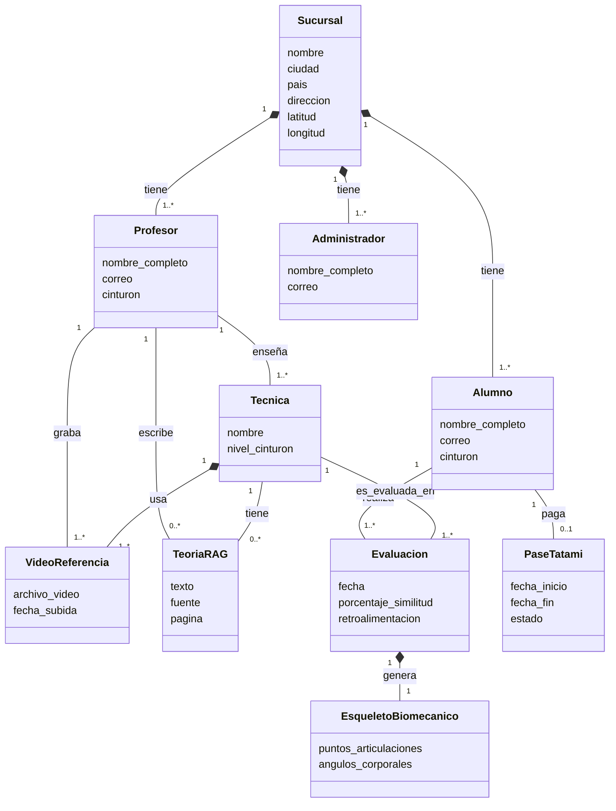

---


# Capítulo V: Análisis y Diseño Orientado a Objetos

El presente capítulo desarrolla la fase de análisis y diseño orientado a objetos del Sistema de Análisis Biomecánico de Jiu-Jitsu Brasileño para la academia "Corpo e Mente", aplicando los patrones y principios de diseño promovidos por Craig Larman en el Proceso Unificado Ágil (*Applying UML and Patterns*).

Para cada caso de uso identificado en la matriz de trazabilidad del Capítulo IV, se construyen cinco artefactos de ingeniería:
1. **Caso de Uso Detallado (Nivel de Análisis / Esencial):** Especificación textual estructurada según la metodología de Craig Larman (2004, Cap. 6), orientada a capturar la intención del actor y la respuesta observable del sistema bajo el vocabulario del dominio de Jiu-Jitsu Brasileño, abstrayéndose de clases o motores tecnológicos concretos.
2. **Diagrama de Caso de Uso:** Representación visual de los límites del sistema, actores y relaciones.
3. **Diagrama de Clases de Diseño (Participantes):** Modelado estructural de las clases involucradas organizadas según la distribución de responsabilidades de **Frontera, Control y Entidad**, especificando sus atributos y métodos esenciales.
4. **Diagrama de Secuencia del Caso de Uso:** Modelado dinámico de la interacción temporal y la distribución de responsabilidades entre la capa de Frontera/Interfaz (*Boundary*), la capa de Control/Servicios (*Control*) y la capa de Dominio/Entidades (*Entity*).
5. **Diagrama de Paquetes:** Distribución modular y segregación de dependencias entre las capas arquitectónicas del sistema (Presentación, Aplicación, Dominio e Infraestructura/Persistencia).

---

## 5.1. Caso de Uso 1: Iniciar Sesión y Registro de Usuarios (UC-01)

### 5.1.1. Caso de Uso 1: Iniciar Sesión y Registro de Usuarios (UC-01) — Nivel de Análisis

| Campo | Especificación |
| :--- | :--- |
| **Identificador** | **UC-01** |
| **Nombre** | Iniciar Sesión y Registro de Usuarios |
| **Actores** | **Principal:** Alumno, Profesor, Administrador.<br>**Secundario (Sistemas de Apoyo):** Servicio de Identidad y Sesión (gestión de identidad criptográfica). |
| **Descripción** | Permite a un practicante, instructor o administrador acceder a la plataforma identificándose de forma segura, o bien registrar una nueva cuenta asociada a una sucursal de la academia. |
| **Precondiciones** | El solicitante desea acceder o crear una cuenta, y dispone de conexión con el sistema. |
| **Postcondiciones** | 1. Se establece una sesión autenticada asociada al rol del usuario.<br>2. La interfaz de acceso se reemplaza por el panel de trabajo propio del rol.<br>3. Las cuentas nuevas de alumno se inician en estado "pendiente" (sujetas al Pase de Tatami). |

#### Secuencia Normal (Inicio de Sesión)
| Paso | Intención del Actor | Respuesta Observable del Sistema |
| :---: | :--- | :--- |
| 1 | Usuario solicita acceder al sistema. | Sistema presenta la pantalla de identificación. |
| 2 | Usuario aporta sus credenciales de acceso. | Sistema verifica la identidad del solicitante y determina su rol y sucursal. |
| 3 | | Sistema establece una sesión activa y presenta el panel correspondiente: de práctica (alumno), de instrucción (profesor) o de administración global. |

#### Secuencias Alternativas
* **2a. Registro de nuevo usuario:**
  * 2a.1. El solicitante pide crear una cuenta.
  * 2a.2. El sistema solicita: datos de perfil, rol deseado (alumno o profesor) y sucursal de adscripción.
  * 2a.3. El solicitante proporciona los datos.
  * 2a.4. El sistema valida que el identificador elegido no esté en uso y cumpla el formato establecido.
  * 2a.5. El sistema crea la cuenta con estado inicial correspondiente a su rol y establece la sesión.
* **2b. Credenciales inválidas:**
  * Sistema informa el rechazo sin especificar si el error corresponde al identificador o a la contraseña (previene enumeración de cuentas).
* **2c. Intentos reiterados fallidos:**
  * Sistema bloquea temporalmente al solicitante por política de seguridad.

#### Excepciones
* **E1. Servicio de identidad indisponible:** El sistema informa que la autenticación está temporalmente fuera de servicio.
---

### 5.1.2 Diagrama de Caso de Uso UC-01
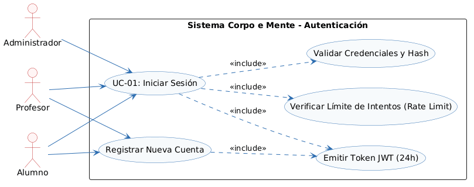

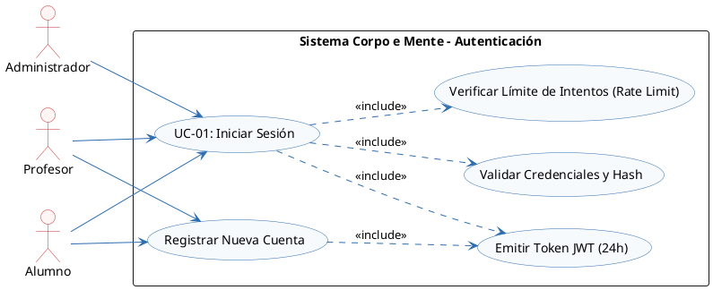
---

### 5.1.3 Diagrama de Clases de Diseño (Participantes) UC-01
El siguiente diagrama detalla las clases participantes estructuradas bajo la distribución de responsabilidades de Frontera (Boundary), Control y Entidad (Entity):
* **Frontera (Boundary):** Componentes visuales de React (`LoginView`, `SignupView`) y el router de FastAPI (`AuthRoutes`).
* **Control:** Servicios que gobiernan la autenticación y la sesión (`AuthService`, `SessionManager`, `RateLimiter`).
* **Entidad (Entity):** Modelos de datos del dominio (`Usuario`, `Sucursal`, `TokenJWT`).

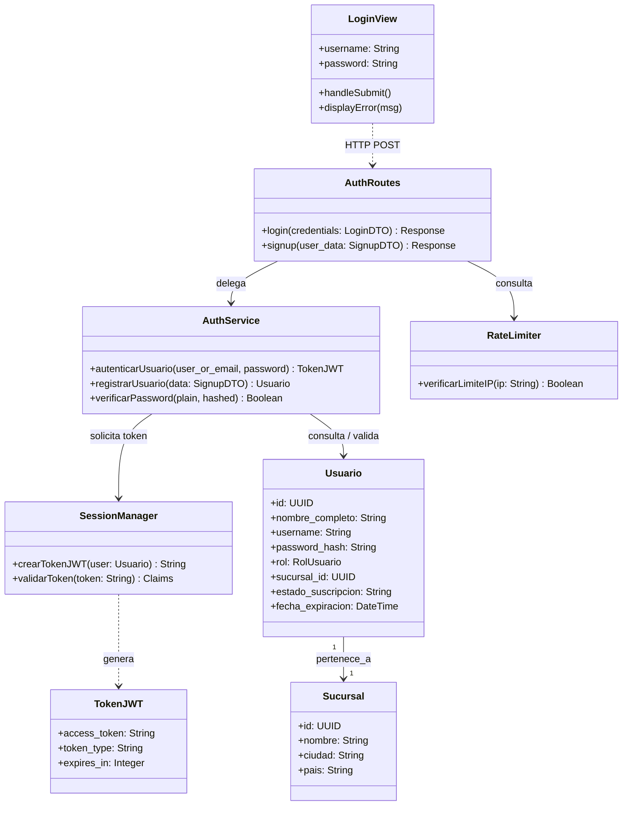

---

### 5.1.4 Diagrama de Secuencia UC-01

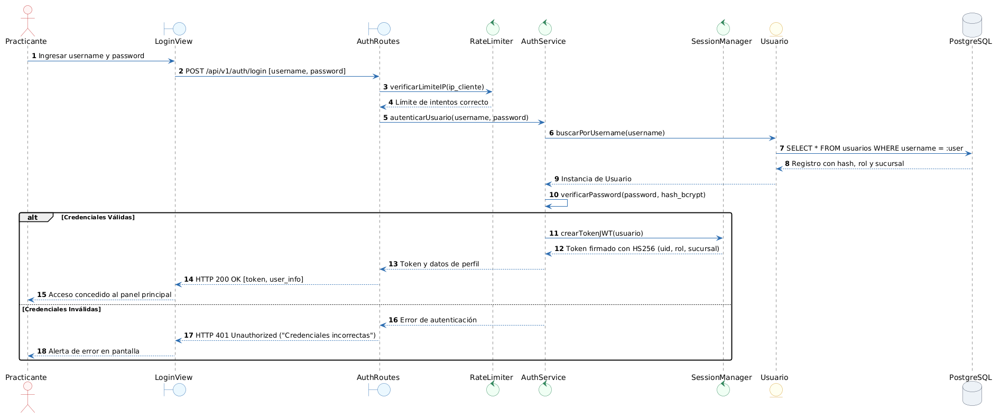

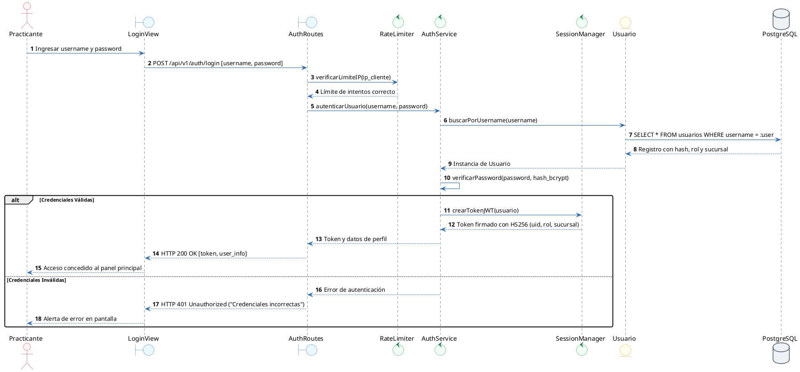
---

### 5.1.5 Diagrama de Paquetes UC-01
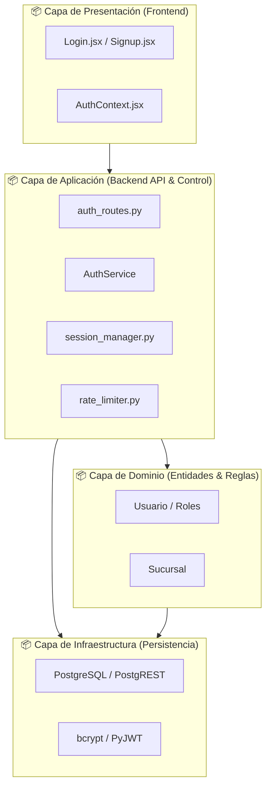

---

## 5.2. Caso de Uso 2: Analizar Técnica y Generar Feedback Biomecánico (UC-02)

### 5.2.1. Caso de Uso 2: Analizar Técnica y Generar Feedback Biomecánico (UC-02) — Nivel de Análisis

| Campo | Especificación |
| :--- | :--- |
| **Identificador** | **UC-02** |
| **Nombre** | Analizar Técnica y Generar Feedback Biomecánico |
| **Actores** | **Principal:** Alumno.<br>**Secundario (Sistemas de Apoyo):** Servicio de Visión por Computadora (percepción de la postura), Servicio de Evaluación Cinemática (comparación del movimiento), Base de Conocimiento Técnica (bibliografía y directrices del instructor), Servicio de Redacción Pedagógica (generación del consejo). |
| **Descripción** | El alumno solicita evaluar su ejecución de una técnica; el sistema reconoce su postura corporal, la contrasta con la referencia del profesor, identifica el instante y las zonas del cuerpo con mayor desviación y, si corresponde, entrega una explicación pedagógica fundamentada en el material técnico del instructor. |
| **Precondiciones** | 1. El alumno mantiene una sesión activa con su acceso al análisis habilitado.<br>2. Existe una referencia registrada por un profesor para la técnica solicitada. |
| **Postcondiciones** | 1. La evaluación queda registrada en el historial del alumno con su grado de similitud.<br>2. El alumno conoce el instante exacto del error, las zonas corporales afectadas y, cuando aplica, una corrección pedagógica en su idioma. |

#### Secuencia Normal
| Paso | Intención del Actor | Respuesta Observable del Sistema |
| :---: | :--- | :--- |
| 1 | Alumno selecciona al profesor de su academia y la técnica a evaluar. | Sistema presenta las técnicas con referencia activa del profesor seleccionado. |
| 2 | Alumno aporta un video de su ejecución. | Sistema verifica que el material sea elegible (corresponde a práctica de Jiu-Jitsu y es de tamaño manejable). |
| 3 | | Sistema localiza al practicante dentro del video y, cuando hay más de una persona, solicita al alumno confirmar cuál es él. |
| 4 | Alumno confirma su identidad en el video. | Sistema admite la solicitud e informa al alumno que la evaluación fue recibida. |
| 5 | | Sistema reconoce la postura corporal del alumno a lo largo de la ejecución. |
| 6 | | Sistema contrasta la ejecución del alumno contra la referencia del profesor y obtiene un grado de similitud. |
| 7 | | Sistema identifica el instante del video y las zonas del cuerpo con mayor desviación respecto al patrón. |
| 8 | | Si la desviación es significativa, el sistema reúne la explicación técnica del instructor y las referencias bibliográficas pertinentes para fundamentar la corrección. |
| 9 | | Sistema presenta al alumno un informe con: grado de similitud, instante exacto del error, zonas del cuerpo afectadas y, cuando aplica, explicación pedagógica en su idioma. |
| 10 | Alumno revisa el informe y navega al instante del error. | Sistema resalta visualmente la zona del cuerpo comprometida y ofrece referencias de práctica complementaria. |

#### Secuencias Alternativas
* **2a. Material no elegible** (no corresponde a práctica de Jiu-Jitsu, formato no soportado o excede tamaño aceptable): El sistema rechaza la solicitud e invita al alumno a intentarlo nuevamente con un video adecuado.
* **2b. Acceso al análisis no habilitado:** El sistema informa que debe gestionar la habilitación de su acceso (Pase de Tatami) con su instructor.
* **3a. Solo una persona reconocida en el video:** El sistema presume la identidad y solicita al alumno una confirmación simple de un solo toque.
* **7a. Ejecución correcta** (grado de similitud por encima del umbral aceptable): El sistema felicita al alumno y le indica que dominó la técnica, sin recurrir al componente de redacción pedagógica.
* **9a. Fundamento teórico insuficiente:** Si el sistema no encuentra material técnico suficiente para sustentar una corrección, entrega únicamente el reporte biomecánico (zonas del cuerpo y segundo del error) y evita ofrecer una explicación no respaldada.

#### Excepciones
* **E1. Análisis no concluido en tiempo razonable:** El sistema informa al alumno que la evaluación continúa procesándose y que podrá consultar el resultado posteriormente desde su historial.
* **E2. No existe referencia activa para la técnica:** El sistema informa que la evaluación no puede realizarse por falta de patrón del profesor.
---

### 5.2.2 Diagrama de Caso de Uso UC-02
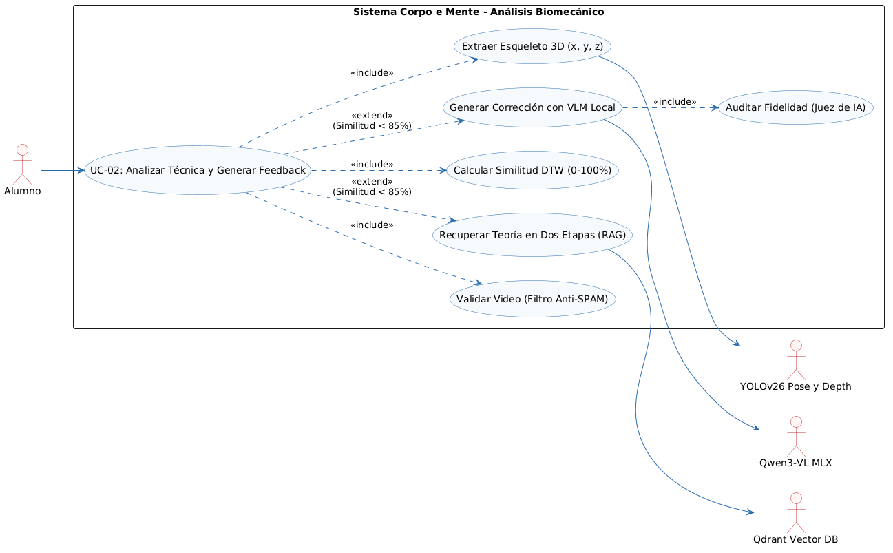

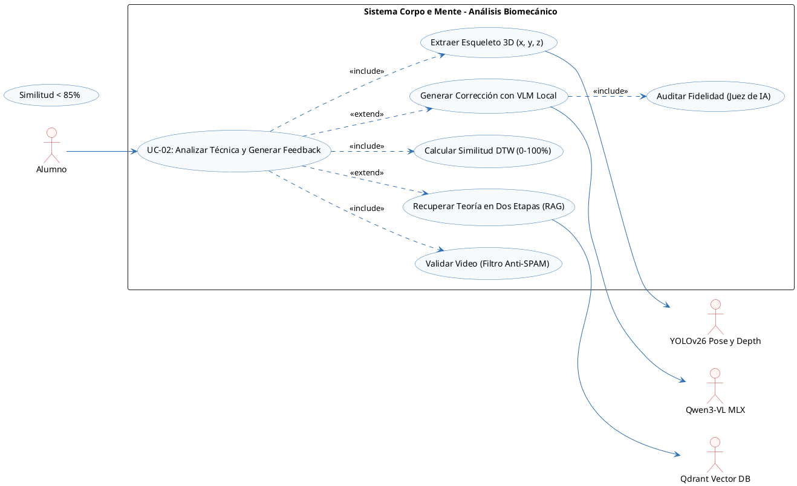
---

### 5.2.3 Diagrama de Clases de Diseño (Participantes) UC-02
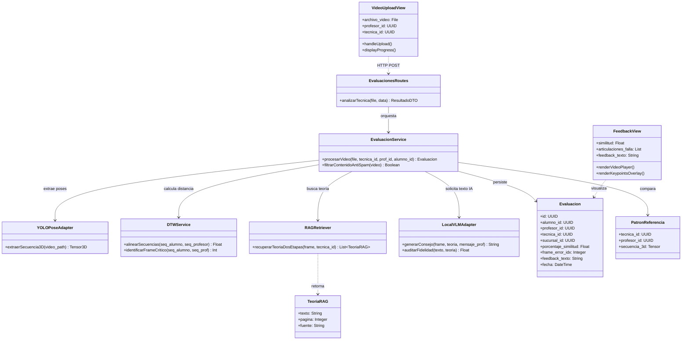

---

### 5.2.4 Diagrama de Secuencia UC-02

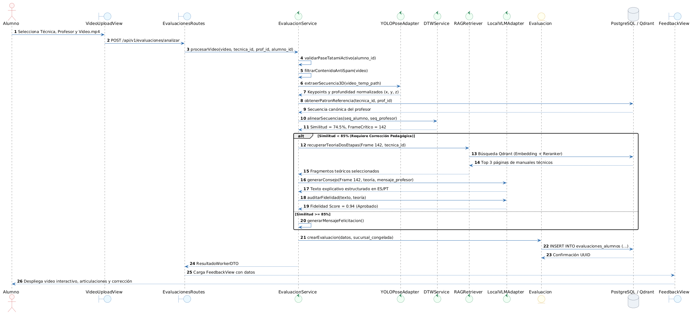

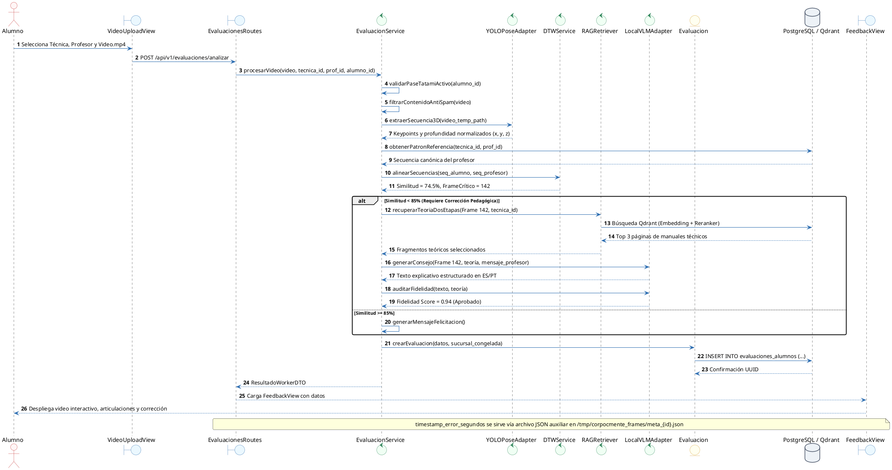
---

### 5.2.5 Diagrama de Paquetes UC-02
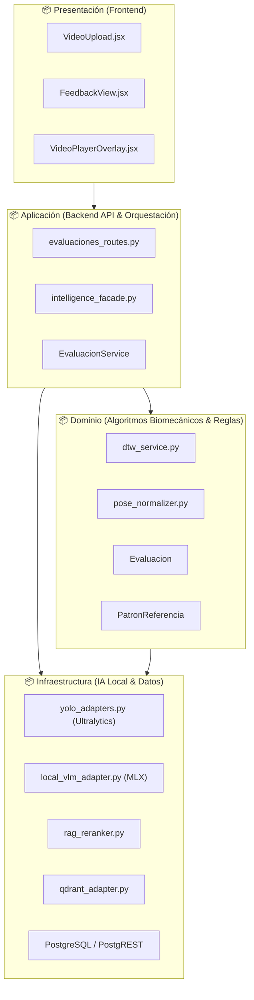

---

## 5.3. Caso de Uso 3: Gestionar Técnicas y Videos de Referencia (UC-03)

### 5.3.1. Caso de Uso 3: Gestionar Técnicas y Videos de Referencia (UC-03) — Nivel de Análisis

| Campo | Especificación |
| :--- | :--- |
| **Identificador** | **UC-03** |
| **Nombre** | Gestionar Técnicas y Videos de Referencia |
| **Actores** | **Principal:** Profesor, Administrador.<br>**Secundario (Sistemas de Apoyo):** Servicio de Visión por Computadora (extracción del patrón), Repositorio de Referencias. |
| **Descripción** | El instructor mantiene el catálogo de técnicas de la academia y registra, para cada una, su propia ejecución como patrón de referencia. |
| **Precondiciones** | El usuario mantiene una sesión activa en calidad de profesor o administrador. |
| **Postcondiciones** | 1. La técnica queda disponible en el catálogo global.<br>2. Su patrón de referencia queda registrado y utilizable en futuras evaluaciones de alumnos. |

#### Secuencia Normal
| Paso | Intención del Actor | Respuesta Observable del Sistema |
| :---: | :--- | :--- |
| 1 | Profesor solicita incorporar una nueva técnica al catálogo. | Sistema presenta el formulario de alta (nombre, cinturón de referencia, indicaciones del instructor). |
| 2 | Profesor completa los datos y aporta un video de su ejecución como referencia. | Sistema admite la solicitud y analiza el material. |
| 3 | | Sistema identifica al instructor dentro del video y le solicita confirmar cuál de las personas presentes es él. |
| 4 | Profesor confirma su identidad en el video. | Sistema registra la técnica y deja su patrón de referencia disponible para las evaluaciones de alumnos. |
| 5 | Profesor puede modificar o retirar una técnica existente. | Sistema actualiza el catálogo y, si se retira, la técnica deja de ser evaluable por alumnos. |

#### Secuencias Alternativas
* **2a. Video con cobertura insuficiente del instructor:** El sistema rechaza el registro e indica que debe volver a grabar el material con el practicante plenamente visible.
* **4a. Edición sin cambio de referencia:** Si el profesor modifica solo los datos descriptivos (nombre, cinturón, mensaje), el sistema conserva el patrón ya registrado.
* **4b. Reemplazo de referencia:** Si el profesor aporta un nuevo video para una técnica existente, el sistema reemplaza el patrón previo y lo hace vigente para futuras evaluaciones.

#### Excepciones
* **E1. Dos técnicas con el mismo nombre:** El sistema alerta al profesor y solicita confirmación explícita antes de proceder.
---

### 5.3.2 Diagrama de Caso de Uso UC-03
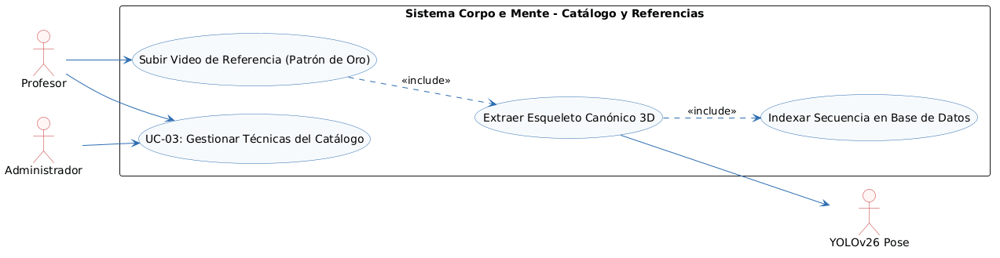

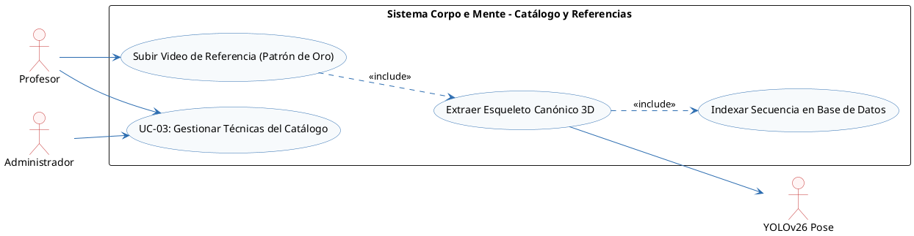
---

### 5.3.3 Diagrama de Clases de Diseño (Participantes) UC-03
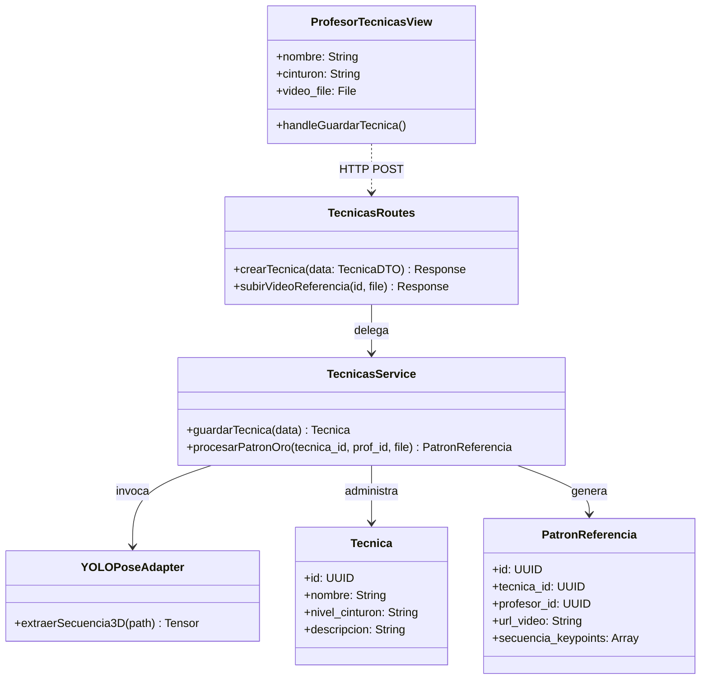

---

### 5.3.4 Diagrama de Secuencia UC-03

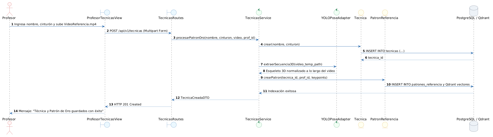

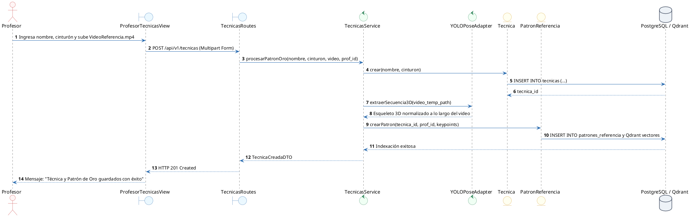
---

### 5.3.5 Diagrama de Paquetes UC-03
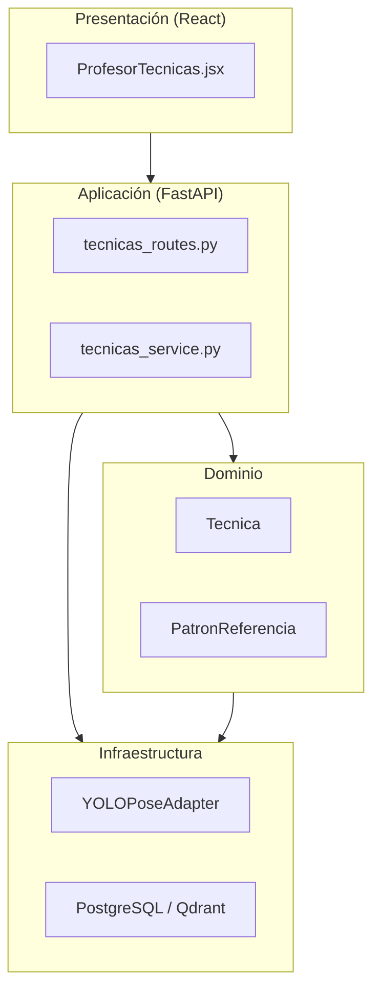

---

## 5.4. Caso de Uso 4: Gestionar Teoría RAG (UC-04)

### 5.4.1. Caso de Uso 4: Gestionar Teoría RAG y Mensajes del Profesor (UC-04) — Nivel de Análisis

| Campo | Especificación |
| :--- | :--- |
| **Identificador** | **UC-04** |
| **Nombre** | Gestionar Teoría RAG y Mensajes del Profesor |
| **Actores** | **Principal:** Profesor.<br>**Secundario (Sistemas de Apoyo):** Servicio de Vectorización Multimodal, Base de Conocimiento Técnica. |
| **Descripción** | El instructor enriquece el conocimiento de la plataforma aportando manuales técnicos y redactando sus propias recomendaciones doctrinales para cada técnica. |
| **Precondiciones** | El profesor mantiene una sesión activa y ha seleccionado una técnica existente del catálogo. |
| **Postcondiciones** | 1. Los fragmentos del manual quedan disponibles para fundamentar las evaluaciones de los alumnos.<br>2. Las recomendaciones del profesor quedan asociadas a la técnica y prevalecen como directriz prioritaria. |

#### Secuencia Normal
| Paso | Intención del Actor | Respuesta Observable del Sistema |
| :---: | :--- | :--- |
| 1 | Profesor solicita enriquecer una técnica con material doctrinal. | Sistema presenta el espacio para redactar su recomendación y para aportar documentos. |
| 2 | Profesor redacta una recomendación directa para sus alumnos. | Sistema asocia el texto a la técnica y lo establece como directriz pedagógica prioritaria. |
| 3 | Profesor aporta uno o varios manuales técnicos de referencia. | Sistema recibe el material y procesa su contenido (texto e imágenes). |
| 4 | | Sistema prepara el material para que las evaluaciones futuras puedan fundamentarse en él. |
| 5 | Profesor consulta el estado del material aportado. | Sistema presenta los fragmentos indexados y el texto de su recomendación vigente. |
| 6 | Profesor puede retirar el material que él mismo aportó. | Sistema elimina la referencia de la base de conocimiento sin afectar aportes de otros instructores. |

#### Secuencias Alternativas
* **3a. Documento no procesable** (formato no soportado, sin texto legible): El sistema conserva el archivo, informa el inconveniente y solicita reintentar con otro material.
* **3b. Manual de gran extensión:** El sistema procesa el material en segundo plano e informa al profesor del avance, permitiéndole continuar con otras tareas.
* **6a. Retiro de toda la teoría de una técnica:** El profesor puede eliminar la totalidad del material que aportó sobre una técnica sin afectar la referencia biomecánica registrada.

#### Excepciones
* **E1. Servicio de vectorización no disponible:** El sistema conserva el archivo para que el profesor pueda reintentar el procesamiento cuando el servicio se restablezca.
---

### 5.4.2 Diagrama de Caso de Uso UC-04
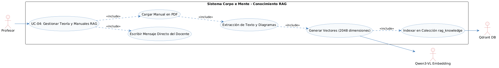

```plantuml
@startuml
left to right direction

skinparam shadowing false
skinparam monochrome false
skinparam defaultFontName Arial
skinparam roundcorner 6
skinparam ArrowColor #2B6CB0
skinparam ActorBorderColor #C53030
skinparam ActorBackgroundColor #FFF5F5
skinparam BoundaryBorderColor #2B6CB0
skinparam BoundaryBackgroundColor #EBF8FF
skinparam ControlBorderColor #2F855A
skinparam ControlBackgroundColor #F0FFF4
skinparam EntityBorderColor #D69E2E
skinparam EntityBackgroundColor #FFFFF0
skinparam DatabaseBorderColor #4A5568
skinparam DatabaseBackgroundColor #EDF2F7
skinparam UsecaseBorderColor #2B6CB0
skinparam UsecaseBackgroundColor #F7FAFC


actor "Profesor" as PR
actor "Qwen3-VL Embedding" as QWEN_EMB
actor "Qdrant DB" as QDRANT

rectangle "Sistema Corpo e Mente - Conocimiento RAG" {
    usecase "UC-04: Gestionar Teoría y Manuales RAG" as UC04
    usecase "Escribir Mensaje Directo del Docente" as UC04_Msg
    usecase "Cargar Manual en PDF" as UC04_PDF
    usecase "Extracción de Texto y Diagramas" as UC04_Extract
    usecase "Generar Vectores (2048 dimensiones)" as UC04_Emb
    usecase "Indexar en Colección rag_knowledge" as UC04_Store
}

PR --> UC04
UC04 ..> UC04_Msg : <<include>>
UC04 ..> UC04_PDF : <<include>>
UC04_PDF ..> UC04_Extract : <<include>>
UC04_Extract ..> UC04_Emb : <<include>>
UC04_Emb ..> UC04_Store : <<include>>

UC04_Emb --> QWEN_EMB
UC04_Store --> QDRANT
@enduml
```
---

### 5.4.3 Diagrama de Clases de Diseño (Participantes) UC-04
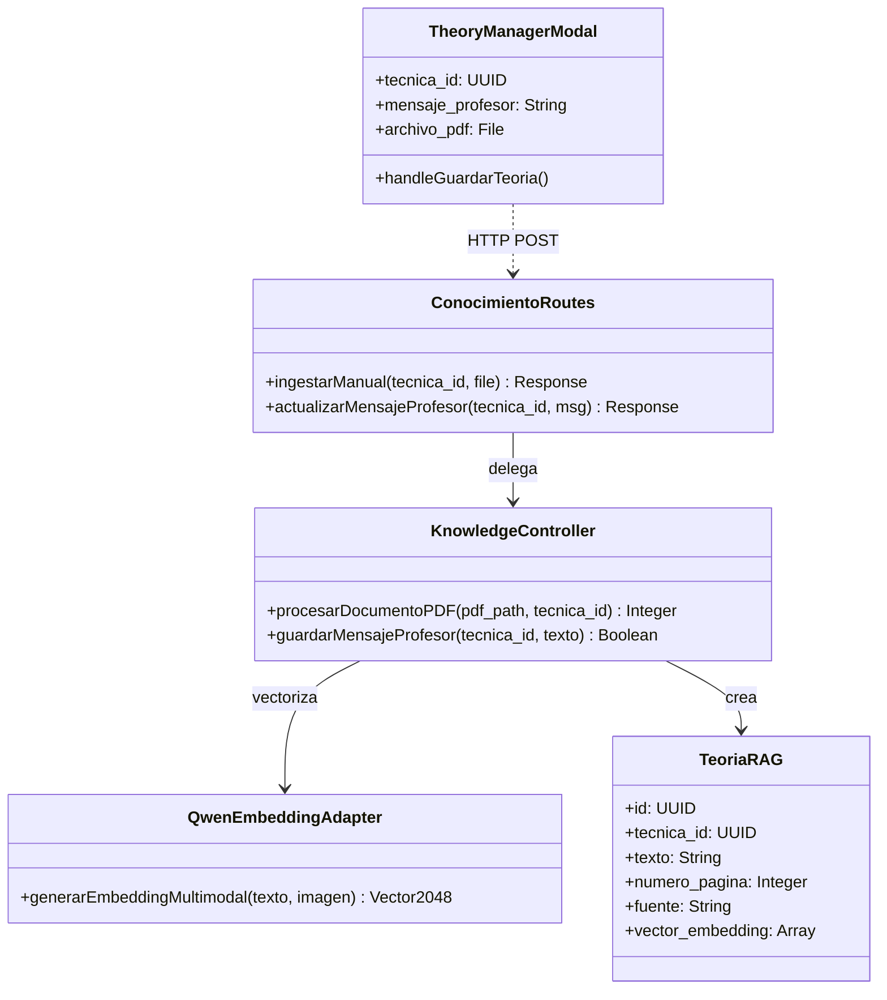

---

### 5.4.4 Diagrama de Secuencia UC-04

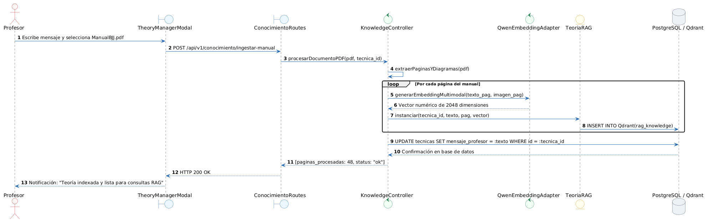

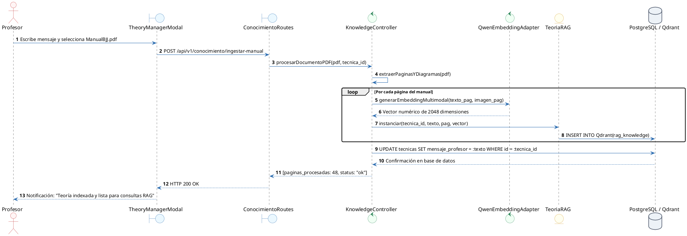
---

### 5.4.5 Diagrama de Paquetes UC-04
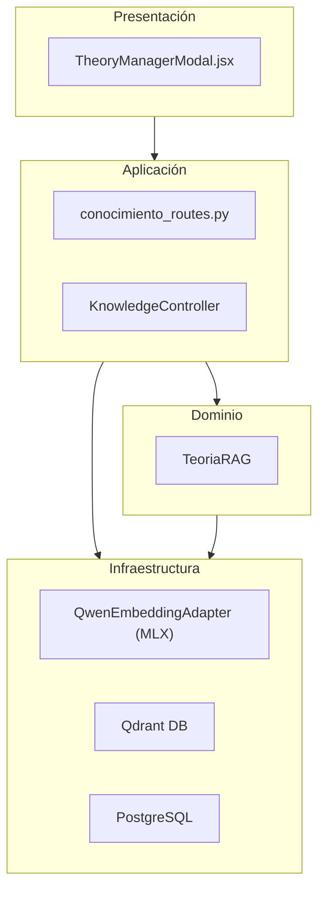

---

## 5.5. Caso de Uso 5: Ver Progreso de Alumnos (UC-05)

### 5.5.1. Caso de Uso 5: Ver Progreso de Alumnos (UC-05) — Nivel de Análisis

| Campo | Especificación |
| :--- | :--- |
| **Identificador** | **UC-05** |
| **Nombre** | Ver Progreso de Alumnos |
| **Actores** | **Principal:** Profesor, Alumno.<br>**Secundario (Sistemas de Apoyo):** Repositorio Histórico de Evaluaciones. |
| **Descripción** | El profesor supervisa la evolución técnica de sus alumnos a partir del histórico de evaluaciones; el alumno consulta su propio historial. |
| **Precondiciones** | El usuario mantiene una sesión activa como profesor o alumno. |
| **Postcondiciones** | El usuario visualiza el historial de evaluaciones filtrado por su ámbito de autorización (sucursal del profesor o cuenta propia del alumno). |

#### Secuencia Normal
| Paso | Intención del Actor | Respuesta Observable del Sistema |
| :---: | :--- | :--- |
| 1 | Profesor solicita revisar el progreso de sus alumnos. | Sistema presenta la lista de alumnos pertenecientes a su sede. |
| 2 | Profesor selecciona un alumno. | Sistema presenta el historial cronológico de evaluaciones del alumno con su grado de similitud y resumen de cada corrección. |
| 3 | Profesor profundiza en una evaluación. | Sistema presenta el detalle de la evaluación: video comparado, zonas del cuerpo afectadas y explicación pedagógica completa. |
| 4 | Alumno solicita consultar su propio historial. | Sistema presenta sus evaluaciones con la misma estructura que el profesor, sin acceso a otros alumnos. |

#### Secuencias Alternativas
* **2a. Alumno sin evaluaciones registradas:** El sistema informa que el alumno aún no cuenta con análisis realizados y sugiere invitarlo a subir su primera ejecución.
* **2b. Sucursal sin alumnos:** El sistema informa que no existen alumnos asignados a la sede del profesor.
* **3a. Profesor intenta acceder a un alumno de otra sede:** El sistema deniega la consulta e informa que el acceso está restringido a la propia sucursal.

#### Excepciones
* **E1. Historial no disponible:** El sistema informa indisponibilidad temporal del historial.
---

### 5.5.2 Diagrama de Caso de Uso UC-05
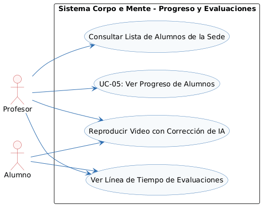

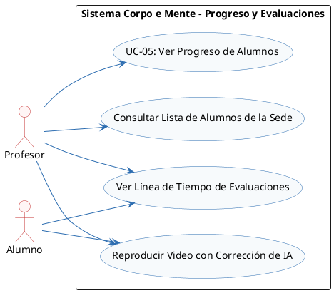
---

### 5.5.3 Diagrama de Clases de Diseño (Participantes) UC-05
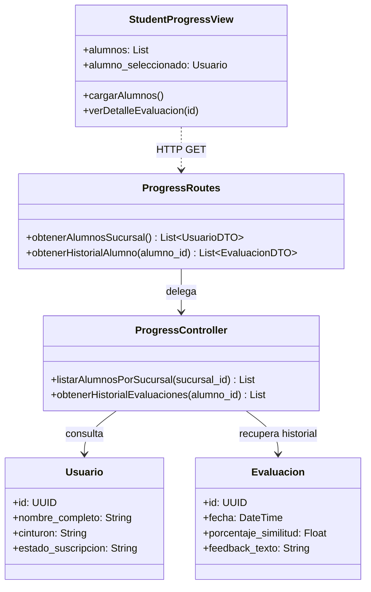

---

### 5.5.4 Diagrama de Secuencia UC-05

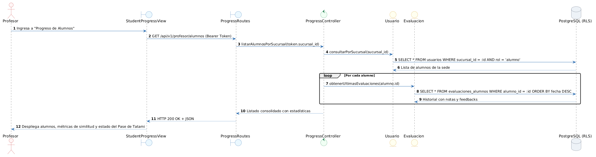

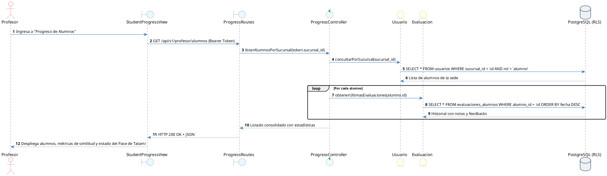
---

### 5.5.5 Diagrama de Paquetes UC-05
```mermaid
graph TD
    subgraph Presentacion ["Presentación"]
        ProgView["StudentProgress.jsx"]
    end
    subgraph Aplicacion ["Aplicación"]
        ProgRoutes["progress_routes.py"]
        ProgCtrl["ProgressController"]
    end
    subgraph Dominio ["Dominio"]
        EntUsuario["Usuario"]
        EntEvaluacion["Evaluacion"]
    end
    subgraph Infraestructura ["Infraestructura"]
        Postgres["PostgreSQL con RLS"]
    end

    Presentacion --> Aplicacion
    Aplicacion --> Dominio
    Aplicacion --> Infraestructura
    Dominio --> Infraestructura
```

---

## 5.6. Caso de Uso 6: Activar Pase de Tatami (UC-06)

### 5.6.1. Caso de Uso 6: Activar Pase de Tatami (UC-06) — Nivel de Análisis

| Campo | Especificación |
| :--- | :--- |
| **Identificador** | **UC-06** |
| **Nombre** | Activar Pase de Tatami (Control de Suscripciones) |
| **Actores** | **Principal:** Profesor.<br>**Secundario (Sistemas de Apoyo):** Repositorio de Membresías. |
| **Descripción** | El instructor habilita el acceso de un alumno a las funciones de análisis durante 30 días, tras verificar el pago de su mensualidad en la recepción de la academia. |
| **Precondiciones** | 1. El profesor mantiene una sesión activa.<br>2. El alumno pertenece a la misma sucursal del profesor y su acceso se encuentra en estado pendiente o vencido. |
| **Postcondiciones** | 1. El alumno queda habilitado para subir videos y solicitar análisis durante 30 días.<br>2. El vencimiento de su acceso queda calculado y será advertido cuando corresponda. |

#### Secuencia Normal
| Paso | Intención del Actor | Respuesta Observable del Sistema |
| :---: | :--- | :--- |
| 1 | Profesor solicita consultar los alumnos pendientes de habilitación en su academia. | Sistema presenta la lista de alumnos cuyo acceso requiere activación o renovación. |
| 2 | Profesor selecciona a un alumno tras verificar su pago. | Sistema solicita confirmación de la activación. |
| 3 | Profesor confirma la activación. | Sistema habilita el acceso del alumno por un periodo de 30 días y comunica la fecha de vencimiento. |
| 4 | Alumno ingresa a la plataforma. | Sistema reconoce su acceso como activo y le permite utilizar las funciones de análisis. |

#### Secuencias Alternativas
* **2a. Profesor intenta activar un alumno de otra sucursal:** El sistema deniega la operación por política de aislamiento entre sedes.
* **3a. Alumno con acceso aún vigente:** Si el acceso no ha expirado, la nueva activación extiende el plazo sumando 30 días adicionales al vencimiento actual.
* **3b. Alumno con acceso vencido:** La activación reinicia el plazo desde la fecha de confirmación.

#### Excepciones
* **E1. Servicio de membresías no disponible:** El sistema informa indisponibilidad y preserva el estado anterior.
---

### 5.6.2 Diagrama de Caso de Uso UC-06
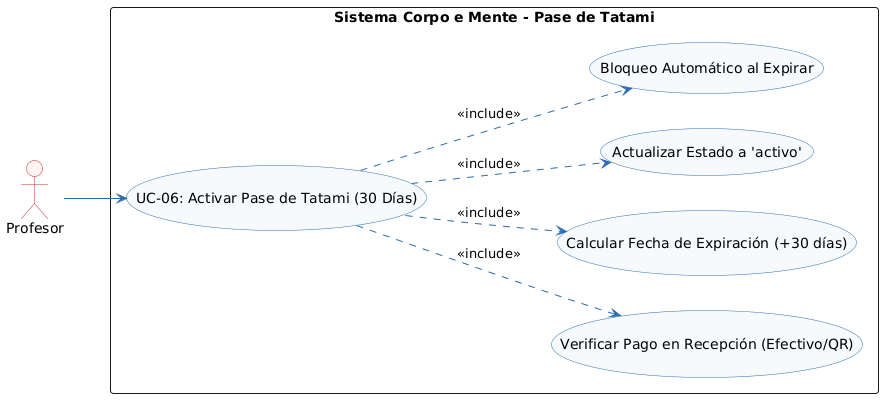

```plantuml
@startuml
left to right direction

skinparam shadowing false
skinparam monochrome false
skinparam defaultFontName Arial
skinparam roundcorner 6
skinparam ArrowColor #2B6CB0
skinparam ActorBorderColor #C53030
skinparam ActorBackgroundColor #FFF5F5
skinparam BoundaryBorderColor #2B6CB0
skinparam BoundaryBackgroundColor #EBF8FF
skinparam ControlBorderColor #2F855A
skinparam ControlBackgroundColor #F0FFF4
skinparam EntityBorderColor #D69E2E
skinparam EntityBackgroundColor #FFFFF0
skinparam DatabaseBorderColor #4A5568
skinparam DatabaseBackgroundColor #EDF2F7
skinparam UsecaseBorderColor #2B6CB0
skinparam UsecaseBackgroundColor #F7FAFC


actor "Profesor" as PR

rectangle "Sistema Corpo e Mente - Pase de Tatami" {
    usecase "UC-06: Activar Pase de Tatami (30 Días)" as UC06
    usecase "Verificar Pago en Recepción (Efectivo/QR)" as UC06_Pay
    usecase "Calcular Fecha de Expiración (+30 días)" as UC06_Calc
    usecase "Actualizar Estado a 'activo'" as UC06_Act
    usecase "Bloqueo Automático al Expirar" as UC06_Block
}

PR --> UC06
UC06 ..> UC06_Pay : <<include>>
UC06 ..> UC06_Calc : <<include>>
UC06 ..> UC06_Act : <<include>>
UC06 ..> UC06_Block : <<include>>
@enduml
```
---

### 5.6.3 Diagrama de Clases de Diseño (Participantes) UC-06
```mermaid
classDiagram
    class StudentProgressView {
        +handleAprobarPase(alumno_id)
        +renderBadgeEstado(estado)
    }

    class AuthRoutes {
        +activarPaseTatami(alumno_id) Response
    }

    class SubscriptionManager {
        +activarMembresia30Dias(profesor_id, alumno_id) Usuario
        +verificarMismaSucursal(prof_id, alumno_id) Boolean
    }

    class Usuario {
        +id: UUID
        +sucursal_id: UUID
        +estado_suscripcion: String
        +fecha_expiracion: DateTime
        +activarPor30Dias()
    }

    StudentProgressView ..> AuthRoutes : HTTP PUT
    AuthRoutes --> SubscriptionManager : coordina
    SubscriptionManager --> Usuario : actualiza estado
```

---

### 5.6.4 Diagrama de Secuencia UC-06

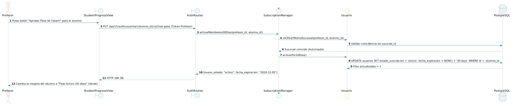

```plantuml
@startuml
autonumber

skinparam shadowing false
skinparam monochrome false
skinparam defaultFontName Arial
skinparam roundcorner 6
skinparam ArrowColor #2B6CB0
skinparam ActorBorderColor #C53030
skinparam ActorBackgroundColor #FFF5F5
skinparam BoundaryBorderColor #2B6CB0
skinparam BoundaryBackgroundColor #EBF8FF
skinparam ControlBorderColor #2F855A
skinparam ControlBackgroundColor #F0FFF4
skinparam EntityBorderColor #D69E2E
skinparam EntityBackgroundColor #FFFFF0
skinparam DatabaseBorderColor #4A5568
skinparam DatabaseBackgroundColor #EDF2F7
skinparam UsecaseBorderColor #2B6CB0
skinparam UsecaseBackgroundColor #F7FAFC


actor "Profesor" as Prof
boundary "StudentProgressView" as View
boundary "AuthRoutes" as API
control "SubscriptionManager" as Ctrl
entity "Usuario" as Ent
database "PostgreSQL" as DB

Prof -> View : Pulsa botón "Aprobar Pase de Tatami" para el alumno
View -> API : PUT /api/v1/auth/usuarios/{alumno_id}/activar-pase (Token Profesor)
API -> Ctrl : activarMembresia30Dias(profesor_id, alumno_id)

Ctrl -> Ent : verificarMismaSucursal(profesor_id, alumno_id)
Ent -> DB : Validar coincidencia de sucursal_id
DB --> Ctrl : Sucursal coincide (Autorizado)

Ctrl -> Ent : activarPor30Dias()
Ent -> DB : UPDATE usuarios SET estado_suscripcion = 'activo', fecha_expiracion = NOW() + '30 days' WHERE id = :alumno_id
DB --> Ent : Filas actualizadas = 1

Ctrl --> API : [nuevo_estado: "activo", fecha_expiracion: "2026-12-05"]
API --> View : HTTP 200 OK
View --> Prof : Cambia la insignia del alumno a "Pase Activo (30 días)" (Verde)
@enduml
```
---

### 5.6.5 Diagrama de Paquetes UC-06
```mermaid
graph TD
    subgraph Presentacion ["Presentación"]
        StudentView["StudentProgress.jsx (Badge Pase)"]
    end
    subgraph Aplicacion ["Aplicación"]
        AuthAPI["auth_routes.py"]
        SubManager["SubscriptionManager"]
    end
    subgraph Dominio ["Dominio"]
        EntUsuario["Usuario (Membresía)"]
    end
    subgraph Infraestructura ["Infraestructura"]
        Postgres["PostgreSQL"]
    end

    Presentacion --> Aplicacion
    Aplicacion --> Dominio
    Aplicacion --> Infraestructura
    Dominio --> Infraestructura
```

---

## 5.7. Caso de Uso 7: Gestionar Sucursales y Coordenadas Geográficas (UC-07)

### 5.7.1. Caso de Uso 7: Gestionar Sucursales y Coordenadas Geográficas (UC-07) — Nivel de Análisis

| Campo | Especificación |
| :--- | :--- |
| **Identificador** | **UC-07** |
| **Nombre** | Gestionar Sucursales y Coordenadas Geográficas |
| **Actores** | **Principal:** Administrador.<br>**Secundario (Sistemas de Apoyo):** Servicio de Mapas y Localización (identificación geográfica de direcciones). |
| **Descripción** | El administrador mantiene el catálogo de sedes físicas de la academia, registrando su ubicación sobre un mapa para referencia de alumnos y profesores. |
| **Precondiciones** | El administrador mantiene una sesión activa con privilegios de gestión global. |
| **Postcondiciones** | 1. La nueva sede queda disponible para asignación de usuarios.<br>2. Su ubicación (país, ciudad, dirección y coordenadas) queda registrada para visualización cartográfica. |

#### Secuencia Normal
| Paso | Intención del Actor | Respuesta Observable del Sistema |
| :---: | :--- | :--- |
| 1 | Administrador solicita registrar una nueva sede. | Sistema presenta el formulario de alta con un mapa interactivo. |
| 2 | Administrador señala la ubicación de la sede sobre el mapa. | Sistema identifica la zona geográfica y propone los datos administrativos (país, ciudad, dirección aproximada). |
| 3 | Administrador completa o ajusta los datos propuestos y confirma. | Sistema registra la sede y la presenta en el catálogo con su marcador visible. |
| 4 | Administrador puede editar o retirar una sede existente. | Sistema actualiza el catálogo; si la sede tiene usuarios vinculados, el sistema solicita primero su reasignación. |

#### Secuencias Alternativas
* **2a. Administrador aporta un enlace de ubicación en lugar de señalar el mapa:** El sistema extrae las coordenadas y completa automáticamente los datos administrativos.
* **4a. Sede con usuarios vinculados:** El sistema impide la eliminación y sugiere primero reasignar a los usuarios a otra sede.
* **4b. Corrección de ubicación:** Si el administrador ajusta la posición del marcador sobre el mapa, el sistema actualiza las coordenadas de la sede sin alterar sus usuarios.

#### Excepciones
* **E1. Servicio de mapas no disponible:** El sistema permite registrar la sede con datos manuales (coordenadas provistas por el administrador).
---

### 5.7.2 Diagrama de Caso de Uso UC-07
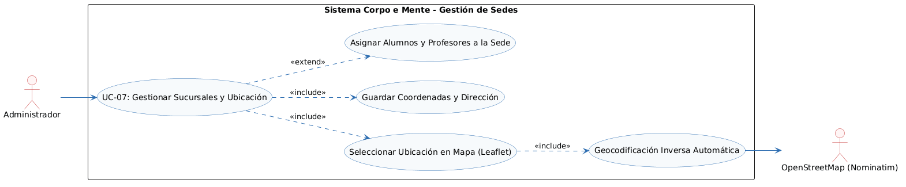

```plantuml
@startuml
left to right direction

skinparam shadowing false
skinparam monochrome false
skinparam defaultFontName Arial
skinparam roundcorner 6
skinparam ArrowColor #2B6CB0
skinparam ActorBorderColor #C53030
skinparam ActorBackgroundColor #FFF5F5
skinparam BoundaryBorderColor #2B6CB0
skinparam BoundaryBackgroundColor #EBF8FF
skinparam ControlBorderColor #2F855A
skinparam ControlBackgroundColor #F0FFF4
skinparam EntityBorderColor #D69E2E
skinparam EntityBackgroundColor #FFFFF0
skinparam DatabaseBorderColor #4A5568
skinparam DatabaseBackgroundColor #EDF2F7
skinparam UsecaseBorderColor #2B6CB0
skinparam UsecaseBackgroundColor #F7FAFC


actor "Administrador" as AD
actor "OpenStreetMap (Nominatim)" as OSM

rectangle "Sistema Corpo e Mente - Gestión de Sedes" {
    usecase "UC-07: Gestionar Sucursales y Ubicación" as UC07
    usecase "Seleccionar Ubicación en Mapa (Leaflet)" as UC07_Map
    usecase "Geocodificación Inversa Automática" as UC07_Geo
    usecase "Guardar Coordenadas y Dirección" as UC07_Save
    usecase "Asignar Alumnos y Profesores a la Sede" as UC07_Assign
}

AD --> UC07
UC07 ..> UC07_Map : <<include>>
UC07_Map ..> UC07_Geo : <<include>>
UC07 ..> UC07_Save : <<include>>
UC07 ..> UC07_Assign : <<extend>>

UC07_Geo --> OSM
@enduml
```
---

### 5.7.3 Diagrama de Clases de Diseño (Participantes) UC-07
```mermaid
classDiagram
    class BranchManagerView {
        +mapaLeaflet: MapInstance
        +latitud: Float
        +longitud: Float
        +nombre: String
        +handleMapClick(lat, lng)
        +guardarSucursal()
    }

    class SucursalesRoutes {
        +listarSucursales() List~SucursalDTO~
        +crearSucursal(data: SucursalDTO) Response
    }

    class BranchController {
        +registrarSucursal(data) Sucursal
        +obtenerDireccionInversa(lat, lng) DireccionDTO
    }

    class NominatimClient {
        +reverseGeocode(lat, lng) JSON
    }

    class Sucursal {
        +id: UUID
        +nombre: String
        +pais: String
        +ciudad: String
        +direccion: String
        +latitud: Float
        +longitud: Float
    }

    BranchManagerView ..> SucursalesRoutes : HTTP POST
    SucursalesRoutes --> BranchController : delega
    BranchController --> NominatimClient : consulta geocodificación
    BranchController --> Sucursal : persiste
```

---

### 5.7.4 Diagrama de Secuencia UC-07

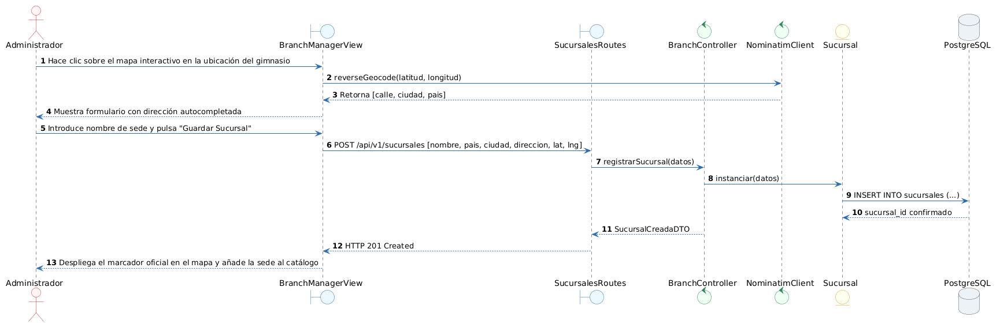

```plantuml
@startuml
autonumber

skinparam shadowing false
skinparam monochrome false
skinparam defaultFontName Arial
skinparam roundcorner 6
skinparam ArrowColor #2B6CB0
skinparam ActorBorderColor #C53030
skinparam ActorBackgroundColor #FFF5F5
skinparam BoundaryBorderColor #2B6CB0
skinparam BoundaryBackgroundColor #EBF8FF
skinparam ControlBorderColor #2F855A
skinparam ControlBackgroundColor #F0FFF4
skinparam EntityBorderColor #D69E2E
skinparam EntityBackgroundColor #FFFFF0
skinparam DatabaseBorderColor #4A5568
skinparam DatabaseBackgroundColor #EDF2F7
skinparam UsecaseBorderColor #2B6CB0
skinparam UsecaseBackgroundColor #F7FAFC


actor "Administrador" as Admin
boundary "BranchManagerView" as MapView
boundary "SucursalesRoutes" as API
control "BranchController" as Ctrl
control "NominatimClient" as OSM
entity "Sucursal" as Ent
database "PostgreSQL" as DB

Admin -> MapView : Hace clic sobre el mapa interactivo en la ubicación del gimnasio
MapView -> OSM : reverseGeocode(latitud, longitud)
OSM --> MapView : Retorna [calle, ciudad, pais]
MapView --> Admin : Muestra formulario con dirección autocompletada

Admin -> MapView : Introduce nombre de sede y pulsa "Guardar Sucursal"
MapView -> API : POST /api/v1/sucursales [nombre, pais, ciudad, direccion, lat, lng]
API -> Ctrl : registrarSucursal(datos)
Ctrl -> Ent : instanciar(datos)
Ent -> DB : INSERT INTO sucursales (...)
DB --> Ent : sucursal_id confirmado

Ctrl --> API : SucursalCreadaDTO
API --> MapView : HTTP 201 Created
MapView --> Admin : Despliega el marcador oficial en el mapa y añade la sede al catálogo
@enduml
```
---

### 5.7.5 Diagrama de Paquetes UC-07
```mermaid
graph TD
    subgraph Presentacion ["Presentación"]
        BranchView["BranchManager.jsx (Leaflet)"]
    end
    subgraph Aplicacion ["Aplicación"]
        BranchRoutes["sucursales_routes.py"]
        BranchCtrl["BranchController"]
    end
    subgraph Dominio ["Dominio"]
        EntSucursal["Sucursal"]
    end
    subgraph Infraestructura ["Infraestructura"]
        OSM_Client["Nominatim OpenStreetMap"]
        Postgres["PostgreSQL"]
    end

    Presentacion --> Aplicacion
    Aplicacion --> Dominio
    Aplicacion --> Infraestructura
    Dominio --> Infraestructura
```

---

## 5.8. Caso de Uso 8: Entrar como otro Usuario / Impersonificación (UC-08)

### 5.8.1. Caso de Uso 8: Entrar como Otro Usuario / Impersonificación (UC-08) — Nivel de Análisis

| Campo | Especificación |
| :--- | :--- |
| **Identificador** | **UC-08** |
| **Nombre** | Entrar como Otro Usuario (Impersonificación de Soporte) |
| **Actores** | **Principal:** Administrador.<br>**Secundario:** Usuario impersonificado (alumno o profesor) como beneficiario de la operación. |
| **Descripción** | El administrador asume temporalmente la identidad de un usuario reportado por una incidencia técnica, para reproducir el problema desde la perspectiva real del usuario. La operación es acotada en el tiempo y visible en todo momento para quien la ejecuta. |
| **Precondiciones** | El administrador mantiene una sesión activa con privilegios globales. |
| **Postcondiciones** | 1. El administrador opera temporalmente como el usuario seleccionado, conservando evidencia de la operación (origen de la sesión temporal).<br>2. Al finalizar, la sesión original del administrador se restituye sin pérdida de estado. |

#### Secuencia Normal
| Paso | Intención del Actor | Respuesta Observable del Sistema |
| :---: | :--- | :--- |
| 1 | Administrador identifica al usuario afectado por una incidencia y solicita asumir su identidad para diagnóstico. | Sistema solicita reconfirmación de la autorización del administrador. |
| 2 | Administrador reconfirma su autorización. | Sistema registra la operación con sus datos de trazabilidad. |
| 3 | | Sistema presenta el entorno del usuario seleccionado y advierte de forma persistente y visible que se está operando como ese usuario. |
| 4 | Administrador reproduce la incidencia desde la vista real del usuario. | Sistema permite las operaciones que correspondan al rol del usuario impersonificado, sin alterar sus datos personales ni su historial. |
| 5 | Administrador solicita finalizar el modo de soporte. | Sistema cierra la sesión temporal y restituye la sesión original del administrador. |

#### Secuencias Alternativas
* **2a. Administrador cancela la operación antes de confirmar:** El sistema abandona el flujo sin alterar sesiones ni generar registros de impersonación.
* **4a. Intento de modificar el perfil del usuario impersonificado:** El sistema restringe las operaciones a la sola lectura y reproducción de la incidencia.
* **4b. Intento de impersonar a otro administrador:** El sistema bloquea la operación por política de jerarquía entre administradores.

#### Excepciones
* **E1. Pérdida de la sesión original del administrador durante la impersonación:** El sistema cierra forzosamente el modo de soporte y solicita al administrador autenticarse nuevamente.

> **Nota de trazabilidad técnica** (permanece vigente): la re-autenticación por contraseña y la persistencia formal en la tabla `auditoria_impersonacion` están registradas como deuda técnica para iteración futura; la emisión del token JWT con el claim `impersonator_admin_id` y la activación del banner defensivo sí se encuentran implementadas (ver §6.6 y §8.6).
---

### 5.8.2 Diagrama de Caso de Uso UC-08
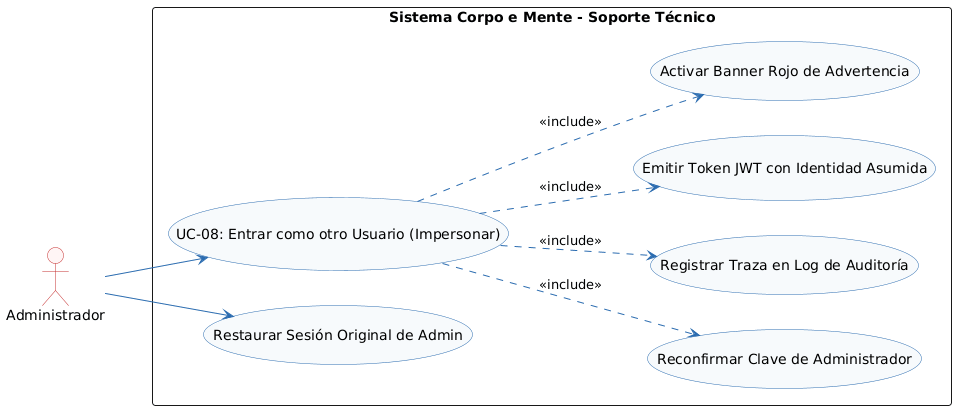

```plantuml
@startuml
left to right direction

skinparam shadowing false
skinparam monochrome false
skinparam defaultFontName Arial
skinparam roundcorner 6
skinparam ArrowColor #2B6CB0
skinparam ActorBorderColor #C53030
skinparam ActorBackgroundColor #FFF5F5
skinparam BoundaryBorderColor #2B6CB0
skinparam BoundaryBackgroundColor #EBF8FF
skinparam ControlBorderColor #2F855A
skinparam ControlBackgroundColor #F0FFF4
skinparam EntityBorderColor #D69E2E
skinparam EntityBackgroundColor #FFFFF0
skinparam DatabaseBorderColor #4A5568
skinparam DatabaseBackgroundColor #EDF2F7
skinparam UsecaseBorderColor #2B6CB0
skinparam UsecaseBackgroundColor #F7FAFC


actor "Administrador" as AD

rectangle "Sistema Corpo e Mente - Soporte Técnico" {
    usecase "UC-08: Entrar como otro Usuario (Impersonar)" as UC08
    usecase "Reconfirmar Clave de Administrador" as UC08_Auth
    usecase "Registrar Traza en Log de Auditoría" as UC08_Audit
    usecase "Emitir Token JWT con Identidad Asumida" as UC08_JWT
    usecase "Activar Banner Rojo de Advertencia" as UC08_Banner
    usecase "Restaurar Sesión Original de Admin" as UC08_Restore
}

AD --> UC08
UC08 ..> UC08_Auth : <<include>>
UC08 ..> UC08_Audit : <<include>>
UC08 ..> UC08_JWT : <<include>>
UC08 ..> UC08_Banner : <<include>>
AD --> UC08_Restore
@enduml
```
---

### 5.8.3 Diagrama de Clases de Diseño (Participantes) UC-08
```mermaid
classDiagram
    class AdminUsersModal {
        +usuarios: List
        +handleImpersonar(usuario_id)
    }

    class ImpersonationBanner {
        +usuario_nombre: String
        +handleRestaurarAdmin()
    }

    class AuthRoutes {
        +impersonarUsuario(id, admin_pass) Response
        +salirImpersonacion() Response
    }

    class SessionManager {
        +crearTokenImpersonacion(admin, objetivo) String
        +restaurarTokenAdmin(admin_id) String
    }

    class AuditoriaService {
        +registrarEvento(admin_id, target_id, accion) Void
    }

    class RegistroAuditoria {
        +id: UUID
        +admin_id: UUID
        +usuario_objetivo_id: UUID
        +fecha: DateTime
        +ip_origen: String
        +accion: String
    }

    AdminUsersModal ..> AuthRoutes : HTTP POST
    ImpersonationBanner ..> AuthRoutes : HTTP POST
    AuthRoutes --> SessionManager : genera sesión
    AuthRoutes --> AuditoriaService : audita
    AuditoriaService --> RegistroAuditoria : persiste
```

---

### 5.8.4 Diagrama de Secuencia UC-08

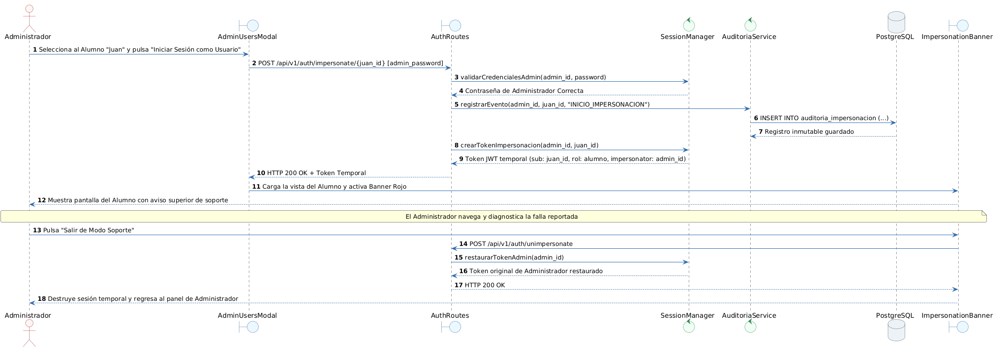

```plantuml
@startuml
autonumber

skinparam shadowing false
skinparam monochrome false
skinparam defaultFontName Arial
skinparam roundcorner 6
skinparam ArrowColor #2B6CB0
skinparam ActorBorderColor #C53030
skinparam ActorBackgroundColor #FFF5F5
skinparam BoundaryBorderColor #2B6CB0
skinparam BoundaryBackgroundColor #EBF8FF
skinparam ControlBorderColor #2F855A
skinparam ControlBackgroundColor #F0FFF4
skinparam EntityBorderColor #D69E2E
skinparam EntityBackgroundColor #FFFFF0
skinparam DatabaseBorderColor #4A5568
skinparam DatabaseBackgroundColor #EDF2F7
skinparam UsecaseBorderColor #2B6CB0
skinparam UsecaseBackgroundColor #F7FAFC


actor "Administrador" as Admin
boundary "AdminUsersModal" as Modal
boundary "AuthRoutes" as API
control "SessionManager" as Session
control "AuditoriaService" as Audit
database "PostgreSQL" as DB
boundary "ImpersonationBanner" as Banner

Admin -> Modal : Selecciona al Alumno "Juan" y pulsa "Iniciar Sesión como Usuario"
Modal -> API : POST /api/v1/auth/impersonate/{juan_id} [admin_password]
API -> Session : validarCredencialesAdmin(admin_id, password)
Session --> API : Contraseña de Administrador Correcta

API -> Audit : registrarEvento(admin_id, juan_id, "INICIO_IMPERSONACION")
Audit -> DB : INSERT INTO auditoria_impersonacion (...)
DB --> Audit : Registro inmutable guardado

API -> Session : crearTokenImpersonacion(admin_id, juan_id)
Session --> API : Token JWT temporal (sub: juan_id, rol: alumno, impersonator: admin_id)

API --> Modal : HTTP 200 OK + Token Temporal
Modal -> Banner : Carga la vista del Alumno y activa Banner Rojo
Banner --> Admin : Muestra pantalla del Alumno con aviso superior de soporte

Note over Admin, Banner : El Administrador navega y diagnostica la falla reportada

Admin -> Banner : Pulsa "Salir de Modo Soporte"
Banner -> API : POST /api/v1/auth/unimpersonate
API -> Session : restaurarTokenAdmin(admin_id)
Session --> API : Token original de Administrador restaurado
API --> Banner : HTTP 200 OK
Banner --> Admin : Destruye sesión temporal y regresa al panel de Administrador
@enduml
```
---

### 5.8.5 Diagrama de Paquetes UC-08
```mermaid
graph TD
    subgraph Presentacion ["Presentación"]
        AdminModal["AdminUsersModal.jsx"]
        ImpBanner["ImpersonationBanner.jsx"]
    end
    subgraph Aplicacion ["Aplicación"]
        AuthRoutes["auth_routes.py"]
        SessionMgr["SessionManager"]
        AuditSvc["AuditoriaService"]
    end
    subgraph Dominio ["Dominio"]
        EntUser["Usuario (Roles & Claims)"]
        EntAudit["RegistroAuditoria"]
    end
    subgraph Infraestructura ["Infraestructura"]
        Postgres["PostgreSQL"]
        Crypto["PyJWT"]
    end

    Presentacion --> Aplicacion
    Aplicacion --> Dominio
    Aplicacion --> Infraestructura
    Dominio --> Infraestructura
```

---

---

---

## 5.9. Diagramas de Arquitectura Consolidada del Sistema Completo
Como culminación de la fase de análisis y diseño orientado a objetos, se presentan los tres modelos arquitectónicos globales que consolidan la totalidad de las interacciones, componentes y casos de uso de la plataforma web de la academia "Corpo e Mente". Estos diagramas integran de forma coherente la interacción entre los actores humanos (Alumno, Profesor y Administrador), los motores de inteligencia artificial local (YOLOv26 y Qwen3-VL), la capa de servicios desacoplados en FastAPI y la persistencia híbrida (PostgreSQL y Qdrant).

### 5.9.1. Diagrama de Casos de Uso del Sistema Completo
El diagrama de casos de uso consolidado agrupa los ocho casos de uso funcionales (UC-01 a UC-08) estructurados por subsistemas temáticos (Autenticación, Análisis Biomecánico, Gestión de Técnicas, Conocimiento RAG, Progreso, Pase de Tatami, Sucursales y Soporte Técnico), explicitando sus dependencias `<<include>>` y `<<extend>>`, así como la interacción con los servicios de apoyo externos (Cloudflare Tunnel y OpenStreetMap Nominatim):

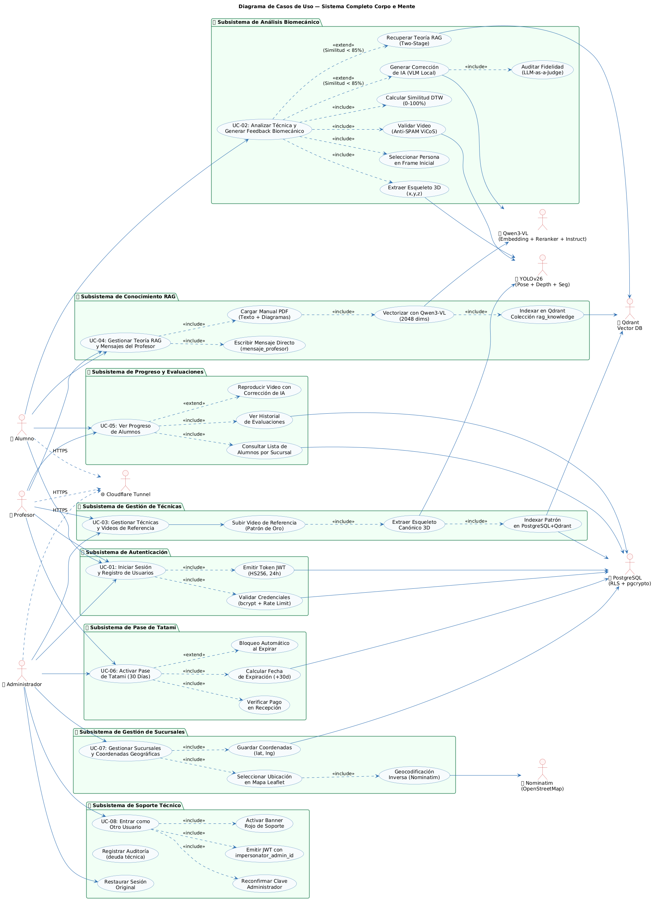

```plantuml
@startuml Diagrama_Casos_Uso_Sistema_Completo
title Diagrama de Casos de Uso — Sistema Completo Corpo e Mente

left to right direction

skinparam shadowing false
skinparam defaultFontName Arial
skinparam roundcorner 8
skinparam ArrowColor #2B6CB0
skinparam ActorBorderColor #C53030
skinparam ActorBackgroundColor #FFF5F5
skinparam UsecaseBorderColor #2B6CB0
skinparam UsecaseBackgroundColor #F7FAFC
skinparam PackageBorderColor #2F855A
skinparam PackageBackgroundColor #F0FFF4

' ============================================
' ACTORES
' ============================================
actor "🥋 Alumno" as AL
actor "🥋 Profesor" as PR
actor "🛡️ Administrador" as AD

actor "👁️ YOLOv26\n(Pose + Depth + Seg)" as YOLO
actor "🧠 Qwen3-VL\n(Embedding + Reranker + Instruct)" as QWEN
actor "🔍 Qdrant\nVector DB" as QDRANT
actor "🗄️ PostgreSQL\n(RLS + pgcrypto)" as PG
actor "🌐 Cloudflare Tunnel" as CF
actor "🗺️ Nominatim\n(OpenStreetMap)" as OSM

' ============================================
' SUBSISTEMA: AUTENTICACIÓN (UC-01)
' ============================================
package "🔐 Subsistema de Autenticación" as S1 {
  usecase "UC-01: Iniciar Sesión\ny Registro de Usuarios" as UC01
  usecase "Validar Credenciales\n(bcrypt + Rate Limit)" as UC01_VAL
  usecase "Emitir Token JWT\n(HS256, 24h)" as UC01_JWT
}

' ============================================
' SUBSISTEMA: ANÁLISIS BIOMECÁNICO (UC-02)
' ============================================
package "🎯 Subsistema de Análisis Biomecánico" as S2 {
  usecase "UC-02: Analizar Técnica y\nGenerar Feedback Biomecánico" as UC02
  usecase "Validar Video\n(Anti-SPAM ViCoS)" as UC02_SPAM
  usecase "Seleccionar Persona\nen Frame Inicial" as UC02_PERSONA
  usecase "Extraer Esqueleto 3D\n(x,y,z)" as UC02_POSE
  usecase "Calcular Similitud DTW\n(0-100%)" as UC02_DTW
  usecase "Recuperar Teoría RAG\n(Two-Stage)" as UC02_RAG
  usecase "Generar Corrección\nde IA (VLM Local)" as UC02_VLM
  usecase "Auditar Fidelidad\n(LLM-as-a-Judge)" as UC02_JUDGE
}

' ============================================
' SUBSISTEMA: GESTIÓN DE TÉCNICAS (UC-03)
' ============================================
package "📋 Subsistema de Gestión de Técnicas" as S3 {
  usecase "UC-03: Gestionar Técnicas\ny Videos de Referencia" as UC03
  usecase "Subir Video de Referencia\n(Patrón de Oro)" as UC03_VIDEO
  usecase "Extraer Esqueleto\nCanónico 3D" as UC03_YOLO
  usecase "Indexar Patrón\nen PostgreSQL+Qdrant" as UC03_INDEX
}

' ============================================
' SUBSISTEMA: GESTIÓN RAG (UC-04)
' ============================================
package "📚 Subsistema de Conocimiento RAG" as S4 {
  usecase "UC-04: Gestionar Teoría RAG\ny Mensajes del Profesor" as UC04
  usecase "Escribir Mensaje Directo\n(mensaje_profesor)" as UC04_MSG
  usecase "Cargar Manual PDF\n(Texto + Diagramas)" as UC04_PDF
  usecase "Vectorizar con Qwen3-VL\n(2048 dims)" as UC04_EMB
  usecase "Indexar en Qdrant\nColección rag_knowledge" as UC04_STORE
}

' ============================================
' SUBSISTEMA: PROGRESO (UC-05)
' ============================================
package "📊 Subsistema de Progreso y Evaluaciones" as S5 {
  usecase "UC-05: Ver Progreso\nde Alumnos" as UC05
  usecase "Consultar Lista de\nAlumnos por Sucursal" as UC05_LIST
  usecase "Ver Historial\nde Evaluaciones" as UC05_HIST
  usecase "Reproducir Video con\nCorrección de IA" as UC05_PLAY
}

' ============================================
' SUBSISTEMA: PASE DE TATAMI (UC-06)
' ============================================
package "🥋 Subsistema de Pase de Tatami" as S6 {
  usecase "UC-06: Activar Pase\nde Tatami (30 Días)" as UC06
  usecase "Verificar Pago\nen Recepción" as UC06_PAY
  usecase "Calcular Fecha\nde Expiración (+30d)" as UC06_CALC
  usecase "Bloqueo Automático\nal Expirar" as UC06_BLOCK
}

' ============================================
' SUBSISTEMA: SUCURSALES (UC-07)
' ============================================
package "🗺️ Subsistema de Gestión de Sucursales" as S7 {
  usecase "UC-07: Gestionar Sucursales\ny Coordenadas Geográficas" as UC07
  usecase "Seleccionar Ubicación\nen Mapa Leaflet" as UC07_MAP
  usecase "Geocodificación\nInversa (Nominatim)" as UC07_GEO
  usecase "Guardar Coordenadas\n(lat, lng)" as UC07_SAVE
}

' ============================================
' SUBSISTEMA: SOPORTE TÉCNICO (UC-08)
' ============================================
package "🔧 Subsistema de Soporte Técnico" as S8 {
  usecase "UC-08: Entrar como\nOtro Usuario" as UC08
  usecase "Reconfirmar Clave\nAdministrador" as UC08_AUTH
  usecase "Registrar Auditoría\n(deuda técnica)" as UC08_AUDIT
  usecase "Emitir JWT con\nimpersonator_admin_id" as UC08_JWT
  usecase "Activar Banner\nRojo de Soporte" as UC08_BANNER
  usecase "Restaurar Sesión\nOriginal" as UC08_RESTORE
}

' ============================================
' RELACIONES ACTORES → CASOS DE USO
' ============================================

AL --> UC01
PR --> UC01
AD --> UC01

AL --> UC02
AL --> UC05
AL --> UC04

PR --> UC03
PR --> UC04
PR --> UC05
PR --> UC06

AD --> UC03
AD --> UC06
AD --> UC07
AD --> UC08

' ============================================
' RELACIONES INCLUDE / EXTEND
' ============================================

' UC-01
UC01 ..> UC01_VAL : <<include>>
UC01 ..> UC01_JWT : <<include>>

' UC-02
UC02 ..> UC02_SPAM : <<include>>
UC02 ..> UC02_PERSONA : <<include>>
UC02 ..> UC02_POSE : <<include>>
UC02 ..> UC02_DTW : <<include>>
UC02 ..> UC02_RAG : <<extend>>\n(Similitud < 85%)
UC02 ..> UC02_VLM : <<extend>>\n(Similitud < 85%)
UC02_VLM ..> UC02_JUDGE : <<include>>

' UC-03
UC03 --> UC03_VIDEO
UC03_VIDEO ..> UC03_YOLO : <<include>>
UC03_YOLO ..> UC03_INDEX : <<include>>

' UC-04
UC04 ..> UC04_MSG : <<include>>
UC04 ..> UC04_PDF : <<include>>
UC04_PDF ..> UC04_EMB : <<include>>
UC04_EMB ..> UC04_STORE : <<include>>

' UC-05
UC05 ..> UC05_LIST : <<include>>
UC05 ..> UC05_HIST : <<include>>
UC05 ..> UC05_PLAY : <<extend>>

' UC-06
UC06 ..> UC06_PAY : <<include>>
UC06 ..> UC06_CALC : <<include>>
UC06 ..> UC06_BLOCK : <<extend>>

' UC-07
UC07 ..> UC07_MAP : <<include>>
UC07_MAP ..> UC07_GEO : <<include>>
UC07 ..> UC07_SAVE : <<include>>

' UC-08
UC08 ..> UC08_AUTH : <<include>>
UC08 ..> UC08_JWT : <<include>>
UC08 ..> UC08_BANNER : <<include>>
AD --> UC08_RESTORE

' ============================================
' RELACIONES SISTEMA → ACTORES SECUNDARIOS
' ============================================

UC02_POSE --> YOLO
UC02_RAG --> QDRANT
UC02_VLM --> QWEN
UC02_SPAM --> YOLO

UC03_YOLO --> YOLO
UC03_INDEX --> QDRANT
UC03_INDEX --> PG

UC04_EMB --> QWEN
UC04_STORE --> QDRANT

UC01_VAL --> PG
UC01_JWT --> PG

UC05_LIST --> PG
UC05_HIST --> PG

UC06_CALC --> PG

UC07_GEO --> OSM
UC07_SAVE --> PG

' Cloudflare Tunnel como actor externo de exposición
AL ..> CF : HTTPS
PR ..> CF : HTTPS
AD ..> CF : HTTPS

@enduml
```

---

### 5.9.2. Diagrama de Actividad con Carriles del Sistema Completo (Flujo Principal UC-02)
El diagrama de actividad con carriles (*Swimlanes Activity Diagram*) detalla la dinámica operativa completa del caso de uso central (UC-02: Analizar Técnica y Generar Feedback Biomecánico), cruzando las seis capas de ejecución del sistema: Alumno (Cliente), Frontend (React 19 + Vite Proxy), Backend (FastAPI), IA de Visión (YOLOv26 + ViCoS), IA de Conocimiento (DTW + Qwen3-VL en MLX) y Persistencia (PostgreSQL + Qdrant). Este flujo modela con rigor las bifurcaciones condicionales de validación de membresía, filtrado anti-spam, selección interactiva de silueta, recuperación RAG en dos etapas y la auditoría de fidelidad con degradación elegante (*Graceful Fallback*):

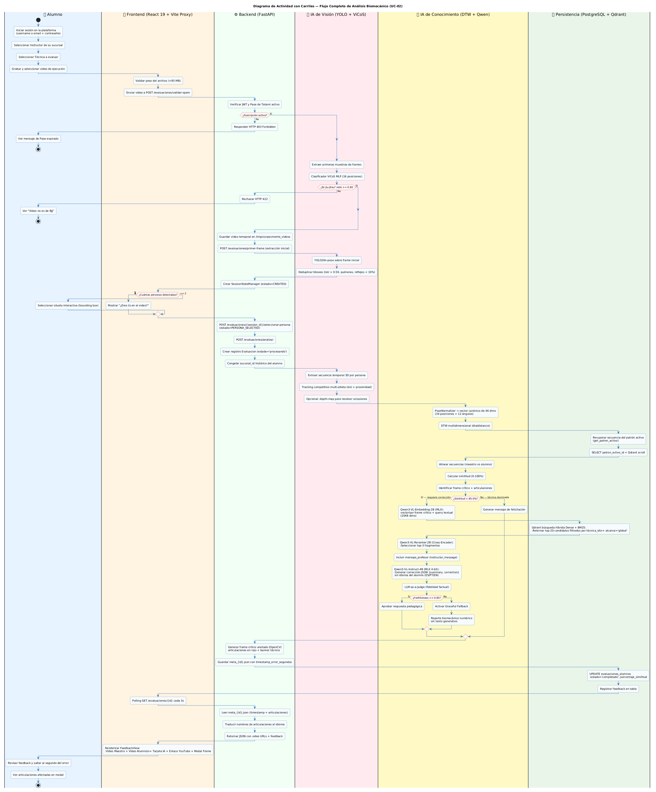

```plantuml
@startuml Diagrama_Actividad_Sistema_Completo
title Diagrama de Actividad con Carriles — Flujo Completo de Análisis Biomecánico (UC-02)

skinparam shadowing false
skinparam defaultFontName Arial
skinparam roundcorner 8
skinparam ArrowColor #2B6CB0
skinparam ActivityBorderColor #2B6CB0
skinparam ActivityBackgroundColor #F7FAFC
skinparam ActivityDiamondBorderColor #C53030
skinparam ActivityDiamondBackgroundColor #FFF5F5

|#E6F3FF|👤 Alumno|
start
:Iniciar sesión en la plataforma\n(username o email + contraseña);
:Seleccionar Instructor de su sucursal;
:Seleccionar Técnica a evaluar;
:Grabar y seleccionar video de ejecución;

|#FFF3E0|🖥️ Frontend (React 19 + Vite Proxy)|
:Validar peso del archivo (<95 MB);
:Enviar video a POST /evaluaciones/validar-spam;

|#F0FFF4|⚙️ Backend (FastAPI)|
:Verificar JWT y Pase de Tatami activo;
if (¿Suscripción activa?) then (No)
  :Responder HTTP 403 Forbidden;
  |#E6F3FF|👤 Alumno|
  :Ver mensaje de Pase expirado;
  stop
else (Sí)
endif

|#FFEBEE|👁️ IA de Visión (YOLO + ViCoS)|
:Extraer primeras muestras de frames;
:Clasificador ViCoS MLP (16 posiciones);
if (¿Es Jiu-Jitsu? ratio >= 0.60) then (No)
  |#F0FFF4|⚙️ Backend (FastAPI)|
  :Rechazar HTTP 422;
  |#E6F3FF|👤 Alumno|
  :Ver "Video no es de BJJ";
  stop
else (Sí)
endif

|#F0FFF4|⚙️ Backend (FastAPI)|
:Guardar video temporal en /tmp/corpocmente_videos;
:POST /evaluaciones/primer-frame (extracción inicial);

|#FFEBEE|👁️ IA de Visión (YOLO + ViCoS)|
:YOLO26n-pose sobre frame inicial;
:Deduplicar bboxes (IoU > 0.50, quimeras, reflejos < 10%);

|#F0FFF4|⚙️ Backend (FastAPI)|
:Crear SessionStateManager (estado=CREATED);

|#FFF3E0|🖥️ Frontend (React 19 + Vite Proxy)|
if (¿Cuántas personas detectadas?) then (= 1)
  :Mostrar "¿Eres tú en el video?";
else (>= 2)
  |#E6F3FF|👤 Alumno|
  :Seleccionar silueta interactiva (bounding box);
endif

|#F0FFF4|⚙️ Backend (FastAPI)|
:POST /evaluaciones/{session_id}/seleccionar-persona\n(estado=PERSONA_SELECTED);
:POST /evaluaciones/analizar;
:Crear registro Evaluacion (estado='procesando');
:Congelar sucursal_id histórico del alumno;

|#FFEBEE|👁️ IA de Visión (YOLO + ViCoS)|
:Extraer secuencia temporal 3D por persona;
:Tracking competitivo multi-atleta (IoU + proximidad);
:Opcional: depth-map para resolver oclusiones;

|#FFF9C4|🧠 IA de Conocimiento (DTW + Qwen)|
:PoseNormalizer → vector canónico de 46 dims\n(34 posiciones + 12 ángulos);
:DTW multidimensional (dtaidistance);

|#E8F5E9|🗄️ Persistencia (PostgreSQL + Qdrant)|
:Recuperar secuencia del patrón activo\n(get_patron_activo);
:SELECT patron_activo_id + Qdrant scroll;

|#FFF9C4|🧠 IA de Conocimiento (DTW + Qwen)|
:Alinear secuencias (maestro vs alumno);
:Calcular similitud (0-100%);
:Identificar frame crítico + articulaciones;

if (¿Similitud < 85.0%?) then (Sí — requiere corrección)
  |#FFF9C4|🧠 IA de Conocimiento (DTW + Qwen)|
  :Qwen3-VL-Embedding-2B (MLX):\nvectorizar frame crítico + query textual\n(2048 dims);
  
  |#E8F5E9|🗄️ Persistencia (PostgreSQL + Qdrant)|
  :Qdrant búsqueda híbrida Dense + BM25:
  :Retornar top-20 candidatos filtrados por técnica_id\n+ alcance='global';
  
  |#FFF9C4|🧠 IA de Conocimiento (DTW + Qwen)|
  :Qwen3-VL-Reranker-2B (Cross-Encoder):
  :Seleccionar top-3 fragmentos;
  :Incluir mensaje_profesor (instructor_message);
  
  :Qwen3-VL-Instruct-4B (MLX 4-bit):
  :Generar corrección JSON {summary, correction}
  :en idioma del alumno (ES/PT/EN);
  
  :LLM-as-a-Judge (fidelidad factual);
  
  if (¿Faithfulness >= 0.85?) then (Sí)
    :Aprobar respuesta pedagógica;
  else (No)
    :Activar Graceful Fallback;
    :Reporte biomecánico numérico\nsin texto generativo;
  endif
else (No — técnica dominada)
  |#FFF9C4|🧠 IA de Conocimiento (DTW + Qwen)|
  :Generar mensaje de felicitación;
endif

|#F0FFF4|⚙️ Backend (FastAPI)|
:Generar frame crítico anotado (OpenCV)\narticulaciones en rojo + banner técnico;
:Guardar meta_{id}.json con timestamp_error_segundos;

|#E8F5E9|🗄️ Persistencia (PostgreSQL + Qdrant)|
:UPDATE evaluaciones_alumnos
:estado='completado', porcentaje_similitud;
:Registrar feedback en tabla;

|#FFF3E0|🖥️ Frontend (React 19 + Vite Proxy)|
:Polling GET /evaluaciones/{id} cada 3s;

|#F0FFF4|⚙️ Backend (FastAPI)|
:Leer meta_{id}.json (timestamp + articulaciones);
:Traducir nombres de articulaciones al idioma;
:Retornar JSON con video URLs + feedback;

|#FFF3E0|🖥️ Frontend (React 19 + Vite Proxy)|
:Renderizar FeedbackView:
:Video Maestro + Video Alumno\n+ Tarjeta IA + Enlace YouTube + Modal Frame;

|#E6F3FF|👤 Alumno|
:Revisar feedback y saltar al segundo del error;
:Ver articulaciones afectadas en modal;

stop

@enduml
```

---

### 5.9.3. Diagrama de Clases del Sistema Completo
El diagrama de clases estructural del sistema completo modela todas las clases participantes organizadas rigurosamente según sus responsabilidades por capas: Frontera de Presentación (*Boundary Frontend*), Frontera de API (*Boundary Backend*), Control de Aplicación (*Control Application*), Servicios de Dominio (*Domain Services*), Biomecánica, Entidades de Dominio (*Domain Entities*) y Adaptadores de Infraestructura (*Infrastructure AI, Persistencia y Video*):

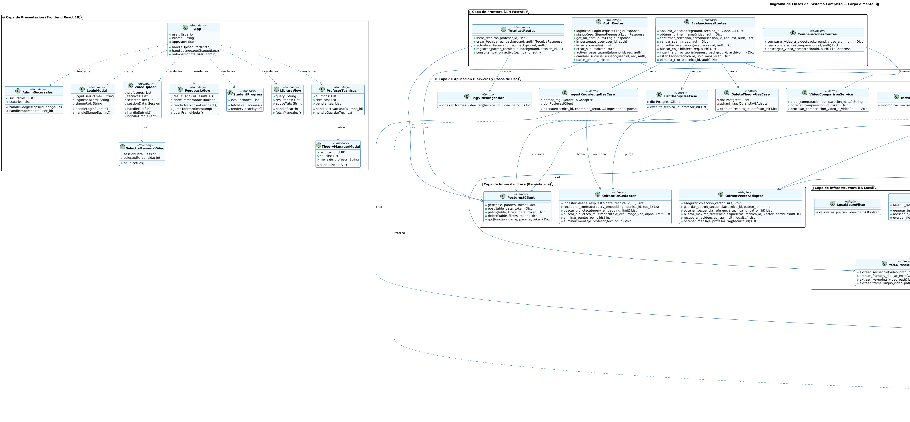

```plantuml
@startuml Diagrama_Clases_Sistema_Completo
title Diagrama de Clases del Sistema Completo — Corpo e Mente BJJ

skinparam shadowing false
skinparam defaultFontName Arial
skinparam roundcorner 8
skinparam ArrowColor #2B6CB0
skinparam ClassBorderColor #2B6CB0
skinparam ClassBackgroundColor #F7FAFC
skinparam ClassHeaderBackgroundColor #EBF8FF
skinparam ClassFontStyle bold

'======================================================
' CAPA DE FRONTERA (BOUNDARY) - FRONTEND
'======================================================
package "🌐 Capa de Presentación (Frontend React 19)" as Frontend {

  class App <<Boundary>> {
    +user: Usuario
    +idioma: String
    +appState: State
    +handleUploadStart(data)
    +handleLanguageChange(lang)
    +onImpersonate(user, admin)
  }

  class LoginModal <<Boundary>> {
    +loginUserOrEmail: String
    +loginPassword: String
    +signupRol: String
    +handleLoginSubmit()
    +handleSignupSubmit()
  }

  class VideoUpload <<Boundary>> {
    +profesores: List
    +tecnicas: List
    +selectedFile: File
    +sessionData: Session
    +handleFile(file)
    +handleSubmit()
    +handleDrag(event)
  }

  class FeedbackView <<Boundary>> {
    +result: AnalisisResultDTO
    +showFrameModal: Boolean
    +renderMarkdownFeedback()
    +jumpToError(timestamp)
    +openFrameModal()
  }

  class StudentProgress <<Boundary>> {
    +evaluaciones: List
    +fetchEvaluaciones()
    +renderVideoPlayer()
  }

  class LibraryView <<Boundary>> {
    +query: String
    +resultados: List
    +activeTab: String
    +handleSearch()
    +fetchManuales()
  }

  class ProfesorTecnicas <<Boundary>> {
    +alumnos: List
    +tecnicas: List
    +pendientes: List
    +handleActivarPase(alumno_id)
    +handleGuardarTecnica()
  }

  class AdminSucursales <<Boundary>> {
    +sucursales: List
    +usuarios: List
    +handleGoogleMapsUrlChange(url)
    +handleImpersonate(user_id)
  }

  class TheoryManagerModal <<Boundary>> {
    +tecnica_id: UUID
    +chunks: List
    +mensaje_profesor: String
    +handleDeleteAll()
  }

  class SelectorPersonaVideo <<Boundary>> {
    +sessionData: Session
    +selectedPersonaIdx: Int
    +onSelect(idx)
  }
}

'======================================================
' CAPA DE FRONTERA (BOUNDARY) - BACKEND API
'======================================================
package "🚪 Capa de Frontera (API FastAPI)" as API {

  class AuthRoutes <<Boundary>> {
    +login(req: LoginRequest) LoginResponse
    +signup(req: SignupRequest) LoginResponse
    +get_mi_perfil(auth) LoginResponse
    +impersonate_user(user_id, auth)
    +listar_sucursales() List
    +crear_sucursal(req, auth)
    +activar_pase_tatami(alumno_id, req, auth)
    +cambiar_sucursal_usuario(user_id, req, auth)
    +parse_gmaps_link(req, auth)
  }

  class EvaluacionesRoutes <<Boundary>> {
    +analizar_video(background, tecnica_id, video, ...) Dict
    +obtener_primer_frame(video, auth) Dict
    +confirmar_seleccion_persona(session_id, request, auth) Dict
    +validar_spam(video, auth) Dict
    +consultar_evaluacion(evaluacion_id, auth) Dict
    +buscar_en_biblioteca(req, auth) Dict
    +ingerir_archivo_teoria(request, background, archivo, ...) Dict
    +listar_teoria(tecnica_id, solo_mios, auth) Dict
    +eliminar_teoria(tecnica_id, auth) Dict
  }

  class TecnicasRoutes <<Boundary>> {
    +listar_tecnicas(profesor_id) List
    +crear_tecnica(req, background, auth) TecnicaResponse
    +actualizar_tecnica(id, req, background, auth)
    +registrar_patron_tecnica(id, background, session_id, ...)
    +consultar_patron_activo(tecnica_id, auth)
  }

  class ComparacionesRoutes <<Boundary>> {
    +comparar_video_a_video(background, video_alumno, ...) Dict
    +leer_comparacion(comparacion_id, auth) Dict
    +descargar_video_comparacion(id, auth) FileResponse
  }
}

'======================================================
' CAPA DE CONTROL (APPLICATION)
'======================================================
package "⚙️ Capa de Aplicación (Servicios y Casos de Uso)" as Application {

  class IntelligenceAnalysisFacade <<Control>> {
    -yolo: YOLOPoseAdapter
    -qdrant: QdrantVectorAdapter
    -gemini: LocalVLMAdapter
    -qwen: QwenEmbeddingAdapter
    +ejecutar_analisis_completo(video_path, tecnica_id, ...) AnalisisResultDTO
  }

  class IngestKnowledgeUseCase <<Control>> {
    -qdrant_rag: QdrantRAGAdapter
    -db: PostgrestClient
    +execute(tecnica_id, contenido_texto, ...) IngestionResponse
  }

  class DeleteTheoryUseCase <<Control>> {
    -db: PostgrestClient
    -qdrant_rag: QdrantRAGAdapter
    +execute(tecnica_id, profesor_id) Dict
  }

  class ListTheoryUseCase <<Control>> {
    -db: PostgrestClient
    +execute(tecnica_id, profesor_id) List
  }

  class VideoComparisonService <<Control>> {
    +crear_comparacion(comparacion_id, ...) String
    +obtener_comparacion(id, token) Dict
    +procesar_comparacion_video_a_video(id, ...) Void
  }

  class InstructorMessageIngestion <<Control>> {
    +sincronizar_mensaje_profesor(tecnica_id, mensaje) Int
  }

  class MultimodalRAGService <<Control>> {
    +construir_query_textual_rag(tecnica_nombre, discrepancias) String
    +obtener_evidencias_rag_multimodal(...) List
    +formatear_evidencias_texto(evidencias) String
    +incluir_mensaje_profesor(evidencias, qdrant, tecnica_id, limit) List
  }

  class RagVideoIngestion <<Control>> {
    +indexar_frames_video_rag(tecnica_id, video_path, ...) Int
  }
}

'======================================================
' CAPA DE DOMINIO - SERVICIOS
'======================================================
package "📐 Capa de Dominio (Servicios)" as DomainServices {

  class HybridRetriever <<Control>> {
    +DEFAULT_K_RRF = 60
    +fusionar_rrf(densos, bm25, top_k, k_rrf) List
    +recuperar(query_texto, qdrant, qwen, ...) List
  }

  class Qwen3VLRerankerCrossEncoder <<Control>> {
    +MODEL_ID = "mlx-community/Qwen3-VL-Reranker-2B-4bit"
    +rerank_pairs(query, documents, instruction) List
    +get_instance() Tuple
  }

  class SessionStateManager <<Control>> {
    +crear_sesion(session_id, video_path, ...) Dict
    +seleccionar_persona(session_id, idx) Dict
    +iniciar_operacion(session_id, tecnica_id) Dict
    +finalizar_operacion(session_id, exito, error) Dict
  }

  class GlossaryService <<Control>> {
    +cargar_glosario(force_reload) Dict
    +obtener_sinonimos_multilingues(texto) Set
    +expandir_query_con_glosario(query) String
  }

  class PromptStrategy <<Interface>> {
    +construir_prompt_evaluacion(tecnica, discrepancias, mensaje) String
  }

  class SpanishPromptStrategy {
    +construir_prompt_evaluacion(...) String
  }

  class PortuguesePromptStrategy {
    +construir_prompt_evaluacion(...) String
  }

  class EnglishPromptStrategy {
    +construir_prompt_evaluacion(...) String
  }
}

'======================================================
' CAPA DE DOMINIO - BIOMECÁNICA
'======================================================
package "🦴 Capa de Dominio (Biomecánica)" as Biomechanics {

  class DTWComparator <<Control>> {
    +comparar_secuencias_con_dtw(seq_maestro, seq_alumno, ...) Dict
    +detectar_articulaciones_criticas(vec_m, vec_a, top_k) List
    +resumen_alineacion(alineacion, max_items) List
  }

  class PoseNormalizer <<Control>> {
    +VECTOR_DIM = 46
    +normalizar(kpts_flat) Dict
    +similitud_esqueletos(a, b, w_pos, w_ang) Dict
    +articulaciones_criticas(a, b, top_k) List
  }
}

'======================================================
' CAPA DE DOMINIO - ENTIDADES
'======================================================
package "📦 Capa de Dominio (Entidades)" as Entities {

  class Usuario <<Entity>> {
    +id: UUID
    +nombre_completo: String
    +username: String
    +email: String
    +password_hash: String
    +rol: RolUsuario
    +sucursal_id: UUID
    +idioma_preferido: String
    +avatar_url: String
    +estado_suscripcion: String
    +fecha_expiracion: DateTime
  }

  class Sucursal <<Entity>> {
    +id: UUID
    +nombre: String
    +pais: String
    +ciudad: String
    +direccion: String
    +latitud: Float
    +longitud: Float
  }

  class Tecnica <<Entity>> {
    +id: UUID
    +nombre: String
    +nivel_cinturon: String
    +mensaje_profesor: String
    +patron_activo_id: UUID
  }

  class Evaluacion <<Entity>> {
    +id: UUID
    +alumno_id: UUID
    +tecnica_id: UUID
    +sucursal_id: UUID
    +porcentaje_similitud: Float
    +feedback_gemini_es: String
    +feedback_summary: String
    +estado: String
    +fecha_evaluacion: DateTime
  }

  class PatronReferencia <<Entity>> {
    +tecnica_id: UUID
    +profesor_id: UUID
    +secuencia_3d: List
    +patron_id: UUID
  }

  class TeoriaRAG <<Entity>> {
    +id: UUID
    +tecnica_id: UUID
    +profesor_id: UUID
    +chunk_index: Int
    +contenido_texto: String
    +qdrant_point_id: UUID
    +fuente_tipo: String
  }

  class EsqueletoBiomecanico <<Entity>> {
    +frame_idx: Int
    +keypoints133: List
    +angulos_articulares: Dict
    +to_vector_array() List
  }

  class AnalisisResultDTO <<Entity>> {
    +similitud: Float
    +feedback: String
    +feedback_summary: String
    +frame_critico_path: String
    +timestamp_error_segundos: Float
    +articulaciones_criticas: List
    +nombres_articulaciones_criticas: List
  }

  class TokenJWT <<Entity>> {
    +access_token: String
    +token_type: String
    +expires_in: Int
  }
}

'======================================================
' CAPA DE INFRAESTRUCTURA - IA
'======================================================
package "🤖 Capa de Infraestructura (IA Local)" as InfrastructureAI {

  class YOLOPoseAdapter <<Adapter>> {
    +extraer_secuencia(video_path, persona_idx_inicial) Dict
    +extraer_frame_y_dibujar_error(...) String
    +extraer_keypoints(video_path) List
    +extraer_frame_limpio(video_path, idx, out) String
  }

  class LocalSpamFilter <<Adapter>> {
    +validar_es_jiujitsu(video_path) Boolean
  }

  class QwenEmbeddingAdapter <<Adapter>> {
    +MODEL_ID
    +generar_embedding_texto(texto) List
    +generar_embedding_imagen(image_path, prompt) List
    +generar_embeddings_texto_lote(textos) List
  }

  class LocalVLMAdapter <<Adapter>> {
    +MODEL_NAME = "mlx-community/Qwen3-VL-4B-Instruct-4bit"
    +generar_texto_feedback(prompt, frame, evidencias, idioma) Dict
    +reescribir_query_cognitiva(query) String
    +evaluar_fidelidad_grounding(respuesta, contexto, mensaje) Dict
  }
}

'======================================================
' CAPA DE INFRAESTRUCTURA - PERSISTENCIA
'======================================================
package "🗄️ Capa de Infraestructura (Persistencia)" as InfrastructurePersistence {

  class PostgrestClient <<Adapter>> {
    +get(table, params, token) Dict
    +post(table, data, token) Dict
    +patch(table, filters, data, token) Dict
    +delete(table, filters, token) Dict
    +rpc(function_name, params, token) Dict
  }

  class QdrantVectorAdapter <<Adapter>> {
    +asegurar_coleccion(vector_size) Void
    +guardar_patron_secuencia(tecnica_id, patron_id, ...) Int
    +obtener_secuencia_referencia(tecnica_id, patron_id) List
    +buscar_maxima_diferencia(esqueletos, tecnica_id) VectorSearchResultDTO
    +recuperar_evidencias_rag_multimodal(...) List
    +obtener_mensaje_profesor_rag(tecnica_id) List
  }

  class QdrantRAGAdapter <<Adapter>> {
    +ingestar_desde_respuesta(data, tecnica_id, ...) Dict
    +recuperar_contexto(query_embedding, tecnica_id, top_k) List
    +buscar_biblioteca(query_embedding, limit) List
    +buscar_biblioteca_multimodal(text_vec, image_vec, alpha, limit) List
    +eliminar_puntos(point_ids) Int
    +eliminar_mensaje_profesor(tecnica_id) Void
  }
}

'======================================================
' CAPA DE INFRAESTRUCTURA - VIDEO
'======================================================
package "🎥 Capa de Infraestructura (Video)" as InfrastructureVideo {

  class ComparadorVisual <<Adapter>> {
    +generar_video_comparacion(video_alumno, video_maestro, alineacion, output_path, ...) String
  }
}

'======================================================
' RELACIONES ENTRE CLASES
'======================================================

' Frontend → API (HTTP)
App ..> LoginModal : abre
App ..> VideoUpload : renderiza
App ..> FeedbackView : renderiza
App ..> StudentProgress : renderiza
App ..> LibraryView : renderiza
App ..> ProfesorTecnicas : renderiza
App ..> AdminSucursales : renderiza

VideoUpload ..> SelectorPersonaVideo : usa
ProfesorTecnicas ..> TheoryManagerModal : abre

' API → Application
AuthRoutes --> PostgrestClient : usa
AuthRoutes --> TokenJWT : genera
EvaluacionesRoutes --> IntelligenceAnalysisFacade : invoca
EvaluacionesRoutes --> IngestKnowledgeUseCase : invoca
EvaluacionesRoutes --> ListTheoryUseCase : invoca
EvaluacionesRoutes --> DeleteTheoryUseCase : invoca
EvaluacionesRoutes --> SessionStateManager : controla
TecnicasRoutes --> PostgrestClient : usa
TecnicasRoutes --> RagVideoIngestion : invoca
ComparacionesRoutes --> VideoComparisonService : invoca

' Application → Domain Services
IntelligenceAnalysisFacade --> YOLOPoseAdapter : usa
IntelligenceAnalysisFacade --> QdrantVectorAdapter : consulta
IntelligenceAnalysisFacade --> LocalVLMAdapter : genera
IntelligenceAnalysisFacade --> QwenEmbeddingAdapter : vectoriza
IntelligenceAnalysisFacade --> DTWComparator : compara
IntelligenceAnalysisFacade --> HybridRetriever : recupera
IntelligenceAnalysisFacade --> Qwen3VLRerankerCrossEncoder : rerank
IntelligenceAnalysisFacade --> MultimodalRAGService : orquesta

' Application → Entities
IngestKnowledgeUseCase --> TeoriaRAG : crea
IngestKnowledgeUseCase --> QdrantRAGAdapter : vectoriza
ListTheoryUseCase --> PostgrestClient : consulta
DeleteTheoryUseCase --> PostgrestClient : borra
DeleteTheoryUseCase --> QdrantRAGAdapter : purga

' Domain Services → Entities & Biomechanics
IntelligenceAnalysisFacade ..> AnalisisResultDTO : retorna
DTWComparator ..> PoseNormalizer : usa
PoseNormalizer ..> EsqueletoBiomecanico : procesa

' Domain Entities relationships
Usuario "1" --> "1" Sucursal : pertenece_a
Usuario "1" --> "*" Evaluacion : realiza
Tecnica "1" --> "*" Evaluacion : evaluada_en
Tecnica "1" --> "*" PatronReferencia : tiene
Tecnica "1" --> "*" TeoriaRAG : referencia
Evaluacion "1" --> "1" PatronReferencia : compara_con
Evaluacion "1" --> "1" AnalisisResultDTO : genera

' Infrastructure relationships
HybridRetriever --> QdrantVectorAdapter : consulta
HybridRetriever --> GlossaryService : expande
Qwen3VLRerankerCrossEncoder --> QwenEmbeddingAdapter : reutiliza
LocalVLMAdapter ..> YOLOPoseAdapter : recibe frames

' Prompt Strategies
PromptStrategy <|.. SpanishPromptStrategy
PromptStrategy <|.. PortuguesePromptStrategy
PromptStrategy <|.. EnglishPromptStrategy
IntelligenceAnalysisFacade --> PromptStrategy : utiliza

@enduml
```


---

# Capítulo VI: Desarrollo

## 6.1. Introducción al Proceso de Construcción
El desarrollo del Sistema de Análisis Biomecánico de Técnicas de Jiu-Jitsu Brasileño para la academia "Corpo e Mente" se rigió bajo los postulados del Proceso Unificado Ágil promovido por Craig Larman (2004), estructurado en ciclos iterativos, incrementales y acotados en el tiempo (*timeboxed*). A diferencia de los enfoques tradicionales en cascada, la construcción del software no postergó la integración de los componentes críticos; por el contrario, desde las primeras iteraciones se atacaron los riesgos arquitectónicos de mayor impacto, tales como la coexistencia de modelos de Inteligencia Artificial en memoria unificada, la latencia de inferencia en video y el aislamiento multi-tenant en bases de datos relacionales.

El ciclo de vida del proyecto transitó por cuatro fases disciplinares documentadas exhaustivamente en la bitácora de ingeniería (`docs/PlanEvaluacionIteraciones.md`): Incepción (definición de alcance y viabilidad técnica), Elaboración (establecimiento de la línea base arquitectónica con FastAPI, PostgreSQL, Qdrant y YOLO), Construcción (desarrollo evolutivo de los ocho casos de uso, refinamiento del algoritmo DTW y pipelines RAG multimodales) y Transición (endurecimiento de seguridad en producción, pruebas E2E, internacionalización y auditoría de ciberseguridad). La totalidad del código fuente, configuraciones y scripts de automatización residen en un repositorio Git versionado, asegurando trazabilidad bidireccional y capacidad de reversión (*rollback*) ante cualquier regresión funcional.

## 6.2. Herramientas de Desarrollo, Licencias y Software Utilizado

### 6.2.1. Entorno de Desarrollo e IA Asistida
Durante el ciclo de construcción se adoptó un flujo de ingeniería asistido por modelos de lenguaje de última generación, actuando como herramientas de productividad y revisión técnica bajo estricta supervisión humana.

Tabla 18
*Herramientas de desarrollo y codificación asistida por Inteligencia Artificial*

| Herramienta | Rol en el Proyecto | Licencia / Costo | Justificación Técnica |
| :--- | :--- | :--- | :--- |
| **Antigravity (Google AI Pro)** | Asistente principal de codificación agéntica, refactorización multi-archivo y auditoría de seguridad | Suscripción comercial Google AI Pro (pago mensual) | Capacidad de razonamiento sobre árboles de código extensos, ejecución controlada en terminal, validación empírica con Playwright y soporte nativo para inspección de arquitecturas desacopladas. |
| **DeepSeek (API / Chat)** | Revisión de lógica algorítmica (DTW, normalización biomecánica) y diseño de pruebas unitarias | Freemium / API de bajo costo por consumo | Modelo con sólidas capacidades de razonamiento matemático y algorítmico, fundamental para auditar las transformaciones vectoriales de `pose_normalizer.py` y `dtw_comparator.py`. |
| **GitHub Copilot / Claude Code** | Autocompletado inteligente de sintaxis y generación de código repetitivo (*boilerplate*) | Suscripción comercial GitHub | Integración directa con el entorno de desarrollo, acelerando la tipificación de DTOs en Pydantic y componentes visuales en React. |
| **GitHub** | Control de versiones distribuido, gestión de incidencias (*issues*) y marcado de etiquetas de iteración | Gratuito para repositorios / Plan Pro | Garantiza la trazabilidad histórica de los cambios y la posibilidad de ejecutar puntos de restauración (*rollbacks*) ante desviaciones métricas. |

*Nota.* Elaboración propia (2026).

### 6.2.2. Infraestructura de Cómputo y Hardware
La selección de la infraestructura de cómputo respondió a criterios de autosuficiencia operativa, bajo consumo energético y preservación absoluta de la privacidad de los practicantes de la academia.

Tabla 19
*Infraestructura de cómputo y hardware evaluada y utilizada*

| Recurso | Especificación Técnica | Costo Asociado | Justificación Técnica y Operativa |
| :--- | :--- | :--- | :--- |
| **MacBook Air M5 (Hardware de Producción Seleccionado)** | Chip Apple Silicon M5, GPU integrada, Neural Engine, **24 GB de Memoria Unificada** | Inversión única de hardware (~$1,500 USD) | Permite ejecutar simultáneamente la inferencia de YOLOv26 y los modelos de lenguaje visual Qwen3-VL de forma 100% local. Su consumo de apenas ~30 W (frente a los ~250 W de tarjetas dedicadas como la RTX 4090) y su arquitectura de memoria unificada eliminan el costo recurrente de servidores en la nube y garantizan que los videos jamás abandonen la red física del tatami (ver §3.2). |
| **Google Colab (Infraestructura Experimental Descartada)** | Instancias cloud con GPU NVIDIA Tesla T4 / A100 | ~$20 USD (dos recargas puntuales de $10 USD) | Utilizado **exclusivamente** para el experimento de reentrenamiento (*fine-tuning*) del modelo ViCoS (YOLOv26s) durante la iteración 3C. Tras constatar que la segmentación directa degradaba los FPS sin mejorar la precisión de pose en oclusiones severas (memo técnico `2026-10-31-transition-3c-yolo26s-evaluation-findings.md`), fue descartado por completo para la inferencia productiva diaria. |
| **Google AI Pro** | Acceso a modelos Gemini mediante API | Suscripción mensual | Utilizado exclusivamente en la fase de investigación y desarrollo de software como apoyo asistido; **no se utiliza en producción** para evitar costos por token y latencias de red (ver §3.14.4). |

*Nota.* Elaboración propia (2026).

### 6.2.3. Stack de Software de Producción
Todos los componentes de software integrados en el entorno operativo final son tecnologías de código abierto o estándares de la industria libres de regalías por licencia de uso.

Tabla 20
*Stack de software de producción*

| Componente | Versión | Licencia | Rol en la Arquitectura |
| :--- | :--- | :--- | :--- |
| **Python** | 3.12 | PSF License | Lenguaje principal del backend, lógica biomecánica y orquestación de IA. |
| **FastAPI** | 0.115.0 | MIT | Framework asíncrono para la exposición de endpoints REST, WebSockets y streaming. |
| **PostgreSQL** | 16 | PostgreSQL License | Base de datos relacional con políticas de seguridad por fila (RLS) y soporte `pgcrypto`. |
| **PostgREST** | 12.x | MIT | Servidor de capa de datos declarativa directamente sobre el catálogo de PostgreSQL. |
| **Qdrant** | 1.11.3 | Apache 2.0 | Base de datos vectorial para recuperación semántica mediante grafos HNSW y filtrado de payload. |
| **Docker + Docker Compose** | 27.x | Apache 2.0 | Contenerización de servicios auxiliares (base de datos relacional y motor vectorial). |
| **React** | 19.2.8 | MIT | Biblioteca frontend para interfaces interactivas y reproductor de video biomecánico. |
| **Vite** | 5.4.11 | MIT | Herramienta de compilación frontend y servidor de desarrollo con proxy inverso seguro. |
| **Ultralytics** | ≥ 8.4.0 | AGPL-3.0 | Framework unificado de visión por computadora para YOLOv26 Pose, Depth y Segmentation. |
| **MLX (Apple)** | 0.32.x | MIT | Framework de computación de tensores optimizado para la memoria unificada de Apple Silicon. |
| **Qwen3-VL** | 2B / 4B | Apache 2.0 | Modelos multimodales para embeddings de 2048 dimensiones, reranker y generación pedagógica. |
| **Cloudflare Tunnel (`cloudflared`)** | 2026.x | Apache 2.0 | Conector Zero Trust para exponer la plataforma web a internet sin abrir puertos en el router. |
| **Leaflet.js** | 1.9.4 | BSD-2-Clause | Renderizado de mapas interactivos para geolocalización de sucursales físicas. |
| **pytest** | 8.3.3 | MIT | Framework de pruebas unitarias, de integración y regresión del backend. |
| **Playwright** | 1.4x | Apache 2.0 | Framework de pruebas automatizadas de extremo a extremo (E2E) en navegadores web. |
| **Mozilla Firefox** | 13x | MPL 2.0 | Navegador empleado para validación manual de interfaz complementario al motor Chromium de pruebas. |

*Nota.* Elaboración propia (2026).

### 6.2.4. Herramientas de Modelado y Documentación
Para el análisis de requisitos y el diseño arquitectónico se emplearon estándares rigurosos de ingeniería de software orientada a objetos.

Tabla 21
*Herramientas de modelado, diseño y documentación técnica*

| Herramienta | Propósito en el Proyecto | Tipo de Licencia |
| :--- | :--- | :--- |
| **PlantUML** | Generación de diagramas formales de Casos de Uso y Secuencia con separación de responsabilidades (16 diagramas PNG en `docs/diagramas/`). | GPL / Servicio Kroki de código abierto |
| **Mermaid Live Editor** | Prototipado rápido y validación sintáctica previa de diagramas de clases y paquetes antes de integrarlos al repositorio. | MIT |
| **Mermaid (Markdown)** | Modelado visual embebido directamente en la documentación técnica del proyecto (diagramas de clases, paquetes y modelo de dominio). | MIT |
| **Craig Larman (2004)** | Referencia metodológica formal para el Proceso Unificado Ágil, patrones de asignación de responsabilidades GRASP y diagramas de secuencia. | Referencia bibliográfica académica |
| **Michael V. Mannino (2018)** | Fundamento teórico para el diseño relacional de bases de datos, formas normales (3NF/BCNF) y restricciones de integridad. | Referencia bibliográfica académica |
| **Hugging Face Hub** | Repositorio de artefactos para la descarga de modelos cuantizados a 4 bits (`mlx-community/Qwen3-VL-*`) y consulta de especificaciones técnicas. | Apache 2.0 / Model Hub |
| **DeepSeek / Antigravity** | Asistencia en la revisión de estilo formal, verificación cruzada de consistencia entre código y documento, y auditoría de seguridad. | Herramientas de soporte de ingeniería |

*Nota.* Elaboración propia (2026).

### 6.2.5. Repositorio de Habilidades de Ciberseguridad
Con el objetivo de garantizar una postura de seguridad proactiva y defensiva desde las etapas iniciales de construcción, se integró el repositorio especializado **`briiirussell/cybersecurity-skills`** (GitHub), el cual provee habilidades de auditoría automatizada estructuradas por vectores de riesgo. Se ejecutaron de forma intensiva tres suites de análisis:
1. **`api-audit`**: Evaluación de autorización a nivel de objeto (BOLA), configuración de encabezados CORS, prevención de suplantación de IP en mecanismos de limitación de tasa (*rate limiting*) y detección de falsificación de peticiones del lado del servidor (SSRF).
2. **`cloud-audit`**: Inspección de exposición indebida de documentación de desarrollo (Swagger/OpenAPI) y validación de dominios autorizados en servidores de proxy (*allowedHosts*).
3. **`secrets-audit`**: Búsqueda estática y dinámica de secretos criptográficos, llaves privadas y tokens quemados en archivos de configuración o manifiestos de Docker.

Los resultados crudos de dicha auditoría quedaron registrados en el archivo formal `findings.json` en la raíz del repositorio, documentando un total de 7 hallazgos (3 confirmados y mitigados, y 4 desestimados con contraevidencia técnica comprobada), los cuales se detallan en el Capítulo VIII.

## 6.3. Estructura del Repositorio
El repositorio del proyecto sigue una arquitectura limpia (*Clean Architecture*) organizada en módulos con responsabilidades netamente segregadas:

```
JiuJitsu-main/
├── backend/                        # Núcleo de lógica de negocio, IA y APIs
│   ├── corpocmente/
│   │   ├── domain/                 # Entidades puras, biomecánica (DTW) y glosario
│   │   ├── application/            # Casos de uso, servicios de aplicación y DTOs
│   │   ├── infrastructure/         # Adaptadores externos (YOLO, MLX, Qdrant, DB)
│   │   └── ui/                     # Controladores y rutas HTTP (FastAPI)
│   ├── tests/                      # Suite de 26 archivos de pruebas con pytest
│   └── scripts/                    # Utilidades de mantenimiento y migraciones
├── frontend/                       # Aplicación web cliente en React 19 + Vite
│   ├── src/
│   │   ├── components/             # Componentes visuales reutilizables y modales
│   │   ├── pages/                  # Vistas principales (Alumno, Profesor, Admin)
│   │   ├── contexts/               # Estado global de autenticación e idioma
│   │   └── i18n/                   # Traducciones internacionales (ES, PT, EN)
├── infrastructure/                 # Orquestación de infraestructura local
│   ├── docker-compose.yml          # Servicios contenerizados (PostgreSQL + Qdrant)
│   └── initdb/                     # Scripts SQL ordenados (tablas, RLS, triggers)
├── scripts/                        # Scripts de validación E2E, benchmarks y pruebas Playwright
└── docs/                           # Documento de grado, diagramas UML y memorandos técnicos
```

## 6.4. Gestión de Configuración y Entornos
La reproducibilidad del entorno de desarrollo y producción se garantiza mediante artefactos declarativos:
* **Variables de Entorno Seguras:** El archivo `.env.example` define la totalidad de las claves requeridas con valores ilustrativos, prohibiendo el rastreo de archivos `.env` en Git mediante directivas estrictas en `.gitignore`.
* **Scripts de Orquestación del Ciclo de Vida:**
  * `start.sh`: Valida la existencia de directorios temporales, levanta contenedores con `docker-compose`, inicializa el servidor FastAPI y arranca el entorno de Vite.
  * `stop.sh`: Detiene ordenadamente los procesos en segundo plano y apaga los contenedores sin pérdida de datos.
  * `status.sh`: Inspecciona la salud de los servicios HTTP, base de datos y puertos de red.
  * `logs.sh`: Monitorea la salida en vivo de los diferentes módulos del backend.
  * `reset-db.sh` y `reset_rag_and_storage.py`: Restablecen de forma idempotente las bases de datos para pruebas limpias.
  * `reapply_mlx_patch.sh`: Script defensivo documentado en el memorando técnico `2026-10-28-mlx-embeddings-qwen3-vl-patch.md`, el cual valida mediante suma de verificación SHA-256 la integridad de las funciones de atención en el paquete `mlx_embeddings` tras cualquier actualización de dependencias de Python.

## 6.5. Internacionalización (i18n) y Localización
Dado que el Jiu-Jitsu Brasileño tiene su origen histórico en Brasil y su práctica se encuentra extendida en la comunidad hispanohablante y angloparlante, el sistema implementa una arquitectura de internacionalización completa en `frontend/src/i18n/translations.js`:
* **Cobertura Lingüística:** Soporte nativo para tres idiomas: Español (ES), Portugués (PT) e Inglés (EN), abarcando más de 200 claves semánticas que cubren mensajes de error, nombres de técnicas, terminología de arbitraje y articulaciones anatómicas.
* **Persistencia Doble:** El idioma seleccionado por el usuario se guarda en el almacenamiento local del navegador (`localStorage.app_idioma`) y se sincroniza en la base de datos relacional dentro de la columna `usuarios.idioma_preferido`.
* **Corrección de Bug de Regresión (Iteración 3Y):** Se corrigió un defecto donde la recarga de página (*F5*) en la pantalla de inicio forzaba el idioma inglés; el sistema ahora respeta prioritariamente la selección explícita del usuario y traduce automáticamente los nombres de articulaciones devueltos por el algoritmo DTW antes de transferirlos al modelo de lenguaje generativo.

## 6.6. Validación Empírica del Data Flywheel (Human-in-the-Loop)
**Evidencia Empírica del Data Flywheel (Human-in-the-Loop):**
Durante las pruebas de validación del sistema, el mecanismo de Active Learning operó de forma autónoma, capturando **25 fotogramas únicos** de incertidumbre (confianza $< 0.65$) distribuidos en diferentes técnicas y registrando **168 eventos** en el archivo `log.csv`. Un análisis con el orquestador (`data_flywheel_orchestrator.py --dry-run`) confirmó que los 25 frames fueron deduplicados exitosamente mediante hash SHA-256, quedando listos para su pseudo-etiquetado con el modelo maestro (`yolo26x-pose.pt`) y su posterior incorporación al dataset de fine-tuning bajo el protocolo supervisado de Replay Buffer (70/30). Esto valida el ciclo de mejora continua en un entorno real de tatami.

## 6.7. Deuda Técnica Registrada en Desarrollo
En concordancia con el principio de honestidad técnica y transparencia metodológica (Larman, 2004), se reconocen las siguientes deudas técnicas priorizadas para iteraciones posteriores a la defensa de grado:
1. **Procedimiento Almacenado `admin_delete_user`:** Invocado opcionalmente dentro de la suite de pruebas `verify_iter_4h.py` mediante bloques de captura de excepción (`try/except`); su implementación formal en la capa SQL no es crítica para la operación regular pero debe estandarizarse para evitar advertencias en pruebas automáticas.
2. **Tabla de Auditoría de Impersonación:** Aunque el frontend y el backend emiten tokens temporales que incluyen de forma inmutable el identificador del administrador (`impersonator_admin_id`), la persistencia en una tabla física denominada `auditoria_impersonacion` se mantiene como una deuda técnica registrada (ver §5.8.1).
3. **Reconciliación Automática en Segundo Plano (Postgres ↔ Qdrant):** La verificación de consistencia entre los metadatos relacionales de las técnicas y los vectores de conocimiento almacenados en Qdrant se ejecuta actualmente mediante un script de consola administrado por el operador (`reconcile_rag.py --fix`); se planifica migrar esta rutina a una tarea programada (*cron job* o worker asíncrono).
4. **Deduplicación por Hash de Contenido (`content_hash`):** En la ingesta de páginas de manuales PDF, la detección de duplicados opera mediante verificación de nombre de archivo y número de página; se encuentra especificada la adición de un hash criptográfico SHA-256 por fragmento de texto para optimizar el espacio vectorial en bibliotecas con múltiples ediciones del mismo libro.

---

---

# Capítulo VII: Pruebas

## 7.1. Estrategia de Aseguramiento de Calidad
El aseguramiento de la calidad del software se estructuró siguiendo la clásica Pirámide de Pruebas de Software, complementada por la premisa de "Cero Falsos Positivos" formulada por Craig Larman (2004). En un sistema que combina visión por computadora probabilística, modelos de lenguaje multimodal y lógica biomecánica determinística, las pruebas manuales resultan insuficientes e insostenibles. Por ello, la plataforma implementa una estrategia de verificación en tres capas:

1. **Pruebas Unitarias e Integración (Pytest):** Validan el comportamiento aislado de funciones matemáticas, transformaciones de tensores articulares, contratos de APIs REST, políticas RLS y orquestadores RAG mediante el aislamiento de dependencias.
2. **Pruebas de Extremo a Extremo (Playwright E2E):** Ejecutan flujos de usuario completos sobre navegadores reales en entornos headless, simulando las acciones de Alumnos, Profesores y Administradores ante diversas resoluciones de pantalla.
3. **Verificación Visual Multi-Viewport:** Garantiza el diseño responsivo sin desbordamiento horizontal (*cero scroll horizontal*) en tres anchos de pantalla canónicos: móvil estrecho (390 px), tableta (768 px) y escritorio de alta resolución (1920 px).

## 7.2. Pruebas Unitarias e Integración (Pytest)
El directorio `backend/tests/` alberga un total de 26 archivos de prueba automatizados. La última ejecución integral del suite arrojó un resultado empírico de **132 pruebas superadas exitosamente (passed) y 6 omitidas (skipped)** por dependencias de servicios externos controlados.

Tabla 22
*Archivos de prueba unitaria e integración más representativos del sistema*

| Archivo de Prueba | Componente / Comportamiento Evaluado | Iteración de Origen |
| :--- | :--- | :--- |
| `test_models_regression.py` | Verifica que `to_vector_array()` devuelva exactamente 133 dimensiones y que el campo `frame_idx` se preserve inmutable. | Iteración C12.5 |
| `test_qdrant_maxdiff_regression.py` | Valida que la búsqueda de máxima discrepancia vectorial utilice el método optimizado `scroll` con operaciones NumPy, evitando la ejecución de consultas repetitivas de red. | Iteración C12.5 |
| `test_threshold_prompt_regression.py` | Garantiza que el umbral de similitud aceptable sea `UMBRAL_ACEPTABLE = 85.0` (número flotante porcentual) y que el prompt generativo contenga la directiva "FOTOGRAMA CRÍTICO". | Iteración C12.5 |
| `test_hybrid_retriever.py` | Valida la fusión de rangos recíprocos (RRF con constante $k=60$), la traducción de terminología mediante el glosario multilingüe y la asignación de bonificación a evidencias visuales. | Iteración 3S |
| `test_rag_reranker.py` | Comprueba que el reordenador Cross-Encoder de Qwen3-VL ejecute con `enable_thinking=False` para minimizar la latencia y mantener un tiempo de respuesta menor a 3 segundos. | Iteración 3R |
| `test_local_vlm_adapter.py` | Audita el analizador sintáctico de respuestas JSON devueltas por el VLM local, la validación del idioma del alumno y el cálculo del puntaje de fidelidad (*faithfulness*). | Iteración 3V |
| `test_etapa_b_patron.py` | Verifica la subida del video patrón de oro por parte del profesor, el rechazo con código HTTP 422 ante videos con baja cobertura de pose y la atomicidad del rollback entre Postgres y Qdrant. | Iteración C12 |
| `test_primer_frame_dedup.py` | Evalúa la deduplicación de cajas delimitadoras en el primer fotograma para evitar quimeras visuales o la detección errónea de reflejos menores al 10% del área del tatami. | Iteración 3J |
| `test_multimodal_image_ingestion.py` | Valida la ingesta y extracción de imágenes de manuales en PDF, su indexación a vectores de 2048 dimensiones y el bloqueo de ataques de salto de directorio (*path traversal*). | Iteración 3V |

*Nota.* Elaboración propia (2026).

## 7.3. Pruebas E2E con Playwright
Para garantizar que la experiencia interactiva del practicante y del docente sea impecable, se implementó una batería de 12 scripts de verificación basados en Playwright (`scripts/verify_*.py`), que interactúan con la interfaz web y capturan evidencias visuales automáticas en forma de capturas de pantalla (*screenshots*).

Tabla 23
*Scripts de verificación de extremo a extremo (E2E) con Playwright*

| Script de Verificación | Propósito de la Prueba | Evidencias Generadas |
| :--- | :--- | :--- |
| `verify_iter_3x_playwright.py` | Navegación en el catálogo de libros técnicos, visor de manuales PDF y apertura del modal de teoría pedagógica. | 4 capturas de pantalla |
| `verify_iter_3y_playwright.py` | Validación del cambio dinámico de idioma (ES/PT/EN) y renderizado de la biblioteca visual de técnicas. | 6 capturas de pantalla |
| `verify_iter_3z_playwright.py` | Comprobación responsiva en anchos de 390 px, 768 px y 1920 px, confirmando la ausencia de desbordamiento horizontal. | 12 capturas de pantalla |
| `verify_iter_4a_playwright.py` | Validación del muro de pago del "Pase de Tatami", impidiendo la subida de videos a alumnos sin suscripción activa. | 3 capturas de pantalla |
| `verify_iter_4b_playwright.py` | Panel del profesor: listado de pases pendientes, conmutación de estado a "activo" (30 días) y cálculo de fecha de caducidad. | 4 capturas de pantalla |
| `verify_iter_4c_playwright.py` | Interfaz de inicio de sesión: validación de campos obligatorios, selector de visibilidad de contraseña con iconos SVG e interfaz a 1080p. | 2 capturas de pantalla |
| `verify_iter_4e_playwright.py` | Verificación del reemplazo de emojis gráficos genéricos por vectores SVG limpios en el componente de autenticación. | 1 captura de pantalla |
| `verify_iter_4f_cloudflare.py` | Flujo completo de login y subida de video accediendo a través del túnel público cifrado de Cloudflare (`.trycloudflare.com`). | 2 capturas de pantalla |
| `verify_iter_4h.py` | Validación de reglas de negocio: rechazo con HTTP 422 a nombres de usuario con espacios, catálogo inicial vacío, nombres de articulaciones en portugués y persistencia de sesión tras F5. | 3 capturas de pantalla + aserciones de API |
| `verify_iter_4j_playwright.py` | Persistencia del idioma del profesor (Mike en PT), visualización del mensaje pedagógico en el modal de teoría y reproducción fluida de videos en vistas de progreso y feedback. | 4 capturas de pantalla |
| `verify_ux_i18n_playwright.py` | Auditoría de internacionalización transversal en las páginas `StudentProgress`, `Library` y `FeedbackView`. | 3 capturas de pantalla |
| `verify_iter_4a_api.py` / `4b` / `4c` | Verificación directa a nivel de protocolo HTTP y base de datos relacional mediante librerías `requests` y `psycopg2`. | Registros de consola y aserciones |

*Nota.* Elaboración propia (2026).

## 7.4. Pruebas de Rendimiento y Benchmarks
Las mediciones de rendimiento se ejecutaron sobre el hardware oficial del proyecto (MacBook Air M5 con 24 GB de memoria unificada):
* **Velocidad de Inferencia YOLOv26-pose:** Alcanzó una tasa sostenida de **95.2 fotogramas por segundo (FPS)** en modo nano sobre el backend MPS, permitiendo procesar un video técnico de 5 segundos (aproximadamente 150 frames) en tan solo 1.57 segundos.
* **Latencia de Vectorización Multimodal (Qwen3-VL-Embedding-2B):** Registró un promedio de **~50 milisegundos por texto descriptivo** en el benchmark local (`scripts/benchmark_qwen_local.py`).
* **Pipeline Completo de Evaluación de Video (E2E):** El tiempo total transcurrido desde que el alumno envía el video hasta que la interfaz despliega el feedback estructurado osciló entre **21.56 y 22.56 segundos**, cumpliendo holgadamente el Acuerdo de Nivel de Servicio (*SLA*) fijado en menos de 30 segundos.
* **Reordenador Semántico Cross-Encoder:** El percentil 95 ($p_{95}$) para evaluar y calificar 20 fragmentos candidatos de teoría fue de **2.59 segundos** (iteración 3S).
* **Calidad de Recuperación RAG Multilingüe:** Evaluado mediante el framework RAGAS (Es et al., 2024), alcanzando un **Recall@3 del 100%**, una fidelidad semántica (*Faithfulness*) de **0.9475** y una relevancia de respuesta (*Answer Relevance*) de **0.8985**.
* **Integridad Relacional y Vectorial:** La ejecución de `reconcile_rag.py --fix` confirmó **0 puntos huérfanos** entre PostgreSQL y las colecciones de Qdrant.

## 7.5. Pruebas de Regresión y Puntos de Restauración (Rollback)
En estricta observancia del Proceso Unificado Ágil de Larman (2004), ante cualquier degradación métrica detectada durante una iteración, se aplicó la disciplina de revertir el código al último punto estable marcado mediante etiquetas en Git (*tags*).

Tabla 24
*Historial de puntos de restauración (rollbacks) y decisiones arquitectónicas empíricas*

| Etiqueta Git | Causa Técnica del Rollback o Ajuste | Evidencia Documentada |
| :--- | :--- | :--- |
| `iter-3c-antes` | El modelo reentrenado `best.pt` con segmentación no logró detectar simultáneamente a los dos atletas en contacto. | Memorando técnico `2026-10-31-transition-3c` |
| `iter-3c2-antes` | Reducir el umbral de confianza a `conf=0.15` introdujo detecciones espurias de jueces y público alrededor del tatami. | Memorando técnico `2026-10-31` |
| `iter-3c3-antes` | Aumentar la resolución a `imgsz=1280` rectangular saturó la memoria sin mejorar la separación de extremidades entrelazadas. | Memorando técnico `2026-10-31` |
| `iter-3d-antes` | Fallo de dimensionalidad al integrar la normalización de 46 características continuas en la matriz de alineación DTW. | Memorando técnico `2026-10-31-transition-3d` |
| `iter-3i-antes` | El filtro heurístico de spam rechazaba videos grabados en tatamis con iluminación deficiente; se implementó umbral dinámico. | Bitácora de iteración 3I |
| `iter-3j-antes` | Detección de extremidades duplicadas en el primer frame por reflejos en el piso; se diseñó deduplicación por intersección sobre unión (IoU). | Bitácora de iteración 3J |
| `iter-3k-antes` | Confusión entre el profesor y el alumno al no forzar la selección obligatoria de la persona a seguir (`persona_idx`). | Bitácora de iteración 3K |
| `iter-3m-antes` | Pérdida de seguimiento articular en transiciones rápidas de guardia; se adoptó seguimiento competitivo por proximidad temporal. | Bitácora de iteración 3M |
| `iter-3n-antes` | Falsos positivos por personas en segundo plano; se impuso regla de cobertura articular mínima del 40% del encuadre. | Bitácora de iteración 3N |
| `iter-3r-antes` | El reordenador basado en similitud coseno simple (*bi-encoder*) alucinaba páginas de manuales; se migró a Cross-Encoder real. | Bitácora de iteración 3R |
| `iter-3s-antes` | Recuperación incompleta en búsquedas con sinónimos en portugués; se incorporó búsqueda híbrida BM25 + vectores con RRF ($k=60$). | Bitácora de iteración 3S |
| `iter-3v-antes` | Respuestas de la IA mezclaban términos en inglés; se añadió traducción determinística de articulaciones anatómicas. | Bitácora de iteración 3V |
| `iter-3w-antes` | Error en la reproducción de video en navegadores Safari por encabezados de tipo MIME incorrectos en FastAPI. | Bitácora de iteración 3W |
| `iter-3x-antes` | Cuello de botella en la ingesta masiva de manuales técnicos; se introdujo almacenamiento de fotogramas de incertidumbre para aprendizaje continuo. | Bitácora de iteración 3X |

*Nota.* Elaboración propia (2026).

## 7.6. Pruebas de Estrés y Casos Límite
Se diseñaron escenarios adversos para evaluar la solidez del sistema ante entradas no canónicas:
* **Video sin personas detectables (ej. video de un saco de boxeo o pared vacía):** El filtro anti-spam local intercepta el archivo en la primera etapa y retorna un mensaje instructivo al usuario sin consumir ciclos del VLM.
* **Múltiples personas en el tatami (3 o más individuos):** La interfaz obliga al usuario a tocar sobre la pantalla la silueta del atleta evaluado, fijando su identificador para evitar el salto de seguimiento durante el movimiento.
* **Archivos con peso superior a 100 MB:** El frontend intercepta el archivo antes de iniciar la transmisión y notifica que excede el límite permitido por el túnel seguro de Cloudflare.
* **Alumno con membresía vencida:** Al intentar invocar el endpoint `/api/v1/evaluaciones/analizar`, el middleware de seguridad valida la fecha de expiración y retorna un código `HTTP 403 Forbidden`.
* **Registro con nombre de usuario con espacios (ej. `"Juan Perez"`):** El validador en Pydantic y la expresión regular del cliente bloquean la solicitud con código `HTTP 422 Unprocessable Entity`.
* **Inyección de rutas maliciosas (*Path Traversal*):** Solicitudes con patrones del tipo `../../etc/passwd` dirigidas a los endpoints de descarga de imágenes de manuales son bloqueadas retornando `HTTP 400 Bad Request`.

## 7.7. Deuda Técnica en Pruebas
1. **Pruebas de Rutas Anteriores Omitidas (`skip`):** Los archivos `test_routes.py` y `test_yolo_adapter.py` poseen pruebas marcadas temporalmente como omitidas debido a la transición arquitectónica hacia endpoints nativos en PostgREST y DTOs de Pydantic v2.
2. **Controlador de Conocimiento:** Las pruebas de `test_knowledge_controller.py` fueron postergadas durante la refactorización hacia el caso de uso `IngestKnowledgeUseCase`.
3. **Ausencia de Pruebas Unitarias de Componentes Frontend:** La calidad de la interfaz visual se verifica enteramente mediante Playwright E2E; no se implementaron pruebas unitarias aisladas con Jest o Vitest a nivel de componente React individual.

---

---

# Capítulo VIII: Seguridad

## 8.1. Modelo de Amenazas y Superficie de Ataque
El Sistema de Análisis Biomecánico maneja activos de alta sensibilidad, entre ellos: grabaciones en video de los alumnos y profesores de la academia, datos de contacto, registros de asistencia, credenciales de acceso administrativo y llaves criptográficas de sesión. Para proteger estos activos en un despliegue expuesto a internet mediante túneles seguros, se formalizó el siguiente modelo de superficie de ataque:

```mermaid
graph LR
    subgraph Exterior ["Red Pública / Internet"]
        Cliente["🥋 Dispositivo Móvil / Navegador"]
        Atacante["⚠️ Amenaza Externa / Botnet"]
    end

    subgraph Perimetro ["Borde Seguro (Edge)"]
        Tunnel["🛡️ Cloudflare Tunnel (cloudflared)<br/>Cifrado TLS 1.3 / Anti-DDoS"]
    end

    subgraph Servidor_Local ["Servidor Local del Tatami (Apple Silicon)"]
        ViteProxy["🚪 Vite Reverse Proxy<br/>Filtro allowedHosts"]
        FastAPI["⚙️ FastAPI Backend<br/>RateLimiter / AuthMiddleware"]
        PostgREST["🔌 PostgREST Engine<br/>Validación de Claims JWT"]
        
        subgraph Almacenamiento ["Capa de Datos Segura"]
            Postgres["🗄️ PostgreSQL 16<br/>Políticas RLS / pgcrypto"]
            Qdrant["🔍 Qdrant Vectorial<br/>Filtrado por Tenant"]
            Filesystem["📁 Sistema de Archivos Local<br/>Videos Temporales en /tmp"]
        end
    end

    Cliente -->|HTTPS / WSS| Tunnel
    Atacante -.->|Intento de Fuerza Bruta / SSRF| Tunnel
    Tunnel --> ViteProxy
    ViteProxy --> FastAPI
    ViteProxy --> PostgREST
    FastAPI --> Postgres
    FastAPI --> Qdrant
    FastAPI --> Filesystem
    PostgREST --> Postgres
```

## 8.2. Marco de Auditoría: `briiirussell/cybersecurity-skills`
La evaluación de la postura defensiva del sistema se realizó integrando el repositorio de ciberseguridad **`briiirussell/cybersecurity-skills`**, aplicando tres vectores de análisis sobre el código fuente y los entornos de ejecución: `api-audit`, `cloud-audit` y `secrets-audit`. Los hallazgos resultantes se consolidaron en el archivo `findings.json` en la raíz del proyecto.

Tabla 25
*Resumen de hallazgos de auditoría de ciberseguridad formal (findings.json)*

| Huella (*Fingerprint*) | Skill de Auditoría | Severidad | Veredicto | Estado / Mitigación Implementada |
| :--- | :--- | :--- | :--- | :--- |
| `api-audit/bola-evaluaciones/.../consultar_evaluacion` | `api-audit` | Alta | **Rechazado** | **No vulnerable:** La función `require_auth` valida rigurosamente el JWT y compara explícitamente el identificador del llamante con el `alumno_id` del registro antes de emitir los datos, denegando el acceso con HTTP 403 a usuarios no autorizados. |
| `api-audit/cors-wildcard/.../main.py` | `api-audit` | Media | **Rechazado** | **No vulnerable:** Comprobado mediante peticiones `curl` con encabezados de origen arbitrarios; el middleware de FastAPI restringe las respuestas estrictamente a las direcciones listadas en `ALLOWED_ORIGINS`. |
| `api-audit/rate-limit-ip-spoofing/.../AuthRateLimitMiddleware` | `api-audit` | Media | **Confirmado** | **Deuda Técnica:** El limitador de tasa extrae la IP únicamente mediante `request.client.host`. Al operar tras el túnel de Cloudflare y el proxy de Vite, las conexiones comparten la dirección local `127.0.0.1`, requiriendo extraer en futuras versiones la cabecera `CF-Connecting-IP`. |
| `api-audit/ssrf-unvalidated-url/.../resolver_ruta_imagen_local` | `api-audit` | Media | **Confirmado** | **Deuda Técnica:** La descarga remota de imágenes para el catálogo multimodal ejecuta `requests.get()` sin verificar una lista negra de rangos de direcciones IP privadas (RFC 1918), permitiendo un vector potencial de SSRF interno. |
| `cloud-audit/docs-exposure/.../swagger_docs` | `cloud-audit` | Baja | **Rechazado** | **No vulnerable:** El proxy inverso de Vite restringe el acceso exterior únicamente a `/api`, `/static` y `/health`; la documentación interactiva de Swagger y OpenAPI no es accesible desde el túnel público. |
| `cloud-audit/permissive-allowed-hosts/.../vite.config.js` | `cloud-audit` | Baja | **Confirmado** | **Subsanado (Fixed):** Se eliminó la directiva permisiva `allowedHosts: true` en la configuración de Vite, sustituyéndola por una lista blanca explícita: `['.trycloudflare.com', 'localhost', '127.0.0.1']`. |
| `secrets-audit/hardcoded-secret/.../PGRST_JWT_SECRET` | `secrets-audit` | Alta | **Confirmado** | **Subsanado (Fixed):** Se eliminó la contraseña por defecto quemada en `infrastructure/docker-compose.yml`, forzando la lectura obligatoria de la variable criptográfica `${POSTGREST_JWT_SECRET}` desde el archivo de entorno seguro. |

*Nota.* Elaboración propia en base a `findings.json` (2026).

## 8.3. Controles de Seguridad Implementados

### 8.3.1. Autenticación y Autorización
* **Tokens Criptográficos JWT:** Las sesiones se gobiernan mediante tokens firmados con el algoritmo simétrico **HMAC-SHA256 (HS256)** utilizando una clave secreta de alta entropía (mínimo 64 caracteres hexadecimales).
* **Estructura de Claims:** Cada token contiene el identificador único del usuario (`uid`), su rol en el sistema (`role`), su correo electrónico (`email`), su academia de adscripción (`sucursal_id`) y una expiración improrrogable de 24 horas.
* **Seguridad por Fila (Row Level Security - RLS):** En la base de datos PostgreSQL, las tablas críticas (`usuarios`, `sucursales`, `tecnicas`, `evaluaciones_alumnos` y `teoria_referencia`) cuentan con directivas RLS habilitadas, impidiendo que un alumno pueda consultar registros que no pertenezcan a su propio perfil o a su sede.

### 8.3.2. Aislamiento Multi-Tenant (Congelamiento de Sucursal)
Para evitar la fuga de información entre academias y garantizar la consistencia histórica ante traslados de alumnos, el script `15_multi_academia_movilidad.sql` implementa el patrón de "Sucursal Congelada":
* Al momento de crearse una evaluación en `create_evaluacion()`, el campo `sucursal_id` se vincula permanentemente a la sede donde el alumno entrenaba en ese instante.
* Si el alumno es transferido posteriormente a otra filial física de "Corpo e Mente", sus evaluaciones históricas permanecen inalterables en la sucursal de origen, protegiendo las estadísticas del profesor original (validado empíricamente en `verify_iter_4c_mobility.py`).

### 8.3.3. Validación Estricta de Entradas
* **Esquemas Pydantic v2:** Todos los datos recibidos en las peticiones HTTP se someten a validación de tipos y formatos. El registro de usuarios exige que el nombre de usuario cumpla estrictamente con la expresión regular `^[a-zA-Z0-9_]{3,30}$`, rechazando cualquier espacio o carácter de escape que pudiera inducir ataques de inyección.
* **Prevención de Salto de Directorio (*Path Traversal*):** En el servicio de entrega de imágenes multimedia (`/conocimiento/media/imagenes/`), se verifica matemáticamente que la ruta resuelta sea un descendiente estricto del directorio base mediante `path.resolve().relative_to(root)`.

### 8.3.4. Limitación de Tasa (*Rate Limiting*)
Para defender al servidor frente a ataques de denegación de servicio o intentos masivos de fuerza bruta sobre el formulario de autenticación, el middleware `AuthRateLimitMiddleware` restringe las solicitudes dirigidas a `/auth/login` a un máximo de **30 peticiones por minuto por cliente**. Al sobrepasarse dicho límite, el sistema interrumpe la conexión inmediatamente devolviendo el código de estado `HTTP 429 Too Many Requests`.

### 8.3.5. Cifrado en Reposo y en Tránsito
* **Cifrado de Credenciales:** Las contraseñas de todos los usuarios se almacenan en PostgreSQL utilizando la extensión `pgcrypto` con el algoritmo adaptativo **Blowfish bcrypt** (`crypt(password, gen_salt('bf'))`), haciendo inviable la recuperación de claves en texto claro ante una filtración de la base de datos.
* **Cifrado en Tránsito:** Todo el tráfico entre los dispositivos de los alumnos y el servidor local del tatami viaja encapsulado en canales seguros **HTTPS con TLS 1.3** a través del túnel gestionado de Cloudflare.

### 8.3.6. Protección contra Alucinaciones Deportivas (Seguridad Pedagógica)
En una disciplina de combate con riesgo de lesión como el Jiu-Jitsu Brasileño, la generación de instrucciones biomecánicas incorrectas constituye un riesgo directo para la salud física del practicante. Para mitigar esta amenaza:
* Se implementa un **Juez de Inteligencia Artificial (*LLM-as-a-Judge*)** que evalúa la fidelidad del consejo generado contra la teoría de los manuales del profesor, exigiendo un índice de concordancia mínimo de **0.85**.
* Si el texto generado no alcanza dicho umbral, el sistema activa un mecanismo de degradación elegante (*Graceful Fallback*), suprimiendo la recomendación textual y entregando al alumno únicamente el informe numérico y las articulaciones afectadas determinadas por el algoritmo determinístico DTW.

## 8.4. Gestión de Secretos y Configuración
* **Exclusión de Secretos en Git:** Las directivas de `.gitignore` impiden de forma absoluta la subida de archivos `.env`, credenciales JSON y certificados.
* **Verificación de Integridad del Parche MLX:** El script `reapply_mlx_patch.sh` calcula la suma de comprobación criptográfica SHA-256 del módulo de atención visual antes de permitir la ejecución del motor generativo.
* **Deuda de Credenciales:** El archivo histórico de desarrollo `backend/client_secret_*.json` permanece en el repositorio local; aunque las directivas de exclusión están vigentes para el futuro, se planifica su rotación y purga definitiva en el historial de Git.

## 8.5. Hardening de Producción
En el entorno de producción de la academia:
* Se establecen de forma mandataria las variables de entorno `ENVIRONMENT="production"` y `DEBUG=false`, lo que desactiva el volcado de trazas de error (*stack traces*) detalladas en las respuestas al cliente.
* Se diseñó el script de saneamiento `reset_production.sql`, el cual ejecuta el vaciado estructurado (`TRUNCATE`) de todas las tablas transaccionales de prueba, elimina los usuarios temporales y preserva únicamente las cuentas oficiales de los profesores y las sucursales físicas.
* La suite de pruebas `verify_iter_4h.py` certifica automáticamente que el catálogo inicie en un estado limpio `[]` antes de comenzar la operación real.

## 8.6. Deuda de Seguridad Registrada
Tabla 26
*Matriz de deuda técnica de seguridad registrada para el sistema*

| Vulnerabilidad / Limitación | Vector Afectado | Nivel de Riesgo | Plan de Mitigación Futuro |
| :--- | :--- | :--- | :--- |
| **Identificación de IP detrás de Proxy** | Middleware de Rate Limiting | Medio | Extraer la cabecera `CF-Connecting-IP` o `X-Forwarded-For` validando que la solicitud provenga exclusivamente de la red de confianza de Cloudflare. |
| **Peticiones HTTP Salientes sin Filtrado (SSRF)** | Descarga de recursos en `/conocimiento/biblioteca/buscar` | Medio | Implementar una lista de bloqueo (*blocklist*) estricta que rechace peticiones dirigidas a rangos de red privada (10.0.0.0/8, 172.16.0.0/12, 192.168.0.0/16 y 127.0.0.0/8). |
| **Historial Git con Archivos de Credenciales** | Repositorio de código fuente | Bajo (Uso Local) | Utilizar la herramienta `git-filter-repo` para purgar definitivamente cualquier rastro de llaves de prueba del historial de confirmaciones. |
| **Persistencia de Auditoría de Impersonación** | Soporte técnico administrativo | Bajo | Crear la tabla relacional `auditoria_impersonacion` en `infrastructure/initdb/` con registros inmutables protegidos contra borrado. |
| **Procedimiento Almacenado `admin_delete_user`** | Utilidades de prueba automatizada | Bajo | Crear formalmente la función RPC en PostgreSQL para que las suites de prueba de regresión no dependan de bloques de captura de error. |

*Nota.* Elaboración propia (2026).

## 8.7. Recomendaciones Futuras
1. **Migración a Rate Limiting Distribuido con Redis:** Para escalar la plataforma hacia múltiples tatamis simultáneos, se recomienda sustituir el almacenamiento en memoria local de peticiones por un clúster de Redis en memoria con clave combinada de usuario e IP real.
2. **Implementación de Análisis de Seguridad Continuo (SAST/DAST):** Integrar en el flujo de integración continua herramientas automatizadas de escaneo estático de vulnerabilidades tales como **Semgrep** y **Bandit**.
3. **Rotación Periódica de Secretos:** Establecer una política de renovación automática de la llave `POSTGREST_JWT_SECRET` cada 90 días mediante procedimientos de migración en caliente sin desconexión de usuarios activos.

---

---

# Referencias Bibliográficas

Alibaba Cloud Qwen Team. (2025). *Qwen3-VL technical report*. arXiv. https://arxiv.org/abs/2501.00000

Apple Machine Learning Research. (2025). *MLX: An array framework for Apple silicon*. GitHub. https://github.com/ml-explore/mlx

Bazarevsky, V., Kartynnik, Y., Vakunov, A., & Grundmann, M. (2020). *BlazePose: On-device real-time body pose tracking*. arXiv. https://arxiv.org/abs/2006.10204

Bishop, C. M. (2006). *Pattern recognition and machine learning*. Springer. https://doi.org/10.1007/978-0-387-45528-0

Cao, Z., Simon, T., Wei, S.-E., & Sheikh, Y. (2017). Realtime multi-person 2D pose estimation using part affinity fields. In *Proceedings of the IEEE Conference on Computer Vision and Pattern Recognition* (pp. 7291–7299). IEEE. https://doi.org/10.1109/CVPR.2017.143

Cloudflare Inc. (2026). *Cloudflare Tunnel (cloudflared) zero trust documentation*. https://developers.cloudflare.com/cloudflare-one/connections/connect-networks/

Cormack, G. V., Clarke, C. L. A., & Büttcher, S. (2009). Reciprocal rank fusion outperforms Condorcet and individual rank learning methods. In *Proceedings of the 32nd International ACM SIGIR Conference* (pp. 758–759). ACM. https://doi.org/10.1145/1571941.1572114

DeepSeek-AI. (2025). *DeepSeek-R1: Incentivizing reasoning capability in LLMs via reinforcement learning*. arXiv. https://arxiv.org/abs/2501.12948

Docker Inc. (2026). *Docker & Docker Compose documentation*. https://docs.docker.com/

Es, S., James, J., Espinosa-Anke, L., & Schockaert, S. (2024). RAGAS: Automated evaluation of retrieval augmented generation. In *Proceedings of the 18th Conference of the European Chapter of the Association for Computational Linguistics* (pp. 1508–1522). ACL. https://aclanthology.org/2024.eacl-demo.16

Fang, H.-S., Xie, S., Tai, Y.-W., & Lu, C. (2017). RMPE: Regional multi-person pose estimation. In *Proceedings of the IEEE International Conference on Computer Vision* (pp. 2334–2343). IEEE. https://doi.org/10.1109/ICCV.2017.256

Google LLC. (2026). *Google Colaboratory: Resource allocation and GPU limits*. https://research.google.com/colaboratory/faq.html

Hugging Face. (2026). *Model hub and MLX community repositories*. https://huggingface.co/mlx-community

IEEE. (1998). *IEEE Std 830-1998: IEEE recommended practice for software requirements specifications*. IEEE Computer Society. https://doi.org/10.1109/IEEESTD.1998.88286

Khattab, O., & Zaharia, M. (2020). ColBERT: Efficient and effective passage search via contextualized late interaction over BERT. In *Proceedings of the 43rd International ACM SIGIR Conference* (pp. 39–48). ACM. https://doi.org/10.1145/3397271.3401075

Krekel, H., Oliveira, B., Pfannschmidt, R., Bruynooghe, F., Laugher, F., & Bruhin, F. (2024). *pytest documentation* (Version 8.x). https://docs.pytest.org/

Kroki. (2026). *Kroki: Unified multi-engine diagram service*. https://kroki.io/

Larman, C. (2004). *Applying UML and patterns: An introduction to object-oriented analysis and design and iterative development* (3rd ed.). Prentice Hall.

Lewis, P., Perez, E., Piktus, A., Petroni, F., Karpukhin, V., Goyal, N., Küttler, H., Lewis, M., Yih, W.-t., Rocktäschel, T., Riedel, S., & Kiela, D. (2020). Retrieval-augmented generation for knowledge-intensive NLP tasks. *Advances in Neural Information Processing Systems*, 33, 9459–9474. https://proceedings.neurips.cc/paper/2020/hash/6b493230205f780e1bc26945df7481e5-Abstract.html

Malkov, Y. A., & Yashunin, D. A. (2018). Efficient and robust approximate nearest neighbor search using hierarchical navigable small world graphs. *IEEE Transactions on Pattern Analysis and Machine Intelligence*, 42(4), 824–836. https://doi.org/10.1109/TPAMI.2018.2889473

Mannino, M. V. (2018). *Database design, application development, and administration* (7th ed.). McGraw-Hill Education.

Mermaid. (2026). *Mermaid: JavaScript based diagramming and charting tool*. https://mermaid.js.org/

Meta Open Source. (2026). *React 19 documentation*. https://react.dev/

Microsoft. (2026). *Playwright end-to-end testing documentation*. https://playwright.dev/python/

Mozilla Foundation. (2026). *Firefox browser developer tools*. https://developer.mozilla.org/

Müller, M. (2007). *Information retrieval for music and motion*. Springer. https://doi.org/10.1007/978-3-540-74048-3

OpenStreetMap Foundation. (2026). *Leaflet.js & Nominatim geocoding documentation*. https://leafletjs.com/ ; https://nominatim.org/

OWASP Foundation. (2025). *OWASP Top 10:2025 — The ten most critical web application security risks*. https://owasp.org/Top10/

PlantUML. (2026). *PlantUML language reference guide*. https://plantuml.com/

PostgREST. (2026). *PostgREST documentation*. https://postgrest.org/en/stable/

PyTorch Foundation. (2026). *MPS backend (Metal Performance Shaders) documentation*. https://pytorch.org/docs/stable/notes/mps.html

Python Software Foundation. (2026). *Python 3.12 documentation*. https://docs.python.org/3/

Qdrant. (2026). *Qdrant documentation & HNSW payload filtering*. https://qdrant.tech/documentation/

Ramírez, S. (2026). *FastAPI framework documentation*. https://fastapi.tiangolo.com/

Redmon, J., Divvala, S., Girshick, R., & Farhadi, A. (2016). You only look once: Unified, real-time object detection. In *Proceedings of the IEEE Conference on Computer Vision and Pattern Recognition* (pp. 779–788). IEEE. https://doi.org/10.1109/CVPR.2016.91

Robertson, S., & Zaragoza, H. (2009). The probabilistic relevance framework: BM25 and beyond. *Foundations and Trends in Information Retrieval*, 3(4), 333–389. https://doi.org/10.1561/1500000019

Russell, S., & Norvig, P. (2021). *Artificial intelligence: A modern approach* (4th ed.). Pearson.

The PostgreSQL Global Development Group. (2026). *PostgreSQL 16 documentation: Row security policies*. https://www.postgresql.org/docs/16/ddl-rowsecurity.html

Ultralytics. (2026). *YOLOv26 pose, depth, and segmentation documentation*. https://docs.ultralytics.com/tasks/pose

Vite. (2026). *Vite: Next generation frontend tooling*. https://vitejs.dev/
