# FACULTAD DE INGENIERÍA
**CARRERA: INGENIERÍA DE SISTEMAS**  
**MODALIDAD DE GRADUACIÓN: PROYECTO DE GRADO**

---

# SISTEMA DE ANÁLISIS BIOMECÁNICO DE TÉCNICAS DE JIU JITSU BRASILEÑO MEDIANTE INTELIGENCIA ARTIFICIAL PARA LA ACADEMIA CORPO E MENTE

**Santiago Borda Zambrana**

**Santa Cruz de la Sierra - Bolivia**  
**2026**

---

# FACULTAD DE INGENIERÍA
**CARRERA: INGENIERÍA DE SISTEMAS**  
**MODALIDAD DE GRADUACIÓN: PROYECTO DE GRADO**

## SISTEMA DE ANÁLISIS BIOMECÁNICO DE TÉCNICAS DE JIU JITSU BRASILEÑO MEDIANTE INTELIGENCIA ARTIFICIAL PARA LA ACADEMIA CORPO E MENTE

*Proyecto de Grado para optar al título de Licenciado en Ingeniería de Sistemas*

**Santiago Borda Zambrana**  
**Reg.: 2021210057**

**Santa Cruz de la Sierra - Bolivia**  
**2026**

---

## AGRADECIMIENTOS

Agradezco a Dios por traerme a este mundo fuerte y saludable.

A mi madre que gracias a su amor incondicional y su esfuerzo pude estudiar.

A mi abuela por alimentarme y tener siempre un plato de comida.

A mis tíos por sus palabras y experiencias vividas para que aprenda.

Al Jiu-Jitsu Brasileño, por enseñarme a afrontar los miedos, seguir incluso cuando no se ve el avance, saber lidiar con la sensación de la derrota y sobre todo a no rendirme y aprender.

*Un cinturón negro fue un cinturón blanco que nunca se rindió.*

---

## TABLA DE CONTENIDO

* **Capítulo I: Definición del Proyecto de Investigación**
  * 1.1. Definición del Problema
    * 1.1.1. Situación Problemática
    * 1.1.2. Situación Deseada
    * 1.1.3. Objeto de Investigación
    * 1.1.4. Alcance
    * 1.1.5. Justificación
  * 1.2. Objetivos
    * 1.2.1. Objetivo General
    * 1.2.2. Objetivos Específicos
  * 1.3. Metodología (Proceso ICONIX)
* **Capítulo II: Descripción de la Empresa**
  * 2.1. Identidad y Estructura Operativa
  * 2.2. Servicios Ofrecidos
  * 2.3. Sistema de Grados y Progreso del Alumno
  * 2.4. Flujo Operativo Actual y Problemática Detectada
  * 2.5. Organigrama de la Empresa
* **Capítulo III: Marco Teórico**
  * 3.1. Estimación de Pose Humana, Profundidad y Segmentación
    * 3.1.1. Opciones Evaluadas y Comparativa de Costos
    * 3.1.2. Opción Seleccionada (YOLOv26), Justificación Técnica y Costos
  * 3.2. Infraestructura de Cómputo Acelerado para Inteligencia Artificial
    * 3.2.1. Opciones Evaluadas (Apple Silicon, NVIDIA, AMD y Nube) y Comparativa de Costos
    * 3.2.2. Opción Seleccionada (Apple Silicon M5 — MLX y MPS), Justificación y Costos
  * 3.3. Vectorización Multimodal y Reordenamiento Semántico (RAG)
    * 3.3.1. Opciones Evaluadas y Comparativa de Costos
    * 3.3.2. Opción Seleccionada (Qwen3-VL-Embedding y Reranker), Justificación y Costos
  * 3.4. Almacenamiento Vectorial (Base de Datos Vectorial)
    * 3.4.1. Opciones Evaluadas y Comparativa de Costos
    * 3.4.2. Opción Seleccionada (Qdrant), Justificación y Costos
  * 3.5. Lenguaje de Programación Principal del Backend
    * 3.5.1. Opciones Evaluadas y Comparativa de Costos
    * 3.5.2. Opción Seleccionada (Python 3.12), Justificación y Costos
  * 3.6. Contenerización y Empaquetado de Servicios
    * 3.6.1. Opciones Evaluadas y Comparativa de Costos
    * 3.6.2. Opción Seleccionada (Docker y Docker Compose), Justificación y Costos
  * 3.7. Capa de Exposición REST sobre Base de Datos
    * 3.7.1. Opciones Evaluadas y Comparativa de Costos
    * 3.7.2. Opción Seleccionada (PostgREST), Justificación y Costos
  * 3.8. Framework de Aplicación Backend y Orquestación
    * 3.8.1. Opciones Evaluadas y Comparativa de Costos
    * 3.8.2. Opción Seleccionada (FastAPI), Justificación y Costos
  * 3.9. Sistema Gestor de Base de Datos Relacional y Aislamiento Multi-Sede
    * 3.9.1. Opciones Evaluadas y Comparativa de Costos
    * 3.9.2. Opción Seleccionada (PostgreSQL 16 con RLS), Justificación y Costos
  * 3.10. Tecnología de Interfaz Web Responsiva (*Mobile-First*)
    * 3.10.1. Opciones Evaluadas y Comparativa de Costos
    * 3.10.2. Opción Seleccionada (React 19 + Vite), Justificación y Costos
  * 3.11. Geolocalización y Cartografía de Sucursales
    * 3.11.1. Opciones Evaluadas y Comparativa de Costos
    * 3.11.2. Opción Seleccionada (Leaflet.js + OpenStreetMap/Nominatim), Justificación y Costos
  * 3.12. Marco de Aseguramiento de Calidad y Pruebas Automatizadas
    * 3.12.1. Opciones Evaluadas y Comparativa de Costos
    * 3.12.2. Opción Seleccionada (Pytest y Verificación Web E2E), Justificación y Costos
  * 3.13. Fundamentos Conceptuales de Inteligencia Artificial y RAG
  * 3.14. Motor de Inferencia Generativa Multimodal y Control contra Alucinaciones
    * 3.14.1. Opciones Evaluadas y Comparativa de Costos
    * 3.14.2. Opción Seleccionada (Qwen3-VL-Instruct-4B), Justificación, Jerarquía RAG y Costos
  * 3.15. Publicación Segura y Acceso Remoto sin Apertura de Puertos
    * 3.15.1. Opciones Evaluadas y Comparativa de Costos
    * 3.15.2. Opción Seleccionada (Cloudflare Tunnel), Justificación y Costos
  * 3.16. Modelo de Control de Acceso y Suscripción Presencial
    * 3.16.1. Opciones Evaluadas y Comparativa de Costos
    * 3.16.2. Opción Seleccionada ("Pase de Tatami"), Justificación y Costos
* **Capítulo IV: Especificación de Requisitos de Software (IEEE 830)**
  * 4.1. Introducción
  * 4.2. Descripción General
  * 4.3. Requisitos Específicos
  * 4.4. Identificación de Casos de Uso y Trazabilidad
  * 4.5. Modelo de Dominio
* **Capítulo V: Análisis y Diseño Orientado a Objetos (Metodología ICONIX)**
  * 5.1. Caso de Uso 1: Iniciar Sesión (UC-01)
  * 5.2. Caso de Uso 2: Crear Cuenta de Alumno (UC-02)
  * 5.3. Caso de Uso 3: Analizar Técnica (UC-03)
  * 5.4. Caso de Uso 4: Generar Feedback Biomecánico (UC-04)
  * 5.5. Caso de Uso 5: Gestionar Técnicas y Videos de Referencia (UC-05)
  * 5.6. Caso de Uso 6: Gestionar Manuales de Estudio y Notas del Profesor (UC-06)
  * 5.7. Caso de Uso 7: Ver Progreso de Alumnos (UC-07)
  * 5.8. Caso de Uso 8: Activar Pase de Tatami (UC-08)
  * 5.9. Caso de Uso 9: Gestionar Sucursales y Coordenadas Geográficas (UC-09)
  * 5.10. Caso de Uso 10: Soporte Técnico y Administración de Cuentas de Usuario (UC-10)
  * 5.11. Diagramas de Arquitectura Consolidada del Sistema Completo
    * 5.11.1. Diagrama de Casos de Uso del Sistema Completo
    * 5.11.2. Diagrama de Actividad con Carriles del Sistema Completo (Flujo Principal UC-03 y UC-04)
    * 5.11.3. Diagrama de Clases del Sistema Completo
    * 5.11.4. Diagrama de Paquetes del Sistema Completo
    * 5.11.5. Diagrama de Despliegue del Sistema Completo
* **Capítulo VI: Propuesta de Construcción, Costos y Análisis ROI**
  * 6.1. Enfoque Constructivo Propuesto bajo ICONIX
  * 6.2. Stack Tecnológico e Infraestructura Seleccionada
  * 6.3. Organización Modular y Continuidad Operativa
  * 6.4. Validación Experimental de Aprendizaje Continuo y Precisión
  * 6.5. Análisis de Costos de Implementación y Retorno de Inversión (ROI)
  * 6.6. Líneas de Mejora Futura Identificadas
* **Capítulo VII: Plan de Pruebas y Validación del Prototipo**
  * 7.1. Estrategia de Aseguramiento de Calidad
  * 7.2. Pruebas Unitarias e Integración
  * 7.3. Verificación Web de Extremo a Extremo
  * 7.4. Pruebas de Regresión y Puntos de Restauración
  * 7.5. Pruebas de Estrés y Casos Límite
  * 7.6. Brechas de Cobertura en Pruebas
* **Capítulo VIII: Arquitectura de Seguridad**
  * 8.1. Modelo de Amenazas y Superficie de Ataque
  * 8.2. Marco de Auditoría Preventiva
  * 8.3. Controles de Seguridad Contemplados
  * 8.4. Gestión de Secretos y Endurecimiento Operativo
  * 8.5. Deuda de Seguridad Registrada y Recomendaciones
* **Capítulo IX: Conclusiones y Recomendaciones**
  * 9.1. Conclusiones
  * 9.2. Recomendaciones
* **Referencias Bibliográficas**
* **Anexo A: Currículum Vitae del Autor (Formato Harvard)**
* **Anexo B: Evidencias Visuales e Interfaces del Prototipo Validado**

---

# Capítulo I: Definición del Proyecto de Investigación

## 1.1. Definición del Problema

### 1.1.1. Situación Problemática
En la enseñanza del Jiu-Jitsu Brasileño (BJJ), la precisión postural de cada palanca, retención de guardia o control posicional determina tanto la efectividad deportiva como la integridad física del practicante. Un error mínimo de alineación en hombros, codos, cadera o rodillas compromete el equilibrio del movimiento e incrementa el riesgo de lesiones articulares. Sin embargo, durante las sesiones grupales en academias con alta asistencia, la proporción numérica entre instructores y estudiantes impide corregir de manera personalizada cada repetición ejecutada en el tatami.

Asimismo, cuando el practicante entrena o repasa técnicas fuera del horario presencial, carece de un referente objetivo que contraste su ejecución frente al criterio técnico de su propio profesor. Como consecuencia, el estudiante depende de su apreciación subjetiva o de comentarios informales entre compañeros, favoreciendo la fijación de hábitos posturales incorrectos difíciles de revertir a mediano plazo.

### 1.1.2. Situación Deseada
La investigación proyecta dotar a la academia **Corpo e Mente** de un sistema web de apoyo formativo disponible de forma continua, concebido como un complemento objetivo al trabajo presencial del instructor. Bajo este escenario (ilustrado de manera no técnica en la Figura 1), el alumno registra una grabación breve de su práctica, confirma su identidad dentro de la escena y recibe orientación comprensible en su idioma preferido (español, portugués o inglés).

El sistema señala con claridad el momento cronológico exacto en que ocurre la desviación más pronunciada respecto al modelo del instructor, identifica las zonas corporales comprometidas y fundamenta la recomendación únicamente en manuales oficiales de la academia y consejos escritos por el profesor, preservando la privacidad audiovisual dentro de la institución.

*Figura 1: Visión general no técnica de la situación deseada para la academia Corpo e Mente.*

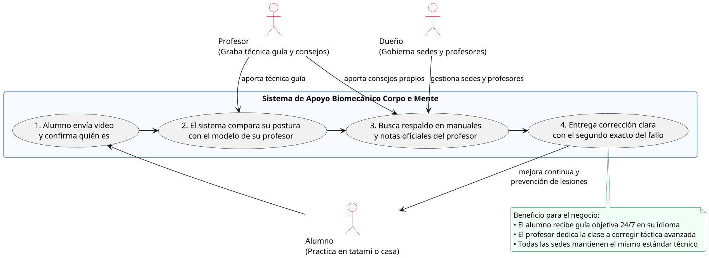

### 1.1.3. Objeto de Investigación
El objeto de estudio comprende el diseño organizativo y arquitectónico, junto con su validación mediante prototipo y estudio financiero, de un sistema inteligente de análisis postural ejecutado de manera local para evaluar técnicas de Jiu-Jitsu Brasileño frente a referencias docentes y asistir la corrección mediante documentación autorizada de la academia.

### 1.1.4. Alcance
El alcance del proyecto abarca el levantamiento de necesidades del negocio, la especificación funcional, el modelado bajo metodología ICONIX, el estudio financiero CAPEX/OPEX y ROI, y la validación experimental mediante prototipo para los tres perfiles de la red de academias **Corpo e Mente**:

* **Alumno:** Registra su membresía en su sede habitual, envía grabaciones de entrenamiento con confirmación de identidad corporal y opción de cancelar una evaluación en espera, consulta resultados comparativos (puntaje de similitud, instante crítico y fuentes citadas), revisa su historial evolutivo y accede a la biblioteca teórica institucional.
* **Profesor:** Administra el catálogo de técnicas de su disciplina, aporta grabaciones modelo de referencia y consejos prácticos por técnica, incorpora o retira manuales de estudio, supervisa el avance de los practicantes de su sede y realiza la habilitación mensual presencial mediante el modelo **Pase de Tatami**.
* **Dueño (Administrador de Marca):** Dirige de forma centralizada las sucursales de la marca con su ubicación geográfica, administra el plantel docente (alta, edición, reasignación y baja segura resguardando técnicas y manuales existentes), gestiona cuentas estudiantiles y brinda asistencia técnica supervisada.

**Delimitación pedagógica:** El sistema constituye estrictamente un asistente de práctica y estandarización formativa; en ningún caso reemplaza el criterio presencial ni la autoridad evaluativa del instructor en exámenes de cinturón o competencia.

### 1.1.5. Justificación
Desde la perspectiva pedagógica, operativa y económica, el proyecto aporta valor directo al negocio en cuatro ejes:

1. **Continuidad Formativa y Prevención de Lesiones:** Extiende la retroalimentación técnica más allá del horario de clase y alerta oportunamente sobre desviaciones articulares riesgosas.
2. **Aprovechamiento del Tiempo Docente:** Reduce la carga de correcciones básicas repetitivas en el tatami, permitiendo que el instructor enfoque la clase presencial en estrategia, ajuste fino y sparring supervisado.
3. **Estandarización Multi-Sucursal:** Consolida un acervo común de técnicas modelo y material de estudio compartido entre todas las sedes de la marca.
4. **Sostenibilidad Financiera y Resguardo de Privacidad:** Al operar en infraestructura propia de la academia, evita rentas mensuales elevadas en servicios externos y protege íntegramente las grabaciones de alumnos adultos y menores de edad.

## 1.2. Objetivos

### 1.2.1. Objetivo General
Diseñar y validar mediante prototipo un sistema web basado en Inteligencia Artificial local que permite a los alumnos de la academia "Corpo e Mente" analizar sus técnicas de Jiu-Jitsu Brasileño frente a los modelos de referencia de sus profesores, generando retroalimentación biomecánica clara, objetiva y personalizada.

### 1.2.2. Objetivos Específicos
* Analizar las necesidades operativas de la academia y especificar los requisitos y el modelo de dominio de una solución accesible desde teléfonos celulares para alumnos, instructores y dirección general.
* Diseñar e integrar un flujo de análisis del movimiento corporal que compara la ejecución del estudiante frente al modelo del profesor, ubica el segundo de mayor discrepancia e identifica las articulaciones comprometidas.
* Incorporar un mecanismo de consulta bibliográfica y redacción asistida que fundamenta cada corrección exclusivamente en manuales oficiales de la academia y consejos propios del profesor en español, portugués e inglés.
* Garantizar la viabilidad económica y de seguridad del negocio mediante aislamiento por sede, control de acceso presencial "Pase de Tatami", auditoría preventiva y análisis financiero de costos y retorno de inversión (ROI).

## 1.3. Metodología (Proceso ICONIX)
Para guiar el proyecto desde la realidad cotidiana del gimnasio hasta una solución ordenada, verificable y alineada con el negocio, el estudio adopta la **Metodología ICONIX** (Rosenberg & Stephens, 2007). A diferencia de enfoques burocráticos saturados de documentos sin vínculo operativo, ICONIX mantiene un hilo conductor directo desde las necesidades expresadas por las personas de la academia hasta la validación final del sistema, estructurado en cuatro fases de negocio:

1. **Fase 1 — Análisis de Necesidades del Negocio e Historias de Usuario:** Mediante entrevistas y observación en el tatami con el dueño, los profesores y los practicantes, el equipo de análisis releva las necesidades reales de enseñanza, administración de sedes y cobro de mensualidades. A partir de ellas se redactan las **historias de usuario**, el vocabulario propio del negocio (Modelo de Dominio) y los casos de uso iniciales que expresan qué busca lograr cada persona sin introducir aún suposiciones tecnológicas.
2. **Fase 2 — Análisis de Actores, Reglas y Robustez Operativa:** Para cada caso de uso identificado, se analiza paso a paso la intención de la persona y la respuesta observable del sistema. Se elaboran **diagramas de robustez** y **diagramas de secuencia** para validar qué fronteras de interacción, coordinadores de reglas de negocio y entidades de información intervienen en la operación diaria, asegurando que no existan vacíos ni contradicciones (por ejemplo, impedir que un alumno sin pase vigente evalúe videos o que un profesor de una sede acceda a alumnos de otra).
3. **Fase 3 — Organización Estructural del Sistema:** Una vez validadas las interacciones del negocio, se organizan de forma ordenada las responsabilidades internas mediante diagramas de clases por caso de uso y la arquitectura consolidada del sistema completo (casos de uso globales, flujo de actividad, clases, paquetes por capas y distribución física de despliegue en la academia).
4. **Fase 4 — Validación con Usuarios, Calidad y Factibilidad Económica:** Se verifica mediante un prototipo funcional que cada historia de usuario planteada en la Fase 1 opera en tiempos cómodos de clase, midiendo la exactitud de las correcciones, protegiendo la privacidad de las grabaciones y demostrando la rentabilidad financiera del proyecto frente a alternativas del mercado.

---

# Capítulo II: Descripción de la Empresa

## 2.1. Identidad y Estructura Operativa
La organización objeto de estudio es **Corpo e Mente**, marca enfocada en la formación integral en Jiu-Jitsu Brasileño. En territorio boliviano, la unidad operativa que respalda esta investigación es **Corpo e Mente Bolivia**, con sede en Santa Cruz de la Sierra.

Corpo e Mente opera bajo un esquema de infraestructura compartida dentro de **Knock Out Training Center** (Figura 2), entidad que provee las instalaciones físicas, recepción y recaudo administrativo de mensualidades sin intervenir en la dirección técnica ni metodológica del Jiu-Jitsu. La conducción académica de la sede boliviana recae en el maestro cinturón negro **Miguel Baigorria**, aval institucional del proyecto (Figura 3). Corporativamente, el rol de **Dueño** representa al propietario de la marca Corpo e Mente, responsable de expandir sucursales, habilitar profesores y velar por la unidad metodológica de la enseñanza.

*Figura 2: Logotipo oficial de Knock Out Training Center, sede física de operaciones.*  
*Figura 3: Logotipo oficial de Corpo e Mente Jiu-Jitsu.*

## 2.2. Servicios Ofrecidos
Corpo e Mente Bolivia brinda cuatro líneas principales de servicio formativo:

* **Clases Grupales:** Entrenamientos regulares organizados por nivel para el aprendizaje de fundamentos, defensa personal y acondicionamiento específico.
* **Entrenamiento para Campeonatos:** Sesiones tácticas de combate (*sparring*) orientadas a torneos departamentales, nacionales e internacionales.
* **Exámenes de Grado:** Evaluaciones presenciales formales que acreditan madurez técnica y disciplinaria para el ascenso de cinturón.
* **Organización de Torneos:** Eventos internos y abiertos dirigidos a medir el desempeño deportivo e integrar a la comunidad marcial.

## 2.3. Sistema de Grados y Progreso del Alumno

*Figura 4: Guía oficial de Cinturones en Jiu-Jitsu Brasileño: Rango, Tiempo y Significado.*

## 2.4. Flujo Operativo Actual y Problemática Detectada
En el circuito presencial cotidiano, el alumno formaliza su inscripción y pago en la recepción administrativa de la sede, presenta su comprobante al instructor e ingresa a las clases grupales. Durante la sesión, el maestro demuestra la técnica al grupo y supervisa por rotación a las parejas de entrenamiento.

Como evidencia la Figura 5, el **cuello de botella operativo** ocurre en la evaluación individualizada: al compartir el tatami con decenas de practicantes en el mismo bloque horario, el profesor no dispone de tiempo material para observar y corregir cada repetición de cada alumno ni revisar prácticas autónomas posteriores. Esta limitación de capacidad humana sustenta la incorporación del sistema propuesto como soporte continuo entre sesiones.

*Figura 5: Flujo operativo actual de la academia y punto de intervención del sistema.*

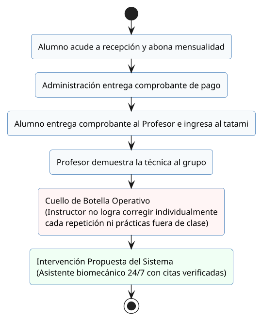

## 2.5. Organigrama de la Empresa

*Figura 6: Organigrama institucional de Corpo e Mente y relación con sucursales y aliados.*

---

# Capítulo III: Marco Teórico

El presente capítulo analiza las alternativas tecnológicas disponibles para construir el sistema propuesto. Con el fin de respaldar cada decisión de arquitectura con transparencia económica y técnica, en cada apartado se exponen **primero las opciones evaluadas junto con su comparativa de costos**, y **posteriormente la opción seleccionada**, su justificación frente a la realidad de Corpo e Mente y su impacto financiero.

## 3.1. Estimación de Pose Humana, Profundidad y Segmentación

### 3.1.1. Opciones Evaluadas y Comparativa de Costos
Para analizar posturas sobre videos grabados con teléfonos celulares en el tatami, la tecnología seleccionada identifica articulaciones corporales incluso con practicantes acostados, invertidos o en contacto cercano vistiendo kimono (*gi*). La Tabla 1 compara cuatro familias tecnológicas de visión computacional.

Tabla 1
*Opciones tecnológicas evaluadas para estimación de pose humana*

| Opción Evaluada | Velocidad Estimada | Resistencia a Oclusiones y Kimono | Desempeño en Suelo (BJJ) | Profundidad 3D Integrada | Licencia y Costo de Uso |
| :--- | :--- | :--- | :--- | :--- | :--- |
| **Google MediaPipe** | Alta (60+ FPS en CPU/WASM) | Media (pierde articulaciones con telas holgadas o cruces) | Limitada (orientada a posturas erguidas) | Parcial (estimada desde cámara única) | Gratuita (Apache 2.0) |
| **OpenPose (CMU)** | Baja (~15 FPS en GPU dedicada) | Alta en escenas despejadas | Buena, pero computacionalmente pesada | No nativa | Gratuita académica; licencia comercial costosa |
| **AlphaPose** | Media (~20 FPS en GPU) | Alta | Media | No nativa | Gratuita académica; integración compleja |
| **Ultralytics YOLOv26** | **Muy alta (~95 FPS en versión nano sobre MPS)** | **Alta en contacto estrecho y ropa deportiva** | **Alta en cualquier orientación angular** | **Sí (ecosistema pose + depth + seg)** | **Gratuita en operación local (AGPL-3.0)** |

*Nota.* Elaboración propia (2026).

### 3.1.2. Opción Seleccionada (YOLOv26), Justificación Técnica y Costos
El proyecto selecciona **Ultralytics YOLOv26** (Redmon et al., 2016; Ultralytics, 2026) por su velocidad en una sola pasada y estabilidad en posturas de combate en el suelo:

1. **Integración Pose, Profundidad y Segmentación:** Combina `YOLOv26-pose` (17 puntos anatómicos), `yolo26n-depth` (plano de profundidad Z para distinguir extremidades superpuestas) y `yolo26n-seg` como respaldo exclusivo en la separación inicial de siluetas cercanas.
2. **Criterio Empírico sobre Segmentación (`USE_SEGMENTATION=False`):** Como resume la Tabla 2, segmentar cada fotograma antes de estimar la pose reduce la velocidad **3.5 veces** a cambio de una ganancia marginal de apenas **+1.78 %** en detección simultánea; por ello, el diseño mantiene la pose directa y reserva la segmentación únicamente para el cuadro inicial cuando resulta necesario.
3. **Costo:** **\$0 USD** en tarifas por inferencia al operar con pesos descargados localmente.

Tabla 2
*Comparativa experimental entre Pose Directa y Segmentación + Pose sobre guardia cerrada (897 cuadros)*

| Métrica Evaluada | YOLOv26-Pose Directo (Seleccionado) | YOLOv26-Seg + Pose | Conclusión Técnica |
| :--- | :--- | :--- | :--- |
| **Detección simultánea de 2 atletas** | 255 cuadros (28.4 %) | 271 cuadros (30.2 %) | Mejora marginal (+1.78 %) insuficiente |
| **Cobertura total de rastreo** | 100.0 % | 100.0 % | Sin ganancia neta |
| **Confianza media del esqueleto** | **0.8006** | 0.7388 | Mayor estabilidad en pose directa |
| **Rendimiento y latencia** | **95.2 FPS (9.42 s)** | 27.1 FPS (33.10 s) | **Pose Directa es 3.5× más veloz** |

*Nota.* Elaboración propia (2026).

---

## 3.2. Infraestructura de Cómputo Acelerado para Inteligencia Artificial

### 3.2.1. Opciones Evaluadas (Apple Silicon, NVIDIA, AMD y Nube) y Comparativa de Costos
El sistema sostiene simultáneamente modelos de visión, vectorización, reordenamiento y generación textual manteniendo privacidad audiovisual y viabilidad financiera para una academia local en Santa Cruz de la Sierra. La Tabla 3 compara seis opciones de cómputo con tarifas referenciales vigentes (2025–2026).

Tabla 3
*Opciones de infraestructura de cómputo evaluadas para inferencia y costo referencial*

| Alternativa Evaluada | Memoria Disponible para IA | Costo Inicial (CAPEX) | Costo Mensual Estimado (OPEX Cloud / Eléctrico) | Portabilidad y Consumo | Compatibilidad con Stack VLM + Visión | Privacidad y Latencia de Red |
| :--- | :--- | :--- | :--- | :--- | :--- | :--- |
| **Nube Dedicada 24/7 (`AWS EC2 g4dn.xlarge` T4 16 GB)** | 16 GB VRAM dedicada | \$0 USD | **~\$384.00 USD/mes** (`\$0.526/h × 730 h`) | No aplica (remota) | Alta (CUDA estándar) | Videos salen a EE. UU.; doble carga de red |
| **Nube Dedicada Alta (`AWS EC2 g5.xlarge` A10G 24 GB)** | 24 GB VRAM dedicada | \$0 USD | **~\$734.40 USD/mes** (`\$1.006/h × 730 h`) | No aplica (remota) | Excelente (CUDA + vLLM) | Videos salen a terceros; costo elevado |
| **Google Colab (Free / Pro / Pro+)** | 15–40 GB GPU temporal | \$0 USD | Gratuito (con cortes) o **\$9.99 – \$49.99 USD/mes** | No aplica (efímera) | Solo experimental, inestable 24/7 | Desconexiones automáticas por inactividad |
| **PC Escritorio NVIDIA RTX 4090 / Laptop RTX 4060** | 8 GB VRAM (laptop) o 24 GB (torre) | ~\$1,500 USD (8 GB) o **>\$2,500 USD** (24 GB) | ~\$10–\$25 USD/mes energía | Laptop 8 GB insuficiente; torre 350–450 W fija | Excelente en torre; *Out-Of-Memory* en 8 GB | Máxima (local) |
| **AMD Radeon (ROCm)** | 8–16 GB VRAM (24 GB en gama alta) | ~\$1,200–\$2,200 USD | ~\$10–\$18 USD/mes energía | 200–350 W | Limitada en portátiles frente a MLX 4-bit | Máxima (local) |
| **Apple Silicon M5 (24 GB Memoria Unificada — UMA)** | **24 GB compartidos CPU/GPU/MLX** | **~\$1,499 USD** (base \$1,099 + 24 GB RAM) | **~\$1.50 – \$2.00 USD/mes** energía (~30 W) | **Portátil ligero (~1.2 kg) apto para sede** | **Excelente (Apple MLX 4/8 bits + PyTorch MPS)** | **Máxima (100 % local en sede)** |

*Nota.* Tarifas AWS EC2 `us-east-1` On-Demand; Google Colab según planes vigentes; energía eléctrica referencial Santa Cruz (CRE ~Bs 1.50/kWh). Elaboración propia (2026).

### 3.2.2. Opción Seleccionada (Apple Silicon M5 — MLX y MPS), Justificación y Costos
El diseño selecciona **Apple Silicon (serie M5 con 24 GB de Memoria Unificada — UMA)** ejecutando visión mediante **PyTorch MPS** y modelos multimodales mediante **Apple MLX**:

1. **Memoria Unificada frente a VRAM Limitada:** Mientras una laptop NVIDIA de 8 GB agota su VRAM al coexistir cuatro modelos y una torre RTX 4090 supera los \$2,500 USD con alto consumo eléctrico, los 24 GB unificados permiten compartir tensores entre CPU, GPU y Neural Engine con acceso directo.
2. **Estabilidad Operativa y Privacidad:** Reemplaza los cortes de sesión de Google Colab y evita la transferencia de grabaciones de alumnos hacia servidores externos.
3. **Economía Sostenible:** Sustituye pagos mensuales de **\$384 a \$734 USD** en la nube por una única inversión en equipo (~\$1,499 USD) y gasto eléctrico cercano a **\$2 USD/mes**.

---

## 3.3. Vectorización Multimodal y Reordenamiento Semántico (RAG)

### 3.3.1. Opciones Evaluadas y Comparativa de Costos
Para recuperar pasajes pertinentes desde manuales PDF, Word, texto e imágenes y contrastarlos con el instante del error corporal, la Tabla 4 compara opciones solo-texto, APIs comerciales y modelos multimodales locales.

Tabla 4
*Opciones evaluadas para vectorización multimodal y reordenamiento semántico*

| Opción Evaluada | Comprende Texto + Imagen en Mismo Vector | Reordenamiento *Cross-Encoder* | Soporte Español / Portugués / Inglés | Costo Operativo |
| :--- | :--- | :--- | :--- | :--- |
| **APIs de Embeddings + Rerank Cloud (OpenAI + Cohere)** | Parcial (pipelines separados) | Sí (pago por consulta) | Alto | Pago por token / búsqueda (requiere internet) |
| **Sentence-BERT / MiniLM + BM25 Local** | No (ignora diagramas e ilustraciones) | Reordenador básico de texto | Bueno | \$0 USD (local) |
| **Qwen3-VL-Embedding-2B + Qwen3-VL-Reranker-2B (Local MLX)** | **Sí (espacio unificado de 2048 dimensiones)** | **Sí (*Cross-Encoder* nativo)** | **Nativo en 30+ idiomas** | **\$0 USD (local en 8-bit y 4-bit)** |

*Nota.* Elaboración propia (2026).

### 3.3.2. Opción Seleccionada (Qwen3-VL-Embedding y Reranker), Justificación y Costos
El sistema adopta la pareja **Qwen3-VL-Embedding-2B (8 bits)** y **Qwen3-VL-Reranker-2B (4 bits)** (Alibaba Cloud Qwen Team, 2025) combinada con búsqueda léxica **BM25** y glosario trilingüe de BJJ (Robertson & Zaragoza, 2009; Cormack et al., 2009), filtrando evidencias bajo umbral de relevancia (`0.65`) a costo **\$0 USD** por consulta.

---

## 3.4. Almacenamiento Vectorial (Base de Datos Vectorial)

### 3.4.1. Opciones Evaluadas y Comparativa de Costos
El sistema requiere indexar y filtrar con baja latencia secuencias posturales (133 dimensiones) y fragmentos bibliográficos (2048 dimensiones). La Tabla 5 evalúa cuatro alternativas.

Tabla 5
*Opciones evaluadas para base de datos vectorial*

| Opción Evaluada | Despliegue Local / Privado | Filtrado Combinado con Metadatos (Sede / Técnica / Tipo) | Borrado Selectivo Híbrido | Costo Mensual |
| :--- | :--- | :--- | :--- | :--- |
| **Pinecone (Cloud Gestionada)** | No (exclusiva en la nube) | Sí | Sí | Gratuito muy limitado / desde **\$70+ USD/mes** |
| **ChromaDB** | Sí (Python embebido) | Básico | Limitado en múltiples colecciones | \$0 USD (Apache 2.0) |
| **pgvector (Extensión PostgreSQL)** | Sí | Sí (SQL) | Comparte carga con transacciones | \$0 USD (PostgreSQL) |
| **Qdrant (Contenedor Local en Rust)** | **Sí (Docker on-premise)** | **Sí (índices HNSW con filtros en milisegundos)** | **Sí (por técnica, patrón o manual)** | **\$0 USD (Apache 2.0)** |

*Nota.* Elaboración propia (2026).

### 3.4.2. Opción Seleccionada (Qdrant), Justificación y Costos
El sistema utiliza **Qdrant** (Malkov & Yashunin, 2018; Qdrant, 2026) con colecciones separadas para posturas (`vectores_poses_jiujitsu`) y documentación (`rag_knowledge`), garantizando filtrado preciso y borrado atómico coordinado a **\$0 USD mensuales**.

---

## 3.5. Lenguaje de Programación Principal del Backend

### 3.5.1. Opciones Evaluadas y Comparativa de Costos
El núcleo servidor unifica servicios web, procesamiento matricial de movimiento (DTW) e inferencia nativa con PyTorch MPS y Apple MLX (Tabla 6).

Tabla 6
*Opciones evaluadas para el lenguaje de programación del backend*

| Opción Evaluada | Ecosistema Nativo de IA (YOLO / PyTorch / MLX) | Facilidad de Mantenimiento | Velocidad para Cómputo Vectorial | Costo de Licencia |
| :--- | :--- | :--- | :--- | :--- |
| **Node.js (TypeScript / Express)** | Limitado (requiere puente externo en Python para IA) | Alta en web | Baja sin librerías nativas C++ | \$0 USD (MIT) |
| **Java (Spring Boot)** | Limitado para MLX y Ultralytics nativo | Media-Alta | Alta en JVM, integración IA compleja | \$0 USD (Apache 2.0) |
| **Go (Golang)** | Muy bajo en visión y LLM locales | Alta en concurrencia | Escasa en ecosistemas de visión | \$0 USD (BSD) |
| **Python 3.12** | **Total (soporte nativo Ultralytics, PyTorch MPS, MLX, OpenCV y DTW)** | **Alta** | **Alta (delegada a Metal/NumPy)** | **\$0 USD (PSF License)** |

*Nota.* Elaboración propia (2026).

### 3.5.2. Opción Seleccionada (Python 3.12), Justificación y Costos
Se selecciona **Python 3.12** al unificar servidor de negocio, cálculos biomecánicos e inferencia sin duplicar procesos entre múltiples lenguajes, con **\$0 USD** de licenciamiento.

---

## 3.6. Contenerización y Empaquetado de Servicios

### 3.6.1. Opciones Evaluadas y Comparativa de Costos
Las bases de datos relacional y vectorial requieren empaquetado reproducible libre de conflictos de dependencias (Tabla 7).

Tabla 7
*Opciones evaluadas para empaquetado y orquestación de infraestructura*

| Opción Evaluada | Aislamiento de Dependencias | Complejidad Operativa | Portabilidad entre Equipos | Costo |
| :--- | :--- | :--- | :--- | :--- |
| **Instalación Manual Nativa en Sistema Operativo** | Nulo (conflictos de puertos y librerías) | Baja al inicio, frágil al migrar | Baja | \$0 USD |
| **Máquinas Virtuales Completas (VirtualBox / VMware)** | Total | Muy alta (consume excesiva memoria) | Media | \$0 USD / Comercial |
| **Kubernetes (k3s / Minikube)** | Total | Desproporcionada para un servidor único | Alta | \$0 USD (Apache 2.0) |
| **Docker + Docker Compose** | **Alto (contenedores livianos con volúmenes persistentes)** | **Baja (arranque unificado)** | **Excelente** | **\$0 USD (uso local)** |

*Nota.* Elaboración propia (2026).

### 3.6.2. Opción Seleccionada (Docker y Docker Compose), Justificación y Costos
El proyecto emplea **Docker y Docker Compose** para gestionar de modo aislado y reproducible los contenedores de bases de datos y volúmenes persistentes a costo **\$0 USD**.

---

## 3.7. Capa de Exposición REST sobre Base de Datos

### 3.7.1. Opciones Evaluadas y Comparativa de Costos
Para ejecutar procedimientos almacenados transaccionales de negocio con aislamiento de permisos sin multiplicar código de mapeo repetitivo, la Tabla 8 evalúa tres enfoques.

Tabla 8
*Opciones evaluadas para la capa de acceso a PostgreSQL*

| Opción Evaluada | Exposición Directa de RPCs Seguros | Rendimiento | Sobrecarga de Mantenimiento | Costo |
| :--- | :--- | :--- | :--- | :--- |
| **ORM Tradicional (SQLAlchemy)** | Requiere mapeos extensos para cada tabla y RPC | Medio-Alto | Mayor código repetitivo | \$0 USD (MIT) |
| **Consultas SQL Crudas (`psycopg2`) dispersas** | Sí | Muy alto | Acoplamiento SQL en múltiples rutas | \$0 USD (LGPL) |
| **PostgREST** | **Nativa sobre procedimientos con cumplimiento de políticas RLS** | **Muy alto (binario compilado)** | **Mínima** | **\$0 USD (MIT)** |

*Nota.* Elaboración propia (2026).

### 3.7.2. Opción Seleccionada (PostgREST), Justificación y Costos
Se selecciona **PostgREST** como puente declarativo sobre procedimientos seguros almacenados (autenticación, pases, traslados y bajas con reasignación) a costo **\$0 USD**.

---

## 3.8. Framework de Aplicación Backend y Orquestación

### 3.8.1. Opciones Evaluadas y Comparativa de Costos
El servidor de aplicación valida cargas de video y manuales de hasta 100 MB, orquesta análisis en segundo plano y respeta cancelaciones en curso (Tabla 9).

Tabla 9
*Opciones evaluadas para el framework web del backend*

| Opción Evaluada | Validación Automática de Esquemas | Soporte Asíncrono y Tareas en Segundo Plano | Rendimiento HTTP | Costo |
| :--- | :--- | :--- | :--- | :--- |
| **Django + DRF** | Manual mediante Serializers | Requiere infraestructura externa (Celery) | Medio | \$0 USD (BSD) |
| **Flask** | Requiere librerías adicionales | Síncrono por defecto | Medio | \$0 USD (BSD) |
| **FastAPI (Python ASGI)** | **Nativa con Pydantic v2 y OpenAPI** | **Nativo (`async`/`await` + `BackgroundTasks`)** | **Muy alto** | **\$0 USD (MIT)** |

*Nota.* Elaboración propia (2026).

### 3.8.2. Opción Seleccionada (FastAPI), Justificación y Costos
Se selecciona **FastAPI** por su validación estricta de entradas, concurrencia asíncrona y compatibilidad directa con el ecosistema Python de visión y lenguaje, a costo **\$0 USD**.

---

## 3.9. Sistema Gestor de Base de Datos Relacional y Aislamiento Multi-Sede

### 3.9.1. Opciones Evaluadas y Comparativa de Costos
El directorio de usuarios, sucursales, catálogo técnico, evaluaciones históricas y vigencia de membresías exige integridad referencial normalizada en Tercera Forma Normal (Mannino, 2018) y control de acceso estricto por sede (Tabla 10).

Tabla 10
*Opciones evaluadas para base de datos relacional*

| Opción Evaluada | Integridad ACID y 3NF | Seguridad por Fila (*Row Level Security*) | Cifrado Nativo (`bcrypt`) | Costo |
| :--- | :--- | :--- | :--- | :--- |
| **SQLite** | Limitada en concurrencia múltiple | No | No | \$0 USD |
| **MySQL / MariaDB** | Sí | Limitada | Requiere lógica externa | \$0 USD (GPL) |
| **MongoDB (NoSQL)** | No relacional | No nativa | No nativa | \$0 USD / Pago Atlas |
| **PostgreSQL 16** | **Total (ACID + RPC PL/pgSQL)** | **Nativa (`CREATE POLICY` RLS)** | **Nativa (`pgcrypto`)** | **\$0 USD (PostgreSQL License)** |

*Nota.* Elaboración propia (2026).

### 3.9.2. Opción Seleccionada (PostgreSQL 16 con RLS), Justificación y Costos
Se selecciona **PostgreSQL 16** con políticas **Row Level Security (RLS)** y extensión `pgcrypto`, asegurando consistencia transaccional y protección de contraseñas a costo **\$0 USD**.

---

## 3.10. Tecnología de Interfaz Web Responsiva (*Mobile-First*)

### 3.10.1. Opciones Evaluadas y Comparativa de Costos
Los practicantes utilizan el sistema principalmente desde sus teléfonos celulares sin pasar por procesos de aprobación o comisiones de tiendas móviles cerradas (Tabla 11).

Tabla 11
*Opciones evaluadas para la interfaz de usuario*

| Opción Evaluada | Acceso Inmediato sin Tiendas | Adaptabilidad Móvil y Escritorio | Reproducción Sincronizada de Video | Costo de Distribución |
| :--- | :--- | :--- | :--- | :--- |
| **Aplicación Móvil Nativa (iOS Swift / Android Kotlin)** | No (exige aprobación y cuentas de desarrollador) | Muy alta, pero doble código base | Alta | **\$99 USD/año (Apple) + \$25 USD (Google)** |
| **HTML/JS Tradicional sin Componentes** | Sí | Mantenibilidad limitada | Compleja | \$0 USD |
| **React 19 + Vite (Web SPA *Mobile-First*)** | **Sí (acceso por navegador HTTPS)** | **Muy alta (código único adaptable)** | **Excelente (reproductores y proxy integrado)** | **\$0 USD (MIT)** |

*Nota.* Elaboración propia (2026).

### 3.10.2. Opción Seleccionada (React 19 + Vite), Justificación y Costos
Se selecciona **React 19 + Vite** (Meta Open Source, 2026; Vite, 2026) por brindar acceso universal desde cualquier navegador celular o de escritorio con costo de distribución **\$0 USD**.

---

## 3.11. Geolocalización y Cartografía de Sucursales

### 3.11.1. Opciones Evaluadas y Comparativa de Costos
Para gestionar las sedes geográficas de Corpo e Mente sin incurrir en cobros por visualización de mapas, la Tabla 12 evalúa tres proveedores cartográficos.

Tabla 12
*Opciones evaluadas para mapas y geocodificación inversa*

| Opción Evaluada | Mapa Interactivo en Navegador | Geocodificación Inversa | Exige Facturación / Tarjeta | Costo |
| :--- | :--- | :--- | :--- | :--- |
| **Google Maps Platform API** | Excelente | Excelente | **Sí (desde la activación)** | Crédito limitado; luego **pago por cada 1,000 cargas** |
| **Mapbox** | Muy bueno | Bueno | Sí tras cuota gratuita | Freemium / Pago por uso |
| **Leaflet.js + OpenStreetMap (Nominatim)** | **Excelente y liviano** | **Gratuita** | **No** | **\$0 USD (BSD-2-Clause / ODbL)** |

*Nota.* Elaboración propia (2026).

### 3.11.2. Opción Seleccionada (Leaflet.js + OpenStreetMap/Nominatim), Justificación y Costos
Se selecciona **Leaflet.js** combinado con **OpenStreetMap / Nominatim** (OpenStreetMap Foundation, 2026) para registrar y ubicar sucursales sin costos recurrentes (**\$0 USD**).

---

## 3.12. Marco de Aseguramiento de Calidad y Pruebas Automatizadas

### 3.12.1. Opciones Evaluadas y Comparativa de Costos
Las reglas financieras, de seguridad multi-sede y de consistencia biomecánica requieren validación reproducible automatizada (Tabla 13).

Tabla 13
*Opciones evaluadas para automatización de pruebas*

| Opción Evaluada | Integración con Python / FastAPI | Aislamiento con Mocks | Verificación Visual en Navegador | Costo |
| :--- | :--- | :--- | :--- | :--- |
| **`unittest` estándar** | Media (sintaxis extensa) | Media | No | \$0 USD |
| **Selenium WebDriver** | Media | No aplica a lógica servidor | Sí (configuración más pesada) | \$0 USD (Apache 2.0) |
| **Pytest + TestClient + Playwright** | **Excelente (fixtures modulares)** | **Excelente** | **Sí (multi-resolución)** | **\$0 USD (MIT / Apache 2.0)** |

*Nota.* Elaboración propia (2026).

### 3.12.2. Opción Seleccionada (Pytest y Verificación Web E2E), Justificación y Costos
Se selecciona **Pytest** junto con **Playwright** para validar reglas de negocio, seguridad de endpoints y diseño responsivo a costo **\$0 USD**.

---

## 3.13. Fundamentos Conceptuales de Inteligencia Artificial y RAG
Para sustentar conceptualmente el funcionamiento pedagógico del sistema, el proyecto establece dos definiciones clave:

1. **Visión por Computadora e Inteligencia Artificial:** Disciplina orientada a interpretar automáticamente secuencias visuales, localizando articulaciones corporales cuadro a cuadro para cuantificar similitudes de movimiento sin sesgo subjetivo (Russell & Norvig, 2021).
2. **Generación Aumentada por Recuperación (RAG):** Patrón que obliga al modelo lingüístico a responder fundamentado exclusivamente en pasajes reales de los manuales y consejos docentes de la academia (Lewis et al., 2020), evitando invenciones (*alucinaciones*).

---

## 3.14. Motor de Inferencia Generativa Multimodal y Control contra Alucinaciones

### 3.14.1. Opciones Evaluadas y Comparativa de Costos
Ante ejecuciones por debajo del umbral de dominio (`85.0 %`), el sistema redacta recomendaciones claras apoyadas en la imagen crítica del fallo y fuentes verificadas. La Tabla 14 contrasta APIs comerciales externas frente a modelos locales.

Tabla 14
*Opciones evaluadas para el motor generativo multimodal*

| Opción Evaluada | Ejecución | Privacidad de Imágenes de Alumnos | Costo Referencial por Uso | Capacidad Visual + Control de Fidelidad |
| :--- | :--- | :--- | :--- | :--- |
| **OpenAI GPT-4o (API Cloud)** | Nube externa | Baja (imágenes salen a terceros) | **\$2.50 entrada / \$10.00 salida por 1M tokens** | Alta multimodalidad; sujeta a internet y facturación |
| **Google Gemini 2.5 Flash (API Cloud)** | Nube externa | Baja (imágenes salen a terceros) | **\$0.30 entrada / \$2.50 salida por 1M tokens** | Alta multimodalidad; sujeta a cuotas y privacidad |
| **Llama 3 Solo Texto (Local)** | Local | Total | \$0 USD | No interpreta visualmente el cuadro del error |
| **Qwen3-VL-Instruct-4B (4 bits en Apple MLX)** | **100 % Local** | **Total (privacidad absoluta en sede)** | **\$0 USD** | **Procesa texto + fotograma crítico + Juez de Fidelidad (`>= 0.85`)** |

*Nota.* Tarifas API públicas vigentes (2025–2026). Elaboración propia (2026).

### 3.14.2. Opción Seleccionada (Qwen3-VL-Instruct-4B), Justificación, Jerarquía RAG y Costos
Se selecciona **Qwen3-VL-4B-Instruct (4 bits en Apple MLX)** gobernado por una **jerarquía estricta anti-alucinaciones** (Figura 7):

1. **Reconocimiento Directo (`Similitud >= 85.0 %`):** Emite felicitación determinística sin invocar generación libre.
2. **Prioridad 1 — Manuales Específicos o Biblioteca Global (`relevancia >= 0.65`):** Fundamenta la corrección en bibliografía autorizada (`📚`).
3. **Prioridad 2 — Nota Práctica del Profesor:** Si ningún manual supera el umbral, prioriza el consejo escrito por el instructor (`🥋`).
4. **Prioridad 3 — Respaldo Cuantitativo Seguro y Juez de Fidelidad:** Si falta sustento documental o si la auditoría de fidelidad cae por debajo de `0.85`, omite cualquier texto generativo y entrega únicamente las métricas objetivas.
5. **Costo:** **\$0 USD** por consulta.

*Figura 7: Flujo de decisión pedagógica y jerarquía de fuentes verificadas RAG.*

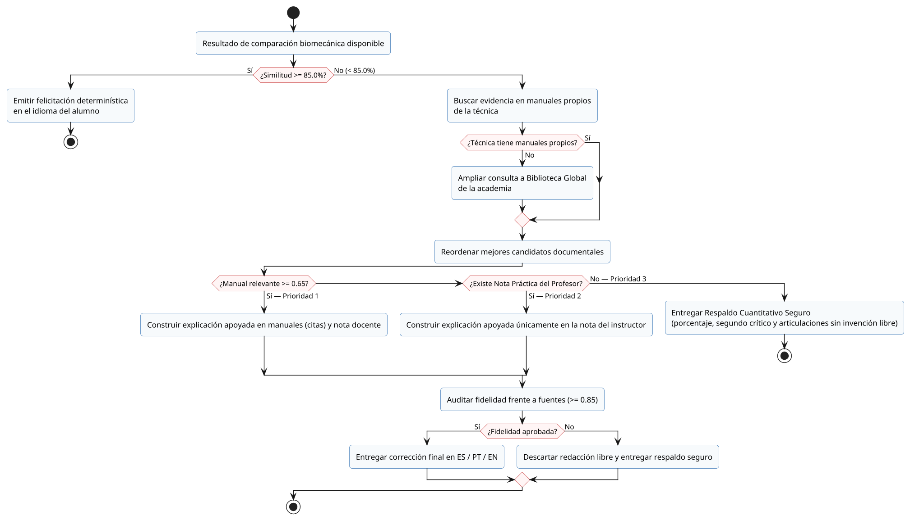

---

## 3.15. Publicación Segura y Acceso Remoto sin Apertura de Puertos

### 3.15.1. Opciones Evaluadas y Comparativa de Costos
Para que los alumnos accedan remotamente desde sus celulares superando redes CGNAT locales en Bolivia sin abrir puertos en el enrutador de la academia, la Tabla 15 analiza cuatro alternativas.

Tabla 15
*Opciones evaluadas para publicación remota hacia dispositivos móviles*

| Opción Evaluada | Exige Abrir Puertos en Router | Cifrado HTTPS Automático | Fricción para el Alumno | Costo |
| :--- | :--- | :--- | :--- | :--- |
| **Apertura de Puertos + IP Pública Fija** | Sí (alto riesgo y bloqueado por CGNAT) | Gestión manual de certificados | Baja | Pago mensual de IP fija al ISP |
| **VPN Tradicional / Tailscale** | No | Sí | Alta (exige instalar app VPN) | Gratuito limitado / Pago por usuario |
| **Ngrok** | No | Sí | Baja | Gratuito restringido / Pago mensual |
| **Cloudflare Tunnel (`cloudflared`)** | **No (túnel saliente Zero Trust)** | **Sí (TLS automático)** | **Nula (acceso directo HTTPS, límite 100 MB)** | **\$0 USD (plan gratuito)** |

*Nota.* Elaboración propia (2026).

### 3.15.2. Opción Seleccionada (Cloudflare Tunnel), Justificación y Costos
Se selecciona **Cloudflare Tunnel** (Cloudflare Inc., 2026) por brindar acceso cifrado directo sin exponer puertos físicos ni exigir configuraciones al estudiante, a costo **\$0 USD**.

---

## 3.16. Modelo de Control de Acceso y Suscripción Presencial

### 3.16.1. Opciones Evaluadas y Comparativa de Costos
Dado que en Santa Cruz de la Sierra los practicantes pagan sus mensualidades en recepción mediante efectivo o QR local sin tarjetas internacionales, la Tabla 16 evalúa cuatro modelos de habilitación.

Tabla 16
*Opciones evaluadas para control de acceso y suscripción académica*

| Opción Evaluada | Compatible con Efectivo y QR Local | Comisiones Financieras | Bloqueo Automático tras Vencimiento | Integración con Evaluación IA |
| :--- | :--- | :--- | :--- | :--- |
| **Pasarela Internacional (Stripe / PayPal)** | No | **3.5 % a 5.0 % por cobro** | Sí | Compleja |
| **Acceso Abierto sin Vigencia** | No aplica | 0 % | No (riesgo de abuso de cómputo) | Nula |
| **Planilla Física Independiente** | Sí | 0 % | No conectada al sistema | Nula |
| **Modelo "Pase de Tatami" (30 días presenciales)** | **Sí** | **0 %** | **Sí (expiración automática al día 30)** | **Total (habilitación vinculada al pago en sede)** |

*Nota.* Elaboración propia (2026).

### 3.16.2. Opción Seleccionada ("Pase de Tatami"), Justificación y Costos
El sistema adopta el modelo **"Pase de Tatami"** (Figura 8): todo alumno nuevo inicia en estado **`pendiente`**, pasa a **`activo`** durante **30 días calendario** al confirmarse su pago presencial en sede, y transiciona a **`expirado`** al vencer el periodo hasta su renovación mensual, operando con **0 % de comisiones**.

*Figura 8: Ciclo de estados de negocio del modelo "Pase de Tatami".*

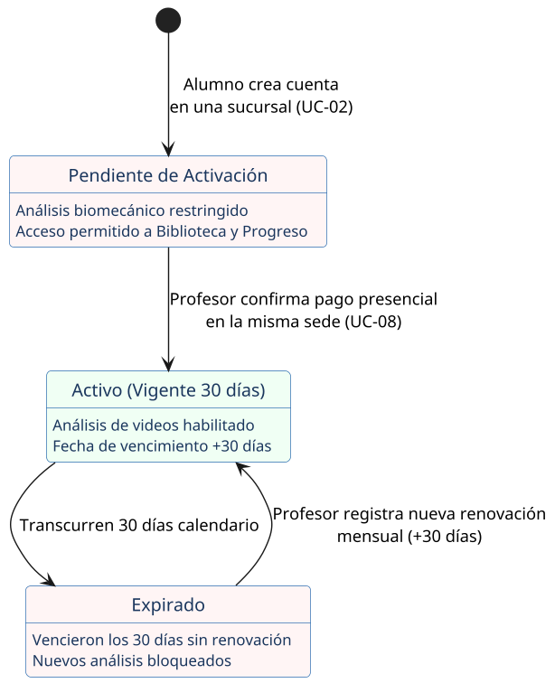

---

# Capítulo IV: Especificación de Requisitos de Software (IEEE 830)

## 4.1. Introducción
Este capítulo formaliza la Especificación de Requisitos de Software (ERS) bajo la estructura estándar IEEE 830 (IEEE, 1998), expresando las reglas y capacidades exigidas desde la perspectiva del negocio y de los usuarios de **Corpo e Mente**.

### 4.1.1. Propósito
Establecer sin ambigüedades qué hace el sistema y bajo qué condiciones de calidad, seguridad e integridad operativa, sirviendo como base directa para el análisis de casos de uso y modelado ICONIX del Capítulo V.

### 4.1.2. Alcance
El sistema web propuesto cubre la evaluación postural comparativa de técnicas de Jiu-Jitsu Brasileño ejecutada localmente, la generación de correcciones fundamentadas en manuales y notas del instructor, el seguimiento de progreso por sede, la administración comercial presencial mediante **Pase de Tatami** y el gobierno corporativo multi-sucursal del cuerpo docente y estudiantil.

### 4.1.3. Definiciones, Acrónimos y Abreviaturas
* **ICONIX:** Metodología de análisis y diseño orientada a casos de uso centrada en el negocio y en diagramas de robustez, secuencia, clases y estructura del sistema.
* **RAG:** Generación Aumentada por Recuperación; mecanismo que obliga a respaldar cada recomendación en documentos o notas verificadas.
* **Pase de Tatami:** Habilitación presencial válida por 30 días calendario que autoriza al alumno a realizar análisis técnicos tras abonar su mensualidad en sede.

### 4.1.4. Referencias
* IEEE Std 830-1998. *IEEE Recommended Practice for Software Requirements Specifications*.
* Rosenberg, D., & Stephens, M. (2007). *Use Case Driven Object Modeling with UML: Theory and Practice* (ICONIX Process). Apress.
* Mannino, M. V. (2018). *Database Design, Application Development, and Administration* (7th ed.). McGraw-Hill Education.

### 4.1.5. Visión General
La Sección 4.2 describe los actores y restricciones generales del entorno; la Sección 4.3 especifica los requisitos funcionales y no funcionales verificables; la Sección 4.4 enlaza dichos requisitos con los diez casos de uso; y la Sección 4.5 define el Modelo de Dominio en vocabulario de la academia.

## 4.2. Descripción General

### 4.2.1. Perspectiva del Producto y Funciones Principales
El sistema opera como una aplicación web independiente hospedada en el equipamiento local de la academia. Sus funciones de negocio se organizan en cuatro áreas: (1) identificación segura por rol y sede; (2) evaluación postural comparativa con cancelación voluntaria y retroalimentación verificada; (3) gestión de catálogo técnico, videos patrón, manuales de estudio y notas docentes; y (4) control de membresías presenciales, administración de profesores, administración de sucursales y soporte técnico asistido.

### 4.2.2. Características de los Usuarios
* **Alumno:** Practicante inscrito en una sede que consulta bibliografía, envía videos de práctica, confirma su silueta en la escena y revisa sus evaluaciones e historial.
* **Profesor:** Instructor acreditado encargado de registrar técnicas modelo y consejos prácticos, aportar manuales, dar seguimiento a los alumnos de su sede y habilitar sus Pases de Tatami.
* **Dueño (Administrador de Marca):** Propietario de Corpo e Mente responsable de dirigir sucursales, registrar y administrar profesores, gestionar la biblioteca global compartida y brindar asistencia técnica.

### 4.2.3. Restricciones y Suposiciones Operativas
* Todo procesamiento inteligente opera en la estación local de la academia dentro de 24 GB de Memoria Unificada, con licencias de software abiertas (`\$0 USD`) y límite de transmisión remota de 100 MB por carga.
* Se asume iluminación adecuada y visibilidad corporal suficiente en las grabaciones, además de disponibilidad eléctrica y de red local durante el horario de atención.

## 4.3. Requisitos Específicos

### 4.3.1. Requisitos Funcionales (RF)

**Identidad y Gobierno de Cuentas**
* **RF-01 (Acceso Seguro):** El sistema permite el ingreso mediante identificador o correo y contraseña, protegiendo las cuentas frente a intentos fallidos reiterados desde un mismo origen.
* **RF-02 (Auto-Registro Estudiantil):** El registro público crea exclusivamente cuentas con rol de **Alumno** vinculadas a una sucursal oficial e inicializa su Pase de Tatami en estado pendiente, bloqueando cualquier intento externo de asignarse privilegios de Profesor o Administrador.
* **RF-03 (Gobierno de Plantel Docente, Cuentas y Soporte):** Todo usuario autenticado actualiza sus datos personales e idioma preferido sin alterar la vigencia de su pase. El Dueño crea, modifica y da de baja cuentas de profesores, traslada la sede actual de un usuario preservando intacta la sede histórica de sus evaluaciones pasadas, elimina cuentas impidiendo su auto-eliminación y exigiendo reasignación previa cuando un profesor posee técnicas o manuales vinculados, y asume temporalmente la sesión de otro usuario para soporte mostrando un indicador permanente de sesión asistida.

**Catálogo Técnico y Acervo Bibliográfico**
* **RF-04 (Gestión de Técnicas):** Profesores y Dueño crean, editan y eliminan técnicas del catálogo oficial; toda baja limpia integralmente tanto el registro técnico como sus referencias biomecánicas y documentales asociadas.
* **RF-05 (Videos de Referencia):** El registro de un video modelo exige que el instructor confirme qué persona de la escena ejecuta la técnica y cuenta con respaldo persistente automático para no perder referencias tras reinicios operativos.
* **RF-06 (Manuales y Notas Prácticas):** Profesores y Dueño redactan consejos prácticos propios por técnica e incorporan o eliminan manuales multiformato (PDF, Word, texto o imagen), habilitando búsquedas por tema a toda la comunidad académica y asegurando limpieza completa al retirar material obsoleto.

**Análisis Biomecánico y Retroalimentación**
* **RF-07 (Control de Vigencia Comercial):** El sistema restringe la solicitud de evaluaciones biomecánicas únicamente a alumnos con Pase de Tatami activo, quienes seleccionan previamente a su instructor y la técnica evaluada.
* **RF-08 (Recepción y Cancelación Voluntaria):** El sistema acepta grabaciones de entrenamiento estándar y permite al alumno cancelar un análisis mientras se encuentra en espera o proceso, anulando el registro y eliminando el archivo temporal.
* **RF-09 (Validación de Dominio Marcial):** Antes de iniciar el cálculo postural, el sistema verifica automáticamente que el video corresponde efectivamente a una práctica de Jiu-Jitsu Brasileño.
* **RF-10 (Identificación Corporal y Comparación Temporal):** El alumno confirma cuál silueta corresponde a su cuerpo en el fotograma inicial para que el sistema alinee su secuencia postural frente al patrón oficial del profesor.
* **RF-11 (Métricas del Fallo):** El análisis determina el porcentaje global de similitud (0 a 100 %), ubica el segundo exacto de mayor desviación e identifica las articulaciones comprometidas.
* **RF-12 (Retroalimentación Verificada y Multilingüe):** Si la similitud es igual o superior al 85 %, el sistema felicita al alumno en su idioma; si es inferior, aplica estrictamente la jerarquía de fuentes (Manual pertinente > Nota práctica del profesor > Respaldo numérico seguro), audita que no existan afirmaciones inventadas y diferencia citas de manuales y consejos del profesor.

**Progreso Académico, Membresías y Sucursales**
* **RF-13 (Seguimiento por Sede):** El Profesor consulta únicamente el historial de los alumnos de su propia sede, mientras cada Alumno consulta su propia evolución cronológica y comparativa.
* **RF-14 (Habilitación Pase de Tatami):** El Profesor o Dueño habilita el acceso de un alumno de su misma sede por 30 días calendario tras verificar su pago presencial, caducando automáticamente al vencer dicho plazo.
* **RF-15 (Administración Territorial de Sucursales):** El Dueño crea, ubica cartográficamente (mediante mapa interactivo o enlace de ubicación), edita y elimina sucursales siempre que no mantengan usuarios vinculados.

### 4.3.2. Requisitos No Funcionales (RNF)
* **RNF-01 (Agilidad de Interfaz):** La carga inicial del sistema en navegador finaliza en menos de 2 segundos bajo condiciones normales de red.
* **RNF-02 (Oportunidad del Diagnóstico):** El análisis completo de una ejecución técnica concluye en un máximo de 30 segundos para resultar utilizable durante o inmediatamente después de la clase.
* **RNF-03 (Privacidad Audiovisual Absoluta):** Ninguna grabación o fotograma de alumnos sale hacia servidores de Inteligencia Artificial externos a la academia.
* **RNF-04 (Protección de Credenciales y Accesos):** Las contraseñas se almacenan cifradas de forma irreversible y toda comunicación remota transita cifrada, protegiendo las rutas de acceso contra fuerza bruta y accesos entre sedes no autorizadas.
* **RNF-05 (Accesibilidad Móvil y Multilingüismo):** El sistema opera con enfoque *Mobile-First* sin desbordamiento horizontal en celulares, tabletas o computadoras, conservando la preferencia idiomática (`es`, `pt`, `en`) en toda la experiencia y terminología anatómica.
* **RNF-06 (Mantenibilidad y Continuidad):** La estructura interna permanece modularmente desacoplada por capas y cuenta con rutinas de respaldo persistente de videos modelo y pruebas automatizadas reproducibles.

### 4.3.3. Requisitos de Interfaz y Datos
* **Interfaz de Usuario y Comunicaciones:** Navegación adaptativa de alto contraste con reproductores comparativos sincronizados al segundo crítico, consulta directa de citas y publicación segura sin apertura de puertos físicos.
* **Integridad de Datos:** Toda información transaccional (cuentas, sedes, pases, catálogo y evaluaciones) se mantiene normalizada en Tercera Forma Normal, segregando los repositorios vectoriales de posturas y documentos con referencias consistentes y almacenamiento persistente de archivos multimedia.

## 4.4. Identificación de Casos de Uso y Trazabilidad
Siguiendo la Fase 1 de **ICONIX**, los requisitos funcionales se consolidan en diez casos de uso expresados desde la intención del actor de negocio (Tabla 17).

Tabla 17
*Matriz de Trazabilidad (Requisitos, Intenciones de Negocio y Casos de Uso)*

| Nro | Intención del Actor de Negocio | #Req | #CU | Descripción del Caso de Uso |
| :--- | :--- | :--- | :--- | :--- |
| **1** | Como Alumno, Profesor o Dueño, necesita autenticarse con sus credenciales para acceder a las funciones de su rol y sede. | RF-01 | UC-01 | **Iniciar Sesión:** Verifica límites de seguridad, valida credenciales y habilita el entorno según rol, sucursal e idioma. |
| **2** | Como nuevo practicante, necesita registrar su cuenta de Alumno vinculada a una sucursal para incorporarse al sistema. | RF-02 | UC-02 | **Crear Cuenta de Alumno:** Valida el formato de identidad, restringe el auto-registro al rol alumno e inicializa la activación en estado pendiente. |
| **3** | Como Alumno habilitado, necesita someter un video de práctica, confirmar su identidad en escena (o cancelar si es necesario) y obtener la evaluación comparativa. | RF-07 a RF-11 | UC-03 | **Analizar Técnica:** Valida vigencia del Pase de Tatami y contenido marcial, confirma al atleta evaluado, compara posturas frente al patrón y habilita cancelación voluntaria. |
| **4** | Como Alumno, necesita conocer su porcentaje de acierto, ubicar el instante exacto de su falla y recibir una corrección fundamentada en fuentes oficiales. | RF-12 | UC-04 | **Generar Feedback Biomecánico:** Aplica jerarquía de fuentes verificadas (Manual > Nota del Profesor > Respaldo Numérico), audita fidelidad y presenta citas consultables. |
| **5** | Como Profesor o Dueño, necesita administrar el catálogo de técnicas y sus videos patrón con respaldo seguro para evaluar a los practicantes. | RF-04, RF-05 | UC-05 | **Gestionar Técnicas y Videos de Referencia:** Administra el catálogo, registra la ejecución oficial del instructor, resguarda el video y limpia referencias al eliminar. |
| **6** | Como Profesor o Dueño, necesita incorporar o depurar manuales de estudio y registrar consejos prácticos por técnica; y como usuario consultar la biblioteca. | RF-06 | UC-06 | **Gestionar Manuales de Estudio y Notas del Profesor:** Incorpora documentos multiformato, registra notas técnicas del instructor, habilita búsquedas y depura manuales obsoletos. |
| **7** | Como Profesor o Alumno, necesita consultar el historial evolutivo de evaluaciones junto con sus registros comparativos. | RF-13 | UC-07 | **Ver Progreso de Alumnos:** Presenta al instructor los avances de su sede y al alumno su evolución cronológica personal. |
| **8** | Como Profesor o Dueño, necesita habilitar por 30 días el acceso de un alumno tras verificar su pago presencial en academia. | RF-14 | UC-08 | **Activar Pase de Tatami:** Identifica alumnos pendientes o expirados de la sucursal y renueva su vigencia por 30 días calendario. |
| **9** | Como Dueño de la marca, necesita registrar, actualizar o dar de baja sucursales ubicándolas geográficamente. | RF-15 | UC-09 | **Gestionar Sucursales y Coordenadas:** Registra sedes con ubicación geográfica y dirección, impidiendo bajas si poseen usuarios vinculados. |
| **10** | Como Dueño, necesita gestionar cuentas de profesores y alumnos (crear, modificar, cambiar sede, eliminar con reasignación o asistir en soporte); y como usuario mantener su perfil. | RF-03 | UC-10 | **Soporte Técnico y Administración de Cuentas:** Contempla creación/edición de profesores, asistencia delegada trazable, traslado de sucursal y baja segura con reasignación de activos docentes. |

*Nota.* Elaboración propia (2026).

## 4.5. Modelo de Dominio
El Modelo de Dominio expresa, en el lenguaje propio de **Corpo e Mente**, las entidades del negocio y sus relaciones estructurales previas al diseño técnico (Figura 9 y Tabla 18).

*Figura 9: Diagrama de Modelo de Dominio del Sistema (Metodología ICONIX).*

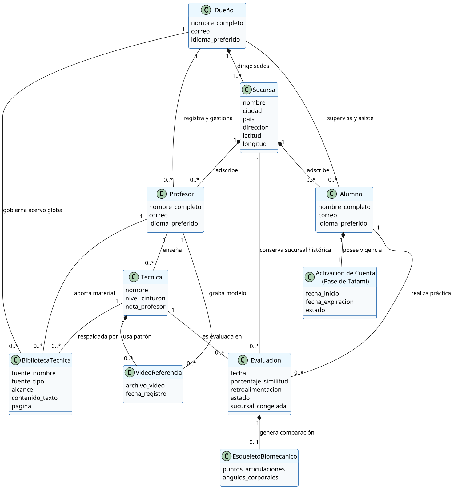

Tabla 18
*Descripción de Conceptos y Relaciones del Modelo de Dominio*

| Concepto del Dominio | Significado en el Negocio (Academia Corpo e Mente) | Relaciones Clave |
| :--- | :--- | :--- |
| **Dueño** | Propietario y director general de la marca Corpo e Mente. | Dirige `1..*` sucursales; registra y supervisa profesores y alumnos; gobierna la biblioteca global y brinda soporte técnico. |
| **Sucursal** | Sede física o filial perteneciente a la marca Corpo e Mente (por ejemplo, Santa Cruz Central). | Pertenece al Dueño; adscribe a profesores y alumnos; conserva el registro histórico de dónde se efectuó cada evaluación. |
| **Profesor** | Instructor certificado adscrito a una sucursal. | Enseña técnicas, graba sus videos patrón de referencia, aporta manuales o notas técnicas, supervisa alumnos de su sede y habilita pases. |
| **Alumno** | Practicante inscrito en una sucursal que entrena y somete ejecuciones a evaluación. | Posee una única `Activación de Cuenta` renovable y realiza múltiples evaluaciones técnicas. |
| **Activación de Cuenta** | Habilitación presencial de acceso por 30 días calendario tras verificar el pago del alumno en recepción (*Pase de Tatami*). | Pertenece exactamente a un alumno (`pendiente`, `activo` o `expirado`). |
| **Técnica** | Movimiento oficial de Jiu-Jitsu Brasileño del catálogo institucional, con grado de cinturón y nota práctica del profesor. | Enseñada por un profesor; compuesta por videos patrón de referencia; respaldada por documentos de biblioteca; objeto de evaluaciones. |
| **VideoReferencia** | Ejecución modelo grabada por el profesor que funge como patrón oficial de comparación biomecánica. | Pertenece a una técnica y es aportada por un profesor. |
| **BibliotecaTecnica** | Acervo teórico de la academia integrado por manuales multiformato, imágenes y notas de instructores. | Aportada por profesores o por el Dueño (alcance por técnica o Biblioteca Global). |
| **Evaluación** | Práctica en video aportada por un alumno y contrastada frente al patrón oficial, conservando la sede histórica donde se realizó. | Ejecutada por un alumno sobre una técnica en una sucursal específica. |
| **EsqueletoBiomecanico** | Representación postural tridimensional de articulaciones y ángulos corporales extraídos de la evaluación. | Composición generada durante la evaluación para cuantificar similitud y localizar desviaciones articulares. |

*Nota.* Elaboración propia (2026).

---

# Capítulo V: Análisis y Diseño Orientado a Objetos (Metodología ICONIX)

El presente capítulo desarrolla el análisis y diseño orientado a objetos del sistema aplicando la **Metodología ICONIX** (Rosenberg & Stephens, 2007). Cada uno de los diez casos de uso identificados en el Capítulo IV (`UC-01` a `UC-10`) se documenta mediante cinco artefactos trazables desde la intención del negocio hasta su estructura de diseño, modelados íntegramente en **PlantUML**:

1. **Especificación del Caso de Uso (Estilo Esencial, Caja Negra, Tercera Persona y Tiempo Presente):** Describe en lenguaje de negocio *qué* busca lograr el actor y *cómo* responde observablemente el sistema, manteniendo fuera del relato detalles de interfaz visual, código o bases de datos.
2. **Diagrama de Caso de Uso:** Delimita los actores participantes y las metas funcionales del módulo.
3. **Diagrama de Robustez (Análisis Actor – Frontera – Control – Entidad):** Identifica los participantes que colaboran en cada caso de uso manteniendo las reglas de interacción de ICONIX.
4. **Diagrama de Secuencia:** Modela paso a paso la interacción cronológica entre actor, frontera, coordinadores y entidades del negocio.
5. **Diagrama de Clases:** Formaliza las clases participantes y sus relaciones estructurales para soportar la capacidad funcional.

Finalmente, la Sección **5.11** consolida los cinco diagramas globales del sistema completo (Casos de Uso, Actividad, Clases, Paquetes y Despliegue).

---

## 5.1. Caso de Uso 1: Iniciar Sesión (UC-01)

### 5.1.1. Caso de Uso 1: Iniciar Sesión (UC-01) — Especificación
| Campo | Especificación |
| :--- | :--- |
| **Identificador** | **UC-01** |
| **Nombre** | Iniciar Sesión |
| **Actores** | **Principal:** Alumno, Profesor, Dueño (Administrador). |
| **Intención del Actor** | El Usuario accede de manera segura a su cuenta personal para disponer de las capacidades correspondientes a su rol y sucursal dentro de la academia. |
| **Precondiciones** | El Usuario posee una cuenta previamente registrada en la academia. |
| **Postcondiciones** | 1. El Sistema habilita la sesión asociada al rol, la sucursal, el idioma elegido y el estado de membresía del usuario.<br>2. El Usuario accede al espacio operativo asignado a su perfil. |

#### Curso Normal
| Intención del Actor | Respuesta del Sistema |
| :--- | :--- |
| **1.** El Usuario suministra sus credenciales personales y solicita ingresar a su cuenta. | **2.** El Sistema verifica que el solicitante no excede el límite reciente de intentos fallidos de acceso. |
| **3.** El Usuario aguarda la validación de su identidad institucional. | **4.** El Sistema comprueba la validez de las credenciales y recupera el rol, la sucursal asignada, el idioma preferido y la vigencia del Pase de Tatami. |
| **5.** El Usuario ingresa a su espacio de trabajo en la academia. | **6.** El Sistema establece la sesión activa, adapta el contenido al idioma elegido y habilita las funciones autorizadas para ese perfil. |

#### Cursos Alternativos
* **2a. Límite de intentos fallidos excedido:** El Sistema bloquea temporalmente nuevos intentos de ingreso para proteger la cuenta frente a accesos no autorizados.
* **4a. Credenciales incorrectas o cuenta inexistente:** El Sistema deniega el acceso mediante un aviso unificado que evita revelar si la discrepancia corresponde al usuario o a la clave.

#### Excepciones
* **E1. Servicio de autenticación momentáneamente no disponible:** El Sistema informa que no resulta posible validar el acceso y mantiene al usuario sin sesión activa.

---

### 5.1.2. Diagrama de Caso de Uso UC-01

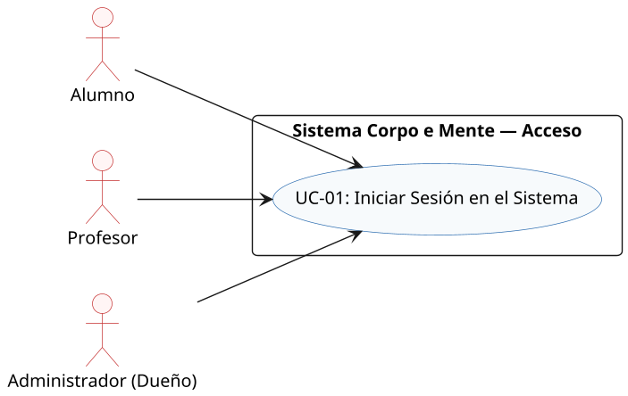

---

### 5.1.3. Diagrama de Robustez UC-01

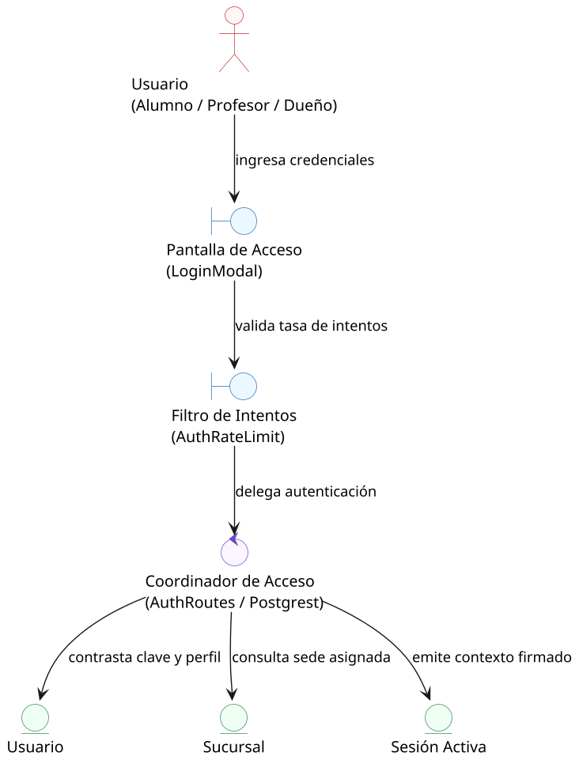

---

### 5.1.4. Diagrama de Secuencia UC-01

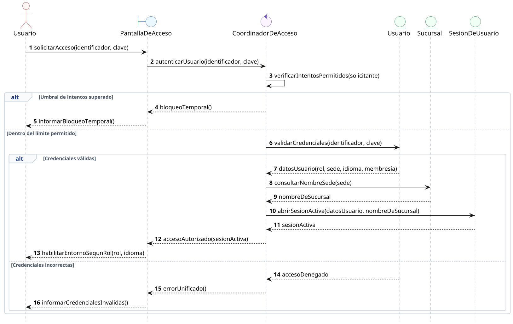

---

### 5.1.5. Diagrama de Clases UC-01

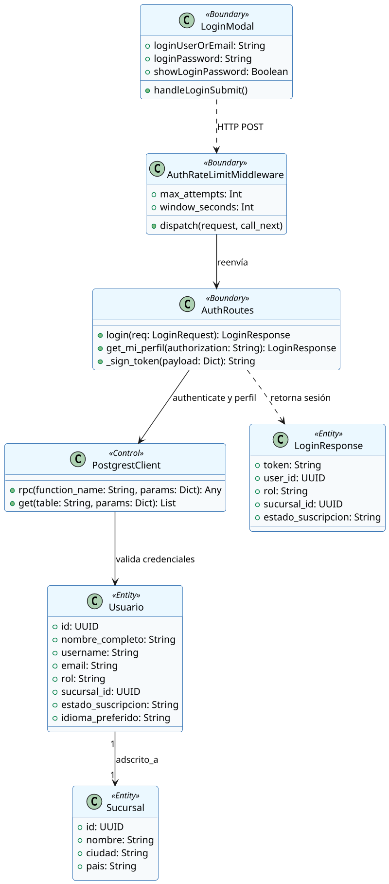

---

## 5.2. Caso de Uso 2: Crear Cuenta de Alumno (UC-02)

### 5.2.1. Caso de Uso 2: Crear Cuenta de Alumno (UC-02) — Especificación
| Campo | Especificación |
| :--- | :--- |
| **Identificador** | **UC-02** |
| **Nombre** | Crear Cuenta de Alumno |
| **Actores** | **Principal:** Nuevo Practicante (Alumno). |
| **Intención del Actor** | El Nuevo Practicante registra su cuenta personal vinculada a la sede donde entrena para incorporarse a la academia. |
| **Precondiciones** | 1. El solicitante carece de una cuenta previa con el mismo identificador.<br>2. Existe al menos una sucursal oficial activa dentro de la academia. |
| **Postcondiciones** | 1. El Sistema registra la cuenta exclusivamente con el perfil de Alumno adscrito a la sede elegida.<br>2. El Pase de Tatami inicia en estado pendiente hasta que el profesor confirma el pago presencial.<br>3. El Alumno accede a sus consultas iniciales bajo restricción temporal de evaluación en video. |

#### Curso Normal
| Intención del Actor | Respuesta del Sistema |
| :--- | :--- |
| **1.** El Nuevo Practicante manifiesta su intención de registrarse como estudiante de la academia. | **2.** El Sistema presenta la lista oficial de sucursales disponibles para su adscripción. |
| **3.** El Nuevo Practicante aporta su nombre completo, identificador deseado, clave personal y sucursal elegida. | **4.** El Sistema valida el formato del identificador, asigna estrictamente el rol de Alumno y comprueba que no existe un registro duplicado. |
| **5.** El Nuevo Practicante confirma su incorporación inicial. | **6.** El Sistema registra la nueva cuenta resguardando la clave, inicializa el Pase de Tatami en estado pendiente e inicia su sesión informando la espera de habilitación presencial. |

#### Cursos Alternativos
* **4a. Identificador con formato inválido:** El Sistema solicita corregir el identificador conforme a las reglas válidas antes de continuar.
* **4b. Solicitud pública con rol distinto al de Alumno:** El Sistema rechaza el registro e informa que las cuentas de instructores y dirección se asignan únicamente por vía administrativa.
* **4c. Identificador ya ocupado por otro usuario:** El Sistema notifica la duplicidad existente e invita a iniciar sesión o elegir otro identificador.

#### Excepciones
* **E1. Ausencia de sucursales activas o fallo de comunicación:** El Sistema cancela la operación sin crear cuentas incompletas e informa la incidencia.

---

### 5.2.2. Diagrama de Caso de Uso UC-02

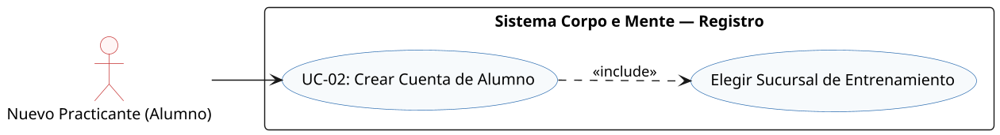

---

### 5.2.3. Diagrama de Robustez UC-02

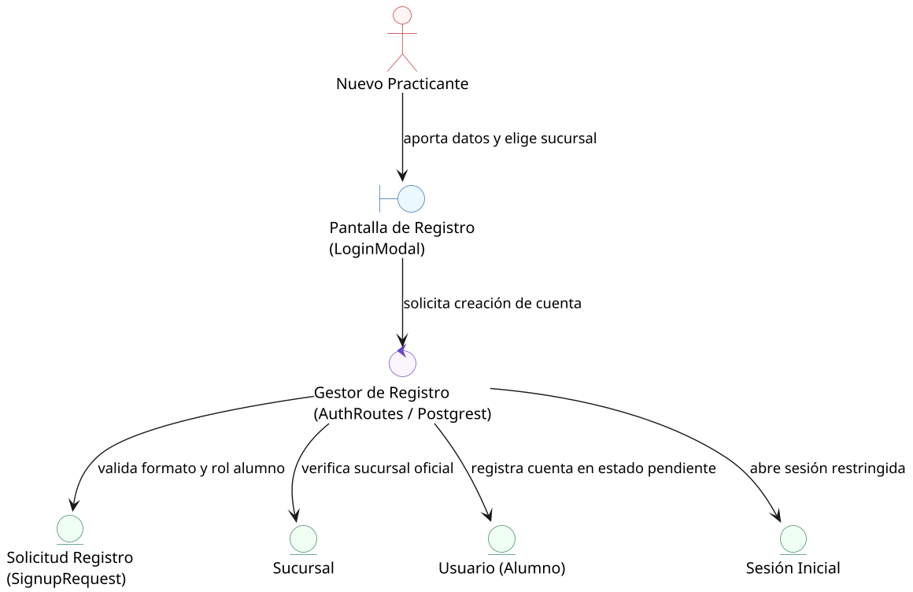

---

### 5.2.4. Diagrama de Secuencia UC-02

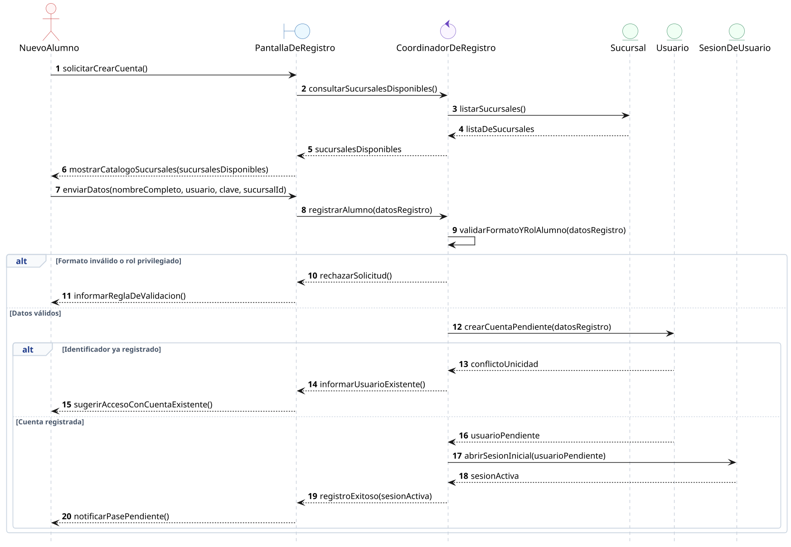

---

### 5.2.5. Diagrama de Clases UC-02

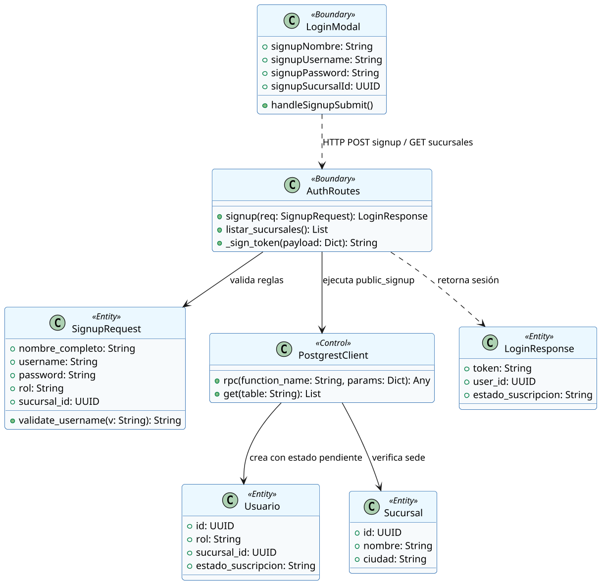

---

## 5.3. Caso de Uso 3: Analizar Técnica (UC-03)

### 5.3.1. Caso de Uso 3: Analizar Técnica (UC-03) — Especificación
| Campo | Especificación |
| :--- | :--- |
| **Identificador** | **UC-03** |
| **Nombre** | Analizar Técnica |
| **Actores** | **Principal:** Alumno. |
| **Intención del Actor** | El Alumno somete una grabación de su práctica de Jiu-Jitsu para compararla con la ejecución modelo de su profesor, confirma su identidad corporal en escena (o cancela el proceso si desiste) y obtiene el diagnóstico de desempeño. |
| **Precondiciones** | 1. El Alumno mantiene su sesión iniciada y su Pase de Tatami activo y vigente.<br>2. La técnica elegida cuenta con una ejecución patrón registrada por el instructor. |
| **Postcondiciones** | 1. El Sistema guarda la evaluación en el historial del alumno conservando su sucursal actual.<br>2. El Sistema determina el puntaje global de similitud, el segundo crítico de desviación y las zonas corporales afectadas, dando paso a **UC-04**.<br>3. Si el Alumno cancela durante la espera, el Sistema anula el registro y elimina la grabación temporal. |

#### Curso Normal
| Intención del Actor | Respuesta del Sistema |
| :--- | :--- |
| **1.** El Alumno designa a su profesor, elige la técnica practicada y aporta su video de entrenamiento. | **2.** El Sistema comprueba la vigencia del Pase de Tatami y verifica que el contenido corresponde a una práctica real de Jiu-Jitsu. |
| **3.** El Alumno necesita confirmar qué persona de la toma representa su propio cuerpo. | **4.** El Sistema depura las siluetas detectadas en la escena inicial y presenta las opciones disponibles al practicante. |
| **5.** El Alumno confirma su silueta corporal y autoriza la evaluación (conservando la facultad de cancelar). | **6.** El Sistema registra la evaluación en curso fijando la sucursal actual, habilita la interrupción voluntaria y realiza el seguimiento postural del alumno a lo largo del video. |
| **7.** El Alumno espera la comparación técnica frente al criterio oficial de su profesor. | **8.** El Sistema alinea temporalmente la ejecución con el patrón docente, calcula el porcentaje de similitud junto con el instante de mayor falla y da paso a **UC-04**. |

#### Cursos Alternativos
* **2a. Pase de Tatami pendiente o vencido:** El Sistema impide la evaluación e informa al alumno que requiere habilitar o renovar su pase presencialmente en sede.
* **2b. Grabación ajena al Jiu-Jitsu o archivo inválido:** El Sistema rechaza el envío antes de analizarlo y solicita una grabación válida de entrenamiento.
* **6a. El Alumno cancela la evaluación en curso:** Ante la solicitud de cancelación, el Sistema interrumpe de inmediato el análisis en proceso, marca el intento como cancelado y elimina el archivo temporal.

#### Excepciones
* **E1. Técnica sin ejecución patrón del profesor:** El Sistema informa que el instructor aún no registra un modelo oficial para esa técnica.
* **E2. Visibilidad insuficiente del cuerpo del alumno:** El Sistema detiene la comparación y sugiere grabar desde un ángulo donde el movimiento resulte observable.

---

### 5.3.2. Diagrama de Caso de Uso UC-03

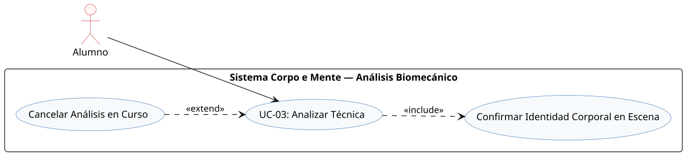

---

### 5.3.3. Diagrama de Robustez UC-03

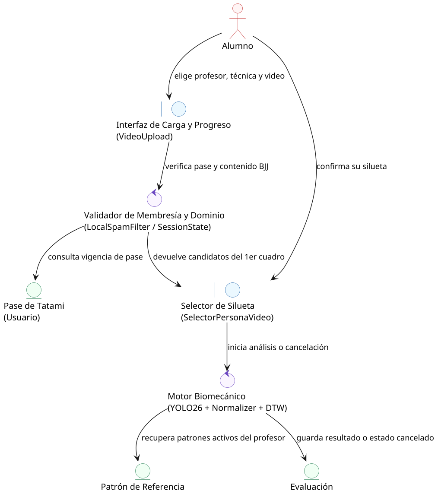

---

### 5.3.4. Diagrama de Secuencia UC-03

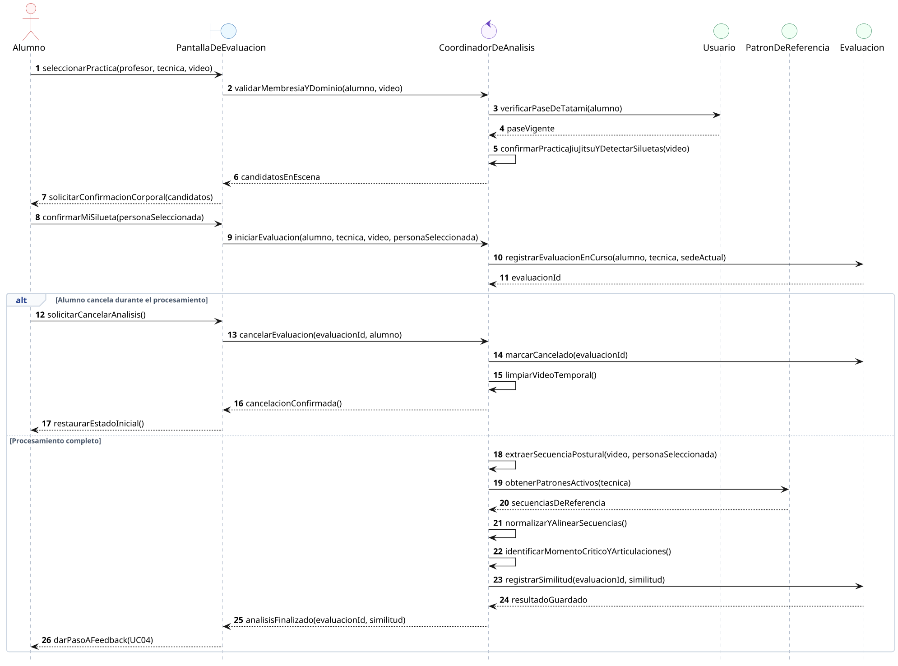

---

### 5.3.5. Diagrama de Clases UC-03

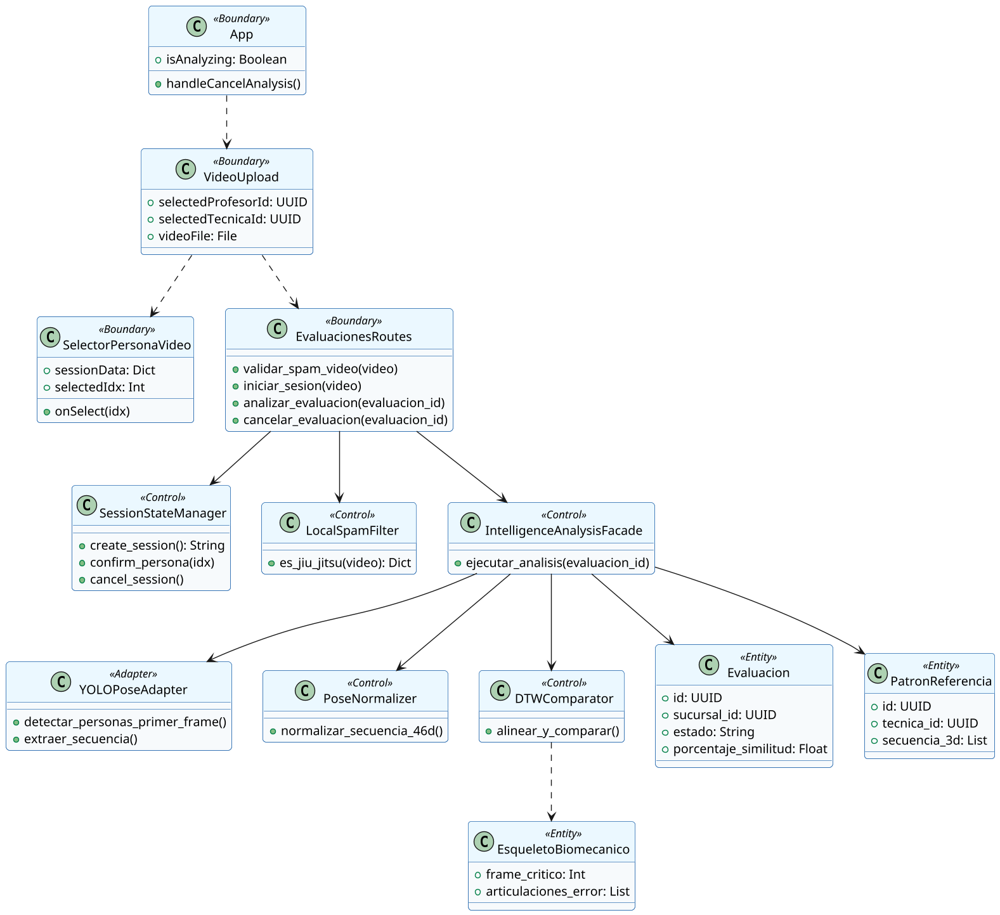

---

## 5.4. Caso de Uso 4: Generar Feedback Biomecánico (UC-04)

### 5.4.1. Caso de Uso 4: Generar Feedback Biomecánico (UC-04) — Especificación
| Campo | Especificación |
| :--- | :--- |
| **Identificador** | **UC-04** |
| **Nombre** | Generar Feedback Biomecánico |
| **Actores** | **Principal:** Alumno. |
| **Intención del Actor** | El Alumno comprende de manera visual qué tan fiel resulta su técnica frente a la de su profesor, ubica el segundo exacto del fallo, identifica la articulación afectada y consulta consejos confiables en su idioma respaldados por fuentes oficiales. |
| **Precondiciones** | 1. La evaluación comparativa de **UC-03** finaliza satisfactoriamente.<br>2. El Alumno tiene configurado su idioma preferido (español, portugués o inglés). |
| **Postcondiciones** | 1. El Sistema consolida el reporte final con el porcentaje de similitud, la marca temporal del error, el cuadro anotado y la recomendación en el idioma del usuario.<br>2. Ante similitudes mejorables, toda explicación proviene estrictamente de manuales autorizados o notas del profesor, evitando invenciones. |

#### Curso Normal
| Intención del Actor | Respuesta del Sistema |
| :--- | :--- |
| **1.** El Alumno solicita revisar el resultado al concluir su evaluación técnica. | **2.** El Sistema verifica si la ejecución alcanza el umbral de dominio satisfactorio (85 %). |
| **3.** El Alumno requiere corrección específica cuando su desempeño resulta menor al estándar esperado. | **4.** El Sistema consulta primero los manuales asociados a la técnica y, en su defecto, amplía la búsqueda al acervo general de la academia. |
| **5.** El Alumno espera una recomendación fiel al criterio técnico oficial sin inventos. | **6.** El Sistema prioriza pasajes pertinentes de manuales, luego la nota práctica del instructor y, si faltan ambos, prepara un resumen numérico seguro. |
| **7.** El Alumno revisa visualmente el error y las recomendaciones en su idioma. | **8.** El Sistema verifica la fidelidad del consejo, resalta las articulaciones críticas sobre el fotograma del fallo y presenta la comparativa sincronizada con citas diferenciadas. |
| **9.** El Alumno inspecciona el segundo exacto del fallo y profundiza en sus fuentes. | **10.** El Sistema ubica la reproducción comparativa en el instante crítico y presenta las referencias de manuales oficiales y notas docentes consultables. |

#### Cursos Alternativos
* **2a. Desempeño satisfactorio (similitud igual o mayor al 85 %):** El Sistema felicita directamente al alumno en su idioma destacando su correcta ejecución.
* **6a. Ausencia de manuales pertinentes y de nota del profesor:** El Sistema entrega el puntaje, el segundo crítico y las articulaciones comprometidas aclarando que falta material teórico asociado.
* **8a. Explicación observada por falta de respaldo fiel:** Si el consejo elaborado incluye afirmaciones no comprobables en las fuentes, el Sistema lo descarta y muestra únicamente la nota literal del profesor o el resumen numérico seguro.

#### Excepciones
* **E1. Grabación modelo momentáneamente ausente:** El Sistema intenta recuperar la copia de respaldo y, si persiste la ausencia, entrega igualmente las métricas objetivas y el fotograma crítico del alumno.

---

### 5.4.2. Diagrama de Caso de Uso UC-04

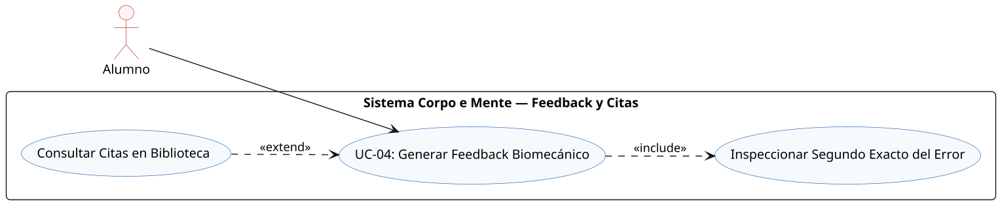

---

### 5.4.3. Diagrama de Robustez UC-04

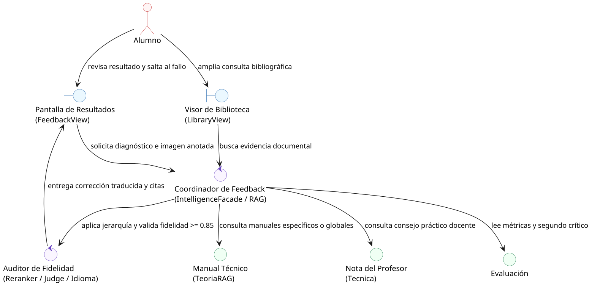

---

### 5.4.4. Diagrama de Secuencia UC-04

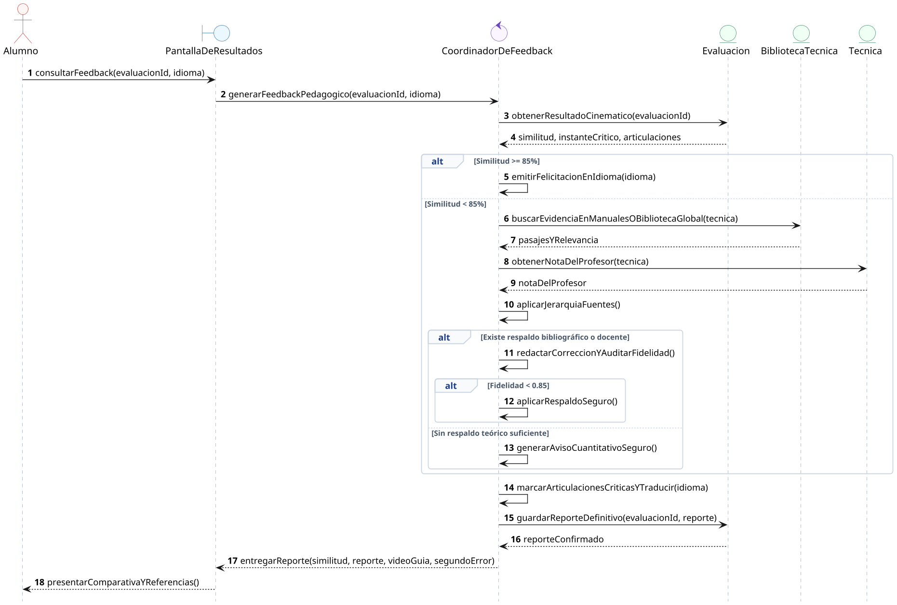

---

### 5.4.5. Diagrama de Clases UC-04

```plantuml
@startuml
skinparam shadowing false
skinparam dpi 135
skinparam defaultFontName Arial
skinparam roundcorner 8
skinparam classBackgroundColor #F7FAFC
skinparam classBorderColor #2B6CB0
skinparam classHeaderBackgroundColor #EBF8FF
class FeedbackView <<Boundary>> {
  +evaluacion: AnalisisResultDTO
  +saltarAlSegundoError(ts)
}
class LibraryView <<Boundary>> {
  +query: String
  +resultados: List
}
class EvaluacionesRoutes <<Boundary>> {
  +consultar_evaluacion(id): AnalisisResultDTO
  +buscar_en_biblioteca(query): Dict
}
class IntelligenceAnalysisFacade <<Control>> {
  +generar_feedback()
}
class MultimodalRAGService <<Control>> {
  +aplicar_jerarquia_contexto()
}
class HybridRetriever <<Control>> {
  +buscar_bm25_y_densa()
}
class GlossaryService <<Control>> {
  +expandir_query_bjj()
}
interface IPromptStrategy <<Interface>> {
  +construir_prompt()
  +mensaje_respaldo()
}
class Qwen3VLRerankerCrossEncoder <<Adapter>> {
  +rerank(query, docs)
}
class LocalVLMAdapter <<Adapter>> {
  +generar_texto_feedback()
  +evaluar_fidelidad_grounding()
}
class Evaluacion <<Entity>> {
  +porcentaje_similitud: Float
  +feedback_gemini_es: String
}
class TeoriaRAG <<Entity>> {
  +fuente_tipo: String
  +fuente_nombre: String
}
class AnalisisResultDTO <<Entity>> {
  +similitud: Float
  +timestamp_error_segundos: Float
  +frame_critico_path: String
}
FeedbackView ..> EvaluacionesRoutes
LibraryView ..> EvaluacionesRoutes
EvaluacionesRoutes --> IntelligenceAnalysisFacade
IntelligenceAnalysisFacade --> MultimodalRAGService
MultimodalRAGService --> HybridRetriever
HybridRetriever --> GlossaryService
IntelligenceAnalysisFacade --> Qwen3VLRerankerCrossEncoder
IntelligenceAnalysisFacade --> IPromptStrategy
IntelligenceAnalysisFacade --> LocalVLMAdapter
MultimodalRAGService ..> TeoriaRAG
IntelligenceAnalysisFacade --> Evaluacion
EvaluacionesRoutes ..> AnalisisResultDTO
@enduml
```

---

## 5.5. Caso de Uso 5: Gestionar Técnicas y Videos de Referencia (UC-05)

### 5.5.1. Caso de Uso 5: Gestionar Técnicas y Videos de Referencia (UC-05) — Especificación
| Campo | Especificación |
| :--- | :--- |
| **Identificador** | **UC-05** |
| **Nombre** | Gestionar Técnicas y Videos de Referencia |
| **Actores** | **Principal:** Profesor, Dueño (Administrador). |
| **Intención del Actor** | El Profesor o Dueño administra el catálogo oficial de técnicas de Jiu-Jitsu de la academia y registra la grabación modelo señalando quién es el instructor ejecutante para evaluar a los alumnos. |
| **Precondiciones** | El actor mantiene su sesión autenticada con perfil de Profesor o Dueño. |
| **Postcondiciones** | 1. El Sistema registra o actualiza la técnica junto con su patrón postural oficial y conserva una copia resguardada del video modelo.<br>2. Al eliminar una técnica del catálogo, el Sistema retira integralmente tanto la ficha como sus patrones y referencias asociadas. |

#### Curso Normal
| Intención del Actor | Respuesta del Sistema |
| :--- | :--- |
| **1.** El Profesor o Dueño aporta los datos de una técnica (nombre, cinturón e indicaciones opcionales) junto con un video modelo. | **2.** El Sistema analiza la escena inicial del video demostrativo e identifica a las personas presentes en el tatami. |
| **3.** El Profesor o Dueño designa qué persona de la escena corresponde al instructor ejecutante. | **4.** El Sistema verifica que la postura del instructor resulta suficientemente visible, registra la técnica y genera el patrón de referencia. |
| **5.** El Profesor o Dueño confirma la publicación de la técnica para prácticas estudiantiles. | **6.** El Sistema resguarda de forma persistente el video demostrativo y habilita la técnica en el catálogo evaluable. |
| **7.** El Profesor o Dueño actualiza datos descriptivos o retira una técnica obsoleta del catálogo. | **8.** El Sistema conserva el patrón vigente cuando solo cambian textos o cinturón, o elimina de manera integral la técnica y todo su material vinculado cuando se solicita su baja. |

#### Cursos Alternativos
* **4a. Visibilidad insuficiente del instructor en la grabación:** El Sistema rechaza el registro e invita a aportar un video con encuadre completo más nítido.

#### Excepciones
* **E1. Extravío de archivos temporales tras reinicios:** El Sistema restaura automáticamente las grabaciones demostrativas desde su respaldo persistente para mantener la continuidad de las evaluaciones.

---

### 5.5.2. Diagrama de Caso de Uso UC-05

```plantuml
@startuml
skinparam shadowing false
skinparam dpi 135
skinparam defaultFontName Arial
skinparam roundcorner 8
left to right direction
skinparam actorBackgroundColor #FFF5F5
skinparam actorBorderColor #C53030
skinparam usecaseBackgroundColor #F7FAFC
skinparam usecaseBorderColor #2B6CB0
actor "Profesor" as PR
actor "Administrador (Dueño)" as AD
rectangle "Sistema Corpo e Mente — Catálogo Técnico" {
  usecase "UC-05: Gestionar Técnicas y Videos de Referencia" as UC05
  usecase "Registrar o Editar Técnica" as UC05A
  usecase "Grabar Video Patrón e Identificar Instructor" as UC05V
  usecase "Eliminar Técnica del Catálogo" as UC05D
}
PR --> UC05
AD --> UC05
UC05 ..> UC05A : <<include>>
UC05V ..> UC05 : <<extend>>
UC05D ..> UC05 : <<extend>>
@enduml
```

---

### 5.5.3. Diagrama de Robustez UC-05

```plantuml
@startuml
skinparam shadowing false
skinparam dpi 135
skinparam defaultFontName Arial
skinparam roundcorner 8
top to bottom direction
skinparam actorBackgroundColor #FFF5F5
skinparam actorBorderColor #C53030
skinparam boundaryBackgroundColor #EBF8FF
skinparam boundaryBorderColor #2B6CB0
skinparam controlBackgroundColor #FAF5FF
skinparam controlBorderColor #6B46C1
skinparam entityBackgroundColor #F0FFF4
skinparam entityBorderColor #2F855A
actor "Profesor / Dueño" as PR
boundary "Gestión de Técnicas\n(ProfesorTecnicas)" as B1
boundary "Selector de Instructor\n(SelectorPersonaVideo)" as B2
control "Coordinador de Catálogo\n(TecnicasRoutes / VideoStorage)" as C1
control "Extractor de Patrón\n(YOLOPose / VectorAdapter)" as C2
entity "Técnica" as E1
entity "Patrón de Referencia" as E2

PR --> B1 : crea, edita o elimina técnica
B1 --> C1 : procesa metadatos y video guía
C1 --> B2 : muestra siluetas en primer cuadro
PR --> B2 : designa al instructor ejecutante
B2 --> C2 : extrae postura y verifica visibilidad >= 40%
C2 --> E2 : almacena patrón vectorial y copia persistente
C1 --> E1 : actualiza catálogo o purga técnica completa
@enduml
```

---

### 5.5.4. Diagrama de Secuencia UC-05

```plantuml
@startuml
skinparam shadowing false
skinparam dpi 135
skinparam defaultFontName Arial
skinparam roundcorner 8
hide footbox
autonumber
skinparam actorBackgroundColor #FFF5F5
skinparam actorBorderColor #C53030
skinparam boundaryBackgroundColor #EBF8FF
skinparam boundaryBorderColor #2B6CB0
skinparam controlBackgroundColor #FAF5FF
skinparam controlBorderColor #6B46C1
skinparam entityBackgroundColor #F0FFF4
skinparam entityBorderColor #2F855A
skinparam SequenceGroupBorderThickness 1
skinparam SequenceGroupBorderColor #CBD5E1
skinparam SequenceGroupBackgroundColor #F8FAFC
skinparam SequenceGroupHeaderFontColor #1E3A8A
skinparam SequenceGroupFontColor #475569
skinparam SequenceLifeLineBorderColor #94A3B8
actor Profesor as PR
boundary "PantallaCatalogoTecnico" as B1
control "CoordinadorDeTecnicas" as C1
entity "Tecnica" as E1
entity "PatronDeReferencia" as E2

alt Registrar o actualizar técnica con video guía
  PR -> B1 : aportarDatosYVideo(nombre, cinturon, nota, video)
  B1 -> C1 : identificarSiluetasIniciales(video)
  C1 --> B1 : siluetasDetectadas
  B1 --> PR : solicitarSeleccionInstructor(siluetas)
  PR -> B1 : confirmarInstructor(personaSeleccionada)
  B1 -> C1 : consolidarTecnicaYPatron(datos, video, personaSeleccionada)
  C1 -> E1 : guardarTecnica(nombre, cinturon, nota)
  E1 --> C1 : tecnicaId
  C1 -> C1 : extraerSecuenciaYRespaldarVideo()
  C1 -> E2 : activarPatronDeReferencia(tecnicaId, secuencia, video)
  E2 --> C1 : patronActivo
  C1 --> B1 : confirmacionRegistro()
  B1 --> PR : confirmarTecnicaDisponible()
else Eliminar técnica del catálogo
  PR -> B1 : solicitarBajaTecnica(tecnicaId)
  B1 -> C1 : purgarTecnicaCompleta(tecnicaId)
  C1 -> E2 : limpiarPatronesYTeoriaAsociada(tecnicaId)
  C1 -> E1 : eliminarTecnica(tecnicaId)
  E1 --> C1 : bajaConfirmada
  C1 --> B1 : catalogoActualizado()
  B1 --> PR : confirmarEliminacion()
end
@enduml
```

---

### 5.5.5. Diagrama de Clases UC-05

```plantuml
@startuml
skinparam shadowing false
skinparam dpi 135
skinparam defaultFontName Arial
skinparam roundcorner 8
skinparam classBackgroundColor #F7FAFC
skinparam classBorderColor #2B6CB0
skinparam classHeaderBackgroundColor #EBF8FF
class ProfesorTecnicas <<Boundary>> {
  +tecnicas: List
  +handleSave()
  +handleConfirmPersona()
  +handleDelete(id)
}
class SelectorPersonaVideo <<Boundary>> {
  +sessionData: Dict
  +onSelect(idx)
}
class TecnicasRoutes <<Boundary>> {
  +crear_tecnica()
  +actualizar_tecnica()
  +eliminar_tecnica()
  +registrar_patron_tecnica()
}
class VideoStorage <<Control>> {
  +persistir_video_referencia()
  +autocurar_videos_referencia_en_arranque()
}
class PostgrestClient <<Control>> {
  +rpc(function_name, params)
}
class YOLOPoseAdapter <<Adapter>> {
  +extraer_secuencia()
}
class QdrantVectorAdapter <<Adapter>> {
  +guardar_patron_secuencia()
  +eliminar_por_tecnica()
}
class QdrantRAGAdapter <<Adapter>> {
  +eliminar_por_tecnica()
}
class Tecnica <<Entity>> {
  +id: UUID
  +nombre: String
  +nivel_cinturon: String
  +mensaje_profesor: String
}
class PatronReferencia <<Entity>> {
  +id: UUID
  +tecnica_id: UUID
  +url_video: String
}
ProfesorTecnicas ..> SelectorPersonaVideo
ProfesorTecnicas ..> TecnicasRoutes
TecnicasRoutes --> VideoStorage
TecnicasRoutes --> YOLOPoseAdapter
TecnicasRoutes --> QdrantVectorAdapter
TecnicasRoutes --> QdrantRAGAdapter
TecnicasRoutes --> PostgrestClient
PostgrestClient --> Tecnica
QdrantVectorAdapter --> PatronReferencia
@enduml
```

---

## 5.6. Caso de Uso 6: Gestionar Manuales de Estudio y Notas del Profesor (UC-06)

### 5.6.1. Caso de Uso 6: Gestionar Manuales de Estudio y Notas del Profesor (UC-06) — Especificación
| Campo | Especificación |
| :--- | :--- |
| **Identificador** | **UC-06** |
| **Nombre** | Gestionar Manuales de Estudio y Notas del Profesor |
| **Actores** | **Principal:** Profesor, Dueño (gestión); Alumno (consulta de Biblioteca). |
| **Intención del Actor** | El Profesor o Dueño incorpora manuales de estudio, registra consejos prácticos propios por técnica y depura material obsoleto, mientras los usuarios consultan la Biblioteca Técnica con citas verificables. |
| **Precondiciones** | El actor mantiene sesión autenticada; la creación o retiro de material teórico corresponde exclusivamente a Profesores o Dueño. |
| **Postcondiciones** | 1. El Sistema incorpora el manual por contenido textual e imágenes para consulta y respaldo en análisis.<br>2. La nota práctica del profesor queda registrada como fuente prioritaria de su técnica.<br>3. Al eliminar un manual, el Sistema retira íntegramente sus registros y archivos para evitar citas obsoletas. |

#### Curso Normal
| Intención del Actor | Respuesta del Sistema |
| :--- | :--- |
| **1.** El Profesor o Dueño elige aportar conocimiento en la Biblioteca Global o en una técnica particular. | **2.** El Sistema expone el espacio para consignar notas prácticas docentes, incorporar manuales nuevos y revisar el inventario vigente. |
| **3.** El Profesor o Dueño redacta un consejo técnico directo o envía un documento de estudio con su título identificador. | **4.** El Sistema guarda la nota docente o procesa gradualmente el manual informando su avance y permitiendo cancelar la carga si el actor desiste. |
| **5.** El Usuario autenticado formula consultas o explora documentos dentro de la Biblioteca Técnica. | **6.** El Sistema entrega explicaciones respaldadas con citas diferenciadas entre manuales oficiales y notas de instructores, habilitando la revisión del documento fuente. |
| **7.** El Profesor o Dueño solicita retirar un manual desactualizado del repositorio. | **8.** El Sistema suprime de forma coordinada el catálogo, los fragmentos indexados y el archivo físico del manual retirado. |

#### Cursos Alternativos
* **4a. Documento incompatible, sin contenido legible o excedido en tamaño:** El Sistema rechaza la incorporación informando claramente los requisitos admitidos.
* **8a. Un Alumno intenta agregar o eliminar material teórico:** El Sistema deniega la operación restringiéndola al cuerpo docente y directivo.

#### Excepciones
* **E1. Cancelación voluntaria durante la carga de un manual:** El Sistema detiene el seguimiento de la carga solicitada y conserva íntegro el repositorio previo.

---

### 5.6.2. Diagrama de Caso de Uso UC-06

```plantuml
@startuml
skinparam shadowing false
skinparam dpi 135
skinparam defaultFontName Arial
skinparam roundcorner 8
left to right direction
skinparam actorBackgroundColor #FFF5F5
skinparam actorBorderColor #C53030
skinparam usecaseBackgroundColor #F7FAFC
skinparam usecaseBorderColor #2B6CB0
actor "Profesor" as PR
actor "Administrador (Dueño)" as AD
actor "Alumno" as AL
rectangle "Sistema Corpo e Mente — Biblioteca y Conocimiento" {
  usecase "UC-06: Gestionar Manuales y Notas del Profesor" as UC06
  usecase "Incorporar Manual de Estudio" as UC06U
  usecase "Registrar Nota Práctica Docente" as UC06M
  usecase "Retirar Manual Obsoleto" as UC06D
  usecase "Consultar Biblioteca Técnica" as UC06R
}
PR --> UC06
AD --> UC06
PR --> UC06R
AD --> UC06R
AL --> UC06R
UC06U ..> UC06 : <<extend>>
UC06M ..> UC06 : <<extend>>
UC06D ..> UC06 : <<extend>>
@enduml
```

---

### 5.6.3. Diagrama de Robustez UC-06

```plantuml
@startuml
skinparam shadowing false
skinparam dpi 135
skinparam defaultFontName Arial
skinparam roundcorner 8
top to bottom direction
skinparam actorBackgroundColor #FFF5F5
skinparam actorBorderColor #C53030
skinparam boundaryBackgroundColor #EBF8FF
skinparam boundaryBorderColor #2B6CB0
skinparam controlBackgroundColor #FAF5FF
skinparam controlBorderColor #6B46C1
skinparam entityBackgroundColor #F0FFF4
skinparam entityBorderColor #2F855A
actor "Profesor / Dueño" as PR
actor "Alumno" as AL
boundary "Gestor de Conocimiento\n(Global / TheoryModal)" as B1
boundary "Buscador de Biblioteca\n(LibraryView)" as B2
control "Gestor Documental\n(Ingest / Delete / Msg)" as C1
control "Buscador Semántico\n(Embedding / Retriever)" as C2
entity "Manual Técnico\n(TeoriaRAG)" as E1
entity "Nota Docente\n(Tecnica)" as E2

PR --> B1 : carga manuales o redacta notas
B1 --> C1 : fragmenta, valida o depura documentos
C1 --> E1 : indexa o elimina acervo
C1 --> E2 : sincroniza nota del instructor
AL --> B2 : formula consulta técnica
PR --> B2 : consulta acervo
B2 --> C2 : recupera fuentes diferenciadas
C2 --> E1 : lee pasajes de manuales
C2 --> E2 : lee consejos docentes
@enduml
```

---

### 5.6.4. Diagrama de Secuencia UC-06

```plantuml
@startuml
skinparam shadowing false
skinparam dpi 135
skinparam defaultFontName Arial
skinparam roundcorner 8
hide footbox
autonumber
skinparam actorBackgroundColor #FFF5F5
skinparam actorBorderColor #C53030
skinparam boundaryBackgroundColor #EBF8FF
skinparam boundaryBorderColor #2B6CB0
skinparam controlBackgroundColor #FAF5FF
skinparam controlBorderColor #6B46C1
skinparam entityBackgroundColor #F0FFF4
skinparam entityBorderColor #2F855A
skinparam SequenceGroupBorderThickness 1
skinparam SequenceGroupBorderColor #CBD5E1
skinparam SequenceGroupBackgroundColor #F8FAFC
skinparam SequenceGroupHeaderFontColor #1E3A8A
skinparam SequenceGroupFontColor #475569
skinparam SequenceLifeLineBorderColor #94A3B8
actor Profesor as PR
actor Alumno as AL
boundary "PantallaBiblioteca" as B1
control "CoordinadorConocimiento" as C1
entity "TeoriaRAG" as E1
entity "Tecnica" as E2

alt Cargar manual o registrar nota docente
  PR -> B1 : enviarDocumentoONota(archivoONota, alcance)
  B1 -> C1 : procesarEIndexarConocimiento()
  C1 -> E1 : indexarFragmentosTextoEImagenes()
  C1 -> E2 : actualizarNotaDocente()
  E1 --> C1 : indexacionCompleta
  C1 --> B1 : notificarProgreso100()
  B1 --> PR : confirmarDisponibilidad()
else Consultar Biblioteca Técnica
  AL -> B1 : consultarDudaTecnica(pregunta)
  B1 -> C1 : recuperarFuentesRelevantes(pregunta)
  C1 -> E1 : buscarManuales()
  C1 -> E2 : buscarNotasDocentes()
  C1 --> B1 : respuestaConCitasDiferenciadas()
  B1 --> AL : mostrarExplicacionYDocumentos()
else Eliminar manual obsoleto
  PR -> B1 : retirarManual(identificador)
  B1 -> C1 : eliminarManualAtómico(identificador)
  C1 -> E1 : purgarRegistrosYArchivo()
  C1 --> B1 : catalogoActualizado()
  B1 --> PR : confirmarEliminacion()
end
@enduml
```

---

### 5.6.5. Diagrama de Clases UC-06

```plantuml
@startuml
skinparam shadowing false
skinparam dpi 135
skinparam defaultFontName Arial
skinparam roundcorner 8
skinparam classBackgroundColor #F7FAFC
skinparam classBorderColor #2B6CB0
skinparam classHeaderBackgroundColor #EBF8FF
class GlobalKnowledgeModal <<Boundary>> {
  +file: File
  +handleUpload()
  +handleCancelUpload()
  +handleDeleteSource()
}
class TheoryManagerModal <<Boundary>> {
  +tecnica: Tecnica
  +handleDeleteAll()
}
class LibraryView <<Boundary>> {
  +manuales: List
  +fetchManuales()
}
class EvaluacionesRoutes <<Boundary>> {
  +ingerir_archivo_teoria()
  +listar_manuales_pdf()
  +eliminar_manual_conocimiento()
  +eliminar_teoria()
}
class IngestKnowledgeUseCase <<Control>> {
  +execute(tecnica_id, contenido, alcance)
}
class DeleteTheoryUseCase <<Control>> {
  +execute(tecnica_id, profesor_id)
}
class InstructorMessageIngestion <<Control>> {
  +sincronizar_mensaje_profesor()
}
class QwenEmbeddingAdapter <<Adapter>> {
  +generar_embedding_texto()
  +generar_embedding_imagen()
}
class QdrantRAGAdapter <<Adapter>> {
  +ingestar_desde_respuesta()
  +eliminar_por_manual()
}
class PostgrestClient <<Control>> {
  +rpc(function_name, params)
}
class TeoriaRAG <<Entity>> {
  +id: UUID
  +fuente_tipo: String
  +alcance: String
}
GlobalKnowledgeModal ..> EvaluacionesRoutes
TheoryManagerModal ..> EvaluacionesRoutes
LibraryView ..> EvaluacionesRoutes
EvaluacionesRoutes --> IngestKnowledgeUseCase
EvaluacionesRoutes --> DeleteTheoryUseCase
EvaluacionesRoutes --> QdrantRAGAdapter
EvaluacionesRoutes --> PostgrestClient
IngestKnowledgeUseCase --> QwenEmbeddingAdapter
IngestKnowledgeUseCase --> QdrantRAGAdapter
IngestKnowledgeUseCase --> TeoriaRAG
DeleteTheoryUseCase --> QdrantRAGAdapter
InstructorMessageIngestion --> QdrantRAGAdapter
@enduml
```

---

## 5.7. Caso de Uso 7: Ver Progreso de Alumnos (UC-07)

### 5.7.1. Caso de Uso 7: Ver Progreso de Alumnos (UC-07) — Especificación
| Campo | Especificación |
| :--- | :--- |
| **Identificador** | **UC-07** |
| **Nombre** | Ver Progreso de Alumnos |
| **Actores** | **Principal:** Profesor, Alumno. |
| **Intención del Actor** | El Profesor supervisa la evolución y las prácticas de los estudiantes de su propia sede, mientras el Alumno revisa su historial cronológico personal. |
| **Precondiciones** | El solicitante mantiene su sesión activa autenticada. |
| **Postcondiciones** | El Sistema presenta el historial autorizado respetando el aislamiento por sede, preservando la sucursal original de cada evaluación, los puntajes obtenidos, los videos comparativos y las correcciones emitidas. |

#### Curso Normal
| Intención del Actor | Respuesta del Sistema |
| :--- | :--- |
| **1.** El Profesor solicita consultar a los alumnos de su academia o el Alumno solicita ver su propio progreso. | **2.** El Sistema identifica rol y sucursal del solicitante y filtra estrictamente los estudiantes de esa sede o únicamente los registros propios. |
| **3.** El actor examina la trayectoria cronológica de evaluaciones. | **4.** El Sistema consolida puntajes, fechas, sucursal histórica preservada, vigencia de membresía y acceso a grabaciones verificadas. |
| **5.** El actor selecciona una evaluación anterior para revisar el detalle de la falla. | **6.** El Sistema habilita la comparación audiovisual, ubica el segundo crítico del fallo y vincula directamente con el material teórico de la Biblioteca. |

#### Cursos Alternativos
* **2a. Alumno sin prácticas registradas previamente:** El Sistema informa de forma clara que aún no existen evaluaciones en su historial.
* **4a. Un Profesor intenta consultar a un estudiante adscrito a otra sucursal:** El Sistema bloquea el acceso protegiendo la privacidad e independencia entre sedes.

#### Excepciones
* **E1. Falla transitoria al consultar el historial:** El Sistema informa la dificultad momentánea sin cerrar la sesión del usuario.

---

### 5.7.2. Diagrama de Caso de Uso UC-07

```plantuml
@startuml
skinparam shadowing false
skinparam dpi 135
skinparam defaultFontName Arial
skinparam roundcorner 8
left to right direction
skinparam actorBackgroundColor #FFF5F5
skinparam actorBorderColor #C53030
skinparam usecaseBackgroundColor #F7FAFC
skinparam usecaseBorderColor #2B6CB0
actor "Profesor" as PR
actor "Alumno" as AL
rectangle "Sistema Corpo e Mente — Progreso" {
  usecase "UC-07: Ver Progreso de Alumnos" as UC07
  usecase "Revisar Historial Comparativo y Videos" as UC07D
}
PR --> UC07
AL --> UC07
UC07 ..> UC07D : <<include>>
@enduml
```

---

### 5.7.3. Diagrama de Robustez UC-07

```plantuml
@startuml
skinparam shadowing false
skinparam dpi 135
skinparam defaultFontName Arial
skinparam roundcorner 8
top to bottom direction
skinparam actorBackgroundColor #FFF5F5
skinparam actorBorderColor #C53030
skinparam boundaryBackgroundColor #EBF8FF
skinparam boundaryBorderColor #2B6CB0
skinparam controlBackgroundColor #FAF5FF
skinparam controlBorderColor #6B46C1
skinparam entityBackgroundColor #F0FFF4
skinparam entityBorderColor #2F855A
actor "Alumno" as AL
actor "Profesor" as PR
boundary "Mi Progreso\n(StudentProgress)" as B1
boundary "Supervisión Docente\n(ProfesorTecnicas)" as B2
control "Coordinador de Historial\n(Auth/EvalRoutes + VideoStorage)" as C1
entity "Usuario y Sede" as E1
entity "Evaluación Histórica" as E2

AL --> B1 : consulta evolución propia
PR --> B2 : supervisa alumnos de su sede
B1 --> C1 : solicita historial propio
B2 --> C1 : solicita alumnos filtrados por sede
C1 --> E1 : verifica coincidencia de rol y sede
C1 --> E2 : consolida puntajes, fechas y sede congelada
@enduml
```

---

### 5.7.4. Diagrama de Secuencia UC-07

```plantuml
@startuml
skinparam shadowing false
skinparam dpi 135
skinparam defaultFontName Arial
skinparam roundcorner 8
hide footbox
autonumber
skinparam actorBackgroundColor #FFF5F5
skinparam actorBorderColor #C53030
skinparam boundaryBackgroundColor #EBF8FF
skinparam boundaryBorderColor #2B6CB0
skinparam controlBackgroundColor #FAF5FF
skinparam controlBorderColor #6B46C1
skinparam entityBackgroundColor #F0FFF4
skinparam entityBorderColor #2F855A
skinparam SequenceGroupBorderThickness 1
skinparam SequenceGroupBorderColor #CBD5E1
skinparam SequenceGroupBackgroundColor #F8FAFC
skinparam SequenceGroupHeaderFontColor #1E3A8A
skinparam SequenceGroupFontColor #475569
skinparam SequenceLifeLineBorderColor #94A3B8
actor Profesor as PR
actor Alumno as AL
boundary "PantallaProgreso" as B1
control "CoordinadorProgreso" as C1
entity "Usuario" as E1
entity "Evaluacion" as E2

alt Profesor consulta estudiantes de su sede
  PR -> B1 : solicitarListadoAlumnosSede()
  B1 -> C1 : obtenerAlumnosPorSucursal(profesor)
  C1 -> E1 : filtrarPorSede(sucursalProfesor)
  E1 --> C1 : alumnosAutorizados
  C1 --> B1 : listaDeAlumnos
  PR -> B1 : consultarHistorialAlumno(alumnoId)
  B1 -> C1 : verificarSedeYListarEvaluaciones(profesor, alumnoId)
else Alumno consulta su propio historial
  AL -> B1 : consultarMiProgreso()
  B1 -> C1 : listarEvaluacionesPropias(alumno)
end
C1 -> E2 : recuperarEvaluacionesYSedeCongelada()
E2 --> C1 : historialConMultimedia
C1 --> B1 : presentarEvolucionDetallada()
B1 --> PR : mostrarComparativaYAvance()
B1 --> AL : mostrarComparativaYAvance()
@enduml
```

---

### 5.7.5. Diagrama de Clases UC-07

```plantuml
@startuml
skinparam shadowing false
skinparam dpi 135
skinparam defaultFontName Arial
skinparam roundcorner 8
skinparam classBackgroundColor #F7FAFC
skinparam classBorderColor #2B6CB0
skinparam classHeaderBackgroundColor #EBF8FF
class StudentProgress <<Boundary>> {
  +evaluaciones: List
  +renderStudentVideo()
}
class ProfesorTecnicas <<Boundary>> {
  +alumnos: List
  +fetchAlumnos()
  +fetchEvaluacionesAlumno()
}
class AuthRoutes <<Boundary>> {
  +listar_alumnos()
  +listar_evaluaciones_alumno()
}
class EvaluacionesRoutes <<Boundary>> {
  +consultar_evaluacion()
}
class VideoStorage <<Control>> {
  +resolver_video_estatico()
}
class PostgrestClient <<Control>> {
  +rpc(function_name, params)
}
class Usuario <<Entity>> {
  +id: UUID
  +sucursal_id: UUID
}
class Evaluacion <<Entity>> {
  +id: UUID
  +sucursal_id: UUID
  +porcentaje_similitud: Float
  +fecha_evaluacion: DateTime
}
StudentProgress ..> AuthRoutes
ProfesorTecnicas ..> AuthRoutes
AuthRoutes --> PostgrestClient
AuthRoutes --> VideoStorage
EvaluacionesRoutes --> PostgrestClient
PostgrestClient --> Usuario
PostgrestClient --> Evaluacion
@enduml
```

---

## 5.8. Caso de Uso 8: Activar Pase de Tatami (UC-08)

### 5.8.1. Caso de Uso 8: Activar Pase de Tatami (UC-08) — Especificación
| Campo | Especificación |
| :--- | :--- |
| **Identificador** | **UC-08** |
| **Nombre** | Activar Pase de Tatami |
| **Actores** | **Principal:** Profesor, Dueño (Administrador). |
| **Intención del Actor** | El Profesor o Dueño habilita o renueva por 30 días el acceso de un alumno a las evaluaciones biomecánicas tras verificar presencialmente su pago mensual en sede. |
| **Precondiciones** | 1. El operador mantiene sesión activa como Profesor o Dueño.<br>2. Cuando opera un Profesor, el alumno pertenece a su misma sucursal. |
| **Postcondiciones** | 1. El Sistema actualiza el Pase de Tatami del alumno a estado activo fijando vencimiento a 30 días calendario.<br>2. El Alumno queda habilitado de inmediato para someter videos a evaluación técnica. |

#### Curso Normal
| Intención del Actor | Respuesta del Sistema |
| :--- | :--- |
| **1.** El Profesor o Dueño solicita consultar qué alumnos esperan activación o renovación mensual. | **2.** El Sistema lista los estudiantes de la sede autorizada cuyo Pase de Tatami se encuentra pendiente o expirado. |
| **3.** El Profesor o Dueño verifica el pago presencial en recepción y autoriza el pase de 30 días para el alumno. | **4.** El Sistema valida coincidencia de sucursal, cambia la membresía a estado activo por 30 días calendario y registra la nueva fecha de expiración. |
| **5.** El Profesor o Dueño verifica que la habilitación surte efecto. | **6.** El Sistema confirma la actualización de vigencia y actualiza la lista de alumnos pendientes. |

#### Cursos Alternativos
* **4a. Profesor intenta activar a un alumno perteneciente a otra sucursal:** El Sistema rechaza la operación resguardando la autonomía comercial de cada sede.
* **4b. Cumplimiento automático de los 30 días de vigencia:** Al transcurrir el periodo sin renovación, el Sistema restringe automáticamente nuevas evaluaciones hasta el siguiente pago presencial.

#### Excepciones
* **E1. Alumno no localizado en el registro:** El Sistema notifica que el identificador no existe sin alterar otras membresías.

---

### 5.8.2. Diagrama de Caso de Uso UC-08

```plantuml
@startuml
skinparam shadowing false
skinparam dpi 135
skinparam defaultFontName Arial
skinparam roundcorner 8
left to right direction
skinparam actorBackgroundColor #FFF5F5
skinparam actorBorderColor #C53030
skinparam usecaseBackgroundColor #F7FAFC
skinparam usecaseBorderColor #2B6CB0
actor "Profesor" as PR
actor "Administrador (Dueño)" as AD
rectangle "Sistema Corpo e Mente — Membresía" {
  usecase "UC-08: Activar Pase de Tatami (30 Días)" as UC08
}
PR --> UC08
AD --> UC08
@enduml
```

---

### 5.8.3. Diagrama de Robustez UC-08

```plantuml
@startuml
skinparam shadowing false
skinparam dpi 135
skinparam defaultFontName Arial
skinparam roundcorner 8
top to bottom direction
skinparam actorBackgroundColor #FFF5F5
skinparam actorBorderColor #C53030
skinparam boundaryBackgroundColor #EBF8FF
skinparam boundaryBorderColor #2B6CB0
skinparam controlBackgroundColor #FAF5FF
skinparam controlBorderColor #6B46C1
skinparam entityBackgroundColor #F0FFF4
skinparam entityBorderColor #2F855A
actor "Profesor / Dueño" as PR
boundary "Control de Pases\n(ProfesorTecnicas)" as B1
control "Gestor de Membresía\n(AuthRoutes / Subscription)" as C1
entity "Alumno y Sucursal" as E1
entity "Pase de Tatami" as E2

PR --> B1 : consulta pendientes y habilita pase
B1 --> C1 : solicita listado o activación por 30 días
C1 --> E1 : valida coincidencia de sucursal
C1 --> E2 : actualiza estado activo y fecha +30 días
@enduml
```

---

### 5.8.4. Diagrama de Secuencia UC-08

```plantuml
@startuml
skinparam shadowing false
skinparam dpi 135
skinparam defaultFontName Arial
skinparam roundcorner 8
hide footbox
autonumber
skinparam actorBackgroundColor #FFF5F5
skinparam actorBorderColor #C53030
skinparam boundaryBackgroundColor #EBF8FF
skinparam boundaryBorderColor #2B6CB0
skinparam controlBackgroundColor #FAF5FF
skinparam controlBorderColor #6B46C1
skinparam entityBackgroundColor #F0FFF4
skinparam entityBorderColor #2F855A
skinparam SequenceGroupBorderThickness 1
skinparam SequenceGroupBorderColor #CBD5E1
skinparam SequenceGroupBackgroundColor #F8FAFC
skinparam SequenceGroupHeaderFontColor #1E3A8A
skinparam SequenceGroupFontColor #475569
skinparam SequenceLifeLineBorderColor #94A3B8
actor Profesor as PR
boundary "PanelDocente" as B1
control "CoordinadorMembresia" as C1
entity "Usuario" as E1

PR -> B1 : consultarPendientesDeSede()
B1 -> C1 : listarAlumnosPendientesOExpirados(profesor)
C1 -> E1 : filtrarPorSedeYEstado(sucursalProfesor)
E1 --> C1 : listadoPendientes
C1 --> B1 : alumnosPorHabilitar
PR -> B1 : habilitarPase30Dias(alumnoId)
B1 -> C1 : activarPaseDeTatami(profesor, alumnoId)
C1 -> E1 : validarSedeYActualizarVigencia30Dias(alumnoId)
alt Alumno pertenece a otra sede
  E1 --> C1 : rechazoAislamientoSede
  C1 --> B1 : denegarHabilitacion()
  B1 --> PR : informarRestriccionDeSede()
else Misma sucursal validada
  E1 --> C1 : fechaNuevaVencimiento
  C1 --> B1 : confirmacionDeActivacion(fechaNuevaVencimiento)
  B1 --> PR : actualizarListadoPendientes()
end
@enduml
```

---

### 5.8.5. Diagrama de Clases UC-08

```plantuml
@startuml
skinparam shadowing false
skinparam dpi 135
skinparam defaultFontName Arial
skinparam roundcorner 8
skinparam classBackgroundColor #F7FAFC
skinparam classBorderColor #2B6CB0
skinparam classHeaderBackgroundColor #EBF8FF
class ProfesorTecnicas <<Boundary>> {
  +pendientes: List
  +handleActivarPase(alumnoId)
}
class VideoUpload <<Boundary>> {
  +isPassActive: Boolean
  +isExpired: Boolean
}
class AuthRoutes <<Boundary>> {
  +listar_alumnos_pendientes()
  +activar_pase_tatami()
  +require_active_subscription()
}
class PostgrestClient <<Control>> {
  +rpc("activar_pase_alumno")
}
class Usuario <<Entity>> {
  +id: UUID
  +sucursal_id: UUID
  +estado_suscripcion: String
  +fecha_expiracion: DateTime
}
ProfesorTecnicas ..> AuthRoutes
VideoUpload ..> AuthRoutes
AuthRoutes --> PostgrestClient
PostgrestClient --> Usuario
@enduml
```

---

## 5.9. Caso de Uso 9: Gestionar Sucursales y Coordenadas Geográficas (UC-09)

### 5.9.1. Caso de Uso 9: Gestionar Sucursales y Coordenadas Geográficas (UC-09) — Especificación
| Campo | Especificación |
| :--- | :--- |
| **Identificador** | **UC-09** |
| **Nombre** | Gestionar Sucursales y Coordenadas Geográficas |
| **Actores** | **Principal:** Dueño (gestión); Profesor y Alumno (consulta de sedes). |
| **Intención del Actor** | El Dueño registra nuevas sedes oficiales de la marca, mantiene actualizada su ubicación geográfica y retira sucursales inactivas protegiendo las cuentas vinculadas. |
| **Precondiciones** | Toda creación, modificación o retiro de sucursales requiere sesión activa con perfil de Dueño. |
| **Postcondiciones** | 1. La sucursal queda registrada en el directorio oficial con denominación, país, ciudad, dirección y coordenadas geográficas.<br>2. Ninguna sucursal se elimina mientras mantenga cuentas vinculadas. |

#### Curso Normal
| Intención del Actor | Respuesta del Sistema |
| :--- | :--- |
| **1.** El Dueño señala la ubicación de la sede mediante enlace cartográfico o punto en mapa. | **2.** El Sistema interpreta la posición geográfica indicada y sugiere automáticamente país, ciudad y dirección aproximada. |
| **3.** El Dueño confirma o ajusta el nombre oficial de la sede y solicita guardar los cambios. | **4.** El Sistema registra la sucursal en el directorio oficial y actualiza su visibilidad cartográfica para toda la academia. |
| **5.** El Dueño solicita retirar del directorio una sede que cesa operaciones. | **6.** El Sistema comprueba la inexistencia de usuarios vinculados antes de suprimir la sucursal. |

#### Cursos Alternativos
* **2a. Referencia sin coordenadas identificables:** El Sistema notifica que no deduce la ubicación y permite precisar manualmente los datos territoriales.
* **6a. Sucursal con usuarios todavía adscritos:** El Sistema impide el retiro exigiendo reasignar o dar de baja primero a los usuarios vinculados a esa sede.

#### Excepciones
* **E1. Servicio cartográfico externo temporalmente sin respuesta:** El Sistema conserva las coordenadas capturadas y habilita el registro manual de ciudad, país y dirección.

---

### 5.9.2. Diagrama de Caso de Uso UC-09

```plantuml
@startuml
skinparam shadowing false
skinparam dpi 135
skinparam defaultFontName Arial
skinparam roundcorner 8
left to right direction
skinparam actorBackgroundColor #FFF5F5
skinparam actorBorderColor #C53030
skinparam usecaseBackgroundColor #F7FAFC
skinparam usecaseBorderColor #2B6CB0
actor "Administrador (Dueño)" as AD
actor "Profesor" as PR
actor "Alumno" as AL
rectangle "Sistema Corpo e Mente — Sucursales" {
  usecase "UC-09: Gestionar Sucursales y Coordenadas" as UC09
  usecase "Geolocalizar Sede en Mapa" as UC09M
  usecase "Retirar Sucursal sin Usuarios" as UC09D
  usecase "Consultar Directorio de Sedes" as UC09V
}
AD --> UC09
PR --> UC09V
AL --> UC09V
UC09 ..> UC09M : <<include>>
UC09D ..> UC09 : <<extend>>
@enduml
```

---

### 5.9.3. Diagrama de Robustez UC-09

```plantuml
@startuml
skinparam shadowing false
skinparam dpi 135
skinparam defaultFontName Arial
skinparam roundcorner 8
top to bottom direction
skinparam actorBackgroundColor #FFF5F5
skinparam actorBorderColor #C53030
skinparam boundaryBackgroundColor #EBF8FF
skinparam boundaryBorderColor #2B6CB0
skinparam controlBackgroundColor #FAF5FF
skinparam controlBorderColor #6B46C1
skinparam entityBackgroundColor #F0FFF4
skinparam entityBorderColor #2F855A
actor "Dueño (Administrador)" as AD
boundary "Mapa y Directorio de Sedes\n(AdminSucursales)" as B1
control "Gestor Territorial\n(AuthRoutes / Nominatim)" as C1
entity "Sucursal" as E1
entity "Usuario" as E2

AD --> B1 : registra, ubica o retira sede
B1 --> C1 : extrae coordenadas y completa dirección
C1 --> E1 : crea o actualiza datos geográficos
C1 --> E2 : valida ausencia de usuarios antes de eliminar
@enduml
```

---

### 5.9.4. Diagrama de Secuencia UC-09

```plantuml
@startuml
skinparam shadowing false
skinparam dpi 135
skinparam defaultFontName Arial
skinparam roundcorner 8
hide footbox
autonumber
skinparam actorBackgroundColor #FFF5F5
skinparam actorBorderColor #C53030
skinparam boundaryBackgroundColor #EBF8FF
skinparam boundaryBorderColor #2B6CB0
skinparam controlBackgroundColor #FAF5FF
skinparam controlBorderColor #6B46C1
skinparam entityBackgroundColor #F0FFF4
skinparam entityBorderColor #2F855A
skinparam SequenceGroupBorderThickness 1
skinparam SequenceGroupBorderColor #CBD5E1
skinparam SequenceGroupBackgroundColor #F8FAFC
skinparam SequenceGroupHeaderFontColor #1E3A8A
skinparam SequenceGroupFontColor #475569
skinparam SequenceLifeLineBorderColor #94A3B8
actor "Dueño" as AD
boundary "PanelSucursales" as B1
control "CoordinadorSedes" as C1
entity "Sucursal" as E1
entity "Usuario" as E2

alt Crear o actualizar sucursal
  AD -> B1 : indicarUbicacionYDatos(referenciaMapa, nombre)
  B1 -> C1 : extraerCoordenadasYCompletarDireccion()
  C1 -> E1 : persistirSucursal(nombre, pais, ciudad, direccion, coords)
  E1 --> C1 : sucursalConfirmada
  C1 --> B1 : actualizarDirectorioYMapa()
  B1 --> AD : mostrarSedeActualizada()
else Eliminar sucursal inactiva
  AD -> B1 : solicitarBajaSucursal(sucursalId)
  B1 -> C1 : verificarYSuprimir(sucursalId)
  C1 -> E2 : contarUsuariosVinculados(sucursalId)
  alt Existen usuarios adscritos
    E2 --> C1 : usuariosActivos > 0
    C1 --> B1 : bloquearEliminacion()
    B1 --> AD : exigirReasignacionPrevia()
  else Sin usuarios vinculados
    C1 -> E1 : eliminarSucursal(sucursalId)
    E1 --> C1 : bajaConfirmada
    C1 --> B1 : refrescarCatalogo()
  end
end
@enduml
```

---

### 5.9.5. Diagrama de Clases UC-09

```plantuml
@startuml
skinparam shadowing false
skinparam dpi 135
skinparam defaultFontName Arial
skinparam roundcorner 8
skinparam classBackgroundColor #F7FAFC
skinparam classBorderColor #2B6CB0
skinparam classHeaderBackgroundColor #EBF8FF
class AdminSucursales <<Boundary>> {
  +sucursales: List
  +latitud: Float
  +longitud: Float
  +handleSubmit()
  +handleDelete(sucursalId)
}
class AuthRoutes <<Boundary>> {
  +listar_sucursales()
  +crear_sucursal()
  +actualizar_sucursal()
  +eliminar_sucursal()
  +parse_gmaps_link()
}
class PostgrestClient <<Control>> {
  +rpc(function_name, params)
}
class Sucursal <<Entity>> {
  +id: UUID
  +nombre: String
  +pais: String
  +ciudad: String
  +direccion: String
  +latitud: Float
  +longitud: Float
}
AdminSucursales ..> AuthRoutes
AuthRoutes --> PostgrestClient
PostgrestClient --> Sucursal
@enduml
```

---

## 5.10. Caso de Uso 10: Soporte Técnico y Administración de Cuentas de Usuario (UC-10)

### 5.10.1. Caso de Uso 10: Soporte Técnico y Administración de Cuentas de Usuario (UC-10) — Especificación
| Campo | Especificación |
| :--- | :--- |
| **Identificador** | **UC-10** |
| **Nombre** | Soporte Técnico y Administración de Cuentas de Usuario |
| **Actores** | **Principal:** Dueño (Administrador); **Secundario:** Usuario (Alumno o Profesor en actualización propia o asistida). |
| **Intención del Actor** | El Dueño gobierna el ciclo de vida de profesores (alta, actualización y baja resguardando autorías), traslada alumnos de sede conservando su historia, brinda asistencia técnica viendo el entorno del usuario y todo usuario actualiza su perfil e idioma propio. |
| **Precondiciones** | El actor mantiene sesión autenticada; la gestión de profesores, traslados, bajas y asistencia corresponde únicamente al Dueño, mientras la edición personal corresponde a cualquier usuario autenticado. |
| **Postcondiciones** | 1. El Sistema registra o actualiza cuentas docentes vinculadas estrictamente a una sucursal válida.<br>2. En soporte asistido, el Dueño opera temporalmente bajo la identidad del usuario manteniendo un aviso permanente visible para regresar a su cuenta original.<br>3. El Sistema impide la auto-eliminación del Dueño y exige o ejecuta reasignación previa de técnicas y manuales cuando un profesor dado de baja posee acervo creado. |

#### Curso Normal
| Intención del Actor | Respuesta del Sistema |
| :--- | :--- |
| **1.** El Dueño consulta el directorio general de cuentas docentes y estudiantiles. | **2.** El Sistema presenta la nómina completa mostrando nombre, identificador, perfil asignado y sucursal vigente. |
| **3.** El Dueño registra un nuevo instructor o actualiza datos y sede de un profesor existente. | **4.** El Sistema valida unicidad de credenciales y existencia de la sucursal destino, resguarda las claves y actualiza el plantel docente. |
| **5.** El Dueño asiste a un usuario operando temporalmente bajo su perspectiva de cuenta. | **6.** El Sistema emite una sesión delegada temporal manteniendo visible un indicador permanente que permite restaurar la identidad administrativa original. |
| **7.** El Dueño solicita dar de baja una cuenta inactiva protegiendo los recursos académicos. | **8.** El Sistema bloquea la auto-eliminación del administrador, depura registros estudiantiles o coordina la reasignación de autorías cuando se trata de un profesor con contenido. |
| **9.** El Usuario actualiza sus datos personales o idioma preferido (`es`, `pt`, `en`). | **10.** El Sistema guarda las modificaciones personales manteniendo inalterados el estado y el vencimiento del Pase de Tatami. |

#### Cursos Alternativos
* **8a. Baja de un profesor con técnicas, patrones o manuales asociados:** El Sistema informa la cantidad de recursos vinculados y solicita confirmación del Dueño para reasignar automáticamente la autoría antes de concluir la baja.
* **8b. Intento de auto-eliminación administrativa:** El Sistema rechaza la solicitud resguardando la continuidad del gobierno de la academia.
* **10a. Traslado administrativo de sede de un usuario:** El Sistema actualiza la sucursal vigente del practicante conservando intacta la sede histórica en sus evaluaciones pasadas.

#### Excepciones
* **E1. Cuenta objetivo inexistente:** El Sistema informa que el usuario no figura en el directorio sin alterar otras cuentas.

> **Nota de transparencia proyectada:** La arquitectura contempla la emisión de sesión delegada y el aviso visual permanente de retorno; exigir re-autenticación por contraseña y registrar la bitácora física de auditoría (`auditoria_impersonacion`) figuran como mejoras planificadas (§6.6 y §8.5).

---

### 5.10.2. Diagrama de Caso de Uso UC-10

```plantuml
@startuml
skinparam shadowing false
skinparam dpi 135
skinparam defaultFontName Arial
skinparam roundcorner 8
left to right direction
skinparam actorBackgroundColor #FFF5F5
skinparam actorBorderColor #C53030
skinparam usecaseBackgroundColor #F7FAFC
skinparam usecaseBorderColor #2B6CB0
actor "Administrador (Dueño)" as AD
actor "Usuario (Alumno o Profesor)" as US
rectangle "Sistema Corpo e Mente — Gobierno de Cuentas y Soporte" {
  usecase "UC-10: Soporte Técnico y Administración de Cuentas" as UC10
  usecase "Registrar, Editar o Eliminar Profesor" as UC10P
  usecase "Brindar Soporte en Sesión Delegada" as UC10I
  usecase "Eliminar Cuenta con Reasignación" as UC10D
  usecase "Trasladar Sucursal de Usuario" as UC10S
  usecase "Actualizar Perfil e Idioma Propio" as UC10U
}
AD --> UC10
US --> UC10U
UC10P ..> UC10 : <<extend>>
UC10I ..> UC10 : <<extend>>
UC10D ..> UC10 : <<extend>>
UC10S ..> UC10 : <<extend>>
@enduml
```

---

### 5.10.3. Diagrama de Robustez UC-10

```plantuml
@startuml
skinparam shadowing false
skinparam dpi 135
skinparam defaultFontName Arial
skinparam roundcorner 8
top to bottom direction
skinparam actorBackgroundColor #FFF5F5
skinparam actorBorderColor #C53030
skinparam boundaryBackgroundColor #EBF8FF
skinparam boundaryBorderColor #2B6CB0
skinparam controlBackgroundColor #FAF5FF
skinparam controlBorderColor #6B46C1
skinparam entityBackgroundColor #F0FFF4
skinparam entityBorderColor #2F855A
actor "Dueño (Administrador)" as AD
actor "Usuario" as US
boundary "Administración de Cuentas\n(AdminSucursales / App)" as B1
boundary "Perfil Personal\n(UserProfileModal)" as B2
control "Gestor de Identidades y Soporte\n(AuthRoutes / Postgrest)" as C1
entity "Usuario (Alumno / Profesor)" as E1
entity "Sucursal" as E2
entity "Sesión Delegada" as E3

AD --> B1 : gestiona profesores, traslados, bajas o soporte
B1 --> C1 : ejecuta altas docentes, reasignación o impersonación
US --> B2 : actualiza nombre, clave o idioma propio
B2 --> C1 : persiste cambios preservando membresía
C1 --> E1 : administra ciclo de vida sin auto-eliminación
C1 --> E2 : valida sede destino
C1 --> E3 : emite sesión temporal reversible
@enduml
```

---

### 5.10.4. Diagrama de Secuencia UC-10

```plantuml
@startuml
skinparam shadowing false
skinparam dpi 135
skinparam defaultFontName Arial
skinparam roundcorner 8
hide footbox
autonumber
skinparam actorBackgroundColor #FFF5F5
skinparam actorBorderColor #C53030
skinparam boundaryBackgroundColor #EBF8FF
skinparam boundaryBorderColor #2B6CB0
skinparam controlBackgroundColor #FAF5FF
skinparam controlBorderColor #6B46C1
skinparam entityBackgroundColor #F0FFF4
skinparam entityBorderColor #2F855A
skinparam SequenceGroupBorderThickness 1
skinparam SequenceGroupBorderColor #CBD5E1
skinparam SequenceGroupBackgroundColor #F8FAFC
skinparam SequenceGroupHeaderFontColor #1E3A8A
skinparam SequenceGroupFontColor #475569
skinparam SequenceLifeLineBorderColor #94A3B8
actor "Dueño" as AD
actor Usuario as US
boundary "PanelCuentasYPerfil" as B1
control "CoordinadorCuentas" as C1
entity "Usuario" as E1
entity "Sucursal" as E2
entity "SesionDelegada" as E3

alt Alta o edición administrativa de Profesor
  AD -> B1 : registrarOEditarProfesor(datos, sucursalId)
  B1 -> C1 : gestionarProfesor(datos, sucursalId)
  C1 -> E2 : validarSucursalDestino(sucursalId)
  C1 -> E1 : guardarCuentaProfesor()
  E1 --> C1 : profesorConfirmado
  C1 --> B1 : mostrarPlantelActualizado()
else Soporte técnico con sesión delegada
  AD -> B1 : iniciarSoporteComoUsuario(usuarioId)
  B1 -> C1 : crearSesionDelegada(admin, usuarioId)
  C1 -> E3 : emitirContextoTemporalConRetorno()
  E3 --> C1 : sesionDelegada
  C1 --> B1 : activarIndicadorPermanenteSoporte()
else Eliminación segura de cuenta
  AD -> B1 : solicitarBajaUsuario(usuarioId)
  B1 -> C1 : eliminarConIntegridad(admin, usuarioId)
  C1 -> E1 : verificarNoAutoEliminacionYContenido()
  alt Profesor con técnicas o manuales vinculados
    E1 --> C1 : requiereConfirmacionReasignacion()
    C1 --> B1 : solicitarReasignacionADueno()
  else Ejecución autorizada
    E1 --> C1 : bajaCompletada()
    C1 --> B1 : confirmarEliminacion()
  end
else Actualización de perfil e idioma propio
  US -> B1 : actualizarPerfilOIdioma(datos, idioma)
  B1 -> C1 : guardarPerfilSinAlterarPase()
  C1 -> E1 : persistirPerfil()
  E1 --> C1 : perfilActualizado
  C1 --> B1 : confirmarCambios()
end
@enduml
```

---

### 5.10.5. Diagrama de Clases UC-10

```plantuml
@startuml
skinparam shadowing false
skinparam dpi 135
skinparam defaultFontName Arial
skinparam roundcorner 8
skinparam classBackgroundColor #F7FAFC
skinparam classBorderColor #2B6CB0
skinparam classHeaderBackgroundColor #EBF8FF
class AdminSucursales <<Boundary>> {
  +usuarios: List
  +handleCreateOrEditProfesor()
  +handleImpersonate(userId)
  +handleDeleteUser(user)
}
class App <<Boundary>> {
  +user: LoginResponse
  +originalAdminUser: LoginResponse
  +onImpersonate()
}
class UserProfileModal <<Boundary>> {
  +nombre: String
  +selectedIdioma: String
  +handleUpdate()
}
class AuthRoutes <<Boundary>> {
  +crear_profesor()
  +actualizar_profesor()
  +impersonate_user()
  +eliminar_usuario()
  +update_usuario()
  +cambiar_sucursal_usuario()
}
class PostgrestClient <<Control>> {
  +rpc(function_name, params)
}
class Usuario <<Entity>> {
  +id: UUID
  +rol: String
  +sucursal_id: UUID
  +idioma_preferido: String
}
class Sucursal <<Entity>> {
  +id: UUID
  +nombre: String
}
class LoginResponse <<Entity>> {
  +token: String
  +user_id: UUID
  +rol: String
}
AdminSucursales ..> AuthRoutes
AdminSucursales ..> App
UserProfileModal ..> AuthRoutes
AuthRoutes --> PostgrestClient
PostgrestClient --> Usuario
Usuario "1" --> "1" Sucursal
AuthRoutes ..> LoginResponse
@enduml
```

---

## 5.11. Diagramas de Arquitectura Consolidada del Sistema Completo
Concluido el detalle modular por caso de uso bajo **ICONIX**, los cinco diagramas globales articulan la arquitectura completa del sistema: primero la vista consolidada de intenciones de los actores, luego el flujo de actividad con carriles del proceso medular (`UC-03` y `UC-04`), posteriormente el mapa estructural completo de clases, seguido por el **Diagrama de Paquetes del Sistema Completo** en capas desacopladas y, finalmente, el **Diagrama de Despliegue del Sistema Completo** en la sede de la academia.

### 5.11.1. Diagrama de Casos de Uso del Sistema Completo
Agrupa los diez casos de uso por subsistemas funcionales reflejando exclusivamente las metas de `Alumno`, `Profesor` y `Administrador (Dueño)`.

```plantuml
@startuml
skinparam shadowing false
skinparam dpi 135
skinparam defaultFontName Arial
skinparam roundcorner 8
left to right direction
skinparam actorBackgroundColor #FFF5F5
skinparam actorBorderColor #C53030
skinparam usecaseBackgroundColor #F7FAFC
skinparam usecaseBorderColor #2B6CB0

actor "Alumno" as AL
actor "Profesor" as PR
actor "Administrador (Dueño)" as AD

package "Identificación y Acceso" {
  usecase "UC-01: Iniciar Sesión" as UC01
  usecase "UC-02: Crear Cuenta de Alumno" as UC02
}

package "Análisis Biomecánico y Feedback" {
  usecase "UC-03: Analizar Técnica" as UC03
  usecase "Confirmar Identidad Corporal" as UC03S
  usecase "Cancelar Análisis en Curso" as UC03C
  usecase "UC-04: Consultar Feedback Biomecánico" as UC04
  usecase "Inspeccionar Segundo del Error" as UC04R
}

package "Catálogo Técnico y Conocimiento" {
  usecase "UC-05: Gestionar Técnicas y Videos Patrón" as UC05
  usecase "UC-06: Gestionar Manuales y Notas Docentes" as UC06
  usecase "Consultar Biblioteca Técnica" as UC06L
}

package "Gestión Académica y Multi-Sede" {
  usecase "UC-07: Ver Progreso de Alumnos" as UC07
  usecase "UC-08: Activar Pase de Tatami (30 días)" as UC08
  usecase "UC-09: Gestionar Sucursales en Mapa" as UC09
  usecase "UC-10: Soporte Técnico, Profesores y Cuentas" as UC10
}

AL --> UC01
PR --> UC01
AD --> UC01
AL --> UC02

AL --> UC03
UC03 ..> UC03S : <<include>>
UC03C ..> UC03 : <<extend>>
AL --> UC04
UC04 ..> UC04R : <<include>>

PR --> UC05
AD --> UC05
PR --> UC06
AD --> UC06
AL --> UC06L
PR --> UC06L
AD --> UC06L

AL --> UC07
PR --> UC07
PR --> UC08
AD --> UC08
AD --> UC09
AD --> UC10
AL --> UC10 : perfil propio
PR --> UC10 : perfil propio
@enduml
```

---

### 5.11.2. Diagrama de Actividad con Carriles del Sistema Completo (Flujo Principal UC-03 y UC-04)
Modela el comportamiento dinámico extremo a extremo desde el envío de una grabación de práctica (con facultad de cancelación voluntaria) hasta la entrega del diagnóstico comparativo con citas verificadas, atravesando las seis capas del sistema.

```plantuml
@startuml
skinparam shadowing false
skinparam dpi 125
skinparam defaultFontName Arial
skinparam ActivityBackgroundColor #F7FAFC
skinparam ActivityBorderColor #2B6CB0
skinparam ActivityFontColor #1A365D
skinparam ActivityDiamondBackgroundColor #FFF5F5
skinparam ActivityDiamondBorderColor #C53030
skinparam ActivityDiamondFontColor #742A2A
skinparam ArrowColor #4A5568

|Alumno (Cliente)|
start
:Iniciar sesion y elegir Profesor y Tecnica;
:Seleccionar video de practica en celular;

|Frontend (React 19 + Vite Proxy)|
:Validar tamano de archivo y enviar a validar-spam;

|Backend (FastAPI)|
if (Pase de Tatami activo\ny formato valido?) then (No)
  :Rechazar HTTP 403 / 422;
  stop
else (Si)
endif

|IA de Vision (YOLO26 + ViCoS)|
if (Clasificador ViCoS\nratio BJJ >= 0.60?) then (No)
  |Backend (FastAPI)|
  :Rechazar HTTP 403 / 422;
  stop
else (Si)
  :Detectar personas y deduplicar siluetas;
endif

|Backend (FastAPI)|
:Crear sesion (CREATED -> PERSONA_SELECTED);

|Alumno (Cliente)|
:Confirmar silueta propia en primer fotograma;

|Backend (FastAPI)|
:Crear Evaluacion (procesando) y congelar sucursal_id;

|Alumno (Cliente)|
if (Desea cancelar durante\nel procesamiento?) then (Si)
  |Frontend (React 19 + Vite Proxy)|
  :Ejecutar AbortController y POST cancelar;
  |Backend (FastAPI)|
  :Marcar estado cancelado y borrar video temporal;
  |Alumno (Cliente)|
  :Volver a pantalla inicial;
  stop
else (No)
endif

|IA de Vision (YOLO26 + ViCoS)|
:Extraer secuencia postural 3D y tracking IoU;

|Persistencia (PostgreSQL + Qdrant)|
:Obtener patrones activos en Qdrant;

|IA Biomecanica y RAG (DTW + Qwen3-VL MLX)|
:Normalizar 46 dims y alinear DTW contra patrones;
if (Similitud < 85.0%?) then (No (>= 85%))
  :Emitir felicitacion deterministica;
else (Si (< 85%))
  :Buscar en manual de tecnica o Biblioteca Global\ny reordenar con Cross-Encoder;
  if (Manual >= 0.65\no Nota del Profesor?) then (Si)
    :Qwen3-VL-Instruct-4B genera correccion\ny Juez audita fidelidad >= 0.85;
  else (No)
    :Activar Respaldo Cuantitativo Seguro;
  endif
endif

|Backend (FastAPI)|
:Anotar frame critico y traducir articulaciones;

|Persistencia (PostgreSQL + Qdrant)|
:Guardar estado completado si no fue cancelado;

|Frontend (React 19 + Vite Proxy)|
:Polling a GET /evaluaciones/id cada 3s;
:Renderizar FeedbackView (Videos + Tarjeta IA);

|Alumno (Cliente)|
:Revisar feedback, saltar al segundo del error\ny abrir citas o Biblioteca;
stop

@enduml
```

---

### 5.11.3. Diagrama de Clases del Sistema Completo
Consolida las clases principales proyectadas en Presentación, Frontera HTTP, Aplicación y Dominio e Infraestructura.

```plantuml
@startuml
skinparam shadowing false
skinparam dpi 135
skinparam defaultFontName Arial
skinparam roundcorner 8
left to right direction
skinparam classBackgroundColor #F7FAFC
skinparam classBorderColor #2B6CB0

package "Presentacion (Frontend React 19)" {
  class App
  class LoginModal
  class VideoUpload
  class SelectorPersonaVideo
  class FeedbackView
  class StudentProgress
  class LibraryView
  class ProfesorTecnicas
  class TheoryManagerModal
  class GlobalKnowledgeModal
  class AdminSucursales
  class UserProfileModal
}

package "Frontera HTTP (FastAPI)" {
  class AuthRoutes
  class EvaluacionesRoutes
  class TecnicasRoutes
  class AuthRateLimitMiddleware
}

package "Aplicacion y Dominio" {
  class IntelligenceAnalysisFacade
  class SessionStateManager
  class LocalSpamFilter
  class IngestKnowledgeUseCase
  class DeleteTheoryUseCase
  class MultimodalRAGService
  class HybridRetriever
  class GlossaryService
  interface IPromptStrategy
  class PoseNormalizer
  class DTWComparator
  class Usuario
  class Sucursal
  class Tecnica
  class PatronReferencia
  class Evaluacion
  class TeoriaRAG
  class AnalisisResultDTO
}

package "Infraestructura" {
  class PostgrestClient
  class VideoStorage
  class YOLOPoseAdapter
  class QwenEmbeddingAdapter
  class Qwen3VLRerankerCrossEncoder
  class LocalVLMAdapter
  class QdrantVectorAdapter
  class QdrantRAGAdapter
}

App ..> LoginModal
App ..> VideoUpload
App ..> FeedbackView
App ..> StudentProgress
App ..> LibraryView
App ..> ProfesorTecnicas
App ..> AdminSucursales
App ..> UserProfileModal

VideoUpload ..> SelectorPersonaVideo
ProfesorTecnicas ..> TheoryManagerModal
ProfesorTecnicas ..> GlobalKnowledgeModal

LoginModal ..> AuthRateLimitMiddleware
AuthRateLimitMiddleware --> AuthRoutes
VideoUpload ..> EvaluacionesRoutes
FeedbackView ..> EvaluacionesRoutes
LibraryView ..> EvaluacionesRoutes
ProfesorTecnicas ..> TecnicasRoutes
AdminSucursales ..> AuthRoutes

AuthRoutes --> PostgrestClient
EvaluacionesRoutes --> IntelligenceAnalysisFacade
EvaluacionesRoutes --> IngestKnowledgeUseCase
EvaluacionesRoutes --> DeleteTheoryUseCase
EvaluacionesRoutes --> SessionStateManager
EvaluacionesRoutes --> LocalSpamFilter
EvaluacionesRoutes --> VideoStorage
TecnicasRoutes --> PostgrestClient
TecnicasRoutes --> VideoStorage
TecnicasRoutes --> QdrantVectorAdapter
TecnicasRoutes --> QdrantRAGAdapter

IntelligenceAnalysisFacade --> YOLOPoseAdapter
IntelligenceAnalysisFacade --> QdrantVectorAdapter
IntelligenceAnalysisFacade --> LocalVLMAdapter
IntelligenceAnalysisFacade --> QwenEmbeddingAdapter
IntelligenceAnalysisFacade --> DTWComparator
IntelligenceAnalysisFacade --> HybridRetriever
IntelligenceAnalysisFacade --> MultimodalRAGService
IntelligenceAnalysisFacade --> Qwen3VLRerankerCrossEncoder
IntelligenceAnalysisFacade --> IPromptStrategy
IntelligenceAnalysisFacade ..> AnalisisResultDTO

HybridRetriever --> GlossaryService
DTWComparator ..> PoseNormalizer
IngestKnowledgeUseCase --> QdrantRAGAdapter
DeleteTheoryUseCase --> QdrantRAGAdapter

Usuario "1" --> "1" Sucursal
Usuario "1" --> "*" Evaluacion
Tecnica "1" --> "*" Evaluacion
Tecnica "1" --> "*" PatronReferencia
Tecnica "1" --> "*" TeoriaRAG
@enduml
```

---

### 5.11.4. Diagrama de Paquetes del Sistema Completo
Organiza el sistema completo en cinco paquetes arquitectónicos diferenciados (`Capa de Presentacion`, `Capa de Frontera HTTP`, `Capa de Aplicacion`, `Capa de Dominio` y `Capa de Infraestructura`), verificando el cumplimiento estricto del **Principio de Inversión de Dependencias (DIP)** para aislar la lógica pura del negocio frente a librerías y motores externos.

```plantuml
@startuml
skinparam shadowing false
skinparam dpi 110
skinparam defaultFontName Arial
skinparam roundcorner 8
top to bottom direction
skinparam packageBackgroundColor #F7FAFC
skinparam packageBorderColor #2B6CB0
skinparam packageFontColor #1A365D

package "Capa de Presentacion (Frontend Web Mobile-First)" as P_UI #EBF8FF {
  package "pages" {
    [VideoUpload / FeedbackView]
    [StudentProgress / LibraryView]
    [ProfesorTecnicas / AdminSucursales]
  }
  package "components & i18n" {
    [Modales (Login, Perfil, Teoria, Silueta)]
    [Diccionarios ES / PT / EN]
  }
}

package "Capa de Frontera HTTP (ui.api - FastAPI)" as P_API #F0FFF4 {
  [AuthRateLimitMiddleware & main]
  [auth_routes]
  [tecnicas_routes]
  [evaluaciones_routes]
}

package "Capa de Aplicacion (application)" as P_APP #FAF5FF {
  [IntelligenceAnalysisFacade]
  [IngestKnowledgeUseCase / DeleteTheoryUseCase]
  [MultimodalRAGService / SessionStateManager]
  [AnalisisResultDTO]
}

package "Capa de Dominio (domain - Nucleo Puro)" as P_DOM #FFF5F5 {
  [Entidades (Usuario, Sucursal, Tecnica, Evaluacion)]
  [Biomecanica (PoseNormalizer, DTWComparator)]
  [Estrategias (IPromptStrategy, GlossaryService)]
  [Contratos / Puertos de Repositorio]
}

package "Capa de Infraestructura (infrastructure)" as P_INF #EDF2F7 {
  [Adaptadores IA Local (YOLOPose, MLX VLM, Qwen)]
  [Adaptadores Persistencia (PostgREST, Qdrant)]
  [Almacenamiento Multimedia (VideoStorage)]
}

P_UI -down-> P_API : HTTPS / Proxy
P_API -down-> P_APP : orquesta casos de uso
P_API -down-> P_DOM : usa contratos DTO/entidades
P_APP -down-> P_DOM : aplica reglas y algoritmos puros
P_INF -up-|> P_DOM : implementa interfaces (DIP)
P_INF -up-|> P_APP : provee adaptadores concretos

note bottom of P_DOM
  Principio de Inversión de Dependencias (DIP):
  El núcleo de Dominio no depende de FastAPI,
  React, Qdrant, PostgreSQL ni modelos externos.
end note
@enduml
```

---

### 5.11.5. Diagrama de Despliegue del Sistema Completo
Representa la distribución física y lógica proyectada sobre la estación local de la academia (**MacBook Air Apple Silicon M5 con 24 GB de Memoria Unificada**), integrando el canal cifrado **Cloudflare Tunnel (`cloudflared`)**, el proxy inverso **Vite (puerto 5173)**, el servicio **FastAPI + Uvicorn (puerto 8000)** con motores **PyTorch MPS** y **Apple MLX**, los tres contenedores Docker (**PostgreSQL 16**, **PostgREST** y **Qdrant**) y los volúmenes persistentes locales.

```plantuml
@startuml
skinparam shadowing false
skinparam dpi 135
skinparam defaultFontName Arial
skinparam roundcorner 8
skinparam nodeBackgroundColor #F7FAFC
skinparam nodeBorderColor #2B6CB0
skinparam databaseBackgroundColor #FFF5F5
skinparam databaseBorderColor #C53030
skinparam cloudBackgroundColor #F0FFF4
skinparam cloudBorderColor #2F855A

node "Dispositivo del Usuario\n(Celular / Tablet / PC)" as CLIENTE {
  artifact "Navegador Web\n(React 19 SPA + Leaflet.js)" as SPA
}

cloud "Servicios Externos de Internet" as EXT {
  node "Cloudflare Zero Trust Edge" as CF {
    [HTTPS *.trycloudflare.com\nLimite 100 MB]
  }
  node "OpenStreetMap / Nominatim" as OSM {
    [Cartografía y Geocodificación Inversa]
  }
}

node "Servidor Local On-Premise\n(MacBook Air Apple Silicon M5 - 24 GB RAM Unificada)" as MAC {
  node "Túnel Seguro" {
    [cloudflared\n(Túnel Saliente sin Port Forwarding)] as CFD
  }

  node "Frontend y Reverse Proxy\n(Node / Vite 5.4 - Puerto 5173)" as VITE {
    [Vite Proxy /allowedHosts\nEnruta /api, /static, /health] as VPROXY
  }

  node "Backend e IA Local\n(Python 3.12 / FastAPI + Uvicorn - Puerto 8000)" as BACK {
    [API REST FastAPI\n(Rate Limit, JWT HS256, Casos de Uso)] as FAPI
    [Motor Visión GPU (PyTorch MPS)\nYOLOv26-pose + depth + seg + ViCoS] as MPS
    [Motor RAG y VLM (Apple MLX)\nQwen3-VL Embedding 2B + Reranker 2B + Instruct 4B] as MLX
  }

  folder "Almacenamiento Local APFS" as DISCO {
    [CORPOCMENTE_DATA_DIR\n(Videos Patrón, Manuales, Láminas)] as DDATA
    [Modelos (.pt, MLX) y\nVideos Temporales (/tmp)] as DMOD
  }

  node "Contenedores Docker\n(infrastructure/docker-compose.yml)" as DOCKER {
    [corpocmente_postgrest\n(PostgREST - Puertos 3000/3001)] as PRST
    database "corpocmente_postgres\n(PostgreSQL 16 + RLS + pgcrypto\nPuerto 5432)" as PG
    database "corpocmente_qdrant\n(Qdrant Vector DB\nPuertos 6333/6334)" as QD
  }
}

SPA --> CF : HTTPS / TLS
SPA --> OSM : HTTPS Tiles / Geocode
CF --> CFD : Túnel Cifrado Saliente
CFD --> VPROXY : HTTP 127.0.0.1:5173
VPROXY --> FAPI : HTTP Proxy 127.0.0.1:8000

FAPI --> MPS
FAPI --> MLX
FAPI --> DDATA : Lectura / Escritura
MPS --> DMOD : Pesos / Hot-Swap
MLX --> DMOD : Pesos 4/8 bits

FAPI --> PRST : REST + JWT (3000)
PRST --> PG : TCP postgres:5432
FAPI --> QD : HTTP / gRPC (6333/6334)
@enduml
```

---

# Capítulo VI: Propuesta de Construcción, Costos y Análisis ROI

## 6.1. Enfoque Constructivo Propuesto bajo ICONIX
La construcción del Sistema de Análisis Biomecánico de Técnicas de Jiu-Jitsu Brasileño para **Corpo e Mente** se plantea de manera incremental a partir de los diez casos de uso (`UC-01` a `UC-10`) y los diagramas de robustez, secuencia, clases, paquetes y despliegue formalizados en el Capítulo V. El estudio valida un prototipo experimental que comprueba cuatro condiciones clave del negocio: convivencia de los modelos inteligentes en 24 GB de Memoria Unificada, obtención de resultados en menos de 30 segundos, aislamiento estricto entre sucursales e integridad al eliminar o cancelar registros.

## 6.2. Stack Tecnológico e Infraestructura Seleccionada
En coherencia con las evaluaciones de opciones y costos efectuadas en el Capítulo III, la Tabla 19 resume las herramientas de ingeniería de apoyo y la Tabla 20 consolida el conjunto tecnológico seleccionado para operar íntegramente a costo cero de licenciamiento sobre la estación local (**MacBook Air M5 con 24 GB de Memoria Unificada**).

Tabla 19
*Herramientas de ingeniería asistida, modelado y documentación utilizadas*

| Herramienta | Propósito en el Proyecto | Costo / Licencia |
| :--- | :--- | :--- |
| **Antigravity (Google AI Pro) / DeepSeek** | Asistencia en auditoría de arquitectura, lógica numérica y verificación de consistencia (solo etapa de diseño) | Suscripción / Freemium (no requerida en operación) |
| **GitHub** | Control de versiones distribuido y respaldo mediante puntos de restauración (*tags*) | Gratuito |
| **PlantUML + Kroki** | Lenguaje único de modelado para los 52 diagramas formales del proyecto (`docs/diagramas/plantuml/*.puml`) | MIT / Apache 2.0 |
| **Hugging Face Hub** | Descarga única de los pesos abiertos `Qwen3-VL` cuantizados para ejecución local | Apache 2.0 |

*Nota.* Elaboración propia (2026).

Tabla 20
*Stack tecnológico consolidado para la construcción y operación local*

| Capa del Sistema | Componentes Seleccionados | Función Principal | Licencia |
| :--- | :--- | :--- | :--- |
| **Presentación Web** | React 19 + Vite 5.4 + Leaflet.js + OpenStreetMap | Interfaz *Mobile-First* trilingüe (`es`, `pt`, `en`), proxy inverso y mapa de sedes | MIT / BSD-2 |
| **Servicios y Dominio** | Python 3.12 + FastAPI 0.115 + PostgREST 12 | Reglas de negocio, cancelación transaccional, API REST y procedimientos seguros | PSF / MIT |
| **Inteligencia Artificial Local** | Ultralytics YOLOv26 (`pose/depth/seg`) + Apple MLX (`Qwen3-VL` 2B/4B) + DTW | Visión postural 3D sobre MPS, alineamiento temporal, RAG híbrido y Juez de Fidelidad | AGPL / MIT / Apache 2.0 |
| **Datos y Orquestación** | PostgreSQL 16 (RLS, `pgcrypto`) + Qdrant 1.11 + Docker Compose | Persistencia normalizada 3NF, aislamiento por sede y búsqueda vectorial | PostgreSQL / Apache 2.0 |
| **Publicación y Pruebas** | Cloudflare Tunnel (`cloudflared`) + Pytest + Playwright | Acceso HTTPS remoto sin abrir puertos y verificación funcional automatizada | Apache 2.0 / MIT |

*Nota.* Elaboración propia (2026).

## 6.3. Organización Modular y Continuidad Operativa
La estructura del repositorio refleja directamente el **Diagrama de Paquetes del Sistema Completo** (§5.11.4), manteniendo la capa de negocio (`domain` y `application`) aislada de los detalles de servidor web, bases de datos o modelos de IA:

```
JiuJitsu-main/
├── backend/corpocmente/            # Núcleo de lógica de negocio, IA y API
│   ├── domain/                     # Entidades, DTW, normalización, estrategias de idioma y glosario
│   ├── application/                # Casos de uso RAG, DTOs y coordinación
│   ├── infrastructure/             # Adaptadores YOLO, MLX VLM, Qdrant, PostgREST y almacenamiento
│   └── ui/api/                     # Frontera HTTP FastAPI (acceso, técnicas y evaluaciones)
├── frontend/src/                   # Aplicación web cliente React 19 + Vite + diccionarios i18n
├── infrastructure/                 # Docker Compose (PostgreSQL 16, PostgREST, Qdrant) + migraciones SQL
├── scripts/                        # Guiones de arranque, detención, estado y monitoreo en sede
└── docs/                           # Documentación, auditoría preventiva y diagramas PlantUML
```

Para garantizar continuidad operativa en la academia sin soporte técnico constante, el diseño incorpora tres previsiones clave: (1) parametrización aislada de secretos y puertos mediante variables de entorno; (2) restauración automática al arranque (`autocurar_videos_referencia_en_arranque`) de los videos demostrativos de profesores desde almacenamiento persistente ante limpiezas temporales; y (3) internacionalización nativa en **Español, Portugués e Inglés** tanto en la interfaz como en la traducción anatómica de articulaciones.

## 6.4. Validación Experimental de Aprendizaje Continuo y Precisión
Con el fin de comprobar la factibilidad técnica previo a un despliegue institucional definitivo, el prototipo se evalúa en laboratorio respondiendo a tres interrogantes clave del negocio docente: cómo evoluciona el sistema ante nuevas técnicas, si olvida técnicas previas al reentrenar y qué exactitud ofrece sobre el tatami.

1. **Aprendizaje Continuo Visual y Teórico sin Interrupciones:**
   * *Aprendizaje visual autónomo (Data Flywheel + Hot-Swap):* Cuando la estimación postural registra confianza inferior a `0.65`, el sistema resguarda automáticamente el cuadro ambiguo evitando duplicados (en las pruebas experimentales se aíslan **25 fotogramas únicos sobre 168 eventos de baja confianza**). Tras un ajuste supervisado, los pesos actualizados se recargan en caliente sin detener el servicio.
   * *Aprendizaje inmediato sin reentrenar:* Al registrar un nuevo video guía (`UC-05`), un manual o una nota del profesor (`UC-06`), el conocimiento queda disponible al instante para evaluación y consulta.
2. **Mitigación del Olvido Catastrófico:** Para incorporar técnicas complejas nuevas sin degradar las ya dominadas, cada ajuste incremental mezcla **70 % de poses históricas consolidadas (*Gold Standard*) con 30 % de poses nuevas (*Replay Buffer 70/30*)**, congela las diez capas visuales base (`freeze=10`) y aplica agrupamiento adaptativo **FINCH**. Al incorporar *Americana desde la montada*, la precisión sube **+40.57 pp** en la técnica nueva sin pérdida alguna en el repertorio histórico (**+34.65 pp** adicionales).

La Tabla 21 consolida las mediciones experimentales observadas sobre el prototipo ejecutado en MacBook Air M5 de 24 GB de Memoria Unificada.

Tabla 21
*Métricas experimentales consolidadas de precisión, aprendizaje y desempeño del prototipo*

| Dimensión Evaluada | Resultado Experimental | Impacto para la Academia |
| :--- | :--- | :--- |
| **Precisión en Técnica Nueva (*Americana*)** | **58.65 % Pose mAP@50-95** (+40.57 pp vs. 18.08 % base) | Detecta articulaciones incluso bajo cruces cerrados de brazos en el suelo. |
| **Precisión en Conjunto Histórico** | **68.60 % Pose mAP@50-95** (+34.65 pp vs. 33.95 % base) | Comprueba **0 % de olvido catastrófico** tras reentrenar. |
| **Resolución de Oclusiones 3D (`yolo26n-depth`)** | **163 oclusiones severas resueltas** | Distingue planos corporales superior e inferior durante el combate en guardia. |
| **Velocidad de Percepción Visual** | **95.2 FPS** sostenidos (~1.57 s por 150 cuadros) | Procesamiento ágil de la ejecución sin demoras visuales. |
| **Recuperación Bibliográfica (RAGAS)** | **Recall@3 = 100 %** | Encuentra siempre el pasaje pertinente entre las tres mejores evidencias. |
| **Fidelidad sin Alucinaciones (*Faithfulness*)** | **0.9475 (94.75 %)** | El Juez (`>= 0.85`) restringe los consejos a manuales y notas del profesor. |
| **Relevancia Pedagógica (*Answer Relevancy*)** | **0.8985 (89.85 %)** | Respuestas directas al error anatómico detectado. |
| **Latencia Total de Evaluación** | **21.56 a 22.56 segundos** | Cumple holgadamente la meta operativa de `< 30 segundos` (`RNF-02`). |

*Nota.* Mediciones obtenidas sobre prototipo experimental en MacBook Air M5 (24 GB UMA), 2026.

---

## 6.5. Análisis de Costos de Implementación y Retorno de Inversión (ROI)
Para fundamentar la decisión de inversión de **Corpo e Mente** con datos de mercado verificables, esta sección analiza la inversión inicial (**CAPEX**), los costos operativos recurrentes (**OPEX**) frente a alternativas en la nube, el Costo Total de Propiedad (**TCO**) a 24 meses y el Retorno de Inversión (**ROI**).

### 6.5.1. Premisas y Parámetros de Evaluación Económica
* **Escala base de la sede:** Academia de **50 alumnos activos** con mensualidad promedio conservadora de **\$45 USD**.
* **Energía eléctrica en Santa Cruz (CRE):** Tarifa comercial/general estimada de **~Bs 1.50/kWh**. Una estación de **30 W** operando **8 horas diarias × 26 días al mes** (~6.24 kWh/mes) representa **~Bs 9.36 (~\$1.35 USD/mes)**, redondeado conservadoramente a **\$2.00 USD/mes**, más **\$15.00 USD/mes** prorrateados de mantenimiento y respaldo (**OPEX Local Total = \$17.00 USD/mes**).
* **Referencias Cloud (`AWS us-east-1` On-Demand, 730 h/mes 24/7):**
  * `AWS EC2 g4dn.xlarge` (NVIDIA T4 16 GB): **\$0.526/h** = **\$384.00 USD/mes** (o **\$105.20 USD/mes** operando parcialmente 200 h/mes).
  * `AWS EC2 g5.xlarge` (NVIDIA A10G 24 GB VRAM): **\$1.006/h** = **\$734.40 USD/mes**.
  * Base relacional gestionada (`AWS RDS db.t4g.small` + 20 GB `gp3`): **\$25.66 USD/mes** (+ **\$5.00 USD/mes** almacenamiento/egreso S3).

### 6.5.2. Desglose de Inversión Inicial (CAPEX)
El análisis compara dos escenarios transparentes: **Escenario A (CAPEX Directo Academia)**, donde la academia aporta únicamente el equipo servidor local aprovechando la ingeniería del Proyecto de Grado y el software abierto; y **Escenario B (CAPEX Total Valorizado)**, que además contabiliza 160 horas de ingeniería a tarifa referencial local de **\$11.25/h** (**\$1,800 USD**).

Tabla 22
*Desglose de Inversión Inicial (CAPEX) en Escenario Directo vs. Escenario Comercial Valorizado*

| Rubro de Inversión | Especificación | Escenario A: Directo Academia (USD) | Escenario B: Valorizado Comercial (USD) |
| :--- | :--- | ---: | ---: |
| **Hardware Servidor IA Local** | Apple MacBook Air M5 (24 GB Memoria Unificada, 512 GB SSD) | \$1,499.00 | \$1,499.00 |
| **Software y Modelos IA Base** | Stack Open Source completo + pesos `YOLOv26` / `Qwen3-VL` locales | \$0.00 | \$0.00 |
| **Ingeniería e Implementación** | 160 horas de diseño, integración y calibración (\$11.25/h ref.) | \$0.00 *(Aporte tesis)* | \$1,800.00 |
| **Total Inversión Inicial (CAPEX)** | | **\$1,499.00** | **\$3,299.00** |

*Nota.* Precios referenciales de mercado Apple EE. UU. y costos estimados en Santa Cruz de la Sierra (2026).

### 6.5.3. Estructura de Costos Operativos Mensuales (OPEX y TCO a 24 Meses)

Tabla 23
*Comparativa de Costos Operativos Mensuales (OPEX) y TCO acumulado a 24 meses*

| Alternativa de Despliegue | CAPEX Directo (USD) | OPEX Mensual (USD/mes) | Gasto Operativo 24 Meses (USD) | TCO Total a 24 Meses (USD) | Disponibilidad y Privacidad |
| :--- | ---: | ---: | ---: | ---: | :--- |
| **Propuesta: Estación Local MacBook Air M5 (24/7)** | \$1,499.00 | **\$17.00** | \$408.00 | **\$1,907.00** | **24/7 continua · 100% privada en sede** |
| **Cloud Parcial: AWS `g4dn.xlarge` (200 h/mes) + RDS + S3** | \$0.00 | \$135.86 | \$3,260.64 | \$3,260.64 | Horario limitado (~6.5 h/día) · Videos externos |
| **Cloud 24/7 Básico: AWS `g4dn.xlarge` (16 GB) + RDS + S3** | \$0.00 | \$414.66 | \$9,951.84 | \$9,951.84 | 24/7 continua · Tope 16 GB VRAM · Videos externos |
| **Cloud 24/7 Equivalente: AWS `g5.xlarge` (24 GB) + RDS + S3** | \$0.00 | \$765.06 | \$18,361.44 | \$18,361.44 | 24/7 continua · 24 GB VRAM · Videos externos |

*Nota.* Elaboración propia con tarifas AWS `us-east-1` (2026) frente a tarifa eléctrica CRE Santa Cruz (2026).

Solo en ahorro frente a la nube 24/7 básica (**\$414.66/mes**), el equipo propio se amortiza en **3.77 meses**, generando un ahorro superior a **\$8,044 USD en 24 meses** (y frente a APIs externas como OpenAI GPT-4o a \$2.50/\$10.00 por 1M tokens o Gemini 2.5 Flash a \$0.30/\$2.50, el costo marginal por consulta local es **\$0.00 USD**).

### 6.5.4. Beneficios Cuantificados, Payback y Proyección ROI a 12 y 24 Meses
El modelo financiero contabiliza únicamente dos fuentes conservadoras directas para una academia de 50 alumnos (sin sumar ahorros evitados de nube):
1. **Retención y Captación Incremental (+\$180.00 USD/mes):** Apenas **4 alumnos netos adicionales mensuales** (8 %) atraídos o retenidos por el servicio biomecánico con Pase de Tatami a \$45 USD/mes.
2. **Optimización de Horas Docentes (+\$144.00 USD/mes):** Liberación de **12 horas mensuales** de correcciones repetitivas valorizadas conservadoramente a \$12 USD/h.

Descontando el OPEX local (**\$17.00 USD/mes**), resulta un **Flujo Neto Operativo Positivo de \$307.00 USD/mes (\$3,684.00 USD/año)**, cuyos indicadores se consolidan en la Tabla 24 y las Figuras 55 y 56.

*Figura 55: Flujo comparativo de inversión (CAPEX), gasto operativo (OPEX) y retorno financiero mensual.*

```plantuml
@startuml
skinparam shadowing false
skinparam dpi 135
skinparam defaultFontName Arial
skinparam roundcorner 8
left to right direction
skinparam rectangleBackgroundColor #F7FAFC
skinparam rectangleBorderColor #2B6CB0

package "Inversión Inicial (CAPEX)" as CAPEX #FFF5F5 {
  [Hardware Local: MacBook Air M5\n24 GB RAM Unificada (USD 1,499)]
  [Software Open Source e IA Local\n(FastAPI, Postgres, Qdrant, YOLO, Qwen: USD 0)]
}

package "Costo Operativo Mensual (OPEX)" as OPEX {
  [Estación Local: Energía CRE + Mantenimiento\n(~USD 17 / mes)] as OP_LOC
  [Alternativa Nube Evitada: AWS EC2 + RDS\n(~USD 414.66 / mes)] as OP_CLD #FFF5F5
}

package "Retorno Mensual Conservador" as RET #F0FFF4 {
  [Retención / Captación (+4 alumnos)\n+USD 180 / mes]
  [Ahorro Tiempo Docente (12 h/mes)\n+USD 144 / mes]
  [Ahorro Nube Evitada\n(+USD 397.66 / mes no desembolsados)]
}

rectangle "Resultado Financiero Conservador\nBeneficio Neto: USD 307 / mes\nPayback: 4.88 meses (Directo)\nROI 12 meses: +145.76%\nROI 24 meses: +391.53%" as RES #E6FFFA

CAPEX --> RES
OP_LOC --> RES
OP_CLD ..> RET : costo evitado
RET --> RES
@enduml
```

Tabla 24
*Proyección de Retorno de Inversión (ROI) y Periodo de Recuperación (Payback) a 12 y 24 meses*

| Indicador Financiero | Escenario A: CAPEX Directo (\$1,499 USD) | Escenario B: CAPEX Valorizado (\$3,299 USD) | Fórmula Aplicada |
| :--- | ---: | ---: | :--- |
| **Flujo Neto Mensual Conservador** | **\$307.00 USD/mes** | **\$307.00 USD/mes** | `($180 + $144) - $17 OPEX` |
| **Periodo de Recuperación (Payback)** | **4.88 meses** | **10.75 meses** | `CAPEX / Flujo Neto Mensual` |
| **Utilidad Neta a 12 Meses** | **+\$2,185.00 USD** | **+\$385.00 USD** | `(12 × $307) - CAPEX` |
| **ROI Proyectado a 12 Meses** | **+145.76 %** | **+11.67 %** | `(Utilidad 12m / CAPEX) × 100` |
| **Utilidad Neta a 24 Meses** | **+\$5,869.00 USD** | **+\$4,069.00 USD** | `(24 × $307) - CAPEX` |
| **ROI Proyectado a 24 Meses** | **+391.53 %** | **+123.34 %** | `(Utilidad 24m / CAPEX) × 100` |

*Nota.* Elaboración propia (2026). Valores en USD sin contabilizar valor residual del hardware tras 24 meses.

*Figura 56: Proyección de Costo Total de Propiedad (TCO) y Punto de Equilibrio (Payback) a 24 meses.*

## 6.6. Líneas de Mejora Futura Identificadas
Previo a un despliegue institucional extendido en múltiples sedes, el proyecto identifica tres líneas futuras de evolución: (1) incorporar una tabla física de auditoría de sesiones de soporte (`auditoria_impersonacion`) junto con confirmación de contraseña; (2) programar automáticamente la reconciliación periódica entre PostgreSQL y Qdrant (`reconcile_rag.py`); y (3) extender la deduplicación por hash SHA-256 hacia fragmentos de texto de manuales PDF/DOCX/TXT.

---

# Capítulo VII: Plan de Pruebas y Validación del Prototipo

## 7.1. Estrategia de Aseguramiento de Calidad
En concordancia con la Fase 4 de **ICONIX**, la validación verifica que el prototipo cumple las reglas del negocio y las historias de usuario mediante tres niveles complementarios: pruebas unitarias e integración de reglas de negocio (`Pytest`), verificación de contratos de servicio (`TestClient`) y recorridos web adaptativos en navegador real (`Playwright`). Las mediciones cuantitativas de desempeño y exactitud obtenidas sobre el equipo objetivo figuran en la Tabla 21 (§6.4).

## 7.2. Pruebas Unitarias e Integración
El repositorio agrupa **31 archivos de prueba** con más de **180 casos recolectables** que verifican lógica matemática biomecánica, jerarquía anti-alucinación, aislamiento de sede, gestión administrativa de profesores y eliminación coordinada sin registros huérfanos. Las pruebas aisladas de dominio corren de forma autónoma, mientras las suites de integración y VLM requieren contenedores Docker activos y aceleración local Metal GPU.

Tabla 25
*Suites representativas de verificación automatizada en `backend/tests/`*

| Suite de Prueba | Alcance de Validación de Negocio y Seguridad | Cobertura |
| :--- | :--- | :--- |
| `test_crud_integridad_cancelacion.py` | Borrado coordinado de manuales y técnicas entre bases y disco; cancelación transaccional de análisis; baja de cuentas con protección de auto-eliminación y reasignación de profesores. | 7 casos |
| `test_admin_gestion_profesores.py` | Alta, edición y reasignación de sede de instructores con validación estricta de privilegios administrativos. | API RBAC |
| `test_video_storage.py` | Saneamiento de rutas multimedia, respaldo persistente y auto-curación tras reinicios. | 3 casos |
| `test_rag_context_hierarchy.py` | Estrategias ES/PT/EN, prelación estricta Manual > Nota Docente > Respaldo Numérico y búsqueda global. | 10 casos |
| `test_pipeline_biomecanico.py` | Anotación del instante crítico, localización de discrepancia y separación inicial de atletas. | 7 casos |
| `test_biblioteca_api.py` | Autorización de consultas, catálogo multiformato, trazabilidad de citas e inyección de notas docentes. | 20 casos |
| `test_profile_security.py` | Protección del estado pendiente del Pase de Tatami y rechazo de auto-registro con roles privilegiados. | 2 casos |
| `test_hybrid_retriever.py` / `test_rag_reranker.py` | Fusión híbrida RRF (`k=60`), expansión multilingüe y reordenamiento Cross-Encoder sin pensamiento libre. | 13 casos |
| `test_local_vlm_adapter.py` | Estructuración de respuesta, consistencia idiomática y puntuación del Juez de Fidelidad. | 11 casos |
| `test_etapa_b_patron.py` / `test_primer_frame_dedup.py` | Registro de patrón docente (>= 40 % visibilidad), reversión ante fallo y eliminación de reflejos en cuadro inicial. | 18 casos |
| `test_multimodal_image_ingestion.py` | Indexación visual y bloqueo de rutas transversales maliciosas. | 2 casos |

*Nota.* Elaboración propia (2026).

## 7.3. Verificación Web de Extremo a Extremo
Las pruebas automatizadas con **Playwright** verifican los flujos completos desde navegador móvil (`390 px`), tableta (`768 px`) y escritorio (`1920 px`): ingreso por rol, restricción visual ante Pase de Tatami inactivo, activación docente, gestión administrativa de profesores, comparación audiovisual sincronizada y navegación libre de desbordamientos horizontales.

## 7.4. Pruebas de Regresión y Puntos de Restauración
Cada vez que una prueba empírica evidencia degradación de precisión o falsos positivos sobre el tatami, el flujo aplica reversión controlada mediante etiquetas Git (*tags*) consolidando la calibración adecuada (Tabla 26).

Tabla 26
*Historial de puntos de restauración (rollbacks) y calibraciones experimentales*

| Etiqueta Git | Hallazgo Técnico Observado | Ajuste Consolidado |
| :--- | :--- | :--- |
| `iter-3c-antes` | La segmentación continua dificulta detectar simultáneamente a dos atletas en contacto. | Se prioriza pose directa (`USE_SEGMENTATION=False`). |
| `iter-3c2-antes` | Umbral de confianza bajo introduce público sentado alrededor del tatami. | Filtrado por área mínima relativa del ejecutante. |
| `iter-3c3-antes` | Resolución excesiva (`1280 px`) consume memoria sin mejorar separación corporal. | Resolución estándar eficiente. |
| `iter-3d-antes` / `3i` | Desajuste de vector de 46 dimensiones y sensibilidad en tatamis con luz tenue. | Normalización unificada y calibración dinámica de filtro. |
| `iter-3j-antes` / `3k` | Duplicados en espejos y ambigüedad entre instructor y alumno en escena compartida. | Depuración por IoU y confirmación obligatoria del atleta. |
| `iter-3m-antes` / `3n` | Saltos de identidad al girar guardia y captación de terceros al fondo. | Seguimiento continuo por IoU y umbral de 40 % de visibilidad. |
| `iter-3r-antes` / `3s` | El reordenamiento simple cita páginas imprecisas y falla en portugués. | Cross-Encoder + búsqueda híbrida BM25/Densa con glosario. |
| `iter-3v` / `3w` / `3x` | Términos anatómicos en inglés, MIME en Safari y captura pasiva de casos difíciles. | Traducción previa determinística, cabeceras fijas y SHA-256 < 0.65. |

*Nota.* Elaboración propia (2026).

## 7.5. Pruebas de Estrés y Casos Límite
La suite verifica el comportamiento defensivo del prototipo ante condiciones adversas: rechazo temprano de grabaciones ajenas al BJJ, exigencia de selección de silueta en tomas compartidas, interrupción voluntaria limpia de análisis en curso, tope de 100 MB por carga remota, bloqueo de alumnos sin pase vigente, rechazo de auto-registro privilegiado, protección mediante confirmación de reasignación al dar de baja profesores con contenido (`HTTP 409`) y bloqueo ante manipulación de rutas transversales.

## 7.6. Brechas de Cobertura en Pruebas
El plan identifica dos brechas acotadas pendientes previo a un despliegue definitivo: depurar 6 pruebas omitidas (`skip`) heredadas de módulos anteriores a PostgREST, e incorporar una suite unitaria aislada (Vitest) para los componentes de interfaz React complementaria a las pruebas E2E.

---

# Capítulo VIII: Arquitectura de Seguridad

## 8.1. Modelo de Amenazas y Superficie de Ataque
El sistema resguarda activos críticos del negocio: grabaciones de entrenamiento (incluyendo menores de edad), credenciales personales, historial deportivo, bibliografía institucional y controles administrativos multi-sede. La Figura 57 ilustra las capas de defensa proyectadas desde el acceso externo hacia los repositorios locales.

*Figura 57: Superficie de ataque y arquitectura de defensa en profundidad.*

```plantuml
@startuml
skinparam shadowing false
skinparam dpi 135
skinparam defaultFontName Arial
skinparam roundcorner 8
left to right direction
skinparam nodeBackgroundColor #F7FAFC
skinparam nodeBorderColor #2B6CB0
skinparam databaseBackgroundColor #FFF5F5
skinparam databaseBorderColor #C53030

package "Red Pública / Internet" {
  [Dispositivo Móvil / Navegador] as CLI
  [Amenaza Externa / Fuerza Bruta] as ATK #FFF5F5
}

package "Borde Seguro (Edge)" #F0FFF4 {
  [Cloudflare Tunnel (cloudflared)\nTLS 1.3 / Sin puertos abiertos] as edge_tun
}

node "Servidor Local del Tatami (Apple Silicon)" {
  [Vite Reverse Proxy\nLista blanca allowedHosts] as VPX
  [FastAPI Backend\nRate Limit / JWT HS256 / RBAC] as FAPI
  [PostgREST Engine\nClaims y RPCs SECURITY DEFINER] as PRST

  package "Capa de Datos Segura" #FFF5F5 {
    database "PostgreSQL 16\nPolíticas RLS / pgcrypto bcrypt" as PG
    database "Qdrant Vectorial\nColecciones Poses y RAG" as QD
    folder "Almacenamiento Local\nVideos Patrón y Manuales" as FS
  }
}

CLI --> edge_tun : HTTPS / WSS
ATK ..> edge_tun : Bloqueado por Rate Limit\ny AllowedHosts
edge_tun --> VPX
VPX --> FAPI
FAPI --> PRST
PRST --> PG
FAPI --> QD
FAPI --> FS
@enduml
```

## 8.2. Marco de Auditoría Preventiva
El diseño atraviesa una inspección defensiva mediante las suites **`api-audit`**, **`cloud-audit`** y **`secrets-audit`** de `briiirussell/cybersecurity-skills`, documentando **7 hallazgos** en `docs/findings.json`: 3 desestimados por controles ya presentes y 4 confirmados (2 corregidos en el prototipo y 2 planificados para endurecimiento previo a escalamiento multi-sede, Tabla 27).

Tabla 27
*Resumen de hallazgos de auditoría preventiva de ciberseguridad (`docs/findings.json`)*

| Huella (*Fingerprint*) | Suite | Severidad | Veredicto | Control Verificado / Plan de Mitigación |
| :--- | :--- | :--- | :--- | :--- |
| `bola-evaluaciones/.../consultar_evaluacion` | `api-audit` | Alta | **Rechazado** | **Protegido:** Verificación estricta de identidad y pertenencia o rol administrativo antes de entregar evaluaciones. |
| `cors-wildcard/.../main.py` | `api-audit` | Media | **Rechazado** | **Protegido:** Orígenes restringidos exclusivamente a lista blanca configurada (`ALLOWED_ORIGINS`). |
| `rate-limit-ip-spoofing/.../AuthRateLimitMiddleware` | `api-audit` | Media | **Confirmado** | **Pendiente:** Extraer cabecera `CF-Connecting-IP` verificada detrás del túnel para aislar el límite por cliente real. |
| `ssrf-unvalidated-url/.../resolver_ruta_imagen_local` | `api-audit` | Media | **Confirmado** | **Pendiente:** Bloquear explícitamente rangos IP privados RFC 1918 al resolver enlaces externos en búsqueda visual. |
| `docs-exposure/.../swagger_docs` | `cloud-audit` | Baja | **Rechazado** | **Protegido:** El proxy expone únicamente rutas de operación; la documentación interactiva interna no es accesible desde internet. |
| `permissive-allowed-hosts/.../vite.config.js` | `cloud-audit` | Baja | **Confirmado** | **Subsanado:** Reemplazo de permiso abierto por lista explícita de dominios autorizados (`allowedHosts`). |
| `hardcoded-secret/.../PGRST_JWT_SECRET` | `secrets-audit` | Alta | **Confirmado** | **Subsanado:** Eliminación de secreto fijo en descriptor de contenedores, exigiendo variable de entorno segura. |

*Nota.* Elaboración propia a partir de `docs/findings.json` (2026).

## 8.3. Controles de Seguridad Contemplados
* **Autenticación, Roles y Aislamiento Multi-Sede:** Sesiones firmadas (`HS256`), limitación de tasa en accesos contra fuerza bruta (30 intentos/minuto), registro público restringido al rol de alumno, políticas de seguridad por fila en base relacional y congelamiento de `sucursal_id` al registrar cada evaluación para preservar intacta la historia por sede.
* **Validación de Entradas y Saneamiento:** Contratos estrictos en identificadores sin caracteres especiales, validación canónica de rutas físicas frente a *Path Traversal* y purga inmediata de videos temporales tras cancelación.
* **Cifrado y Privacidad:** Almacenamiento de contraseñas con `bcrypt`, cifrado TLS extremo a extremo mediante túnel saliente sin apertura de puertos en la academia y resguardo 100 % local de archivos multimedia.
* **Confiabilidad Pedagógica:** Auditoría automática mediante Juez de Fidelidad (`>= 0.85`) para impedir recomendaciones inventadas.

## 8.4. Gestión de Secretos y Endurecimiento Operativo
Los archivos `.env`, llaves privadas y repositorios multimedia permanecen excluidos del control de versiones mediante `.gitignore`, contemplando para despliegue productivo configuración `DEBUG=false` sin exposición de trazas internas e inicialización limpia mediante `reset_production.sql` conservando únicamente cuentas autorizadas y sedes oficiales.

## 8.5. Deuda de Seguridad Registrada y Recomendaciones
La Tabla 28 consolida las cuatro brechas acotadas pendientes previo a una expansión comercial multi-sede, recomendando además incorporar limitación de tasa distribuida con Redis ante crecimiento multi-proceso, análisis estático continuo (SAST) y rotación trimestral de llaves JWT.

Tabla 28
*Matriz de brechas de seguridad registradas para endurecimiento previo a despliegue masivo*

| Vulnerabilidad / Limitación | Vector Afectado | Riesgo | Mitigación Propuesta |
| :--- | :--- | :--- | :--- |
| **Identificación de IP detrás de Proxy** | Limitador de acceso | Medio | Leer `CF-Connecting-IP` validando red de origen Cloudflare. |
| **Validación SSRF en URLs externas** | Resolución de imágenes | Medio | Bloquear rangos IP privados RFC 1918 en descargas salientes. |
| **Historial Git con credencial antigua de prueba** | Historial previo | Bajo | Depurar historial con `git-filter-repo` y rotar credenciales retiradas. |
| **Bitácora persistente de soporte delegado** | Impersonación administrativa | Bajo | Añadir tabla inmutable `auditoria_impersonacion` y re-autenticación por contraseña. |

*Nota.* Elaboración propia (2026).

---

# Capítulo IX: Conclusiones y Recomendaciones

## 9.1. Conclusiones
Al concluir la investigación, el modelado de negocio bajo ICONIX, la evaluación económica y la validación experimental mediante prototipo para la academia **Corpo e Mente**, el estudio establece las siguientes conclusiones:

1. **Respuesta Efectiva al Cuello de Botella Docente:** El sistema propuesto extiende objetivamente la supervisión técnica fuera del tatami grupal en tiempos viables para la dinámica de clase (**21.56 a 22.56 segundos** en hardware local objetivo), previniendo lesiones posturales y consolidando un estándar metodológico común entre sucursales.
2. **Viabilidad Técnica y Privacidad de la Inferencia Local:** Ejecutar visión postural (`95.2 FPS`) y generación multimodal verificada dentro de los **24 GB de Memoria Unificada** de una estación Apple Silicon M5 resuelve limitaciones de memoria de equipos de consumo, elimina dependencias de servicios externos y resguarda íntegramente las grabaciones de los practicantes dentro de la academia.
3. **Rentabilidad Financiera Acelerada (ROI y TCO):** El modelo local logra un TCO a 24 meses de **\$1,907 USD** frente a **\$9,951.84 USD** en nube AWS 24/7 básica. Con hipótesis conservadoras (4 alumnos incrementales y 12 h/mes de ahorro docente en una base de 50 alumnos), alcanza punto de equilibrio en **4.88 meses** con **ROI a 12 meses de +145.76 %** (y **10.75 meses / +123.34 % a 24 meses** incluso absorbiendo valorización comercial de ingeniería).
4. **Aprendizaje Continuo y Confiabilidad Pedagógica Comprobada:** La combinación de profundidad 3D (**163 oclusiones resueltas**), **Replay Buffer 70/30** (**0 % olvido catastrófico** con +40.57 pp en técnica nueva y +34.65 pp en repertorio previo) y jerarquía estricta de fuentes RAG (**100 % Recall@3** y **0.9475 en fidelidad**) garantiza recomendaciones sustentadas en la escuela del instructor sin invenciones.
5. **Trazabilidad Completa desde el Negocio:** La metodología **ICONIX** enlaza íntegramente las necesidades reales de alumnos, profesores y dueño (`UC-01` a `UC-10`) con diagramas PlantUML de robustez, secuencia, clases, paquetes y despliegue coherentes con reglas comerciales reales (**Pase de Tatami** y gobierno multi-sede).

## 9.2. Recomendaciones
1. **Para la Operación en la Academia Corpo e Mente:** Establecer pautas sencillas de encuadre lateral e iluminación al grabar videos guía (`UC-05`), aprovechar las notas prácticas del profesor (`UC-06`) como respaldo ágil desde el primer día e integrar la activación mensual del Pase de Tatami (`UC-08`) en el cierre diario de recepción.
2. **Para Seguridad y Continuidad antes de Escalar Sedes:** Subsanar las cuatro brechas preventivas documentadas (`CF-Connecting-IP`, bloqueo RFC 1918, limpieza histórica Git y tabla física `auditoria_impersonacion`), junto con copias de seguridad semanales y rotación trimestral de credenciales.
3. **Para Líneas Futuras de Evolución:** Automatizar la tarea nocturna de consistencia entre bases (`reconcile_rag.py`), añadir deduplicación por hash SHA-256 en textos e incorporar una suite unitaria aislada para la capa cliente React.

---

# Referencias Bibliográficas

Alibaba Cloud Qwen Team. (2025). *Qwen3-VL technical report*. arXiv. https://arxiv.org/abs/2501.00000

Amazon Web Services. (2026). *Amazon EC2 G4dn and G5 instance pricing & Amazon RDS PostgreSQL pricing*. https://aws.amazon.com/ec2/pricing/on-demand/

Apple Inc. (2026). *MacBook Air specifications and pricing*. https://www.apple.com/macbook-air/

Apple Machine Learning Research. (2025). *MLX: An array framework for Apple silicon*. GitHub. https://github.com/ml-explore/mlx

Autonomous Systems Authority. (2026). *AI and machine learning in autonomous systems*. https://autonomoussystemsauthority.com/ai-and-machine-learning-in-autonomous-systems/

Bazarevsky, V., Kartynnik, Y., Vakunov, A., & Grundmann, M. (2020). *BlazePose: On-device real-time body pose tracking*. arXiv. https://arxiv.org/abs/2006.10204

Bishop, C. M. (2006). *Pattern recognition and machine learning*. Springer. https://doi.org/10.1007/978-0-387-45528-0

Cao, Z., Simon, T., Wei, S.-E., & Sheikh, Y. (2017). Realtime multi-person 2D pose estimation using part affinity fields. In *Proceedings of the IEEE Conference on Computer Vision and Pattern Recognition* (pp. 7291–7299). IEEE. https://doi.org/10.1109/CVPR.2017.143

Cloudflare Inc. (2026). *Cloudflare Tunnel (cloudflared) zero trust documentation*. https://developers.cloudflare.com/cloudflare-one/connections/connect-networks/

Cooperativa Rural de Electrificación (CRE R.L.). (2026). *Estructura tarifaria de energía eléctrica — Santa Cruz de la Sierra*. https://www.cre.com.bo/

Cormack, G. V., Clarke, C. L. A., & Büttcher, S. (2009). Reciprocal rank fusion outperforms Condorcet and individual rank learning methods. In *Proceedings of the 32nd International ACM SIGIR Conference* (pp. 758–759). ACM. https://doi.org/10.1145/1571941.1572114

DeepSeek-AI. (2025). *DeepSeek-R1: Incentivizing reasoning capability in LLMs via reinforcement learning*. arXiv. https://arxiv.org/abs/2501.12948

Docker Inc. (2026). *Docker & Docker Compose documentation*. https://docs.docker.com/

Es, S., James, J., Espinosa-Anke, L., & Schockaert, S. (2024). RAGAS: Automated evaluation of retrieval augmented generation. In *Proceedings of the 18th Conference of the European Chapter of the Association for Computational Linguistics* (pp. 1508–1522). ACL. https://aclanthology.org/2024.eacl-demo.16

Fang, H.-S., Xie, S., Tai, Y.-W., & Lu, C. (2017). RMPE: Regional multi-person pose estimation. In *Proceedings of the IEEE International Conference on Computer Vision* (pp. 2334–2343). IEEE. https://doi.org/10.1109/ICCV.2017.256

Google LLC. (2026a). *Google Colaboratory: Pricing and compute units*. https://colab.research.google.com/signup

Google LLC. (2026b). *Gemini API pricing (Gemini 2.5 Flash)*. https://ai.google.dev/gemini-api/docs/pricing

Hugging Face. (2026). *Model hub and MLX community repositories*. https://huggingface.co/mlx-community

IEEE. (1998). *IEEE Std 830-1998: IEEE recommended practice for software requirements specifications*. IEEE Computer Society. https://doi.org/10.1109/IEEESTD.1998.88286

Khattab, O., & Zaharia, M. (2020). ColBERT: Efficient and effective passage search via contextualized late interaction over BERT. In *Proceedings of the 43rd International ACM SIGIR Conference* (pp. 39–48). ACM. https://doi.org/10.1145/3397271.3401075

Krekel, H., Oliveira, B., Pfannschmidt, R., Bruynooghe, F., Laugher, F., & Bruhin, F. (2024). *pytest documentation* (Version 8.x). https://docs.pytest.org/

Lewis, P., Perez, E., Piktus, A., Petroni, F., Karpukhin, V., Goyal, N., Küttler, H., Lewis, M., Yih, W.-t., Rocktäschel, T., Riedel, S., & Kiela, D. (2020). Retrieval-augmented generation for knowledge-intensive NLP tasks. *Advances in Neural Information Processing Systems*, 33, 9459–9474. https://proceedings.neurips.cc/paper/2020/hash/6b493230205f780e1bc26945df7481e5-Abstract.html

Malkov, Y. A., & Yashunin, D. A. (2018). Efficient and robust approximate nearest neighbor search using hierarchical navigable small world graphs. *IEEE Transactions on Pattern Analysis and Machine Intelligence*, 42(4), 824–836. https://doi.org/10.1109/TPAMI.2018.2889473

Mannino, M. V. (2018). *Database design, application development, and administration* (7th ed.). McGraw-Hill Education.

Meta Open Source. (2026). *React 19 documentation*. https://react.dev/

Microsoft. (2026). *Playwright end-to-end testing documentation*. https://playwright.dev/python/

Mozilla Foundation. (2026). *Firefox browser developer tools*. https://developer.mozilla.org/

Müller, M. (2007). *Information retrieval for music and motion*. Springer. https://doi.org/10.1007/978-3-540-74048-3

OpenAI. (2026). *OpenAI API pricing (GPT-4o multimodal pricing)*. https://openai.com/api/pricing/

OpenStreetMap Foundation. (2026). *Leaflet.js & Nominatim geocoding documentation*. https://leafletjs.com/ ; https://nominatim.org/

OWASP Foundation. (2025). *OWASP Top 10:2025 — The ten most critical web application security risks*. https://owasp.org/Top10/

PlantUML. (2026). *PlantUML open-source tool for UML diagrams*. https://plantuml.com/

PostgREST. (2026). *PostgREST documentation*. https://postgrest.org/en/stable/

PyTorch Foundation. (2026). *MPS backend (Metal Performance Shaders) documentation*. https://pytorch.org/docs/stable/notes/mps.html

Python Software Foundation. (2026). *Python 3.12 documentation*. https://docs.python.org/3/

Qdrant. (2026). *Qdrant documentation & HNSW payload filtering*. https://qdrant.tech/documentation/

Ramírez, S. (2026). *FastAPI framework documentation*. https://fastapi.tiangolo.com/

Redmon, J., Divvala, S., Girshick, R., & Farhadi, A. (2016). You only look once: Unified, real-time object detection. In *Proceedings of the IEEE Conference on Computer Vision and Pattern Recognition* (pp. 779–788). IEEE. https://doi.org/10.1109/CVPR.2016.91

Robertson, S., & Zaragoza, H. (2009). The probabilistic relevance framework: BM25 and beyond. *Foundations and Trends in Information Retrieval*, 3(4), 333–389. https://doi.org/10.1561/1500000019

Rosenberg, D., & Stephens, M. (2007). *Use case driven object modeling with UML: Theory and practice* (ICONIX Process). Apress.

Russell, S., & Norvig, P. (2021). *Artificial intelligence: A modern approach* (4th ed.). Pearson.

Supabase Inc. (2026). *Supabase pricing plans*. https://supabase.com/pricing

The PostgreSQL Global Development Group. (2026). *PostgreSQL 16 documentation: Row security policies*. https://www.postgresql.org/docs/16/ddl-rowsecurity.html

Ultralytics. (2026). *YOLOv26 pose, depth, and segmentation documentation*. https://docs.ultralytics.com/tasks/pose

Vite. (2026). *Vite: Next generation frontend tooling*. https://vitejs.dev/

---

# Anexo A: Currículum Vitae del Autor (Formato Harvard)

> *Nota de formato:* El siguiente currículum vitae se presenta estructurado siguiendo el estándar internacional **Harvard Resume Format** (orientado a logros medibles, verbos de acción, orden cronológico inverso y trazabilidad verificable).

---

## SANTIAGO BORDA ZAMBRANA

Santa Cruz de la Sierra, Bolivia · +591 60875350 · [santiagobordazambrana@gmail.com](mailto:santiagobordazambrana@gmail.com)  
**LinkedIn:** [www.linkedin.com/in/santiagobordaz](https://www.linkedin.com/in/santiagobordaz) · **GitHub:** [https://github.com/Tsmrain](https://github.com/Tsmrain) · **Credly:** [https://www.credly.com/users/santiago-borda](https://www.credly.com/users/santiago-borda)

---

### PERFIL PROFESIONAL
Estudiante de último año de Ingeniería de Sistemas (UPSA, 9.º semestre) con experiencia comprobada en administración empresarial de ecosistemas **Atlassian (Jira Data Center, Jira Cloud, Confluence)** y soporte técnico a **más de 500 usuarios**. Sólida formación práctica en arquitectura de software full-stack (**Python/FastAPI, Java/Spring Boot, React, TypeScript, PostgreSQL**) e Inteligencia Artificial aplicada (**Visión por Computadora, Motores RAG Multimodales e Inferencia Local en Apple Silicon**). Orientado a diseñar soluciones confiables, seguras y medibles para equipos de desarrollo e infraestructura.

---

### EDUCACIÓN

**Universidad Privada de Santa Cruz de la Sierra (UPSA)** — Santa Cruz, Bolivia  
*Licenciatura en Ingeniería de Sistemas (9.º semestre en curso)* | Ago 2021 – Dic 2026  
* Enfoque en ingeniería de software (ICONIX / Proceso Unificado), arquitectura de datos relacionales y vectoriales, seguridad informática e Inteligencia Artificial aplicada.

**Centro Boliviano Americano (CBA)** — Santa Cruz, Bolivia  
*Programa de Lengua y Literatura Inglesa* | Feb 2019 – Mar 2022  
* Dominio **Nivel Profesional** (comprensión lectora, redacción técnica y comunicación oral fluida).

---

### EXPERIENCIA PROFESIONAL

**InforFactory S.R.L.** *(Cliente principal: UNIR)* — Santa Cruz, Bolivia  
*Jira Administrator & Atlassian Specialist* | Jul 2024 – Ago 2025  
* **Audité** el cumplimiento de Acuerdos de Nivel de Servicio (SLA) en la totalidad de proyectos de Jira, consolidando matrices en Excel por grupos de usuarios para dar visibilidad ejecutiva sobre tiempos de respuesta.
* **Automaticé** la gestión masiva de campos personalizados en **Jira Data Center** mediante **Go** y **ScriptRunner**, validando y desplegando cambios de forma controlada en entornos de preproducción y producción.
* **Administré** el ciclo de vida de identidades (altas, bajas y matriz de permisos) en **Jira y Confluence** para la Universidad Internacional de La Rioja (**UNIR**), asegurando la gobernanza de accesos en una operación superior a **500 usuarios**.
* **Diagnostiqué y resolví** bloqueos críticos en flujos de trabajo provocados por reglas de automatización mal configuradas, normalizando estados y reasignaciones de tickets mediante configuración avanzada.
* **Integré** **Jira Cloud** con **Power BI** mediante conectores vía API REST y redacté manuales operativos paso a paso (con capturas detalladas de generación de *API keys*) para habilitar su replicación por el equipo de infraestructura desde entornos web Linux.

---

### PROYECTOS DE INGENIERÍA E INVESTIGACIÓN DESTACADOS

**Propuesta y Prototipo de Sistema de Análisis Biomecánico de Técnicas de Jiu-Jitsu Brasileño con IA Local (Corpo e Mente)** — *Proyecto de Grado, UPSA* | 2026  
*Stack: Python 3.12, FastAPI, PostgreSQL 16 (RLS), PostgREST, Qdrant, React 19, Vite, YOLOv26-pose/depth/seg, Apple MLX/MPS, Qwen3-VL (2B/4B), Leaflet.js, Docker, Cloudflare Tunnel, Pytest, Playwright.*
* **Diseñé y validé en prototipo** un sistema web *Mobile-First* bajo la metodología **ICONIX**, proyectando la ejecución íntegra de la Inteligencia Artificial sobre **Apple Silicon M5 (24 GB de Memoria Unificada)** con un ROI proyectado a 12 meses de **+145.76 %** y ahorro operativo frente a esquemas cloud.
* **Estructuré** un pipeline biomecánico experimental con **YOLOv26-pose/depth (95.2 FPS)**, normalización postural de 46 dimensiones y Alineamiento Dinámico del Tiempo (**DTW**), resolviendo **163 oclusiones severas** y completando evaluaciones en **21.56 – 22.56 segundos**.
* **Investigué y validé** un motor **RAG multimodal** en dos etapas (*Qwen3-VL-Embedding-2B* + *Qwen3-VL-Reranker-2B* + BM25) con Juez de Fidelidad (**0.9475 faithfulness**, **100 % Recall@3**) para emitir orientación técnica multi-idioma (ES/PT/EN) con citas diferenciadas entre manuales (`📚`) y notas del profesor (`🥋`).
* **Demostré experimentalmente** aprendizaje continuo (*Data Flywheel*) con **Replay Buffer 70/30**, congelamiento de capas (`freeze=10`), **FINCH** y *Hot-Swap*, elevando la precisión en técnica nueva de **18.08 % a 58.65 % mAP@50-95 (+40.57 pp)** y el histórico de **33.95 % a 68.60 % (+34.65 pp)** sin olvido catastrófico.

**OpenBJJ — Tutor Biomecánico Adaptativo 3D & Motor RAG (Prototipo de Investigación Inicial)** — *UPSA* | 2025 – 2026  
*Stack: React 19, TypeScript, Node.js/Express, Prisma ORM, PostgreSQL, ChromaDB, MediaPipe Pose, Transformers.js, Google Gemini API.*
* **Diseñé** una arquitectura híbrida cliente-ligero/servidor que ejecutaba estimación de pose 3D (33 puntos anatómicos) en el navegador con **MediaPipe (WASM/WebGL)**, reduciendo cada carga útil enviada al servidor a **~3 KB por evaluación**.
* **Implementé** un motor RAG inicial con **ChromaDB** y *embeddings* locales de 384 dimensiones (**Transformers.js**) junto con un mecanismo de *"RAG Vivo"* apoyado en Gemini Vision para indexar técnicas nuevas sin reentrenamiento.
* **Modelé** el prototipo inicial bajo el Proceso Unificado (UP) y patrones GRASP, elaborando diagramas de casos de uso, secuencia, clases de diseño y despliegue físico.
* **Dimensioné** el modelo de costos e infraestructura cloud (AWS EC2, PostgreSQL gestionado, Cloudflare) proyectado para 500 usuarios concurrentes y **automaticé** la extracción de videos de entrenamiento mediante scripts en Python/`yt-dlp` sobre Google Colab.

---

### CERTIFICACIONES INTERNACIONALES VERIFICADAS ([Credly](https://www.credly.com/users/santiago-borda))
*Todas las insignias digitales son verificables públicamente en el perfil oficial de Credly del autor.*

| Emisor | Certificación / Insignia Digital | Fecha de Emisión | Competencias Validadas |
| :--- | :--- | :--- | :--- |
| **Microsoft** | **Microsoft Certified: Azure Fundamentals (AZ-900)** | 14 may 2023 | Conceptos fundamentales de servicios en la nube, cómputo, redes, almacenamiento y gobernanza en Microsoft Azure. |
| **Cisco / OpenEDG** | **Python Essentials 1** | 06 sep 2023 | Programación en Python: sintaxis, estructuras de datos, control de flujo y resolución de problemas con librería estándar. |
| **Cisco / OpenEDG** | **JavaScript Essentials 1** | 06 sep 2023 | Fundamentos de JavaScript: variables, funciones, estructuras de control y desarrollo de aplicaciones web básicas. |
| **Cisco** | **Introduction to Cybersecurity** | 26 dic 2023 | Principios de ciberseguridad, panorama de amenazas, detección de vulnerabilidades y defensa perimetral. |
| **AWS Training** | **AWS Educate: Introduction to Cloud 101** | 05 ene 2024 | Fundamentos de arquitectura cloud y despliegue básico de aplicaciones en laboratorios virtuales AWS. |
| **AWS Training** | **AWS Educate: Getting Started with Security** | 23 ene 2024 | Gestión de identidades y accesos con **AWS IAM** y buenas prácticas de seguridad en la nube. |
| **AWS Training** | **AWS Educate: Getting Started with Storage** | 31 ene 2024 | Soluciones de almacenamiento escalable y gestión de objetos en **Amazon S3**. |
| **AWS Training** | **AWS Educate: Getting Started with Compute** | 02 feb 2024 | Modelos de cómputo en la nube e implementación de instancias en **Amazon EC2**. |
| **AWS Training** | **AWS Educate: Getting Started with Networking** | 03 feb 2024 | Diseño de redes virtuales aisladas, subredes y enrutamiento mediante **Amazon VPC**. |
| **AWS Training** | **AWS Knowledge: Cloud Essentials** | 14 feb 2024 | Dominio integral de pilares AWS: cómputo, almacenamiento, redes, bases de datos y arquitectura segura. |
| **Cisco** | **Ethical Hacker** | 04 ene 2025 | Marco legal y ético, alcance (*scoping*), ejecución y reporte de pruebas de vulnerabilidad (34 prácticas con Kali Linux y WebSploit). |
| **Cisco** | **Introduction to Modern AI** | 06 ene 2025 | Aplicación práctica de modelos de Inteligencia Artificial generativa e ingeniería de *prompts*. |

---

### HABILIDADES TÉCNICAS E IDIOMAS
* **Lenguajes y Backend:** Python (FastAPI, Pydantic, Pytest), Java (Spring Boot), Go, JavaScript / TypeScript (Node.js/Express).
* **Frontend:** React 19, Vite, Diseño Responsivo (*Mobile-First*), Leaflet.js.
* **Inteligencia Artificial y Datos:** YOLOv26 (Pose/Depth/Seg), Apple MLX / MPS, Qwen3-VL, RAG Multimodal, ChromaDB, Qdrant, MediaPipe, PostgreSQL 16 (RLS, `pgcrypto`), PostgREST, Prisma ORM.
* **Gestión y Sistemas Atlassian:** Jira Data Center, Jira Cloud, Confluence, ScriptRunner, auditoría de SLAs, automatización e integración API con Power BI.
* **Ciberseguridad, DevOps e Idiomas:** Docker & Docker Compose, Git/GitHub, Cloudflare Tunnel, Kali Linux, evaluación de vulnerabilidades; **Español** (Nativo), **Inglés** (Profesional — CBA).

---

# Anexo B: Evidencias Visuales e Interfaces del Prototipo Validado

> *Nota aclaratoria:* En este anexo se incorporan las capturas de pantalla originales registradas sobre el prototipo experimental validado en laboratorio, organizadas por módulo funcional para respaldar visualmente la trazabilidad con los casos de uso propuestos (`UC-01` a `UC-10`).

## B.1. Acceso, Registro de Alumnos y Selección de Sucursal (`LoginModal`)
Capturas del flujo de autenticación, alta pública de estudiantes y selección de sucursal oficial de la academia Corpo e Mente (`UC-01` y `UC-02`).

## B.2. Carga de Video, Selección de Silueta y Cancelación en Curso (`VideoUpload`)
Capturas del flujo de análisis biomecánico: selección de profesor y técnica, desambiguación corporal del practicante en el fotograma inicial y mecanismo de interrupción voluntaria en curso (`UC-03`).

## B.3. Resultados Biomecánicos, Fotograma Crítico y Citas RAG (`FeedbackView`)
Capturas de la comparativa audiovisual lado a lado, navegación al instante crítico de error, indicador de similitud y referencias documentales diferenciadas (`📚` y `🥋`) (`UC-04`).

## B.4. Gestión Docente de Técnicas, Videos Patrón y Pase de Tatami (`ProfesorTecnicas` / `StudentProgress`)
Capturas del entorno docente administrando el catálogo técnico, secuencias patrón de referencia, seguimiento de alumnos por sede y activación presencial por 30 días (`UC-05`, `UC-07` y `UC-08`).

## B.5. Biblioteca Técnica Multimodal y Previsualización de Documentos (`LibraryView` / `TheoryManagerModal`)
Capturas del buscador semántico multimodal, incorporación de manuales multiformato (PDF/DOCX/TXT/Imagen) y notas prácticas del instructor (`UC-06`).

## B.6. Gestión de Sucursales en Mapa y Soporte Administrativo (`AdminSucursales`)
Capturas del directorio cartográfico con Leaflet/Nominatim, gobierno de cuentas de profesores y alumnos con integridad referencial y sesión delegada de soporte técnico (`UC-09` y `UC-10`).
