# FACULTAD DE INGENIERÍA
**CARRERA: INGENIERÍA DE SISTEMAS**  
**MODALIDAD DE GRADUACIÓN: PROYECTO DE GRADO**

---

# SISTEMA DE ANÁLISIS BIOMECÁNICO DE TÉCNICAS DE JIU JITSU BRASILEÑO MEDIANTE INTELIGENCIA ARTIFICIAL PARA LA ACADEMIA CORPO E MENTE

**Santiago Borda Zambrana**

**Santa Cruz de la Sierra - Bolivia**  
**2026**

---

# FACULTAD DE INGENIERÍA
**CARRERA: INGENIERÍA DE SISTEMAS**  
**MODALIDAD DE GRADUACIÓN: PROYECTO DE GRADO**

## SISTEMA DE ANÁLISIS BIOMECÁNICO DE TÉCNICAS DE JIU JITSU BRASILEÑO MEDIANTE INTELIGENCIA ARTIFICIAL PARA LA ACADEMIA CORPO E MENTE

*Proyecto de Grado para optar al título de Licenciado en Ingeniería de Sistemas*

**Santiago Borda Zambrana**  
**Reg.: 2021210057**

**Santa Cruz de la Sierra - Bolivia**  
**2026**

---

## AGRADECIMIENTOS

Agradezco a Dios por traerme a este mundo fuerte y saludable.

A mi madre que gracias a su amor incondicional y su esfuerzo pude estudiar.

A mi abuela por alimentarme y tener siempre un plato de comida.

A mis tíos por sus palabras y experiencias vividas para que aprenda.

Al Jiu-Jitsu Brasileño, por enseñarme a afrontar los miedos, seguir incluso cuando no se ve el avance, saber lidiar con la sensación de la derrota y sobre todo a no rendirme y aprender.

*Un cinturón negro fue un cinturón blanco que nunca se rindió.*

---

## TABLA DE CONTENIDO

* **Capítulo I: Definición del Proyecto de Investigación**
  * 1.1. Definición del Problema
    * 1.1.1. Situación Problemática
    * 1.1.2. Situación Deseada
    * 1.1.3. Objeto de Investigación
    * 1.1.4. Alcance
    * 1.1.5. Justificación
  * 1.2. Objetivos
    * 1.2.1. Objetivo General
    * 1.2.2. Objetivos Específicos
  * 1.3. Metodología (Proceso ICONIX)
* **Capítulo II: Descripción de la Empresa**
  * 2.1. Identidad y Estructura Operativa
  * 2.2. Servicios Ofrecidos
  * 2.3. Sistema de Grados y Progreso del Alumno
  * 2.4. Flujo Operativo Actual y Problemática Detectada
* **Capítulo III: Marco Teórico**
  * 3.1. Estimación de Pose, Profundidad y Segmentación con YOLOv26
    * 3.1.1. ¿Qué es YOLOv26?
    * 3.1.2. Modelos Seleccionados: YOLOv26-pose, YOLOv26-depth y YOLOv26-seg
    * 3.1.3. Justificación de la Elección y Prueba Empírica de Segmentación
    * 3.1.4. Aprendizaje Continuo Autónomo (Data Flywheel) y Hot-Swap
    * 3.1.5. Comparativa frente a otras opciones
  * 3.2. Infraestructura de Cómputo Acelerado Local: Apple Silicon (MLX y MPS)
    * 3.2.1. ¿Qué es Apple Silicon y la Memoria Unificada (MLX / MPS)?
    * 3.2.2. Modelo de Acceso y Costos (Frente a Google Colab)
    * 3.2.3. Justificación de la Elección y Descarte de Google Colab
    * 3.2.4. Comparativa frente a otras opciones
  * 3.3. Vectorización Multimodal y Reordenamiento: Qwen3-VL-Embedding y Qwen3-VL-Reranker
    * 3.3.1. ¿Qué son Qwen3-VL-Embedding y Qwen3-VL-Reranker?
    * 3.3.2. Modelos Seleccionados (Búsqueda en Dos Etapas)
    * 3.3.3. Justificación de la Elección
    * 3.3.4. Comparativa frente a otras opciones
  * 3.4. Base de Datos Vectorial: Qdrant
    * 3.4.1. ¿Qué es Qdrant?
    * 3.4.2. Modelo de Acceso y Costos
    * 3.4.3. Justificación de la Elección
    * 3.4.4. Comparativa frente a otras opciones
  * 3.5. Lenguaje de Programación: Python
    * 3.5.1. ¿Qué es Python?
    * 3.5.2. Costo
    * 3.5.3. Justificación de la Elección
    * 3.5.4. Comparativa frente a otras opciones
  * 3.6. Contenerización y Despliegue: Docker
    * 3.6.1. ¿Qué es Docker?
    * 3.6.2. Costo
    * 3.6.3. Justificación de la Elección
    * 3.6.4. Comparativa frente a otras opciones
  * 3.7. Capa de API Automática: PostgREST
    * 3.7.1. ¿Qué es PostgREST?
    * 3.7.2. Costo
    * 3.7.3. Justificación de la Elección
    * 3.7.4. Comparativa frente a otras opciones
  * 3.8. Framework de Backend: FastAPI
    * 3.8.1. ¿Qué es FastAPI?
    * 3.8.2. Costo
    * 3.8.3. Justificación de la Elección
    * 3.8.4. Comparativa frente a otras opciones
  * 3.9. Base de Datos Relacional: PostgreSQL con Row Level Security (RLS)
    * 3.9.1. ¿Qué es PostgreSQL y RLS?
    * 3.9.2. Costo
    * 3.9.3. Justificación de la Elección
    * 3.9.4. Comparativa frente a otras opciones
  * 3.10. Frontend: React 19 + Vite (Mobile-First y Proxy Inverso)
    * 3.10.1. ¿Qué es React y Vite?
    * 3.10.2. Costo
    * 3.10.3. Justificación de la Elección
    * 3.10.4. Comparativa frente a otras opciones
  * 3.11. Geolocalización y Mapas: Leaflet.js + OpenStreetMap (Nominatim)
    * 3.11.1. ¿Qué son Leaflet y OpenStreetMap?
    * 3.11.2. Costo
    * 3.11.3. Justificación de la Elección
    * 3.11.4. Comparativa frente a otras opciones
  * 3.12. Pruebas de Software: Pytest y Verificación Web
    * 3.12.1. ¿Qué son Pytest y la Verificación E2E?
    * 3.12.2. Costo
    * 3.12.3. Justificación de la Elección
    * 3.12.4. Comparativa frente a otras opciones
  * 3.13. Inteligencia Artificial: Conceptos Básicos
    * 3.13.1. ¿Qué es la Inteligencia Artificial y la Visión por Computadora?
    * 3.13.2. ¿Qué es RAG (Generación Aumentada por Recuperación)?
  * 3.14. Motor de Inferencia Generativa: Qwen3-VL-Instruct-4B (Local en MLX)
    * 3.14.1. ¿Qué es Qwen3-VL-Instruct?
    * 3.14.2. Modelo Seleccionado: Qwen3-VL-Instruct-4B (4 bits), Ingesta Triple y Biblioteca Global
    * 3.14.3. Costo, Accesibilidad y Control contra Alucinaciones (Juez de IA)
    * 3.14.4. Comparativa frente a otras opciones (y descarte de Google Gemini)
  * 3.15. Exposición Segura a Internet: Cloudflare Tunnel (`cloudflared`)
    * 3.15.1. ¿Qué es Cloudflare Tunnel?
    * 3.15.2. Costo
    * 3.15.3. Justificación de la Elección y Mitigación del Límite de 100 MB
    * 3.15.4. Comparativa frente a otras opciones
  * 3.16. Seguridad y Control de Acceso: Modelo "Pase de Tatami"
    * 3.16.1. ¿Qué es el Modelo "Pase de Tatami"?
    * 3.16.2. Costo
    * 3.16.3. Justificación de la Elección y Ciberseguridad Defensiva
    * 3.16.4. Comparativa frente a otras opciones
* **Capítulo IV: Especificación de Requisitos de Software (IEEE 830)**
  * 4.1. Introducción
    * 4.1.1. Propósito
    * 4.1.2. Alcance
    * 4.1.3. Definiciones, Acrónimos y Abreviaturas
    * 4.1.4. Referencias
    * 4.1.5. Visión General
  * 4.2. Descripción General
    * 4.2.1. Perspectiva del Producto
    * 4.2.2. Funciones del Producto
    * 4.2.3. Características de los Usuarios
    * 4.2.4. Restricciones
    * 4.2.5. Suposiciones y Dependencias
  * 4.3. Requisitos Específicos
    * 4.3.1. Requisitos Funcionales (RF)
    * 4.3.2. Requisitos No Funcionales (RNF)
    * 4.3.3. Requisitos de Interfaz
    * 4.3.4. Requisitos de Datos
  * 4.4. Identificación de Casos de Uso y Trazabilidad
  * 4.5. Modelo de Dominio
* **Capítulo V: Análisis y Diseño Orientado a Objetos (Metodología ICONIX)**
  * 5.1. Caso de Uso 1: Iniciar Sesión (UC-01)
  * 5.2. Caso de Uso 2: Crear Cuenta de Alumno (UC-02)
  * 5.3. Caso de Uso 3: Analizar Técnica (UC-03)
  * 5.4. Caso de Uso 4: Generar Feedback Biomecánico (UC-04)
  * 5.5. Caso de Uso 5: Gestionar Técnicas y Videos de Referencia (UC-05)
  * 5.6. Caso de Uso 6: Gestionar Manuales de Estudio y Notas del Profesor (UC-06)
  * 5.7. Caso de Uso 7: Ver Progreso de Alumnos (UC-07)
  * 5.8. Caso de Uso 8: Activar Pase de Tatami (UC-08)
  * 5.9. Caso de Uso 9: Gestionar Sucursales y Coordenadas Geográficas (UC-09)
  * 5.10. Caso de Uso 10: Soporte Técnico y Administración de Cuentas de Usuario (UC-10)
  * 5.11. Diagramas de Arquitectura Consolidada del Sistema Completo
    * 5.11.1. Diagrama de Casos de Uso del Sistema Completo
    * 5.11.2. Diagrama de Actividad con Carriles del Sistema Completo (Flujo Principal UC-03 y UC-04)
    * 5.11.3. Diagrama de Clases del Sistema Completo
* **Capítulo VI: Desarrollo**
  * 6.1. Introducción al Proceso de Construcción
  * 6.2. Herramientas de Desarrollo, Licencias y Software Utilizado
    * 6.2.1. Entorno de Desarrollo e IA Asistida
    * 6.2.2. Infraestructura de Cómputo y Hardware
    * 6.2.3. Stack de Software de Producción
    * 6.2.4. Herramientas de Modelado y Documentación
    * 6.2.5. Repositorio de Habilidades de Ciberseguridad
  * 6.3. Estructura del Repositorio
  * 6.4. Gestión de Configuración y Entornos
  * 6.5. Internacionalización (i18n) y Localización
  * 6.6. Aprendizaje Continuo, Prevención del Olvido y Precisión del Sistema
    * 6.6.1. ¿Cómo aprende el sistema? (Aprendizaje Continuo Visual y Teórico)
    * 6.6.2. ¿El sistema se olvida de lo que ya sabía? (Mitigación del Olvido Catastrófico)
    * 6.6.3. ¿El sistema tiene precisión? (Métricas Reales de Exactitud y Rendimiento)
  * 6.7. Deuda Técnica Registrada en Desarrollo
* **Capítulo VII: Pruebas**
  * 7.1. Estrategia de Aseguramiento de Calidad
  * 7.2. Pruebas Unitarias e Integración (Pytest)
  * 7.3. Verificación Web de Extremo a Extremo (Playwright E2E)
  * 7.4. Pruebas de Rendimiento y Benchmarks
  * 7.5. Pruebas de Regresión y Puntos de Restauración (Rollback)
  * 7.6. Pruebas de Estrés y Casos Límite
  * 7.7. Deuda Técnica en Pruebas
* **Capítulo VIII: Seguridad**
  * 8.1. Modelo de Amenazas y Superficie de Ataque
  * 8.2. Marco de Auditoría: `briiirussell/cybersecurity-skills`
  * 8.3. Controles de Seguridad Implementados
  * 8.4. Gestión de Secretos y Configuración
  * 8.5. Hardening de Producción
  * 8.6. Deuda de Seguridad Registrada
  * 8.7. Recomendaciones Futuras
* **Capítulo IX: Conclusiones y Recomendaciones**
  * 9.1. Conclusiones
  * 9.2. Recomendaciones
* **Referencias Bibliográficas**
* **Anexo A: Currículum Vitae del Autor (Formato Harvard)**

---

# Capítulo I: Definición del Proyecto de Investigación

## 1.1. Definición del Problema

### 1.1.1. Situación Problemática
En el aprendizaje del Jiu-Jitsu Brasileño, la corrección de los movimientos es fundamental. Una mala postura no solo hace que la técnica falle, sino que puede provocar lesiones graves en articulaciones como hombros, codos, rodillas o cuello. Sin embargo, en academias con muchos alumnos, los profesores no pueden dedicar el tiempo suficiente a corregir uno por uno durante la clase grupal.

Además, cuando el alumno practica por su cuenta o fuera del horario de clase, no tiene a quién preguntarle si está ejecutando el movimiento de manera correcta. Actualmente, el practicante depende de su propia percepción o de la ayuda de compañeros que muchas veces aún no tienen la experiencia suficiente para detectar errores sutiles pero decisivos en la postura del cuerpo.

### 1.1.2. Situación Deseada
Se busca contar con un "entrenador virtual" disponible las 24 horas del día como apoyo al profesor humano. El alumno graba su técnica con la cámara de su celular, sube el video a la plataforma, indica quién es dentro de la escena y recibe un informe claro y fácil de entender sobre su ejecución.

Este sistema le indica exactamente en qué segundo ocurrió el error, qué articulación estuvo mal posicionada (por ejemplo, "tu codo izquierdo quedó muy abierto") y cómo corregirla, comparándose contra la técnica modelo de su propio profesor y respaldándose en los manuales oficiales de la academia. Todo esto de forma automática, privada y en su idioma preferido (español, portugués o inglés).

### 1.1.3. Objeto de Investigación
El objeto de este proyecto es el desarrollo de una plataforma web que utiliza Inteligencia Artificial local para analizar los movimientos de los practicantes de Jiu-Jitsu Brasileño. El sistema compara el video del alumno con el video de referencia grabado por su profesor, detecta las diferencias físicas cuadro por cuadro y genera consejos personalizados respaldados por documentos técnicos.

### 1.1.4. Alcance
El proyecto abarca la creación de una plataforma web completa y lista para operar en la red de academias **Corpo e Mente**:

* **Para los alumnos:** Permite crear su cuenta en una sucursal, subir videos de práctica, confirmar su silueta en la escena, cancelar un análisis en curso si decide interrumpirlo, recibir su porcentaje de similitud con retroalimentación biomecánica y citas interactivas, consultar su historial de progreso y explorar la biblioteca técnica con buscador inteligente.
* **Para los profesores:** Permite crear, editar y eliminar técnicas del catálogo; subir sus videos de referencia (con respaldo persistente para evitar pérdidas de archivos); redactar indicaciones directas por técnica; subir, previsualizar y eliminar manuales teóricos en múltiples formatos (PDF, Word `.docx`, texto `.txt` e imágenes); revisar el historial de sus alumnos; y activar o renovar el "Pase de Tatami" por 30 días.
* **Para los administradores:** Permite gestionar las sucursales de la academia en un mapa interactivo, administrar cuentas de usuarios (incluyendo la baja segura de cuentas con reasignación automática del material docente) y entrar temporalmente como otro usuario para brindar soporte técnico.

**Aclaración importante:** El sistema no busca reemplazar al profesor humano, sino ser una herramienta de apoyo pedagógico disponible en todo momento para acelerar el aprendizaje en el tatami.

### 1.1.5. Justificación
Este proyecto aporta valor práctico y técnico por cuatro razones principales:

* **Acelera el aprendizaje:** El alumno recibe retroalimentación inmediata y objetiva incluso fuera del horario de clase.
* **Previene lesiones:** Al señalar malas posturas articulares a tiempo, protege la integridad física del practicante.
* **Estandariza la enseñanza:** Permite que la academia "Corpo e Mente" comparta un mismo criterio técnico y bibliográfico en todas sus sucursales.
* **Cero costos mensuales en la nube:** Al ejecutarse con modelos de Inteligencia Artificial optimizados localmente en Apple Silicon, la academia no paga licencias por consulta ni suscripciones costosas en servidores externos, y los videos de los alumnos nunca salen de la computadora de la academia.

## 1.2. Objetivos

### 1.2.1. Objetivo General
Desarrollar una plataforma web basada en Inteligencia Artificial local que permita a los alumnos de la academia "Corpo e Mente" analizar sus técnicas de Jiu-Jitsu Brasileño frente a los modelos de referencia de sus profesores, generando retroalimentación biomecánica clara, objetiva y personalizada.

### 1.2.2. Objetivos Específicos
* Construir una interfaz web sencilla y pensada para teléfonos celulares donde los alumnos suban y gestionen sus evaluaciones y los profesores administren su catálogo de técnicas, videos patrón y biblioteca de manuales.
* Implementar un pipeline de visión por computadora y comparación biomecánica que extraiga el esqueleto en 3D del alumno, lo alinee con la ejecución del profesor y ubique el segundo exacto y las articulaciones con mayor error.
* Integrar un motor de recuperación y generación de consejos (RAG multimodal) que consulte los manuales y notas del profesor para redactar explicaciones claras y verificadas en el idioma del alumno (español, portugués o inglés), evitando invenciones o alucinaciones.
* Garantizar la seguridad, privacidad y operación multi-sucursal mediante control de acceso por roles, aislamiento de datos por sede y el modelo de membresía presencial "Pase de Tatami".

## 1.3. Metodología (Proceso ICONIX)
Para documentar y estructurar de manera clara el análisis y diseño de la plataforma se adoptó la **Metodología ICONIX**, propuesta por Doug Rosenberg y Matt Stephens (2007). ICONIX es un proceso práctico y guiado por casos de uso que ocupa un punto intermedio ideal: ofrece la claridad suficiente para no programar a ciegas, pero evita la burocracia pesada de llenar decenas de diagramas que nadie lee.

En palabras sencillas, ICONIX parte siempre de **lo que el usuario quiere hacer** (sus intenciones reales en los casos de uso) y lo conecta paso a paso hasta llegar a las **clases y módulos reales del software**, organizando el trabajo en cuatro fases claras:

1. **Fase 1 — Análisis de Requisitos y Dominio:** Se identifican los conceptos reales del negocio en un **Modelo de Dominio** sencillo (sucursales, alumnos, profesores, técnicas, evaluaciones, biblioteca), se diseñan las pantallas principales y se listan los **Casos de Uso** enfocados únicamente en la intención del usuario, sin mezclar todavía detalles técnicos internos.
2. **Fase 2 — Análisis y Diseño Preliminar (Patrón ECB):** Cada caso de uso se describe paso a paso (intención del actor y respuesta del sistema) y se analiza cómo colaboran sus participantes usando tres roles simples: **Boundary** (pantallas y puertas de entrada), **Control** (coordinadores de reglas) y **Entity** (datos del negocio).
3. **Fase 3 — Diseño Detallado:** Se dibujan los **Diagramas de Secuencia** siguiendo esa estructura Boundary-Control-Entity y se definen los **únicos dos artefactos a nivel de componentes**: el **Diagrama de Clases** (qué clases y métodos concretos existen en el código) y el **Diagrama de Paquetes** (cómo se agrupan en capas ordenadas).
4. **Fase 4 — Implementación y Pruebas:** Se construye el sistema de manera incremental, verificando cada caso de uso mediante pruebas automatizadas con Pytest y pruebas de interfaz web para confirmar que todo lo documentado funciona exactamente igual en el sistema real.

*Figura 1: Flujo de las cuatro fases de la Metodología ICONIX aplicadas al proyecto.*

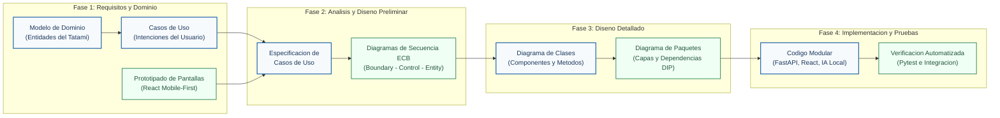

---

# Capítulo II: Descripción de la Empresa

## 2.1. Identidad y Estructura Operativa
La empresa objeto de estudio es **Corpo e Mente**, una organización internacional dedicada a la enseñanza y difusión del Jiu-Jitsu Brasileño. Para el desarrollo de este proyecto, la entidad legal y operativa que avala la investigación es **Corpo e Mente Bolivia**.

Es importante aclarar que Corpo e Mente opera bajo un modelo de infraestructura compartida. La academia física que alberga las instalaciones, gestiona la cobranza a los alumnos y administra los pagos al personal docente es **Knock Out Training Center** (ver Figura 2). Sin embargo, Knock Out actúa exclusivamente como proveedor de infraestructura y servicios administrativos básicos; no participa en la toma de decisiones técnicas, pedagógicas ni estratégicas de Corpo e Mente.

La dirección técnica y académica recae totalmente en **Miguel Baigorria**, cinturón negro de Jiu-Jitsu Brasileño, quien es el responsable de la sucursal y quien firmó la carta de autorización para este proyecto de grado. Su liderazgo garantiza que, aunque la ubicación física sea compartida, la identidad y los estándares técnicos de Corpo e Mente se mantengan intactos e independientes (ver Figura 3).

A nivel de gobierno de la plataforma, la figura de **Administrador** corresponde al **dueño y director general de la marca Corpo e Mente**, quien es propietario de las distintas sucursales de la red, habilita y supervisa a los profesores de cada sede, gobierna la Biblioteca Global compartida y brinda soporte técnico a las cuentas de usuarios.

*Figura 2: Logotipo oficial de Knock Out Training Center, sede física de operaciones.*  
*Figura 3: Logotipo oficial de Corpo e Mente Jiu-Jitsu.*

## 2.2. Servicios Ofrecidos
Corpo e Mente Bolivia ofrece un portafolio de servicios orientados tanto al practicante recreativo como al competidor de alto rendimiento:

* **Clases Grupales:** Entrenamientos regulares dirigidos por instructores certificados, enfocados en la técnica, la condición física y la defensa personal. Las clases se organizan según el nivel de cinturón del alumno.
* **Entrenamiento para Campeonatos:** Sesiones especializadas de *sparring* (combate de entrenamiento) y preparación táctica para alumnos que compiten a nivel regional, nacional o internacional.
* **Exámenes de Grado:** Evaluaciones formales donde los alumnos demuestran su dominio técnico para ascender en el sistema de cinturones, supervisadas directamente por el Maestro Miguel Baigorria.
* **Organización de Torneos:** Planificación y ejecución de torneos internos y abiertos que fomentan la competencia sana y el intercambio técnico entre academias.

## 2.3. Sistema de Grados y Progreso del Alumno
El núcleo del servicio educativo de Corpo e Mente es el sistema de graduación del Jiu-Jitsu Brasileño. Este sistema no solo mide el tiempo de práctica, sino el dominio técnico, la capacidad de aplicación en combate y la madurez del practicante.

Como se ilustra en la Figura 4, el progreso para adultos se divide en cinco niveles principales:

* **Cinturón Blanco (1-2 años):** Fase de supervivencia y fundamentos. El objetivo es aprender a escapar de posiciones dominantes y entender la mecánica básica del cuerpo.
* **Cinturón Azul (2-4 años):** Dominio de técnicas básicas y comienzo del encadenamiento de movimientos. El alumno empieza a construir su propio estilo de juego.
* **Cinturón Morado (4-7 años):** Nivel avanzado. Se espera un amplio repertorio técnico y la capacidad de orientar a cinturones blancos y azules.
* **Cinturón Marrón (7-10 años):** Nivel experto. Preparación final hacia la maestría, puliendo detalles finos de palancas y transiciones.
* **Cinturón Negro (10+ años):** Maestría y liderazgo. Representa un conocimiento profundo del arte marcial y la responsabilidad de formar nuevos practicantes.

Adicionalmente, el sistema contempla grados (rayas) en la punta del cinturón para marcar el avance dentro de cada nivel, y una escala de colores específica (blanco, gris, amarillo, naranja y verde) para menores de 16 años.

*Figura 4: Guía oficial de Cinturones en Jiu-Jitsu Brasileño: Rango, Tiempo y Significado.*

## 2.4. Flujo Operativo Actual y Problemática Detectada
En el día a día de la academia, la enseñanza ocurre principalmente de forma presencial: el profesor explica una técnica frente al grupo, realiza la demostración paso a paso y luego los alumnos practican en parejas sobre el tatami. Debido a que en una sola clase pueden entrenar decenas de alumnos al mismo tiempo, el instructor solo logra observar y corregir brevemente a unos pocos practicantes por sesión.

Cuando el alumno regresa a casa o entrena por su cuenta en horarios libres, carece de una referencia objetiva para revisar si su cadera, sus codos o sus rodillas quedaron bien ubicados. Si repite un movimiento mal ejecutado sin recibir corrección oportuna, consolida malos hábitos musculares y aumenta el riesgo de sufrir una lesión. La plataforma desarrollada interviene precisamente en este punto, conectando la grabación casera del alumno con el criterio oficial del profesor y los manuales de la academia.

*Figura 5: Flujo operativo actual de la academia y punto de intervención del sistema.*

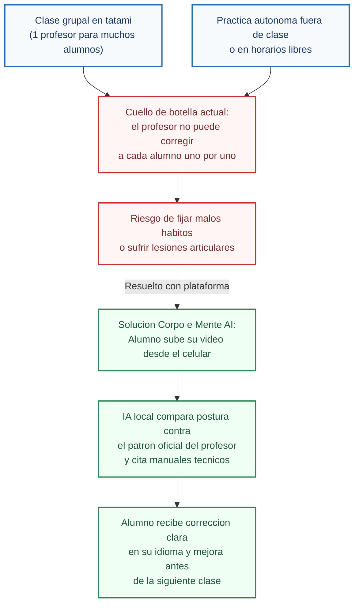

---

# Capítulo III: Marco Teórico

## 3.1. Estimación de Pose, Profundidad y Segmentación con YOLOv26

### 3.1.1. ¿Qué es YOLOv26?
YOLO (acrónimo en inglés de *You Only Look Once*, que significa "Solo miras una vez") es una familia de algoritmos de Inteligencia Artificial desarrollada por Ultralytics (2026) para detectar personas y analizar imágenes en tiempo real.

A diferencia de métodos antiguos que revisan una foto por partes varias veces, YOLO procesa cada imagen en un solo paso, lo que lo hace muy veloz. La familia YOLOv26 reúne en un mismo ecosistema la detección de pose humana (esqueleto), la estimación de profundidad (3D) y el recorte de siluetas a nivel de píxel (segmentación).

### 3.1.2. Modelos Seleccionados: YOLOv26-pose, YOLOv26-depth y YOLOv26-seg
En la plataforma (`backend/corpocmente/infrastructure/ai/adapters.py`) trabajan varios modelos complementarios almacenados localmente en `backend/storage/models/` y `backend/`:

* **`yolo26m-pose.pt` / `yolo26n-pose.pt` (Modelo Principal de Pose):** Localiza y rastrea 17 puntos anatómicos clave del cuerpo humano (hombros, codos, muñecas, caderas, rodillas, tobillos y rostro) cuadro por cuadro, generando un esqueleto digital. En el servidor actual se utiliza `yolo26m-pose.pt` como modelo base de alta precisión y se soporta la carga dinámica de `yolo26n_autonomous.pt` cuando el módulo autónomo valida mejoras.
* **`yolo26n-depth.pt` (Modelo de Profundidad 3D):** Calcula qué tan cerca o lejos de la cámara se encuentra cada extremidad (eje Z). Esto ayuda a distinguir quién está arriba y quién está abajo cuando dos cuerpos se cruzan en el suelo.
* **`yolo26n-seg.pt` (Modelo de Segmentación de Respaldo):** Recorta la silueta exacta de cada luchador píxel por píxel. Se mantiene desactivado por defecto en la pasada general (`USE_SEGMENTATION=False`), pero se activa de forma puntual en el primer fotograma cuando dos atletas aparecen tan pegados que YOLO Pose los agrupa en una sola caja ancha (`_split_candidate_via_segmentation`), con clustering K-Means como respaldo adicional.
* **`yolo26x-pose.pt` / `yolo26l-pose.pt` (Modelos Mayores para Re-etiquetado y Aprendizaje Continuo):** Versiones más grandes empleadas fuera de la consulta en vivo para generar etiquetas de referencia de alta calidad en escenas difíciles con kimono.

### 3.1.3. Justificación de la Elección y Prueba Empírica de Segmentación
La elección de YOLOv26 se validó mediante pruebas experimentales reales sobre videos de la academia, priorizando precisión en el suelo y velocidad de respuesta para el alumno:

1. **Velocidad y Eficiencia:** La variante nano alcanzó **95.2 fotogramas por segundo (FPS)** en la MacBook local, procesando un video de 15 segundos en menos de 10 segundos.
2. **Precisión en el Suelo (Tatami):** A diferencia de soluciones pensadas para personas de pie (como MediaPipe), YOLOv26 sigue detectando articulaciones cuando los atletas están acostados, invertidos o vistiendo kimono (*gi*).
3. **Desambiguación en 3D con Profundidad:** La combinación de pose más profundidad (`yolo26n-depth.pt`) permitió resolver **163 oclusiones severas** de extremidades cruzadas manteniendo velocidades superiores a 92 FPS.
4. **Decisión Basada en Evidencia sobre la Segmentación (`USE_SEGMENTATION=False`):** Se comparó usar pose directa frente a recortar primero todas las siluetas con `yolo26n-seg.pt` sobre un video real de guardia cerrada (897 fotogramas). La mejora de detección simultánea de 2 personas fue de apenas **+1.78%** (16 fotogramas), sin alcanzar la meta del 5%, pero redujo la velocidad **3.5 veces** (de 95.2 FPS a 27.1 FPS). Por ello se desactivó como paso obligatorio en todo el video y se reservó únicamente para separar cajas fusionadas en el encuadre inicial.
5. **Costo Cero:** Software de código abierto sin cobros por API.

Tabla 1
*Prueba experimental entre Pose Directa vs. Segmentación + Pose*

| Métrica Evaluada | YOLO26-Pose Directo (Activo) | YOLO-Seg + Pose (`USE_SEGMENTATION=True`) | Resultado / Decisión |
| :--- | :--- | :--- | :--- |
| **Fotogramas analizados** | 897 frames | 897 frames | Video real de Guardia Cerrada |
| **Detección de 2 personas** | 255 frames (28.4%) | 271 frames (30.2%) | Solo +1.78% de diferencia |
| **Cobertura total de rastreo** | 100.0% | 100.0% | Sin mejora adicional |
| **Confianza del esqueleto** | 0.8006 | 0.7388 | Pierde precisión al recortar |
| **Velocidad y Tiempo Total** | **95.2 FPS (9.42 seg)** | **27.1 FPS (33.10 seg)** | **Pose Directo es 3.5x más rápido** |

*Nota.* Elaboración propia (2026).

### 3.1.4. Aprendizaje Continuo Autónomo (Data Flywheel) y Hot-Swap
Para mejorar progresivamente la detección en posiciones complejas del tatami sin etiquetar imágenes a mano durante la operación diaria, `YOLOPoseAdapter` incorpora un mecanismo de recolección y reemplazo en caliente:

1. **Captura de Casos Difíciles:** Cuando durante el análisis de un video la confianza de detección cae por debajo de `0.65`, el adaptador guarda automáticamente el fotograma en `backend/storage/uncertainty_frames/` junto con su registro en `log.csv` para su posterior revisión o reentrenamiento.
2. **Entrenamiento con Memoria Equilibrada (Replay Buffer 70/30 y FINCH):** En las pruebas de reentrenamiento sobre técnicas con oclusión severa como la *Americana desde la montada*, mezclar 70% de poses base (Gold Standard) con 30% de poses nuevas y congelar las primeras 10 capas (`freeze=10`) bajo el planificador adaptativo FINCH evitó el olvido catastrófico de técnicas anteriores.
3. **Hot-Swap en Caliente (`_get_model()`):** Cada vez que el adaptador solicita el modelo en memoria, verifica si existe un archivo de pesos validado (`yolo26n_autonomous.pt`) y compara su fecha de modificación (`st_mtime`). Si detecta una versión nueva aprobada, la carga automáticamente sin necesidad de reiniciar el servidor FastAPI.

### 3.1.5. Comparativa frente a otras opciones

Tabla 2
*Comparativa de tecnologías de estimación de pose humana*

| Tecnología | Velocidad y Eficiencia | Resistencia a Oclusiones (Kimono / Contacto) | Desempeño en Suelo (Jiu-Jitsu) | Profundidad 3D | Costo y Accesibilidad |
| :--- | :--- | :--- | :--- | :--- | :--- |
| **Ultralytics YOLO26 (Seleccionada)** | **Muy alta (95+ FPS en versión nano local)** | **Excelente (Ropa deportiva y contacto estrecho)** | **Excelente (Cualquier ángulo)** | **Sí (`yolo26n-depth` integrado)** | **Gratuita (Sin licencias de pago)** |
| Google MediaPipe | Alta (60+ FPS) | Media (Falla con telas holgadas o cuerpos cruzados) | Baja (Pensada para personas de pie) | Parcial (Aproximada) | Gratuita, pero limitada en suelo |
| OpenPose (CMU) | Baja (15 FPS en GPU, muy lenta en CPU) | Alta | Buena, pero lenta | No | Gratuita académica, exige hardware costoso |
| AlphaPose | Media (20 FPS en GPU) | Alta | Media | No nativa | Gratuita, configuración compleja |

*Nota.* Elaboración propia (2026).

---

## 3.2. Infraestructura de Cómputo Acelerado Local: Apple Silicon (MLX y MPS)

### 3.2.1. ¿Qué es Apple Silicon y la Memoria Unificada (MLX / MPS)?
Apple Silicon es la familia de procesadores de Apple (serie M) que integra en un mismo chip la CPU, la tarjeta gráfica (GPU) y el motor neuronal compartiendo un único bloque de **Memoria Unificada (24 GB de RAM)**.

En las computadoras tradicionales, la tarjeta gráfica tiene su propia memoria separada y pierde tiempo copiando datos de un lado a otro. Con la memoria unificada, los modelos de Inteligencia Artificial leen directamente los videos y textos desde el mismo espacio mediante dos herramientas gratuitas:

* **MPS (Metal Performance Shaders):** Acelera el procesamiento de visión por computadora de YOLOv26 sobre los núcleos gráficos de la Mac.
* **Apple MLX:** Motor oficial de Apple para ejecutar modelos de lenguaje y visión (como Qwen3-VL) con gran velocidad y bajo consumo de memoria.

### 3.2.2. Modelo de Acceso y Costos (Local frente a Nube y GPUs Tradicionales)
Ejecutar toda la Inteligencia Artificial en la MacBook Air M5 local de la academia tiene un **costo operativo mensual de \$0 USD** una vez adquirido el equipo portátil:

* **Inferencia Local en Apple Silicon M5 (Seleccionada):** Costo mensual de \$0 USD, disponibilidad 24/7 sin desconexiones ni límites de tokens y bajo consumo eléctrico (~15 a 30 W).
* **Alternativas en la Nube Evaluadas y Descartadas:** Contratar servidores con GPU dedicados (AWS, GCP o Azure) implica pagos recurrentes de **\$150 a \$400+ USD mensuales**, mientras que opciones gratuitas como Google Colab cortan las sesiones por inactividad (obligando a pagar Colab Pro entre \$9.99 y \$49.99 USD/mes) y exigen subir cada video dos veces por red.

### 3.2.3. Justificación Técnica: ¿Por qué Apple Silicon en lugar de NVIDIA, AMD o Nube?
La elección de **Apple Silicon (M5 con 24 GB de Memoria Unificada — UMA)** frente a tarjetas **NVIDIA**, **AMD** o servidores en la **Nube** responde a cuatro restricciones reales de memoria, portabilidad, ecosistema de software y costos en Bolivia:

1. **Memoria Unificada de 24 GB (*Zero-Copy*) frente a VRAM limitada de NVIDIA:** En una arquitectura de PC tradicional (NVIDIA o AMD), la RAM del sistema y la VRAM de la tarjeta gráfica están separadas y los datos deben copiarse constantemente por el bus PCIe. Una laptop común con **NVIDIA RTX 3050 o 4060** apenas dispone de **6 a 8 GB de VRAM**, capacidad insuficiente para mantener cargados en memoria al mismo tiempo los 4 modelos que necesita esta plataforma (`YOLOv26-pose`, `Qwen3-VL-Embedding-2B`, `Qwen3-VL-Reranker-2B` y `Qwen3-VL-Instruct-4B`), generando fallos por falta de memoria (*Out-Of-Memory*). Para igualar los 24 GB dedicados en NVIDIA se requiere una **RTX 3090 o RTX 4090 de escritorio**, cuyo precio supera los **\$2,000 USD**, consume **350 a 450 W**, genera calor y ruido excesivo, y obliga a usar un gabinete pesado imposible de llevar cómodamente al tatami. En cambio, en la MacBook Air M5 los 24 GB unificados permiten que CPU, GPU (`MPS`) y `Apple MLX` accedan directamente al mismo bloque de memoria sin copias ni pausas en un portátil silencioso de ~1.2 kg.
2. **Ecosistema Nativo `Apple MLX` frente a las limitaciones de AMD (`ROCm`):** Aunque AMD ofrece tarjetas gráficas competitivas para videojuegos, su plataforma de cómputo para IA (**ROCm**) tiene soporte restringido en tarjetas de consumo y portátiles, carece de soporte nativo en macOS y no ofrece un equivalente optimizado como **Apple MLX** para ejecutar los modelos multimodales `Qwen3-VL` cuantizados a 4 y 8 bits con inferencia fluida en ~22 segundos.
3. **Privacidad Total, Cero Costos Recurrentes y Baja Latencia frente a la Nube:** En una solución 100 % en la Nube (AWS/GCP/APIs externas de pago como Gemini o GPT-4o), los alumnos tendrían que subir videos de 20 a 100 MB por conexiones domésticas de internet hacia servidores extranjeros y asumir un gasto mensual constante en alquiler de GPU o por cada video evaluado. Además, los videos del gimnasio (que incluyen menores de edad) abandonarían el control físico de la academia. En local, el procesamiento ocurre dentro del propio gimnasio, a \$0 USD por análisis y con privacidad absoluta.
4. **Convivencia Simultánea de Modelos sin Desbordamiento:** Gracias a la cuantización de 4 y 8 bits en Apple MLX y a la aceleración MPS para YOLOv26, todo el pipeline de visión, búsqueda vectorial y generación de correcciones convive en los 24 GB unificados sin saturar la memoria.

### 3.2.4. Comparativa frente a otras opciones

Tabla 3
*Comparativa de Infraestructuras de Cómputo: Apple Silicon frente a NVIDIA, AMD y la Nube*

| Plataforma / Opción | Memoria Disponible para IA | Costo Inicial / Mensual | Consumo y Portabilidad | Ecosistema Software para Qwen3-VL + YOLO | Privacidad y Latencia de Red | Idoneidad para la Academia |
| :--- | :--- | :--- | :--- | :--- | :--- | :--- |
| **Apple Silicon M5 (Seleccionada)** | **24 GB Memoria Unificada (UMA) compartida** | **~\$1,500 USD único / \$0 al mes** | **~15–30 W, portátil ligero para tatami** | **Excelente (Apple MLX 4/8 bits + PyTorch MPS nativo)** | **Máxima (100% local, sin subir videos a terceros)** | **Óptima (Sostenible, portátil y potente)** |
| NVIDIA Gama Media Laptop (ej. RTX 4060) | Solo 8 GB VRAM dedicados (insuficiente para 4 modelos) | ~\$1,300–\$1,800 USD / \$0 al mes | ~115–140 W, ventiladores ruidosos | Bueno (CUDA), pero sufre *Out-Of-Memory* con varios modelos VLM | Máxima (Local) | Limitada por poca VRAM |
| NVIDIA Gama Alta Escritorio (ej. RTX 4090) | 24 GB VRAM dedicados | >\$2,000–\$3,500 USD / alto gasto eléctrico | 350–450 W, PC torre pesada no portátil | Excelente (CUDA + vLLM) | Máxima (Local) | Costo y tamaño excesivos para el gimnasio |
| AMD Radeon (ROCm) | 8–16 GB VRAM (24 GB solo en tope de gama) | ~\$1,200–\$2,200 USD / \$0 al mes | 200–350 W | Limitado (ROCm sin equivalencia directa a MLX 4-bit en portátiles) | Máxima (Local) | Baja compatibilidad práctica con el stack VLM |
| Solución en la Nube (AWS / GCP / Colab / APIs) | Variable (16–40 GB GPU alquilada) | **\$150 – \$400+ USD/mes** (o Colab con cortes) | No aplica | Bueno, pero atado a cuotas, conexión e internet | Baja (Videos salen a terceros y demoran en subir) | Inviable económicamente y menor privacidad |

*Nota.* Elaboración propia (2026).

---

## 3.3. Vectorización Multimodal y Reordenamiento: Qwen3-VL-Embedding y Qwen3-VL-Reranker

### 3.3.1. ¿Qué son Qwen3-VL-Embedding y Qwen3-VL-Reranker?
La familia **Qwen3-VL** (Alibaba Cloud Qwen Team, 2025) agrupa modelos capaces de comprender al mismo tiempo texto escrito e imágenes. En la plataforma trabajan en pareja para buscar la teoría exacta dentro de los manuales y notas de la academia:

* **Qwen3-VL-Embedding:** Convierte los párrafos de los libros, las imágenes extraídas y la foto del error del alumno en listas numéricas llamadas "vectores" de **2048 dimensiones**, agrupando conceptos técnicos parecidos.
* **Qwen3-VL-Reranker:** Actúa como un segundo filtro experto (*Cross-Encoder*) que compara de cerca la consulta y el error del alumno frente a cada candidato recuperado y los ordena del más pertinente al menos pertinente.

### 3.3.2. Modelos Seleccionados (Búsqueda en Dos Etapas)
El sistema ejecuta localmente en **Apple MLX** una búsqueda en dos etapas:

1. **Etapa 1 — Recuperación Rápida (`Qwen3-VL-Embedding-2B-8bit`):** Encuentra en la base vectorial los fragmentos candidatos que coinciden en significado con la técnica y las fallas detectadas, combinándose con búsqueda léxica BM25 y un glosario multilingüe (`HybridRetriever`).
2. **Etapa 2 — Reordenamiento Experto (`Qwen3-VL-Reranker-2B-4bit`):** Evalúa los candidatos con *Think Mode* desactivado (`enable_thinking=False`) para mantener baja latencia y selecciona únicamente los fragmentos que superan el umbral mínimo de relevancia (`UMBRAL_RELEVANCIA_RAG = 0.65`).

### 3.3.3. Justificación de la Elección
1. **Comprensión Real de Texto y Fotos:** Los manuales de Jiu-Jitsu contienen secuencias ilustradas; Qwen3-VL indexa y consulta tanto texto como páginas e imágenes visuales.
2. **Menos Confusión entre Posiciones Similares:** El segundo filtro evita confundir técnicas visualmente parecidas (como un escape de 100 kilos frente a un pasaje de guardia).
3. **Manejo Natural de Español, Portugués e Inglés:** Comprende la terminología propia del arte marcial (*guardia cerrada / guarda fechada*, *raspado / raspagem*, *americana*).
4. **Costo Cero y Privacidad Local:** Ambos modelos corren localmente en MLX sin pagos por consulta.

### 3.3.4. Comparativa frente a otras opciones

Tabla 4
*Comparativa de Modelos de Búsqueda y Vectorización Multimodal*

| Tecnología | Capacidad Multimodal (Texto + Imagen) | Segundo Filtro (Reranker) | Soporte Español / Portugués | Costo de Uso | Ejecución Local en Mac |
| :--- | :--- | :--- | :--- | :--- | :--- |
| **Qwen3-VL Embedding + Reranker (Seleccionada)** | **Sí (Nativo y preciso)** | **Sí (Doble etapa)** | **Excelente (Jerga de BJJ)** | **Gratuito (Open Source)** | **Nativa y rápida en MLX** |
| OpenAI text-embedding-3 | No (Solo texto) | No nativo | Excelente | De pago | No (Solo nube) |
| BGE-M3 (BAAI) | Limitado (Enfoque en texto) | Sí (Solo texto) | Bueno | Gratuito (Open Source) | Media |
| CLIP (OpenAI) | Sí (Básico) | No | Regular (Sesgo al inglés) | Gratuito (Open Source) | Sí, pero impreciso en BJJ |

*Nota.* Elaboración propia (2026).

---

## 3.4. Base de Datos Vectorial: Qdrant

### 3.4.1. ¿Qué es Qdrant?
Qdrant es una base de datos vectorial de código abierto basada en grafos HNSW (Malkov & Yashunin, 2018; Qdrant, 2026). A diferencia de una base relacional que busca coincidencias exactas por palabra o identificador, Qdrant compara similitud entre vectores numéricos.

En el sistema organiza dos colecciones separadas y validadas en configuración (`backend/corpocmente/config.py`):
* **`vectores_poses_jiujitsu` (133 dimensiones):** Almacena los patrones posturales de referencia grabados por los profesores.
* **`rag_knowledge` (2048 dimensiones):** Almacena los fragmentos de manuales (PDF, DOCX, TXT), páginas visuales, imágenes, fotogramas muestreados y notas del profesor (`instructor_message`).

### 3.4.2. Modelo de Acceso y Costos
Qdrant cuenta con licencia Apache 2.0 y corre localmente de forma gratuita en el contenedor Docker `corpocmente_qdrant` (`infrastructure/docker-compose.yml`), persistiendo sus datos en el volumen Docker nombrado `corpocmente_qdrant_data` (`/qdrant/storage`).

### 3.4.3. Justificación de la Elección
1. **Filtrado por Metadatos Durante la Búsqueda:** Permite restringir resultados por `tecnica_id`, `alcance` (`tecnica` o `global`) o `fuente_tipo` en escasos milisegundos.
2. **Soporte de Limpieza Híbrida:** Facilita eliminar puntos por `tecnica_id`, por `patron_id`, por lista de IDs o por nombre de manual (`eliminar_por_manual`), manteniendo la base libre de datos huérfanos.
3. **Bajo Consumo en Rust:** Escrito en Rust, ofrece estabilidad y bajo consumo de RAM en la máquina local.
4. **Costo Operativo Cero:** Auto-alojado sin restricciones de tamaño ni tarifas mensuales.

### 3.4.4. Comparativa frente a otras opciones

Tabla 5
*Comparativa de Motores de Búsqueda Vectorial*

| Tecnología | Lenguaje Base | Filtrado por Metadatos | Complejidad de Instalación | Consumo de Memoria | Costo Operativo |
| :--- | :--- | :--- | :--- | :--- | :--- |
| **Qdrant (Seleccionada)** | **Rust** | **Nativo en el índice (HNSW)** | **Baja (Un solo contenedor Docker)** | **Muy Bajo** | **Gratuito (Open Source)** |
| Milvus | Go / C++ | Pre-filtrado o Post-filtrado | Alta (Múltiples servicios) | Alto | Gratuito, exige más hardware |
| Weaviate | Go | Filtrado invertido | Media | Medio-Alto | Gratuito (Open Source) |
| Pinecone | Propietario | Nativo | Nula (En la nube) | Nulo localmente | De pago mensual |
| FAISS (Meta) | C++ / Python | No tiene (Solo librería) | Media | Bajo | Gratuito (Open Source) |

*Nota.* Elaboración propia (2026).

---

## 3.5. Lenguaje de Programación: Python

### 3.5.1. ¿Qué es Python?
Python es un lenguaje de programación de alto nivel, interpretado y muy legible (Python Software Foundation, 2026). Su sintaxis clara facilita leer, revisar y mantener la lógica del servidor y de la Inteligencia Artificial.

### 3.5.2. Costo
Es 100% gratuito y de código abierto (*Open Source*), sin licencias comerciales.

### 3.5.3. Justificación de la Elección
1. **Ecosistema Líder en IA:** Las librerías centrales del proyecto (Ultralytics YOLO26, Apple MLX, PyTorch, OpenCV, `dtaidistance`, `PyMuPDF`, Qdrant Client) funcionan de manera nativa en Python.
2. **Construcción Ágil Guiada por Casos de Uso:** Permite traducir con limpieza la estructura ICONIX (rutas de frontera, servicios de aplicación, entidades de dominio y adaptadores de infraestructura) en módulos claros.
3. **Mantenibilidad:** Facilita pruebas unitarias rápidas y evolución continua sin reescrituras complejas.

### 3.5.4. Comparativa frente a otras opciones

Tabla 6
*Comparativa de Lenguajes de Programación para el Proyecto*

| Lenguaje | Curva de Aprendizaje | Ecosistema de IA / Visión | Integración con Apple MLX y YOLO | Velocidad de Desarrollo |
| :--- | :--- | :--- | :--- | :--- |
| **Python (Seleccionado)** | **Baja (Muy legible)** | **Nativo y líder** | **Directa y oficial** | **Muy Alta** |
| Node.js (JavaScript) | Media | Limitado (Requiere puentes externos) | Inexistente de forma nativa | Alta |
| Java | Alta (Verboso) | Rezagado en IA local moderna | Muy compleja | Media |
| C++ | Muy Alta | Excelente velocidad, lento de programar | Baja productividad web | Baja |

*Nota.* Elaboración propia (2026).

---

## 3.6. Contenerización y Despliegue: Docker

### 3.6.1. ¿Qué es Docker?
Docker empaqueta los servicios auxiliares de la aplicación en contenedores estandarizados con todas sus dependencias (Docker Inc., 2026), garantizando que funcionen igual en cualquier equipo.

### 3.6.2. Costo
Docker Engine y Docker Compose son gratuitos para uso personal, educativo y de investigación.

### 3.6.3. Justificación de la Elección
1. **Entorno Predecible:** Levanta de forma ordenada PostgreSQL (`corpocmente_postgres`), PostgREST (`corpocmente_postgrest`) y Qdrant (`corpocmente_qdrant`) mediante `infrastructure/docker-compose.yml`.
2. **Persistencia Segura:** Sus volúmenes nombrados (`corpocmente_postgres_data` y `corpocmente_qdrant_data`) conservan usuarios, técnicas, manuales y evaluaciones entre reinicios.
3. **Arranque Sencillo:** Con el script `./scripts/start.sh`, toda la plataforma se inicia y verifica de forma automática.

### 3.6.4. Comparativa frente a otras opciones

Tabla 7
*Comparativa de Tecnologías de Contenerización y Despliegue*

| Tecnología | Consumo de Recursos | Nivel de Aislamiento | Facilidad de Configuración |
| :--- | :--- | :--- | :--- |
| **Docker + Docker Compose (Seleccionado)** | **Bajo (Comparte el núcleo)** | **Alto (Servicios aislados)** | **Muy Alta (`docker-compose.yml`)** |
| Máquina Virtual (VM) | Muy Alto (Duplica el sistema operativo) | Muy Alto | Baja (Lenta de iniciar) |
| Instalación Manual Directa | Nulo | Nulo (Riesgo de conflictos) | Muy Baja |

*Nota.* Elaboración propia (2026).

---

## 3.7. Capa de API Automática: PostgREST

### 3.7.1. ¿Qué es PostgREST?
PostgREST es un servidor ligero compilado en Haskell que convierte el esquema y los procedimientos almacenados de PostgreSQL en una API REST rápida y segura (PostgREST, 2026).

### 3.7.2. Costo
100% gratuito y de código abierto (licencia MIT).

### 3.7.3. Justificación de la Elección
1. **Ejecución Segura mediante RPC (`SECURITY DEFINER`):** Las operaciones críticas (autenticación, registro de alumnos, cambio de sucursal, activación de pase, cancelación de evaluación, eliminación de manuales y eliminación administrativa de usuarios) se ejecutan a través de funciones SQL controladas sin exponer directamente las tablas sensibles.
2. **Consistencia Relacional y Vectorial:** Al combinar procedimientos almacenados (como `admin_delete_manual_teoria`, `admin_delete_tecnica` o `admin_delete_user`) con los adaptadores de Qdrant desde FastAPI, se evita dejar datos huérfanos entre ambas bases.
3. **Consumo Mínimo:** Responde en milisegundos consumiendo poca memoria RAM.

### 3.7.4. Comparativa frente a otras opciones

Tabla 8
*Comparativa de Tecnologías para Capa de Datos REST*

| Tecnología | Código Repetitivo | Seguridad y Control de Acceso | Rendimiento y Consumo |
| :--- | :--- | :--- | :--- |
| **PostgREST (Seleccionado)** | **Mínimo (Expone RPCs y vistas)** | **Nativa con RLS y roles SQL** | **Muy Alto y muy ligero en RAM** |
| Consultas SQL Manuales en todo el Backend | Alto | Manual (Mayor riesgo de descuidos) | Medio |
| Hasura (GraphQL) | Bajo | Bueno, añade complejidad innecesaria | Mayor consumo de RAM |

*Nota.* Elaboración propia (2026).

---

## 3.8. Framework de Backend: FastAPI

### 3.8.1. ¿Qué es FastAPI?
FastAPI es un framework moderno de Python para construir APIs rápidas y asíncronas (Ramírez, 2026), apoyado en **Pydantic** para validar automáticamente todos los datos que entran y salen del servidor.

### 3.8.2. Costo
100% gratuito y de código abierto (licencia MIT).

### 3.8.3. Justificación de la Elección
1. **Conexión Directa con IA Local:** Ejecuta en el mismo ecosistema Python los modelos de YOLO26, MLX y Qdrant.
2. **Validación Estricta y Seguridad:** Valida formatos de usuario, tipos de archivos permitidos y protege contra fuerza bruta (`AuthRateLimitMiddleware`) y acceso cruzado entre usuarios.
3. **Gestión de Archivos, Videos y Cancelaciones:** Sirve los videos de referencia con respaldo persistente y auto-curación automática (`video_storage.py`), además de soportar tareas en segundo plano con cancelación transaccional (`POST /api/v1/evaluaciones/{id}/cancelar`).

### 3.8.4. Comparativa frente a otras opciones

Tabla 9
*Comparativa de Frameworks de Backend*

| Framework | Lenguaje | Rendimiento (Asincronía) | Validación Automática | Integración con IA |
| :--- | :--- | :--- | :--- | :--- |
| **FastAPI (Seleccionado)** | **Python** | **Nativa y Muy Alta** | **Sí (Pydantic)** | **Directa y nativa** |
| Django | Python | Tradicional (Más pesado) | Parcial (Formularios propios) | Directa con carga extra |
| Express.js | JavaScript | Alta | Manual | Indirecta |
| Flask | Python | Básica (Síncrona por defecto) | Manual | Directa pero sin tipado nativo |

*Nota.* Elaboración propia (2026).

---

## 3.9. Base de Datos Relacional: PostgreSQL con Row Level Security (RLS)

### 3.9.1. ¿Qué es PostgreSQL y RLS?
PostgreSQL es un sistema gestor de bases de datos relacional robusto con cumplimiento ACID y soporte nativo de **Row Level Security (RLS)** (The PostgreSQL Global Development Group, 2026), que restringe qué filas puede consultar o modificar cada rol de usuario.

### 3.9.2. Costo
100% gratuito y de código abierto (licencia PostgreSQL).

### 3.9.3. Justificación de la Elección
1. **Aislamiento Multi-Sucursal e Historial Congelado:** Múltiples academias conviven en la misma base de datos. Al registrar una evaluación (`create_evaluacion`), la sucursal del alumno queda congelada en ese registro histórico: si luego cambia de sede, su historial anterior sigue perteneciendo a la sucursal donde realizó la práctica.
2. **Integridad Referencial y Bajas Seguras:** Organizada en Tercera Forma Normal (Mannino, 2018), la base protege la integridad mediante claves foráneas y procedimientos dedicados como `admin_delete_user` (impide auto-eliminación del administrador y exige o ejecuta reasignación cuando un profesor tiene videos, patrones o teoría asociados) y `admin_delete_manual_teoria`.
3. **Cifrado de Contraseñas:** Usa la extensión `pgcrypto` con algoritmo `bcrypt` para nunca almacenar claves en texto claro.

### 3.9.4. Comparativa frente a otras opciones

Tabla 10
*Comparativa de Bases de Datos Relacionales y No Relacionales*

| Base de Datos | Tipo | Seguridad por Fila (RLS) | Integridad de Datos (ACID) |
| :--- | :--- | :--- | :--- |
| **PostgreSQL 16 (Seleccionada)** | **Relacional** | **Nativa y Robusta (RLS)** | **Total** |
| MySQL / MariaDB | Relacional | Limitada (Manual en código) | Total |
| MongoDB | No Relacional | Básica | Parcial en relaciones complejas |
| SQLite | Relacional (Archivo) | No tiene | Baja bajo alta concurrencia |

*Nota.* Elaboración propia (2026).

---

## 3.10. Frontend: React 19 + Vite (Mobile-First y Proxy Inverso)

### 3.10.1. ¿Qué es React y Vite?
**React** es la biblioteca de interfaz de usuario basada en componentes reutilizables (Meta Open Source, 2026), y **Vite** es el entorno de compilación y servidor web de carga rápida que además actúa como proxy inverso en `frontend/vite.config.js`.

### 3.10.2. Costo
Ambas tecnologías son gratuitas y de código abierto (licencia MIT).

### 3.10.3. Justificación de la Elección
1. **Diseño Mobile-First para el Tatami:** Botones táctiles amplios (mínimo 44 px), menú adaptable y pantallas pensadas para usarse desde el celular al lado de la colchoneta.
2. **Experiencia Interactiva Completa:** Permite cancelar un análisis en espera mediante `AbortController` (`App.jsx`), seleccionar visualmente al practicante en el primer fotograma (`SelectorPersonaVideo.jsx`), saltar al segundo exacto del error (`FeedbackView.jsx`), previsualizar manuales y distinguir citas de libros (`📚`) frente a notas del profesor (`🥋`) en `LibraryView.jsx`.
3. **Proxy Inverso Integrado:** Reenvía `/api`, `/static` y `/health` hacia el backend FastAPI evitando errores de CORS tanto en red local como tras el túnel de internet.
4. **Internacionalización Persistente (ES / PT / EN):** Guarda el idioma preferido en `localStorage` y en la base de datos.

### 3.10.4. Comparativa frente a otras opciones

Tabla 11
*Comparativa de Tecnologías de Frontend*

| Tecnología | Velocidad de Carga | Adaptación a Móviles | Manejo de Video y Proxy | Ecosistema |
| :--- | :--- | :--- | :--- | :--- |
| **React 19 + Vite (Seleccionado)** | **Ultrarrápida** | **Excelente** | **Muy Alta (`vite.config.js`)** | **Líder de la industria** |
| Angular | Más pesada | Media | Media | Amplia pero compleja |
| Vue.js + Vite | Ultrarrápida | Buena | Alta | Menor que React |
| Next.js | Media | Buena | Compleja para IA local | Pesado para este caso |

*Nota.* Elaboración propia (2026).

---

## 3.11. Geolocalización y Mapas: Leaflet.js + OpenStreetMap (Nominatim)

### 3.11.1. ¿Qué son Leaflet y OpenStreetMap?
**Leaflet.js** es una biblioteca ligera de JavaScript para mostrar mapas interactivos, **OpenStreetMap (OSM)** es la base cartográfica abierta y colaborativa mundial, y **Nominatim** convierte coordenadas en direcciones legibles (país, ciudad, calle).

### 3.11.2. Costo
100% gratuitos, sin API Keys de pago ni tarjeta de crédito requerida.

### 3.11.3. Justificación de la Elección
1. **Cero Costo:** El administrador puede registrar sedes pegando un enlace de Google Maps o ubicando el punto en el mapa sin generar cargos por consultas.
2. **Privacidad:** No rastrea a los alumnos ni comparte métricas comerciales de ubicación.
3. **Ligereza:** Carga rápidamente en teléfonos con datos móviles.

### 3.11.4. Comparativa frente a otras opciones

Tabla 12
*Comparativa de Servicios de Mapas Digitales*

| Servicio de Mapas | Costo | Requiere Tarjeta / API Key | Facilidad de Integración |
| :--- | :--- | :--- | :--- |
| **Leaflet + OpenStreetMap (Seleccionado)** | **Gratuito (\$0)** | **No** | **Alta y muy ligera** |
| Google Maps Platform | De pago según visitas | Sí (Obligatoria) | Alta, con riesgo de cobros |
| Mapbox | Freemium con límites | Sí | Alta |

*Nota.* Elaboración propia (2026).

---

## 3.12. Pruebas de Software: Pytest y Verificación Web

### 3.12.1. ¿Qué son Pytest y la Verificación E2E?
Siguiendo el principio de verificación empírica de ICONIX (asegurar que cada caso de uso funcione en el código real sin supuestos ni falsos positivos), el proyecto combina dos niveles de prueba:

* **Pytest:** Suite automatizada en Python (`backend/tests/`) que prueba lógica biomecánica, jerarquías RAG, seguridad JWT/RBAC, limpieza híbrida PostgreSQL-Qdrant, cancelación transaccional, respaldo de videos y endpoints HTTP.
* **Verificación Web E2E (Playwright / Navegador):** Durante las fases de construcción se validaron los flujos completos en navegador real (inicio de sesión, carga de videos, cambio de idioma, diseño responsivo sin desbordamiento horizontal y acceso mediante túnel HTTPS).

### 3.12.2. Costo
Ambas herramientas son gratuitas y de código abierto (licencias MIT y Apache 2.0).

### 3.12.3. Justificación de la Elección
1. **Cobertura Amplia del Núcleo:** La suite actual en `backend/tests/` consta de **30 archivos de prueba** que reúnen **181 casos de prueba recolectados** (incluyendo 6 casos marcados como omitidos por migración heredada).
2. **Control de Integridad Híbrida y Regresiones:** Permite verificar automáticamente invariantes críticos (por ejemplo, que borrar una técnica o un manual limpie Qdrant, PostgreSQL y disco, o que un alumno no pueda registrarse como profesor).

### 3.12.4. Comparativa frente a otras opciones

Tabla 13
*Comparativa de Herramientas de Pruebas de Software*

| Herramienta | Qué Verifica | Comprueba Pantalla Real | Automatización y Velocidad |
| :--- | :--- | :--- | :--- |
| **Pytest + Verificación E2E (Seleccionadas)** | **Lógica interna, APIs, BD y flujos web** | **Sí (Multi-resolución y video)** | **Muy Alta y automatizada** |
| Unittest (Nativo Python) | Solo código interno | No | Media (Más verboso) |
| Pruebas Manuales Exclusivas | Todo el sistema | Sí, pero depende de revisión humana | Baja y propensa a olvidos |

*Nota.* Elaboración propia (2026).

---

## 3.13. Inteligencia Artificial: Conceptos Básicos

### 3.13.1. ¿Qué es la Inteligencia Artificial y la Visión por Computadora?
La **Inteligencia Artificial (IA)** permite que una computadora realice tareas que requieren percepción y razonamiento, como reconocer movimientos y explicar errores técnicos (Russell & Norvig, 2021). Dentro de ella, la **Visión por Computadora** localiza las articulaciones del cuerpo humano en cada cuadro de video, mientras que los **Modelos de Visión y Lenguaje (VLM)** observan la imagen del error y redactan una guía comprensible para el practicante.

### 3.13.2. ¿Qué es RAG (Generación Aumentada por Recuperación)?
Cuando un modelo generativo responde solo de memoria, puede inventar consejos erróneos ("alucinar"), algo riesgoso en un deporte de contacto. **RAG** (*Retrieval-Augmented Generation*; Lewis et al., 2020) resuelve este problema buscando primero los pasajes reales dentro de los manuales y notas del profesor de la academia para que el consejo se base únicamente en esa fuente verificada.

---

## 3.14. Motor de Inferencia Generativa: Qwen3-VL-Instruct-4B (Local en MLX)

### 3.14.1. ¿Qué es Qwen3-VL-Instruct?
Es el modelo multimodal de Visión y Lenguaje que actúa como "redactor pedagógico": observa el fotograma crítico donde el alumno falló, lee los pasajes teóricos recuperados y redacta una explicación concreta, respetuosa y en el idioma del alumno.

### 3.14.2. Modelo Seleccionado: Qwen3-VL-Instruct-4B (4 bits), Ingesta Triple y Biblioteca Global
Se seleccionó **`mlx-community/Qwen3-VL-4B-Instruct-4bit`** corriendo localmente en Apple MLX (`backend/corpocmente/infrastructure/ai/local_vlm_adapter.py`). En `IntelligenceAnalysisFacade` combina tres insumos bajo una **jerarquía estricta**:

1. **Evidencia Visual y Biomecánica:** Fotograma crítico anotado y nombres de las articulaciones comprometidas traducidos al idioma del alumno.
2. **Manuales Técnicos y Biblioteca Global (Prioridad 1):** Busca evidencias asociadas a la técnica; si la técnica no posee manual propio (o solo tiene fotogramas de video), consulta automáticamente la **Biblioteca Global** de la academia (`tecnica_id=None`). Solo si el mejor fragmento supera `UMBRAL_RELEVANCIA_RAG = 0.65` se activa la Prioridad 1.
3. **Nota del Profesor (Prioridad 2):** Si no hay manual relevante que supere el umbral, utiliza la nota técnica o consejo práctico escrito por el profesor en la técnica (`mensaje_profesor`, también persistida en Qdrant bajo `fuente_tipo='instructor_message'`). En la interfaz de Biblioteca (`LibraryView.jsx`), las fuentes se distinguen claramente con `📚` para manuales y `🥋` para notas del profesor.

Si no existe ni manual relevante ni nota del profesor, el sistema aplica **Prioridad 3 (Respaldo Cuantitativo Seguro)** sin invocar al modelo generativo, evitando cualquier invención.

### 3.14.3. Costo, Accesibilidad y Control contra Alucinaciones (Juez de IA)
* **Costo Cero:** Inferencia local en MLX sin límites ni tarifas por token.
* **Control de Calidad (*LLM-as-a-Judge*):** Antes de mostrar una corrección generada (Prioridades 1 o 2), el método `evaluar_fidelidad_grounding()` verifica que el texto no invente datos fuera de las fuentes (exigiendo `faithfulness_score >= 0.85` y cero afirmaciones no respaldadas). Si falla, activa un respaldo seguro (la nota directa del profesor si existe, o el aviso determinístico de información insuficiente).

### 3.14.4. Comparativa frente a otras opciones (y descarte de Google Gemini)
Aunque inicialmente se contempló usar Google Gemini en la nube, fue reemplazado por **Qwen3-VL-4B-Instruct** local para eliminar límites de cuota gratuita, evitar que las imágenes de los alumnos salieran a servidores externos y asegurar consistencia idiomática total.

Tabla 14
*Comparativa de Motores Generativos para Retroalimentación Deportiva*

| Modelo / Proveedor | Dónde se Ejecuta | Privacidad de Fotos y Videos | Costo Operativo | Control de Idioma y Fidelidad | Ideal para... |
| :--- | :--- | :--- | :--- | :--- | :--- |
| **Qwen3-VL-Instruct-4B en MLX (Seleccionado)** | **100% Local en la Academia** | **Total (Nada sale a internet)** | **Gratuito (\$0)** | **Alto (Juez de IA + traducción articular)** | **Producción real, privada y sostenible** |
| Google Gemini 2.5 Flash Lite (Descartado) | Nube externa de Google | Baja | Límites gratuitos / Pago por uso | Regular | Prototipos iniciales |
| GPT-4o (OpenAI) | Nube externa | Baja | Alto (Pago obligatorio) | Excelente | Empresas con alto presupuesto cloud |
| Llama 3 Texto (Meta) | Local | Total | Gratuito | No procesa imágenes en versión texto | Chatbots sin análisis visual |

*Nota.* Elaboración propia (2026).

---

## 3.15. Exposición Segura a Internet: Cloudflare Tunnel (`cloudflared`)

### 3.15.1. ¿Qué es Cloudflare Tunnel?
Es una herramienta (`cloudflared`) que crea un túnel cifrado saliente desde el servidor local de la academia hacia la red de Cloudflare (Cloudflare Inc., 2026), generando una dirección web segura con HTTPS para acceder desde celulares o fuera del gimnasio sin abrir puertos peligrosos en el router.

### 3.15.2. Costo
El uso mediante *Quick Tunnels* (`trycloudflare.com`) es gratuito y no requiere tarjeta de crédito.

### 3.15.3. Justificación de la Elección y Mitigación del Límite de 100 MB
1. **Router Cerrado sin Port Forwarding:** Evita exponer la red interna de la academia y sortea el bloqueo CGNAT de los operadores de internet locales.
2. **Cifrado HTTPS Automático:** Protege contraseñas, sesiones y videos en tránsito mediante TLS.
3. **Control del Límite de 100 MB:** En `frontend/vite.config.js` se restringen los dominios permitidos (`allowedHosts: ['.trycloudflare.com', 'localhost', '127.0.0.1']`) y el backend limita el peso máximo permitido de manuales a 100 MB (`MAX_MANUAL_BYTES`), evitando errores silenciosos por archivos excesivos.

### 3.15.4. Comparativa frente a otras opciones

Tabla 15
*Comparativa de Tecnologías para Acceso Remoto desde Internet*

| Tecnología | Requiere Abrir Puertos | HTTPS Automático | Límites en Versión Gratuita | Costo |
| :--- | :--- | :--- | :--- | :--- |
| **Cloudflare Tunnel (Seleccionada)** | **No (100% seguro)** | **Sí (Incluida)** | **Hasta 100 MB por petición** | **Gratuito (\$0)** |
| Ngrok (Gratuita) | No | Sí | Muy restrictivo | Gratuito limitado / Pago |
| Tailscale / VPN | No | Sí | Exige instalar app VPN en cada alumno | Gratuito limitado |
| Abrir Puertos en Router | Sí (Alto riesgo) | No | Bloqueado por CGNAT local | Exige IP pública fija |

*Nota.* Elaboración propia (2026).

---

## 3.16. Seguridad y Control de Acceso: Modelo "Pase de Tatami"

### 3.16.1. ¿Qué es el Modelo "Pase de Tatami"?
En Bolivia y gran parte de Latinoamérica, los alumnos pagan su mensualidad presencialmente en recepción (efectivo, transferencia local o QR), sin usar tarjeta de crédito internacional. El **"Pase de Tatami"** adapta el control de acceso digital a esa realidad:

1. Todo alumno nuevo que se registra públicamente nace en estado **`pendiente`** (puede navegar y consultar su perfil o biblioteca pública autenticada, pero no consumir inferencia de video).
2. Tras verificar su pago presencial, el profesor de su misma sede o un administrador activa su pase desde el celular pasando su cuenta a estado **`activo`** por **30 días**.
3. Al vencer el plazo, el sistema bloquea automáticamente nuevos análisis marcando el pase como **`expirado`**, preservando todo su historial previo intacto.

### 3.16.2. Costo
Tiene **\$0 en comisiones bancarias**, a diferencia de pasarelas internacionales.

### 3.16.3. Justificación de la Elección y Ciberseguridad Defensiva
1. **Adaptación Real al Gimnasio:** Cero fricción para alumnos sin tarjeta internacional.
2. **Protección contra Fuerza Bruta y Uso Indebido:** `AuthRateLimitMiddleware` limita intentos repetidos en `/auth/login` devolviendo `HTTP 429`, y `require_active_subscription` bloquea con `HTTP 403` el análisis a alumnos con pase pendiente o vencido.
3. **Secretos Protegidos y Estado Limpio de Producción:** Los secretos criptográficos se cargan desde variables de entorno (`.env`) y el script `infrastructure/initdb/reset_production.sql` permite sanear tablas transaccionales dejando únicamente el personal oficial y las tres sedes autorizadas, verificado durante las pruebas de endurecimiento e integración.

### 3.16.4. Comparativa frente a otras opciones

Tabla 16
*Comparativa de Modelos de Control de Suscripción para la Academia*

| Modelo de Control | Acepta Efectivo y QR Local | Comisiones | Bloqueo Automático a los 30 Días | Facilidad para el Profesor |
| :--- | :--- | :--- | :--- | :--- |
| **Modelo "Pase de Tatami" (Seleccionado)** | **Sí** | **0%** | **Sí (Automático en BD)** | **Muy Alta (Un toque en celular)** |
| Pasarela Internacional (Stripe / PayPal) | No | 3.5% a 5% por cobro | Sí | Compleja (Trámites externos) |
| Plataforma Abierta sin Control | No aplica | 0% | No | Mala (Abuso de recursos) |
| Cuaderno o Planilla Física | Sí | 0% | No conecta con la IA | Baja |

*Nota.* Elaboración propia (2026).

---

# Capítulo IV: Especificación de Requisitos de Software (IEEE 830)

## 4.1. Introducción
Este capítulo presenta la Especificación de Requisitos de Software (ERS) del Sistema de Análisis Biomecánico de Técnicas de Jiu-Jitsu Brasileño siguiendo los lineamientos del estándar IEEE 830 (IEEE, 1998), redactada de forma clara y verificable.

### 4.1.1. Propósito
Definir con claridad las funciones, restricciones y reglas que cumple la plataforma para la academia "Corpo e Mente", sirviendo como puente entre las necesidades de alumnos, profesores y administradores y el diseño orientado a objetos bajo ICONIX del Capítulo V.

### 4.1.2. Alcance
El sistema es una plataforma web independiente que permite a los alumnos de Jiu-Jitsu Brasileño subir videos de práctica (con opción de cancelar análisis en curso), compararse con el patrón oficial de su profesor mediante IA local y recibir correcciones en español, portugués o inglés respaldadas en manuales técnicos y notas del instructor. Asimismo, permite a los profesores administrar técnicas, videos de referencia, biblioteca de conocimiento y pases mensuales, y a los administradores gestionar sucursales y cuentas de usuario.

### 4.1.3. Definiciones, Acrónimos y Abreviaturas
* **ICONIX:** Metodología de desarrollo orientada a objetos guiada por casos de uso y análisis de robustez Boundary-Control-Entity (ECB).
* **RAG:** Técnica que busca pasajes reales en manuales e indicaciones del profesor antes de redactar un consejo, evitando invenciones.
* **YOLO:** Tecnología de visión por computadora que detecta a las personas y ubica las 17 articulaciones de su esqueleto en cada cuadro del video.
* **Qdrant:** Base de datos vectorial que almacena secuencias posturales y fragmentos de conocimiento multimodal.
* **JWT:** Token firmado digitalmente que identifica de manera segura la sesión y el rol de cada usuario.
* **Pase de Tatami:** Habilitación de 30 días otorgada por el profesor o administrador luego de comprobar el pago presencial del alumno.
* **Apple MLX:** Motor de cómputo de Apple para ejecutar modelos de IA localmente en procesadores serie M.

### 4.1.4. Referencias
* IEEE Std 830-1998. IEEE Recommended Practice for Software Requirements Specifications.
* Rosenberg, D., & Stephens, M. (2007). *Use Case Driven Object Modeling with UML: Theory and Practice* (ICONIX Process). Apress.
* Mannino, M. V. (2018). *Database Design, Application Development, and Administration* (7th ed.). McGraw-Hill Education.

### 4.1.5. Visión General
La Sección 4.2 resume el contexto general, usuarios y restricciones del producto. La Sección 4.3 detalla los requisitos funcionales, no funcionales, de interfaz y de datos. La Sección 4.4 presenta la matriz de trazabilidad hacia los casos de uso, y la Sección 4.5 muestra el Modelo de Dominio.

## 4.2. Descripción General

### 4.2.1. Perspectiva del Producto
Es una plataforma web nueva y autónoma que complementa la enseñanza presencial en el tatami. Todo el análisis pesado de video y lenguaje se ejecuta localmente en la computadora de la academia, protegiendo la privacidad de los practicantes, y se expone de forma segura a celulares externos mediante Cloudflare Tunnel.

### 4.2.2. Funciones del Producto
* **Autenticación y Registro de Alumnos:** Inicio de sesión con control de intentos y registro público exclusivo para nuevos alumnos en una sucursal.
* **Administración de Usuarios y Soporte:** Cambio de sucursal, edición de perfil, eliminación segura de cuentas con reasignación de recursos docentes e impersonación temporal para soporte.
* **Gestión de Técnicas y Videos Patrón:** Alta, edición, baja en cascada híbrida y registro de video de referencia con respaldo persistente y auto-curación.
* **Gestión de Biblioteca y Notas del Profesor (RAG):** Subida multi-formato (PDF, DOCX, TXT, imágenes), previsualización, búsqueda semántica multimodal, consejos y notas prácticas del profesor y eliminación atómica de manuales.
* **Análisis Biomecánico y Cancelación:** Validación anti-spam, selección de silueta, comparación 3D con DTW, cálculo de similitud, identificación del frame crítico y cancelación en curso por parte del usuario.
* **Generación de Feedback Verificado:** Jerarquía estricta de fuentes (Manual específico o Biblioteca Global > Nota del profesor > Respaldo numérico) con auditoría de fidelidad y salto al segundo exacto del error.
* **Progreso y Pase de Tatami:** Consulta de historial por sucursal y habilitación de membresías por 30 días.
* **Gestión de Sucursales:** Alta, edición, baja y geocodificación en mapa interactivo.

### 4.2.3. Características de los Usuarios
* **Alumno:** Practicante que utiliza la plataforma principalmente desde su celular para evaluar sus técnicas, cancelar envíos si se equivocó, revisar sus errores y consultar manuales.
* **Profesor:** Instructor de una sucursal que graba técnicas de referencia, redacta consejos y notas técnicas, sube o depura manuales teóricos, revisa el avance de sus alumnos y activa Pases de Tatami.
* **Administrador (Dueño de la Marca Corpo e Mente):** Dueño y director general de la marca Corpo e Mente. Es la autoridad máxima del negocio que crea y gestiona las sucursales, habilita y supervisa a los profesores de cada sede, gobierna la Biblioteca Global compartida, administra las cuentas de usuarios (incluyendo cambio de sede o eliminación con reasignación) y brinda soporte ingresando temporalmente como otro usuario.

### 4.2.4. Restricciones
* **Hardware Local:** Optimizado para operar localmente en Apple Silicon (24 GB de Memoria Unificada) sin servidores GPU externos de pago.
* **Presupuesto de Software:** Basado íntegramente en herramientas gratuitas de código abierto.
* **Límite de Subida por Túnel:** Al acceder remotamente vía Cloudflare Tunnel gratuito, las cargas de video o manuales están acotadas a un límite máximo de 100 MB por petición.

### 4.2.5. Suposiciones y Dependencias
* Los videos grabados cuentan con iluminación suficiente y encuadre visible del practicante.
* El equipo local de la academia y sus contenedores Docker permanecen encendidos durante el horario de servicio.
* Los profesores aportan las ejecuciones modelo y los manuales técnicos oficiales para alimentar la base de conocimiento.

## 4.3. Requisitos Específicos

### 4.3.1. Requisitos Funcionales (RF)

**Módulo de Autenticación y Administración de Cuentas**
* **RF-01:** El sistema debe permitir a Alumnos, Profesores y Administradores iniciar sesión usando su nombre de usuario o correo electrónico y su contraseña, protegiendo el acceso frente a intentos masivos repetidos.
* **RF-02:** El sistema debe permitir el registro público de nuevas cuentas exclusivamente con el rol de **Alumno**, validando un identificador sin espacios, asociándolo a una sucursal oficial e inicializando su Pase de Tatami en estado pendiente (rechazando intentos de auto-registro como profesor o administrador con `HTTP 403`).
* **RF-03:** El sistema debe permitir a cada usuario editar su perfil e idioma, y al Administrador: listar usuarios, cambiar la sucursal de un usuario preservando sus evaluaciones históricas, **eliminar cuentas de usuario** impidiendo su auto-eliminación y reasignando el contenido docente si es un profesor, y **entrar temporalmente como otro usuario** para soporte técnico mostrando un aviso rojo permanente en pantalla.

**Módulo de Gestión de Técnicas y Conocimiento**
* **RF-04:** El sistema debe permitir a los Profesores (y Administradores) crear, editar y eliminar técnicas del catálogo; al eliminar una técnica se deben purgar en cascada sus registros en PostgreSQL y sus vectores biomecánicos y teóricos en Qdrant.
* **RF-05:** El sistema debe permitir a los Profesores subir un video de referencia (patrón de oro) identificando su silueta en la escena inicial, respaldando el video en almacenamiento persistente y auto-curando enlaces rotos al iniciar el servidor.
* **RF-06:** El sistema debe permitir a los Profesores escribir una nota o consejo práctico en cada técnica y subir, buscar, previsualizar y **eliminar** manuales de estudio de la biblioteca (en formato PDF, DOCX, TXT o imagen), ejecutando una limpieza atómica en Qdrant, PostgreSQL y almacenamiento físico al borrar un manual.

**Módulo de Análisis Biomecánico y Feedback**
* **RF-07:** El sistema debe permitir al Alumno con Pase de Tatami activo seleccionar a su profesor y la técnica a evaluar.
* **RF-08:** El sistema debe permitir subir un video de práctica (MP4, MOV, AVI, WebM) y ofrecer al Alumno la opción de **cancelar un análisis en curso** en cualquier momento, deteniendo la petición en pantalla, marcando la evaluación como `cancelado` y borrando el video temporal.
* **RF-09:** El sistema debe validar automáticamente que el video corresponda a Jiu-Jitsu Brasileño (filtro anti-spam) antes de iniciar el análisis completo.
* **RF-10:** El sistema debe solicitar al Alumno confirmar su silueta en el encuadre inicial, extraer su secuencia postural 3D y compararla dinámicamente (DTW) contra los patrones activos del profesor.
* **RF-11:** El sistema debe calcular el porcentaje de similitud (0 a 100%), ubicar el instante exacto del error (segundo y fotograma crítico) y detectar las articulaciones corporales con mayor desviación.
* **RF-12:** Si la similitud es menor al 85%, el sistema debe generar una corrección en el idioma del alumno aplicando jerarquía estricta de fuentes (1° Manual específico o Biblioteca Global con relevancia $\ge 0.65$; 2° Nota del profesor; 3° Respaldo numérico seguro), auditando su fidelidad ($\ge 0.85$) y mostrando citas diferenciadas (`📚` para manuales y `🥋` para notas del instructor). Si es mayor o igual al 85%, debe felicitar al alumno sin invocar al modelo generativo.

**Módulo de Progreso y Administración de Sedes**
* **RF-13:** El sistema debe permitir al Profesor ver el listado de alumnos de su sucursal con su historial de evaluaciones, y al Alumno consultar su propio historial personal.
* **RF-14:** El sistema debe permitir al Profesor (o Administrador) activar o renovar el "Pase de Tatami" de un alumno de su sucursal por 30 días; al vencer el plazo, la cuenta pasa a estado expirado e impide nuevos análisis hasta su renovación.
* **RF-15:** El sistema debe permitir al Administrador crear, editar y eliminar sucursales (siempre que no tengan usuarios vinculados), capturando coordenadas mediante mapa interactivo o enlace de Google Maps con geocodificación inversa.

### 4.3.2. Requisitos No Funcionales (RNF)

**Rendimiento**
* **RNF-01:** La interfaz web debe cargar en menos de 2 segundos en condiciones normales de red.
* **RNF-02:** El análisis completo de un video de práctica debe completarse en un máximo de 30 segundos sobre Apple Silicon local.
* **RNF-03:** La recuperación vectorial en Qdrant debe ejecutarse en pocos milisegundos.

**Seguridad y Privacidad**
* **RNF-04:** Todas las contraseñas deben almacenarse encriptadas con `bcrypt` (`pgcrypto`) y las sesiones protegerse con tokens JWT firmados (`HS256`).
* **RNF-05:** Ningún video o imagen de los alumnos debe enviarse a servicios de IA externos en la nube; todo el procesamiento se realiza localmente.
* **RNF-06:** El servidor debe bloquear con `HTTP 429` los intentos excesivos de inicio de sesión sobre `/auth/login`.

**Usabilidad y Compatibilidad**
* **RNF-07:** La aplicación debe ser *Mobile-First*, legible sin desplazamiento horizontal y con controles táctiles amplios (mínimo 44 px) en teléfonos, tabletas y computadoras.
* **RNF-08:** El idioma elegido (Español, Portugués o Inglés) debe persistir en el navegador y en el perfil del usuario, traduciendo interfaz, articulaciones anatómicas y feedback.

**Mantenibilidad**
* **RNF-09:** El software debe organizarse en capas desacopladas (`Presentacion`, `Aplicacion`, `Dominio`, `Infraestructura`) para facilitar pruebas y mejoras.

### 4.3.3. Requisitos de Interfaz
* **Interfaz de Usuario:** Diseño moderno oscuro (rojo institucional `#d01118` sobre fondo oscuro), con reproductores de video comparativos, salto directo al segundo del error y modales claros de biblioteca.
* **Interfaz de Software:** Integración local con YOLO26 (MPS), Qwen3-VL (Apple MLX), Qdrant, PostgREST y servicios externos cartográficos (OpenStreetMap / Nominatim).
* **Interfaz de Comunicaciones:** Tráfico cifrado mediante HTTPS a través de Cloudflare Tunnel.

### 4.3.4. Requisitos de Datos
* **RD-01:** Usuarios, sucursales, técnicas, videos de referencia, evaluaciones y metadatos de teoría se almacenan en PostgreSQL 16 normalizado en 3NF.
* **RD-02:** Patrones de pose (133 dimensiones) y conocimiento multimodal (2048 dimensiones) se almacenan en Qdrant en colecciones separadas.
* **RD-03:** Los archivos de manuales, imágenes extraídas y respaldos persistentes de videos de referencia se almacenan en el directorio de datos configurado (`storage_root()`, por defecto `/tmp/corpocmente_data` o la ruta definida en `CORPOCMENTE_DATA_DIR`).
* **RD-04:** Los tokens de impersonación y las rutas administrativas deben preservar la trazabilidad del usuario operador y las políticas de acceso por rol y sede.

## 4.4. Identificación de Casos de Uso y Trazabilidad
En congruencia con la metodología **ICONIX**, cada requisito funcional se traduce en intenciones claras del usuario agrupadas en diez Casos de Uso (`UC-01` a `UC-10`), tal como resume la Matriz de Trazabilidad siguiente.

Tabla 17
*Matriz de Trazabilidad (Requisitos, Intenciones del Usuario y Casos de Uso)*

| Nro | Intención del Usuario (Historia de Usuario) | #Req | #CU | Descripción del Caso de Uso |
| :--- | :--- | :--- | :--- | :--- |
| **1** | Como Alumno, Profesor o Admin, quiero iniciar sesión con mi usuario o correo y contraseña para acceder a mi entorno de trabajo. | RF-01 | UC-01 | **Iniciar Sesión:** El sistema verifica límites de intentos y credenciales para abrir la sesión según rol, sede e idioma. |
| **2** | Como nuevo practicante, quiero crear mi cuenta de Alumno en una sucursal para empezar a usar la plataforma. | RF-02 | UC-02 | **Crear Cuenta de Alumno:** El sistema valida formato sin espacios, restringe el auto-registro a `alumno` e inicializa el Pase de Tatami pendiente. |
| **3** | Como Alumno, quiero subir mi video, indicar quién soy en la escena (o cancelar si me equivoqué) y obtener la comparación contra mi profesor. | RF-07, RF-08, RF-09, RF-10, RF-11 | UC-03 | **Analizar Técnica:** Valida pase y contenido BJJ, permite confirmar silueta, alinea posturas 3D con DTW, calcula similitud y permite cancelación transaccional en curso. |
| **4** | Como Alumno, quiero ver mi porcentaje de acierto, saltar al segundo exacto de mi falla y recibir una explicación clara respaldada en manuales o notas de mi profesor. | RF-12 | UC-04 | **Generar Feedback Biomecánico:** Aplica jerarquía de fuentes (Manual específico o Biblioteca Global > Nota del Profesor > Respaldo seguro), audita fidelidad y presenta citas diferenciadas. |
| **5** | Como Profesor, quiero crear, editar o eliminar técnicas y subir mis videos patrón con respaldo seguro para evaluar a mis alumnos. | RF-04, RF-05 | UC-05 | **Gestionar Técnicas y Videos de Referencia:** Administra el catálogo, extrae el patrón oficial 3D, respalda/autocura el video y limpia Qdrant y PostgreSQL al eliminar. |
| **6** | Como Profesor, quiero subir o eliminar manuales de estudio y escribir consejos en mis técnicas, y como usuario quiero consultar y previsualizar la biblioteca. | RF-06 | UC-06 | **Gestionar Manuales de Estudio y Notas del Profesor:** Indexa PDF, DOCX, TXT e imágenes, registra consejos del instructor en cada técnica, permite búsqueda/previsualización y borra manuales atómicamente. |
| **7** | Como Profesor o Alumno, quiero consultar el historial de evaluaciones y ver los videos y correcciones registradas. | RF-13 | UC-07 | **Ver Progreso de Alumnos:** Muestra al profesor los alumnos de su sede y al alumno su propio historial cronológico con videos y notas. |
| **8** | Como Profesor o Admin, quiero activar o renovar el Pase de Tatami de un alumno por 30 días tras confirmar su pago presencial. | RF-14 | UC-08 | **Activar Pase de Tatami:** Lista alumnos pendientes o expirados de la sucursal y habilita su acceso por 30 días calendario. |
| **9** | Como Administrador, quiero registrar, editar o eliminar sucursales ubicándolas en un mapa interactivo o mediante un enlace. | RF-15 | UC-09 | **Gestionar Sucursales y Coordenadas:** Captura latitud/longitud con Leaflet y Nominatim, valida ausencia de usuarios al eliminar y actualiza el directorio. |
| **10** | Como Administrador, quiero entrar como otro usuario para darle soporte o administrar y dar de baja cuentas reasignando su contenido; y como usuario editar mi perfil. | RF-03 | UC-10 | **Soporte Técnico y Administración de Cuentas:** Permite impersonación con aviso rojo, cambio de sucursal, edición de perfil y baja segura con `admin_delete_user`. |

*Nota.* Elaboración propia (2026).

## 4.5. Modelo de Dominio
El Modelo de Dominio representa, en el vocabulario propio del Jiu-Jitsu Brasileño y de la academia, los conceptos clave del negocio y sus relaciones reales antes de pasar al diseño técnico de software. En la cima organizacional se ubica el **Dueño** de la marca Corpo e Mente (quien en el sistema técnico opera con permisos de administrador), propietario de todas las sucursales, responsable de habilitar y supervisar a los profesores, administrar cuentas de alumnos y gobernar la Biblioteca Global de la marca.

*Figura 6: Diagrama de Modelo de Dominio del Sistema (Metodología ICONIX).*

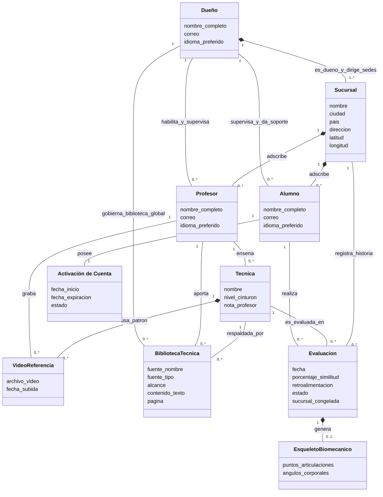

Tabla 17B
*Descripción de Conceptos y Relaciones del Modelo de Dominio*

| Concepto del Dominio | Significado en el Negocio (Academia Corpo e Mente) | Relaciones Clave |
| :--- | :--- | :--- |
| **Dueño** | Propietario y director general de la marca Corpo e Mente. | Es dueño y dirige `1..*` sucursales; habilita y supervisa profesores y alumnos; gobierna la biblioteca global y realiza soporte técnico. |
| **Sucursal** | Sede física o filial perteneciente a la marca Corpo e Mente (por ejemplo, Santa Cruz Central). | Pertenece al Dueño; adscribe a profesores y alumnos; registra históricamente dónde se realizó cada evaluación. |
| **Profesor** | Instructor certificado adscrito a una sucursal. | Enseña técnicas, graba sus videos patrón de referencia, aporta manuales o notas técnicas, revisa el progreso de alumnos de su sede y realiza la activación de cuenta de los alumnos. |
| **Alumno** | Practicante inscrito en una sucursal que entrena y evalúa sus técnicas. | Posee una única `Activación de Cuenta` renovable y realiza múltiples evaluaciones en video. |
| **Activación de Cuenta** | Habilitación presencial de acceso por 30 días calendario tras verificar el pago del alumno en recepción (conocida operativamente en la academia como *Pase de Tatami*). | Pertenece exactamente a un alumno (`pendiente`, `activo` o `expirado`). |
| **Tecnica** | Movimiento oficial de Jiu-Jitsu Brasileño del catálogo (por ejemplo, *Armlock desde la Guardia*), con nivel de cinturón y nota práctica del profesor. | Enseñada por un profesor; compuesta por videos patrón de referencia; respaldada por documentos de biblioteca; objeto de evaluaciones. |
| **VideoReferencia** | Video modelo grabado por el profesor que sirve como patrón oficial de comparación biomecánica. | Pertenece a una técnica y es grabado por un profesor. |
| **BibliotecaTecnica** | Acervo teórico de la academia: manuales PDF/DOCX/TXT, imágenes o notas técnicas de instructores. | Aportada por profesores o por el Dueño (alcance específico por técnica o Biblioteca Global). |
| **Evaluacion** | Práctica grabada en video por un alumno y comparada contra el patrón oficial, conservando la sucursal histórica donde se realizó (`sucursal_congelada`). | Realizada por un alumno sobre una técnica en una sucursal determinada. |
| **EsqueletoBiomecanico** | Representación numérica tridimensional de las articulaciones y ángulos corporales extraídos de la evaluación. | Composición generada durante la ejecución de una evaluación para calcular similitud y ubicar el fallo articular. |

*Nota.* Elaboración propia (2026).

---

# Capítulo V: Análisis y Diseño Orientado a Objetos (Metodología ICONIX)

El presente capítulo presenta el análisis y diseño orientado a objetos del sistema aplicando la **Metodología ICONIX** (Rosenberg & Stephens, 2007). A diferencia de enfoques pesados con exceso de documentación, ICONIX mantiene un camino directo y fácil de seguir desde la necesidad del usuario hasta el código real del sistema.

Para lograr total claridad y trazabilidad entre lo que el usuario quiere y cómo está programado el software, cada uno de los diez casos de uso identificados en el Capítulo IV (`UC-01` a `UC-10`) se documenta mediante cinco artefactos complementarios:

1. **Especificación del Caso de Uso (Enfocado en la Intención del Usuario):** Explica en lenguaje sencillo *qué* quiere lograr el usuario (Alumno, Profesor o Administrador) y *cómo responde* el sistema, sin mezclar detalles internos de código o bases de datos.
2. **Diagrama de Caso de Uso:** Muestra visualmente únicamente a los actores humanos y las intenciones reales de uso dentro de ese módulo, manteniendo la frontera conceptual limpia de pasos internos técnicos.
3. **Diagrama de Clases:** Traduce los participantes del análisis de robustez **Boundary – Control – Entity (ECB)** a las clases reales implementadas en el frontend React y el backend FastAPI.
4. **Diagrama de Secuencia ECB:** Muestra paso a paso cómo interactúan en el tiempo el objeto de frontera (`Boundary`), el coordinador lógico (`Control`) y las entidades del negocio (`Entity`).
5. **Diagrama de Paquetes:** Muestra en qué capas reales (`Presentacion`, `Aplicacion`, `Dominio`, `Infraestructura`) viven esos archivos y cómo respetan el **Principio de Inversión de Dependencias (DIP)** para mantener el núcleo del negocio protegido.

---

## 5.1. Caso de Uso 1: Iniciar Sesión (UC-01)

### 5.1.1. Caso de Uso 1: Iniciar Sesión (UC-01) — Especificación
| Campo | Especificación |
| :--- | :--- |
| **Identificador** | **UC-01** |
| **Nombre** | Iniciar Sesión |
| **Actores** | **Principal:** Alumno, Profesor, Administrador. |
| **Intención del Usuario** | Ingresar de forma segura a su cuenta personal usando su usuario o correo electrónico y contraseña para acceder a las herramientas de su rol y sucursal. |
| **Precondiciones** | El usuario cuenta previamente con una cuenta registrada en la academia. |
| **Postcondiciones** | 1. Se abre una sesión activa asociada al rol, sucursal, idioma preferido y estado de membresía del usuario.<br>2. La interfaz dirige al usuario a su pantalla principal (carga de videos para el alumno, panel docente para el profesor o gestión global para el administrador). |

#### Curso Normal
| Paso | Intención del Actor | Respuesta Observable del Sistema |
| :---: | :--- | :--- |
| 1 | El Usuario abre la ventana de acceso, escribe su nombre de usuario o correo electrónico junto con su contraseña y solicita ingresar. | El Sistema comprueba que no se haya superado el límite temporal de intentos fallidos desde ese origen. |
| 2 | | El Sistema valida que las credenciales coincidan con una cuenta registrada y recupera su rol, sucursal, idioma preferido y estado del Pase de Tatami. |
| 3 | | El Sistema inicia la sesión activa, recuerda el idioma elegido por el usuario y habilita la pantalla correspondiente a su perfil. |

#### Cursos Alternativos
* **1a. Límite de intentos fallidos superado:**
  * El Sistema bloquea temporalmente nuevos intentos de ingreso (`HTTP 429`) para proteger las cuentas frente a ataques de fuerza bruta.
* **2a. Credenciales incorrectas o usuario inexistente:**
  * El Sistema rechaza el acceso con un mensaje único de credenciales inválidas sin revelar si el fallo estuvo en el usuario o en la clave.

#### Excepciones
* **E1. Servicio de acceso temporalmente no disponible:** El Sistema informa que no se pudo conectar con el servidor y mantiene al usuario en la pantalla de acceso sin abrir sesión.

---

### 5.1.2. Diagrama de Caso de Uso UC-01

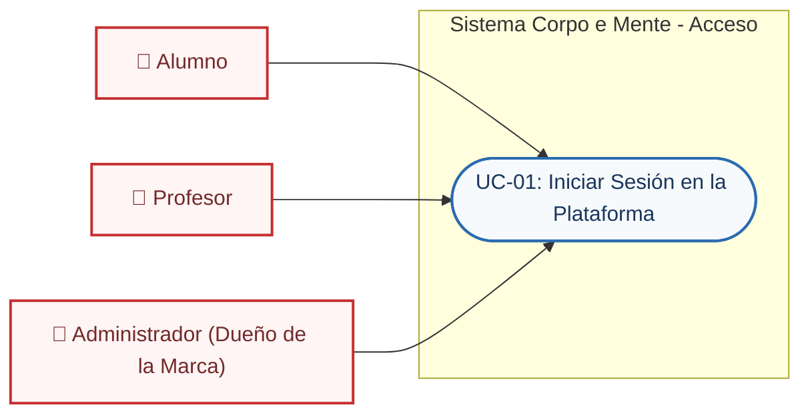

---

### 5.1.3. Diagrama de Clases UC-01
Correspondencia de los estereotipos ECB de ICONIX con las clases reales del sistema:
* **Boundary:** `LoginModal` (componente React), `AuthRateLimitMiddleware` (`main.py`) y `AuthRoutes` (`auth_routes.py`).
* **Control:** `PostgrestClient` (ejecución segura del procedimiento `authenticate` y consulta de perfil).
* **Entity:** `Usuario`, `Sucursal` y `LoginResponse` (contrato de sesión con token JWT firmado).

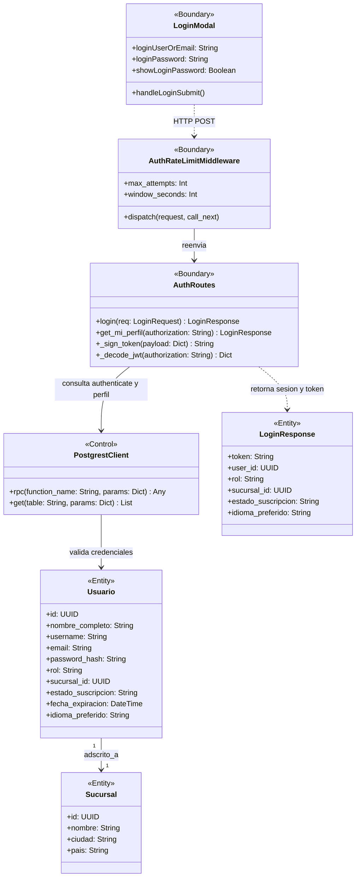

---

### 5.1.4. Diagrama de Secuencia ECB UC-01

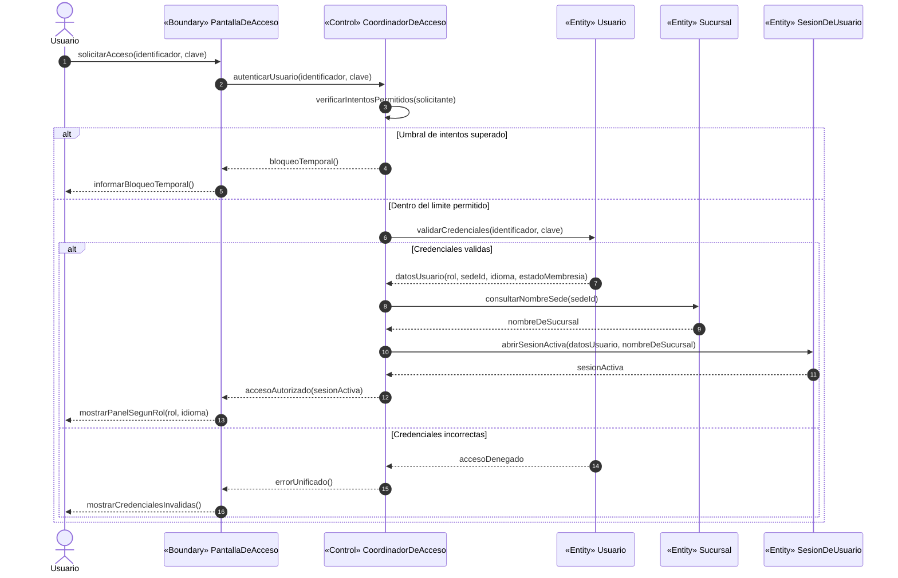

---

### 5.1.5. Diagrama de Paquetes UC-01
Las dependencias avanzan de las capas externas hacia las internas (`Presentacion` hacia `Aplicacion` y `Dominio`, e `Infraestructura` implementando los contratos hacia `Aplicacion` y `Dominio`).

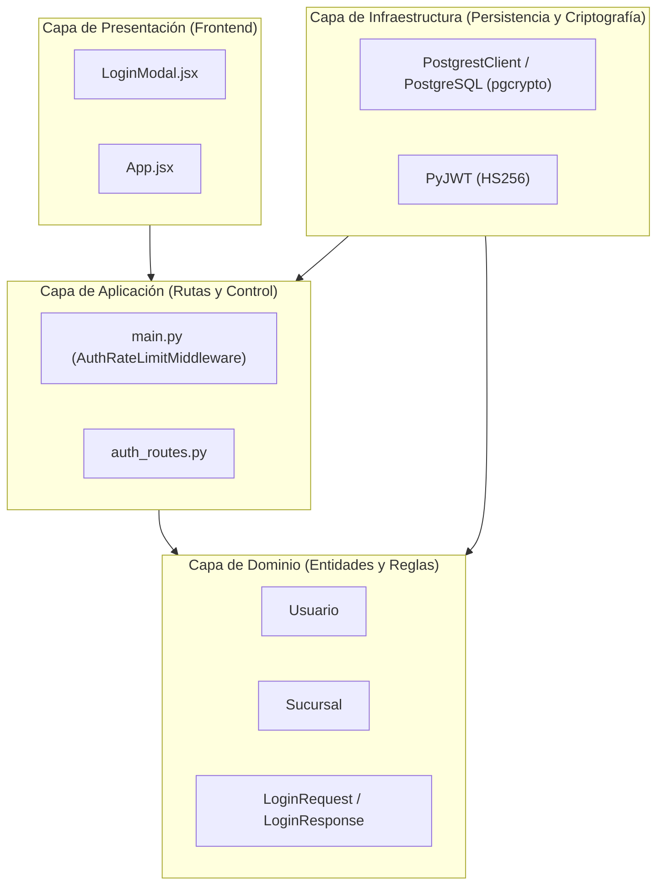

---

## 5.2. Caso de Uso 2: Crear Cuenta de Alumno (UC-02)

### 5.2.1. Caso de Uso 2: Crear Cuenta de Alumno (UC-02) — Especificación
| Campo | Especificación |
| :--- | :--- |
| **Identificador** | **UC-02** |
| **Nombre** | Crear Cuenta de Alumno |
| **Actores** | **Principal:** Nuevo Practicante (Alumno). |
| **Intención del Usuario** | Registrarse por primera vez en la plataforma eligiendo la sucursal donde entrena para empezar a usar la academia virtual. |
| **Precondiciones** | 1. El solicitante aún no tiene una cuenta con el mismo nombre de usuario.<br>2. Existe al menos una sucursal oficial activa en el sistema. |
| **Postcondiciones** | 1. Se crea la cuenta estrictamente con rol `alumno` asociada a la sucursal elegida.<br>2. Su Pase de Tatami se inicializa en estado `pendiente` hasta que el profesor confirme su pago presencial en la academia.<br>3. Se inicia su sesión de trabajo mostrando el aviso de activación pendiente. |

#### Curso Normal
| Paso | Intención del Actor | Respuesta Observable del Sistema |
| :---: | :--- | :--- |
| 1 | El Nuevo Practicante abre la pestaña de registro de alumno. | El Sistema consulta y muestra la lista de sucursales oficiales disponibles para seleccionar. |
| 2 | El solicitante ingresa su nombre completo, nombre de usuario deseado (sin espacios), contraseña y elige su sucursal. | El Sistema verifica que el formato del usuario contenga únicamente letras, números o guion bajo, confirma el rol estricto de `alumno` y comprueba que el nombre no esté repetido. |
| 3 | | El Sistema guarda la cuenta cifrando la contraseña, inicializa el Pase de Tatami en estado `pendiente` y abre la sesión inicial en la pantalla principal del alumno. |

#### Cursos Alternativos
* **2a. Formato de usuario inválido (con espacios o símbolos no permitidos):**
  * El Sistema rechaza el envío de inmediato e indica que el nombre de usuario solo admite letras, números y guion bajo.
* **2b. Intento de registro público con rol diferente a alumno:**
  * Por seguridad, el backend bloquea cualquier solicitud pública que intente registrarse como profesor o administrador (`HTTP 403`), indicando que esas cuentas se gestionan administrativamente.
* **2c. Nombre de usuario ya existente:**
  * El Sistema informa que ese nombre ya está ocupado y sugiere iniciar sesión o elegir otro identificador.

#### Excepciones
* **E1. No hay sucursales registradas o fallo de comunicación:** El Sistema informa que no se pudo completar el registro y no crea cuentas incompletas.

---

### 5.2.2. Diagrama de Caso de Uso UC-02

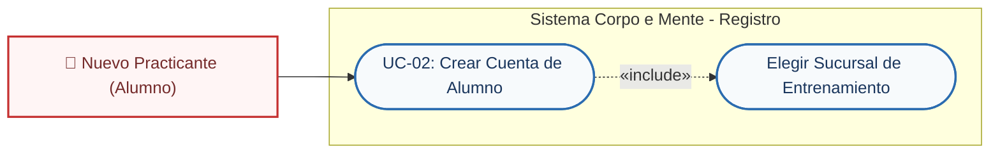

---

### 5.2.3. Diagrama de Clases UC-02
Participantes reales del módulo de registro:
* **Boundary:** `LoginModal` (pestaña de registro) y `AuthRoutes` (`signup`, `listar_sucursales`).
* **Control:** `PostgrestClient` (ejecución del procedimiento `public_signup` y validación de sucursal).
* **Entity:** `SignupRequest` (regla de validación de username), `Usuario`, `Sucursal` y `LoginResponse`.

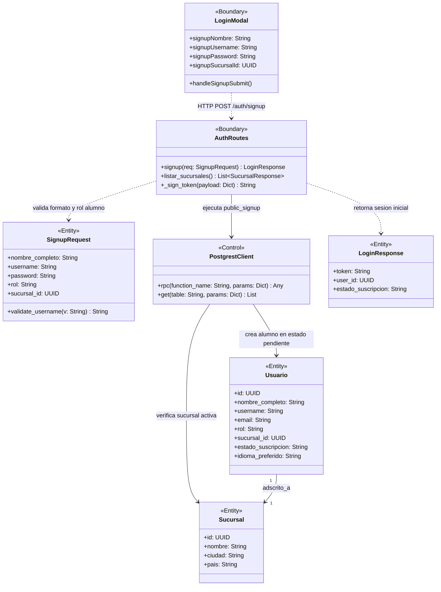

---

### 5.2.4. Diagrama de Secuencia ECB UC-02

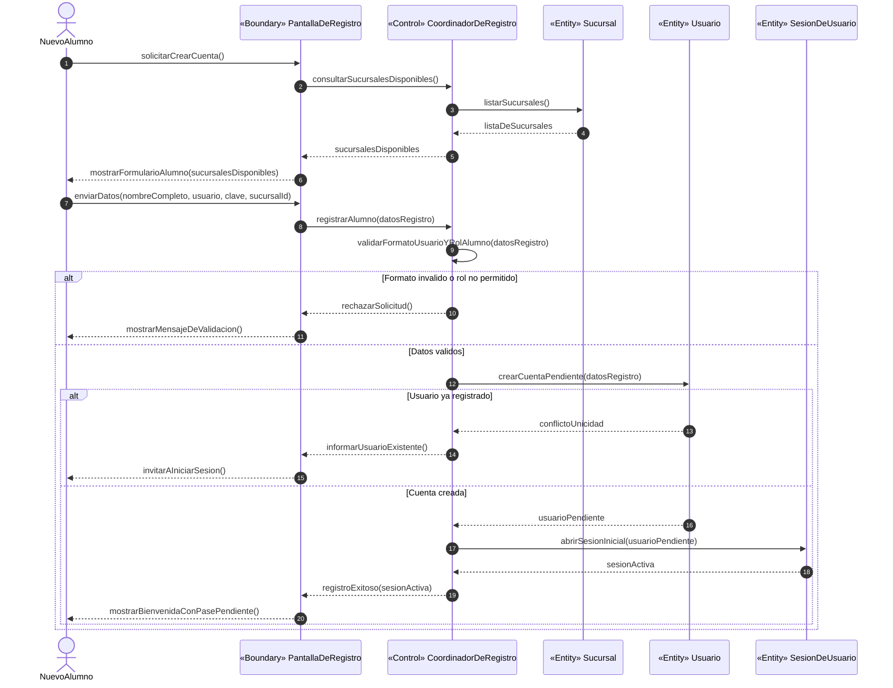

---

### 5.2.5. Diagrama de Paquetes UC-02
Mantiene el esquema limpio en cuatro capas cumpliendo el principio DIP.

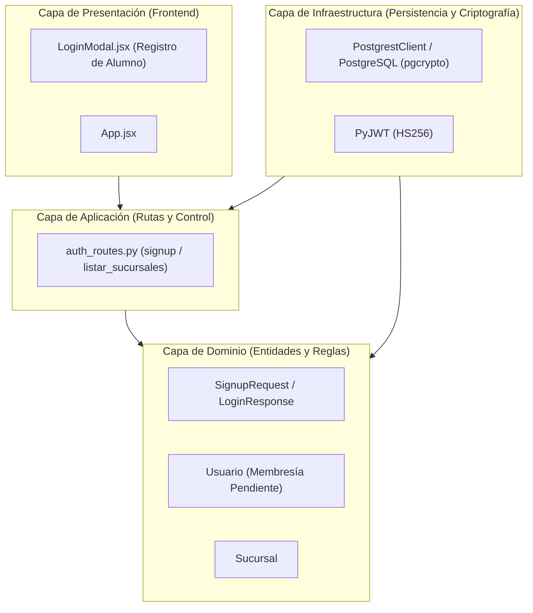

---

## 5.3. Caso de Uso 3: Analizar Técnica (UC-03)

### 5.3.1. Caso de Uso 3: Analizar Técnica (UC-03) — Especificación
| Campo | Especificación |
| :--- | :--- |
| **Identificador** | **UC-03** |
| **Nombre** | Analizar Técnica |
| **Actores** | **Principal:** Alumno. |
| **Intención del Usuario** | Subir el video de una práctica de Jiu-Jitsu, elegir a su profesor y la técnica practicada, confirmar quién es dentro del video (o cancelar la espera si cambió de opinión) y obtener la comparación biomecánica frente al patrón oficial. |
| **Precondiciones** | 1. El alumno tiene una sesión activa y su Pase de Tatami está en estado `activo` y vigente.<br>2. La técnica elegida cuenta con un patrón de referencia registrado por el profesor. |
| **Postcondiciones** | 1. Si el análisis finaliza, la evaluación queda guardada en el historial del alumno congelando la sucursal donde entrena actualmente.<br>2. Se calcula el porcentaje de similitud (0 a 100%), el segundo del error y las articulaciones con mayor desviación, dando paso a **UC-04 (Generar Feedback Biomecánico)**.<br>3. Si el alumno cancela en curso, la evaluación queda marcada como `cancelado` y se elimina el video temporal del servidor. |

#### Curso Normal
| Paso | Intención del Actor | Respuesta Observable del Sistema |
| :---: | :--- | :--- |
| 1 | El Alumno elige a su profesor y la técnica que practicó, y selecciona o arrastra su archivo de video (MP4, MOV, AVI o WebM). | El Sistema verifica que su Pase de Tatami esté vigente y revisa mediante visión artificial que el video corresponda efectivamente a una práctica de Jiu-Jitsu (filtro anti-spam). |
| 2 | | El Sistema extrae el fotograma inicial, detecta y depura las siluetas presentes (eliminando duplicados o reflejos pequeños) y pide al alumno confirmar cuál silueta corresponde a su cuerpo. |
| 3 | El Alumno selecciona su silueta y presiona enviar para analizar. | El Sistema registra la evaluación en estado `procesando` congelando su sucursal actual, muestra el indicador de progreso junto con el botón de cancelar, y extrae su secuencia postural 3D cuadro por cuadro. |
| 4 | | El Sistema recupera los patrones activos de referencia del profesor, alinea ambos movimientos en el tiempo y calcula el porcentaje de similitud global, el fotograma crítico y las articulaciones desviadas, dando paso a **UC-04**. |

#### Cursos Alternativos
* **1a. Pase de Tatami pendiente o expirado:** El Sistema bloquea la carga de análisis y muestra un aviso claro para renovar el pase con su profesor en la academia.
* **1b. Video ajeno al Jiu-Jitsu o formato no soportado:** El Sistema rechaza el archivo antes de procesarlo e invita al alumno a subir una grabación válida de entrenamiento.
* **3a. El Alumno cancela el análisis en curso:**
  * Mientras el video se está subiendo o analizando, el Alumno presiona **Cancelar Análisis**. El navegador aborta la espera (`AbortController`), el servidor marca la evaluación como `cancelado`, limpia la sesión, borra el video temporal del alumno y garantiza que el proceso en segundo plano no sobrescriba el estado cancelado.

#### Excepciones
* **E1. Técnica sin patrón de referencia del profesor:** El Sistema informa que el instructor aún no ha subido el video patrón para esa técnica.
* **E2. Baja visibilidad en el video (cobertura menor al 40%):** El Sistema detiene la comparación y pide grabar en un ángulo donde el cuerpo sea claramente visible.

---

### 5.3.2. Diagrama de Caso de Uso UC-03

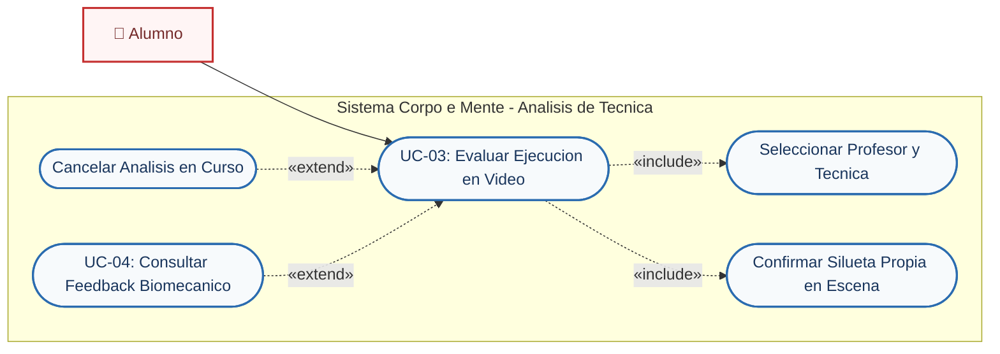

---

### 5.3.3. Diagrama de Clases UC-03
Participantes reales del análisis biomecánico y su cancelación:
* **Boundary:** `App` (estado de carga y `handleCancelAnalysis` con `AbortController`), `VideoUpload`, `SelectorPersonaVideo` y `EvaluacionesRoutes` (`routes.py`).
* **Control:** `SessionStateManager`, `LocalSpamFilter`, `IntelligenceAnalysisFacade`, `YOLOPoseAdapter`, `PoseNormalizer` y `DTWComparator`.
* **Entity:** `Evaluacion`, `PatronReferencia` y `EsqueletoBiomecanico`.

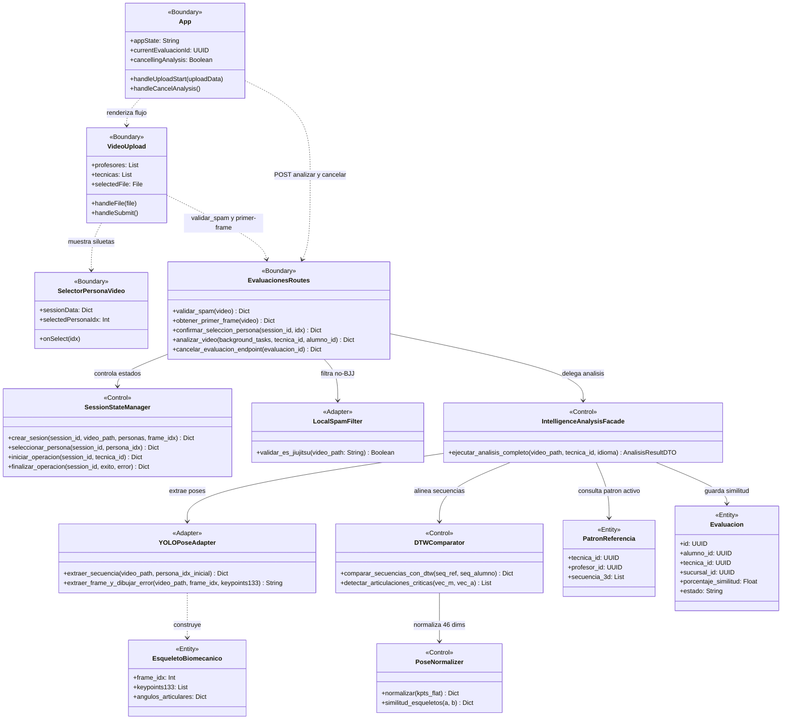

---

### 5.3.4. Diagrama de Secuencia ECB UC-03

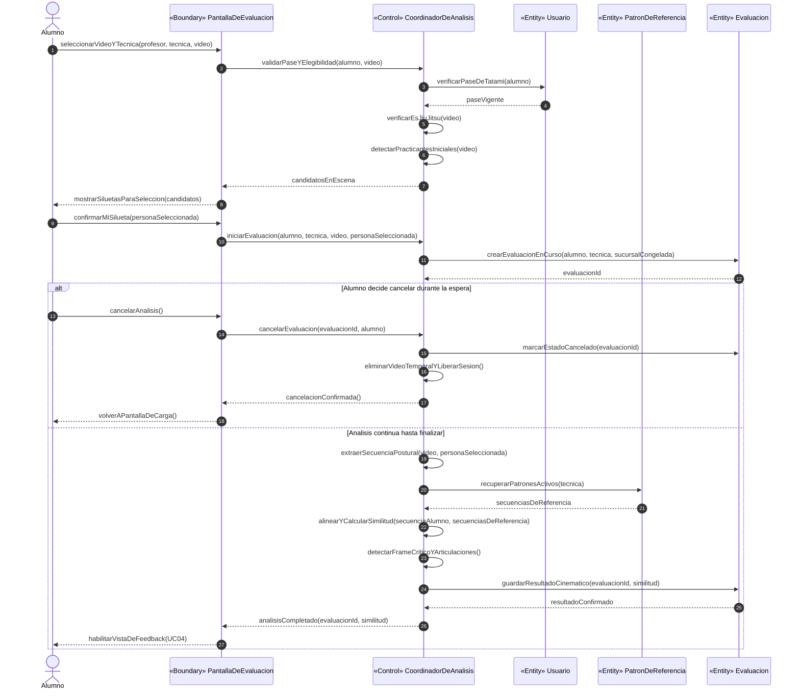

---

### 5.3.5. Diagrama de Paquetes UC-03
Los cálculos matemáticos puros (`dtw_comparator.py`, `pose_normalizer.py`) y las entidades permanecen aislados en `Dominio`, independientes de YOLO, FastAPI o Qdrant.

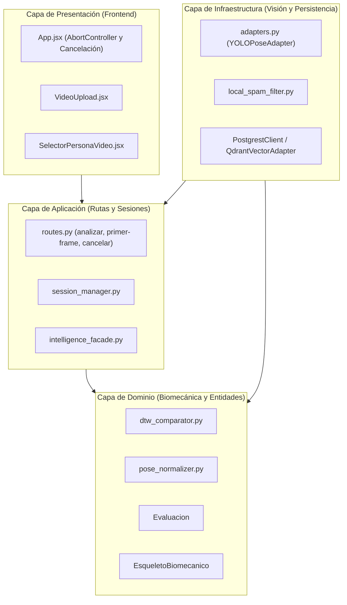

---

## 5.4. Caso de Uso 4: Generar Feedback Biomecánico (UC-04)

### 5.4.1. Caso de Uso 4: Generar Feedback Biomecánico (UC-04) — Especificación
| Campo | Especificación |
| :--- | :--- |
| **Identificador** | **UC-04** |
| **Nombre** | Generar Feedback Biomecánico |
| **Actores** | **Principal:** Alumno. |
| **Intención del Usuario** | Ver de manera visual y clara qué tan parecida fue su técnica a la del profesor, saltar al segundo exacto del error, entender qué articulación falló y leer una corrección confiable en su idioma con citas consultables. |
| **Precondiciones** | 1. Se completó el cálculo de similitud y detección de fotograma crítico en **UC-03**.<br>2. El alumno tiene configurado un idioma preferido (`es`, `pt` o `en`). |
| **Postcondiciones** | 1. El reporte final queda guardado con la nota, el segundo exacto del error, la imagen anotada con las articulaciones en rojo y el consejo adaptado al idioma del alumno.<br>2. Si la similitud fue menor al 85%, el consejo está respaldado exclusivamente por manuales de alta relevancia o por la nota directa del profesor (o entrega un aviso cuantitativo seguro sin inventar texto). |

#### Curso Normal
| Paso | Intención del Actor | Respuesta Observable del Sistema |
| :---: | :--- | :--- |
| 1 | Al terminar **UC-03**, el Alumno visualiza automáticamente su pantalla de resultados. | El Sistema evalúa si la similitud alcanzó el umbral de dominio técnico (`85.0%`). |
| 2 | | Si es menor al 85%, el Sistema busca evidencias relevantes primero en los manuales de la técnica y, si no tiene manuales propios, amplía la búsqueda a la **Biblioteca Global** de la academia. |
| 3 | | El Sistema aplica la jerarquía determinística de fuentes: **Prioridad 1** (pasajes de manual con relevancia $\ge 0.65$), **Prioridad 2** (nota o consejo práctico escrito por el profesor para esa técnica) o **Prioridad 3** (respaldo numérico seguro sin invocar al modelo generativo). |
| 4 | | Cuando hay respaldo válido (Prioridad 1 o 2), el modelo local redacta la corrección en el idioma del alumno y un juez interno verifica su fidelidad ($\ge 0.85$) antes de aprobarla. |
| 5 | | El Sistema dibuja las articulaciones críticas sobre el fotograma del error, traduce sus nombres al idioma del alumno y muestra lado a lado el video del profesor y el video del alumno con el botón **"Ir al momento del error"**. |
| 6 | El Alumno puede presionar el botón del segundo del error para inspeccionar el fotograma ampliado, o abrir la Biblioteca para profundizar en las citas. | El Sistema posiciona el video en el segundo exacto del fallo, abre la vista detallada de articulaciones o muestra las citas diferenciando manuales (`📚`) de notas del instructor (`🥋`). |

#### Cursos Alternativos
* **1a. Ejecución satisfactoria (similitud $\ge 85.0\%$):** El Sistema muestra un mensaje de felicitación en el idioma del alumno sin gastar cómputo generativo adicional.
* **3a. Sin manuales pertinentes ni nota del profesor (Prioridad 3):** El Sistema no invoca al modelo de lenguaje y entrega directamente el porcentaje, el fotograma crítico, las articulaciones afectadas y un mensaje claro indicando que no hay material teórico suficiente.
* **4a. Respuesta rechazada por el juez de fidelidad (`faithfulness < 0.85`):** Si se detectan afirmaciones sin respaldo en las fuentes, el Sistema descarta el texto generado y muestra únicamente la nota literal escrita por el profesor (si existe) o el respaldo cuantitativo seguro.

#### Excepciones
* **E1. Video de referencia temporalmente faltante en `/tmp`:** El servicio `VideoStorage` intenta restaurarlo automáticamente desde su respaldo persistente o desde la raíz del proyecto; si no existe archivo recuperable, muestra la tarjeta comparativa con el patrón numérico y el fotograma crítico del alumno.

---

### 5.4.2. Diagrama de Caso de Uso UC-04

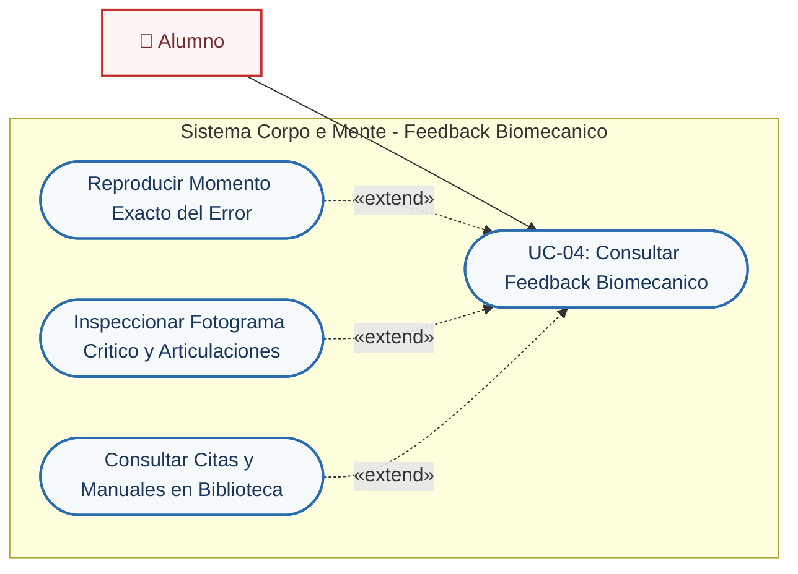

---

### 5.4.3. Diagrama de Clases UC-04
Participantes reales del pipeline de retroalimentación y consulta de citas:
* **Boundary:** `FeedbackView`, `LibraryView` y `EvaluacionesRoutes` (`consultar_evaluacion`, `buscar_en_biblioteca`).
* **Control:** `IntelligenceAnalysisFacade`, `MultimodalRAGService`, `HybridRetriever`, `Qwen3VLRerankerCrossEncoder`, `GlossaryService`, `IPromptStrategy` y `LocalVLMAdapter`.
* **Entity:** `Evaluacion`, `TeoriaRAG` y `AnalisisResultDTO`.

```mermaid
classDiagram
    class FeedbackView {
        <<Boundary>>
        +result: AnalisisResultDTO
        +showFrameModal: Boolean
        +jumpToError(timestamp)
        +openFrameModal()
    }

    class LibraryView {
        <<Boundary>>
        +messages: List
        +handleSearch()
        +handleCitationClick(src)
    }

    class EvaluacionesRoutes {
        <<Boundary>>
        +consultar_evaluacion(evaluacion_id: UUID) Dict
        +buscar_en_biblioteca(req: BibliotecaBuscarRequest) Dict
    }

    class IntelligenceAnalysisFacade {
        <<Control>>
        +UMBRAL_RELEVANCIA_RAG: Float
        +ejecutar_analisis_completo(video_path, tecnica_id, idioma) AnalisisResultDTO
    }

    class MultimodalRAGService {
        <<Control>>
        +obtener_evidencias_rag_multimodal(qwen, qdrant, tecnica_id) List
        +formatear_evidencias_texto(evidencias) String
    }

    class HybridRetriever {
        <<Control>>
        +DEFAULT_K_RRF: Int
        +fusionar_rrf(densos, bm25, top_k) List
        +recuperar(query_texto, qdrant, qwen) List
    }

    class Qwen3VLRerankerCrossEncoder {
        <<Control>>
        +rerank_pairs(query, documents) List
    }

    class GlossaryService {
        <<Control>>
        +expandir_query_con_glosario(query) String
    }

    class IPromptStrategy {
        <<Interface>>
        +construir_prompt_evaluacion(tecnica, discrepancias, mensaje) String
        +obtener_mensaje_sin_contexto() Dict
    }

    class LocalVLMAdapter {
        <<Adapter>>
        +generar_texto_feedback(prompt, frame, evidencias, idioma) Dict
        +evaluar_fidelidad_grounding(respuesta, contexto, mensaje) Dict
        +generar_respuesta_rag_chat(query, chunks, idioma) String
    }

    class Evaluacion {
        <<Entity>>
        +id: UUID
        +porcentaje_similitud: Float
        +feedback_gemini_es: String
        +feedback_summary: String
    }

    class TeoriaRAG {
        <<Entity>>
        +id: UUID
        +contenido_texto: String
        +fuente_tipo: String
        +fuente_nombre: String
        +alcance: String
    }

    class AnalisisResultDTO {
        <<Entity>>
        +similitud: Float
        +feedback: String
        +feedback_summary: String
        +frame_critico_path: String
        +timestamp_error_segundos: Float
        +nombres_articulaciones_criticas: List
    }

    FeedbackView ..> EvaluacionesRoutes : HTTP GET evaluacion
    LibraryView ..> EvaluacionesRoutes : HTTP POST biblioteca/buscar
    EvaluacionesRoutes --> IntelligenceAnalysisFacade : consulta resultados
    IntelligenceAnalysisFacade --> MultimodalRAGService : aplica jerarquia y fallback global
    MultimodalRAGService --> HybridRetriever : recupera candidatos
    HybridRetriever --> GlossaryService : expande terminos
    IntelligenceAnalysisFacade --> Qwen3VLRerankerCrossEncoder : reordena top candidatos
    IntelligenceAnalysisFacade --> IPromptStrategy : selecciona idioma
    IntelligenceAnalysisFacade --> LocalVLMAdapter : redacta y audita fidelidad
    MultimodalRAGService ..> TeoriaRAG : consulta
    IntelligenceAnalysisFacade --> Evaluacion : actualiza reporte
    EvaluacionesRoutes ..> AnalisisResultDTO : retorna
```

---

### 5.4.4. Diagrama de Secuencia ECB UC-04

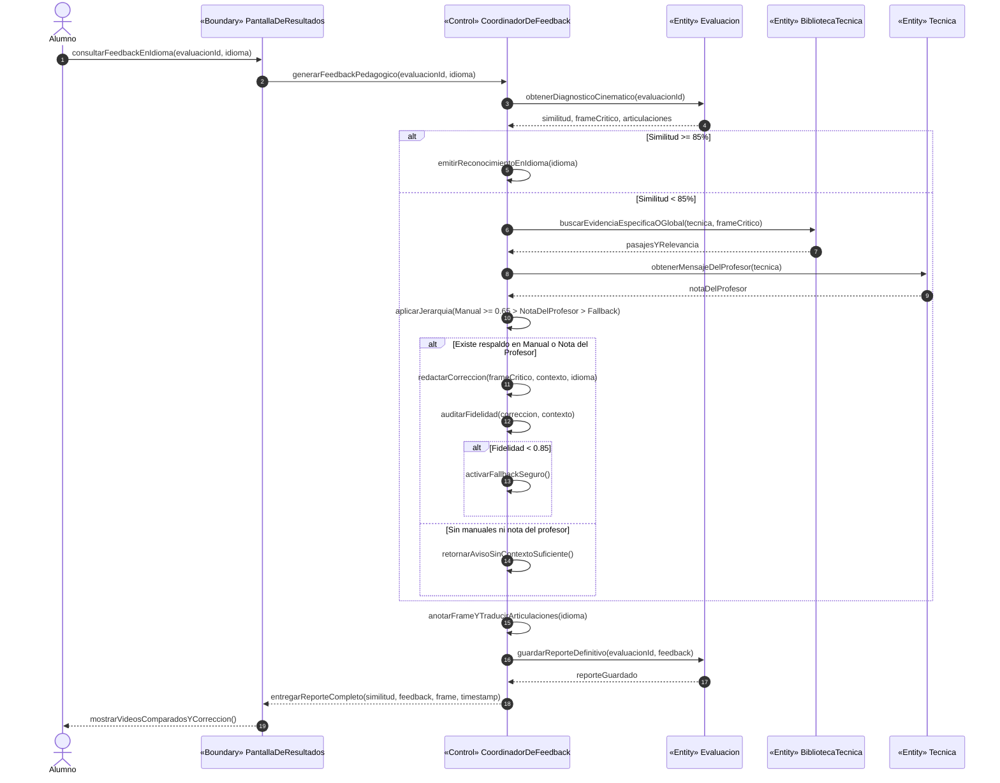

---

### 5.4.5. Diagrama de Paquetes UC-04
Las estrategias de idioma (`prompt_strategies.py`), el glosario y el recuperador híbrido residen en `Dominio` e interactúan con `local_vlm_adapter.py`, `qwen_adapter.py` y Qdrant en `Infraestructura`.

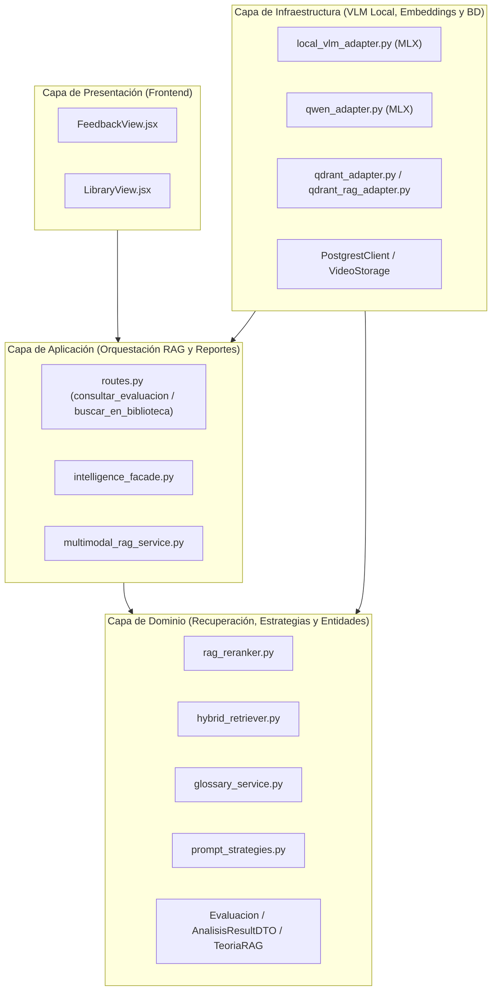

---

## 5.5. Caso de Uso 5: Gestionar Técnicas y Videos de Referencia (UC-05)

### 5.5.1. Caso de Uso 5: Gestionar Técnicas y Videos de Referencia (UC-05) — Especificación
| Campo | Especificación |
| :--- | :--- |
| **Identificador** | **UC-05** |
| **Nombre** | Gestionar Técnicas y Videos de Referencia |
| **Actores** | **Principal:** Profesor, Administrador. |
| **Intención del Usuario** | Crear, editar o eliminar técnicas de Jiu-Jitsu en el catálogo oficial de la academia y subir su video demostrativo señalando quién es el instructor en la escena para que sirva como referencia a los alumnos. |
| **Precondiciones** | El usuario ha iniciado sesión con rol `profesor` o `admin`. |
| **Postcondiciones** | 1. Al crear o actualizar con video, la técnica queda registrada con su patrón biomecánico activo en Qdrant y su video respaldado de forma persistente (`storage_root()/reference_videos`).<br>2. Al eliminar una técnica, se borran de forma coordinada sus filas en PostgreSQL, sus vectores de poses y sus fragmentos asociados en Qdrant. |

#### Curso Normal
| Paso | Intención del Actor | Respuesta Observable del Sistema |
| :---: | :--- | :--- |
| 1 | El Profesor abre su panel de técnicas, solicita crear o editar una técnica e ingresa su nombre, cinturón, indicaciones opcionales y video demostrativo. | El Sistema procesa el fotograma inicial del video y muestra las personas detectadas en la escena. |
| 2 | El Profesor confirma qué silueta corresponde al instructor que ejecuta la técnica. | El Sistema crea o actualiza la técnica, extrae la secuencia postural completa del instructor verificando una cobertura mínima del 40%, registra el patrón en Qdrant y lo activa en PostgreSQL. |
| 3 | | El Sistema guarda una copia persistente del video demostrativo (`persistir_video_referencia`), dispara en segundo plano la indexación visual de fotogramas para RAG y deja la técnica lista para que los alumnos se evalúen. |
| 4 | El Profesor puede editar solo el texto/cinturón de una técnica o solicitar eliminarla del catálogo. | Al editar texto se conserva el patrón vigente; al eliminar, el Sistema purga primero los vectores de pose y RAG en Qdrant y luego borra el registro de la técnica en PostgreSQL. |

#### Cursos Alternativos
* **2a. Cobertura postural insuficiente (menor al 40%) o falla al guardar patrón:** El Sistema rechaza el registro con error claro (`HTTP 422`), revierte cualquier dato parcial creado para no dejar técnicas vacías y solicita grabar un video más claro.
* **4a. Eliminación con datos en ambas bases:** El Sistema ejecuta la limpieza híbrida en `vectores_poses_jiujitsu`, `rag_knowledge` y PostgreSQL para no dejar vectores huérfanos.

#### Excepciones
* **E1. Pérdida de archivos temporales en `/tmp` tras reinicio:** Al arrancar FastAPI o consultar el catálogo, `VideoStorage` restaura automáticamente los videos faltantes desde su carpeta de respaldo persistente (`autocurar_videos_referencia_en_arranque`).

---

### 5.5.2. Diagrama de Caso de Uso UC-05

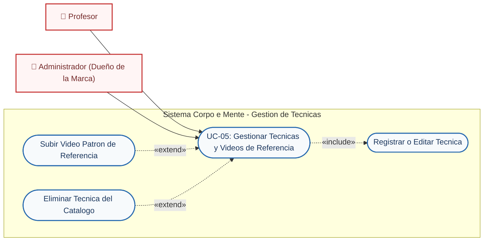

---

### 5.5.3. Diagrama de Clases UC-05
Participantes reales del catálogo técnico y persistencia de videos:
* **Boundary:** `ProfesorTecnicas`, `SelectorPersonaVideo` y `TecnicasRoutes` (`tecnicas_routes.py`).
* **Control:** `VideoStorage` (`video_storage.py`) y `PostgrestClient`.
* **Adapter / Entity:** `YOLOPoseAdapter`, `QdrantVectorAdapter`, `QdrantRAGAdapter`, `Tecnica` y `PatronReferencia`.

```mermaid
classDiagram
    class ProfesorTecnicas {
        <<Boundary>>
        +tecnicas: List
        +selectedFile: File
        +handleSave()
        +handleConfirmPersona()
        +handleDelete(id)
    }

    class SelectorPersonaVideo {
        <<Boundary>>
        +sessionData: Dict
        +selectedIdx: Int
        +onSelect(idx)
    }

    class TecnicasRoutes {
        <<Boundary>>
        +listar_tecnicas(profesor_id) List~TecnicaResponse~
        +crear_tecnica(req: TecnicaCreate) TecnicaResponse
        +actualizar_tecnica(tecnica_id, req) TecnicaResponse
        +eliminar_tecnica(tecnica_id) Void
        +registrar_patron_tecnica(tecnica_id, session_id, persona_idx) Dict
    }

    class VideoStorage {
        <<Control>>
        +persistir_video_referencia(source_path) String
        +resolver_video_estatico(raw_path, es_referencia) String
        +autocurar_videos_referencia_en_arranque() Void
    }

    class YOLOPoseAdapter {
        <<Adapter>>
        +extraer_secuencia(video_path, persona_idx_inicial) Dict
    }

    class QdrantVectorAdapter {
        <<Adapter>>
        +guardar_patron_secuencia(tecnica_id, patron_id, secuencia_kpts) Int
        +eliminar_por_tecnica(tecnica_id) Int
    }

    class QdrantRAGAdapter {
        <<Adapter>>
        +eliminar_por_tecnica(tecnica_id) Int
    }

    class PostgrestClient {
        <<Control>>
        +rpc(function_name: String, params: Dict) Any
    }

    class Tecnica {
        <<Entity>>
        +id: UUID
        +nombre: String
        +nivel_cinturon: String
        +mensaje_profesor: String
        +patron_activo_id: UUID
    }

    class PatronReferencia {
        <<Entity>>
        +id: UUID
        +tecnica_id: UUID
        +profesor_id: UUID
        +url_video: String
        +secuencia_3d: List
    }

    ProfesorTecnicas ..> SelectorPersonaVideo : selecciona instructor en video
    ProfesorTecnicas ..> TecnicasRoutes : HTTP GET/POST/PUT/DELETE
    TecnicasRoutes --> VideoStorage : respalda y autocura videos
    TecnicasRoutes --> YOLOPoseAdapter : extrae patron 3D
    TecnicasRoutes --> QdrantVectorAdapter : guarda o limpia poses
    TecnicasRoutes --> QdrantRAGAdapter : limpia fragmentos al eliminar
    TecnicasRoutes --> PostgrestClient : persiste en PostgreSQL
    PostgrestClient --> Tecnica : administra
    QdrantVectorAdapter --> PatronReferencia : almacena
```

---

### 5.5.4. Diagrama de Secuencia ECB UC-05

```mermaid
sequenceDiagram
    autonumber
    actor PR as Profesor
    participant B1 as «Boundary» PantallaCatalogoTecnico
    participant C1 as «Control» CoordinadorDeTecnicas
    participant E1 as «Entity» Tecnica
    participant E2 as «Entity» PatronDeReferencia

    alt Registrar o actualizar tecnica con video patron
        PR->>B1: ingresarDatosTecnicaYVideo(nombre, cinturon, notaProfesor, video)
        B1->>C1: procesarVideoInicial(video)
        C1-->>B1: siluetasEnEscena
        B1-->>PR: solicitarConfirmacionDeInstructor(siluetas)
        PR->>B1: confirmarInstructorYGuardar(personaSeleccionada)
        B1->>C1: registrarTecnicaYPatron(datos, video, personaSeleccionada)
        C1->>E1: guardarDatosTecnica(nombre, cinturon, notaProfesor)
        E1-->>C1: tecnicaId
        C1->>C1: extraerSecuenciaPosturalYRespaldarVideo(video, personaSeleccionada)
        C1->>E2: registrarPatronYVideoPersistente(tecnicaId, secuencia, videoRespaldo)
        E2-->>C1: patronActivo
        C1-->>B1: confirmacionDeRegistro(tecnicaId, patronActivo)
        B1-->>PR: mostrarTecnicaListaParaEvaluar()
    else Eliminar tecnica del catalogo
        PR->>B1: solicitarEliminarTecnica(tecnicaId)
        B1->>C1: eliminarTecnicaEnCascada(tecnicaId)
        C1->>E2: limpiarPatronesYTeoriaAsociada(tecnicaId)
        C1->>E1: eliminarRegistroDeCatalogo(tecnicaId)
        E1-->>C1: eliminacionConfirmada
        C1-->>B1: catalogoActualizado()
        B1-->>PR: confirmarEliminacionDeTecnica()
    end
```

---

### 5.5.5. Diagrama de Paquetes UC-05

```mermaid
graph TD
    subgraph Presentacion ["Capa de Presentación (Frontend)"]
        P_Prof["ProfesorTecnicas.jsx"]
        P_Sel["SelectorPersonaVideo.jsx"]
        P_Api["api/tecnicas.js"]
    end

    subgraph Aplicacion ["Capa de Aplicación (Rutas y Servicios)"]
        A_Routes["tecnicas_routes.py"]
        A_Msg["instructor_message_ingestion.py"]
        A_VidRag["rag_video_ingestion.py"]
    end

    subgraph Dominio ["Capa de Dominio (Entidades y Reglas)"]
        D_Tecnica["Tecnica"]
        D_Patron["PatronReferencia"]
    end

    subgraph Infraestructura ["Capa de Infraestructura (Visión, Almacenamiento y BD)"]
        I_YOLO["adapters.py (YOLOPoseAdapter)"]
        I_Vid["video_storage.py (Respaldo y Auto-curación)"]
        I_Qdrant["qdrant_adapter.py / qdrant_rag_adapter.py"]
        I_PG["PostgrestClient / PostgreSQL"]
    end

    Presentacion --> Aplicacion
    Aplicacion --> Dominio
    Infraestructura --> Aplicacion
    Infraestructura --> Dominio
```

---

## 5.6. Caso de Uso 6: Gestionar Manuales de Estudio y Notas del Profesor (UC-06)

### 5.6.1. Caso de Uso 6: Gestionar Manuales de Estudio y Notas del Profesor (UC-06) — Especificación
| Campo | Especificación |
| :--- | :--- |
| **Identificador** | **UC-06** |
| **Nombre** | Gestionar Manuales de Estudio y Notas del Profesor |
| **Actores** | **Principal:** Profesor, Administrador (Dueño de la Marca) en tareas de gestión; Alumno en consulta de Biblioteca. |
| **Intención del Usuario** | Subir libros o manuales de estudio en distintos formatos (PDF, Word, texto o imágenes), escribir notas o consejos prácticos propios en cada técnica (para guiar al alumno y servir de respaldo al análisis), eliminar manuales obsoletos y buscar o leer el material en la Biblioteca Técnica. |
| **Precondiciones** | El usuario ha iniciado sesión; solo `profesor` y `admin` pueden subir o eliminar material teórico y editar notas técnicas. |
| **Postcondiciones** | 1. El manual subido queda guardado, segmentado e indexado multimodalmente (texto e imágenes/páginas) en Qdrant y PostgreSQL.<br>2. La nota o consejo del profesor (`mensaje_profesor`) queda guardada tanto en PostgreSQL dentro de la técnica como en Qdrant (`instructor_message`).<br>3. Al eliminar un manual, se limpian atómicamente sus vectores en Qdrant, sus filas en PostgreSQL y su archivo físico e imágenes asociadas en disco. |

#### Curso Normal
| Paso | Intención del Actor | Respuesta Observable del Sistema |
| :---: | :--- | :--- |
| 1 | El Profesor abre la Biblioteca Global o la sección de teoría de una técnica específica. | El Sistema muestra el formulario para subir archivos, el cuadro de texto para escribir la **nota o consejo práctico del profesor** y la lista de manuales ya registrados. |
| 2 | El Profesor redacta una nota práctica para la técnica (por ejemplo: *"Mantén la rodilla pegada a la cadera antes de girar"*) o sube un manual de estudio (`.pdf`, `.docx`, `.txt` o imagen) indicando su título. | El Sistema guarda la nota del profesor o procesa el archivo en segundo plano mostrando su porcentaje de avance (con opción de cancelar), extrae texto e imágenes/páginas visuales y los indexa en Qdrant y PostgreSQL. |
| 3 | Cualquier usuario autenticado abre la pestaña de Biblioteca para buscar una duda técnica o abrir el catálogo de manuales. | El Sistema ejecuta búsqueda semántica multimodal, responde citando las fuentes con etiquetas claras (`📚` para manuales y `🥋` para notas del profesor) y permite previsualizar PDFs, textos o imágenes. |
| 4 | El Profesor o Administrador presiona eliminar junto a un manual obsoleto (o limpia la teoría de una técnica). | El Sistema elimina simultáneamente los puntos vectoriales en Qdrant, las filas en `teoria_referencia` (`admin_delete_manual_teoria`) y los archivos físicos en disco, actualizando el catálogo al instante. |

#### Cursos Alternativos
* **2a. Formato no compatible o archivo mayor a 100 MB:** El Sistema rechaza el documento (`HTTP 415` o `HTTP 413`) explicando los formatos admitidos y el límite de tamaño.
* **2b. Documento sin contenido extraíble:** El Sistema informa (`HTTP 422`) que el archivo no contiene texto ni páginas válidas para indexar.
* **4a. Alumno intenta eliminar un manual o subir material:** El Sistema deniega la operación (`HTTP 403`) y oculta las acciones de edición en pantalla.

#### Excepciones
* **E1. Cancelación de la carga de un manual desde el modal:** El cliente aborta la petición y el monitoreo de progreso, devolviendo el modal a estado listo sin bloquear la interfaz.

---

### 5.6.2. Diagrama de Caso de Uso UC-06

```mermaid
flowchart LR
    classDef actor fill:#FFF5F5,stroke:#C53030,color:#742A2A,stroke-width:2px
    classDef usecase fill:#F7FAFC,stroke:#2B6CB0,color:#1A365D,stroke-width:2px

    PR["👤 Profesor"]:::actor
    AD["👤 Administrador (Dueño de la Marca)"]:::actor
    AL["👤 Alumno"]:::actor

    subgraph Sistema["Sistema Corpo e Mente - Biblioteca y Conocimiento"]
        UC06(["UC-06: Gestionar Manuales de Estudio y Notas del Profesor"]):::usecase
        UC06_Up(["Subir Manual a Biblioteca PDF/DOCX/TXT/Imagen"]):::usecase
        UC06_Msg(["Escribir Nota o Consejo del Profesor en la Tecnica"]):::usecase
        UC06_Del(["Eliminar Manual o Teoria Obsoleta"]):::usecase
        UC06_Read(["Buscar y Previsualizar Biblioteca"]):::usecase
    end

    PR --> UC06
    AD --> UC06
    PR --> UC06_Read
    AD --> UC06_Read
    AL --> UC06_Read

    UC06_Up -.->|"«extend»"| UC06
    UC06_Msg -.->|"«extend»"| UC06
    UC06_Del -.->|"«extend»"| UC06
```

---

### 5.6.3. Diagrama de Clases UC-06
Participantes reales del módulo de conocimiento:
* **Boundary:** `GlobalKnowledgeModal`, `TheoryManagerModal`, `LibraryView` y `EvaluacionesRoutes` (`routes.py`).
* **Control:** `IngestKnowledgeUseCase`, `DeleteTheoryUseCase`, `ListTheoryUseCase`, `InstructorMessageIngestion` y `PostgrestClient`.
* **Adapter / Entity:** `QwenEmbeddingAdapter`, `QdrantRAGAdapter`, `TeoriaRAG` y `Tecnica`.

```mermaid
classDiagram
    class GlobalKnowledgeModal {
        <<Boundary>>
        +file: File
        +sourceName: String
        +sources: List
        +handleUpload()
        +handleCancelUpload()
        +handleDeleteSource(filename)
    }

    class TheoryManagerModal {
        <<Boundary>>
        +tecnica: Tecnica
        +chunks: List
        +handleDeleteAll()
    }

    class LibraryView {
        <<Boundary>>
        +manuales: List
        +fetchManuales()
        +handleDeleteManual(filename)
    }

    class EvaluacionesRoutes {
        <<Boundary>>
        +ingerir_archivo_teoria(archivo, alcance, tecnica_id) Dict
        +listar_manuales_pdf() List
        +servir_manual_pdf(filename) FileResponse
        +eliminar_manual_conocimiento(filename) Dict
        +eliminar_teoria(tecnica_id) Dict
    }

    class IngestKnowledgeUseCase {
        <<Control>>
        +execute(tecnica_id, contenido_texto, alcance) IngestionResponse
    }

    class DeleteTheoryUseCase {
        <<Control>>
        +execute(tecnica_id, profesor_id) Dict
    }

    class InstructorMessageIngestion {
        <<Control>>
        +sincronizar_mensaje_profesor(tecnica_id, mensaje) Int
    }

    class QwenEmbeddingAdapter {
        <<Adapter>>
        +generar_embedding_texto(texto) List
        +generar_embedding_imagen(image, prompt) List
    }

    class QdrantRAGAdapter {
        <<Adapter>>
        +ingestar_desde_respuesta(data, tecnica_id, alcance) Dict
        +eliminar_por_manual(filename) Int
        +eliminar_puntos(point_ids) Int
    }

    class PostgrestClient {
        <<Control>>
        +rpc(function_name: String, params: Dict) Any
    }

    class TeoriaRAG {
        <<Entity>>
        +id: UUID
        +tecnica_id: UUID
        +fuente_tipo: String
        +fuente_nombre: String
        +alcance: String
        +qdrant_point_id: UUID
    }

    GlobalKnowledgeModal ..> EvaluacionesRoutes : sube o elimina manuales
    TheoryManagerModal ..> EvaluacionesRoutes : consulta o limpia teoria
    LibraryView ..> EvaluacionesRoutes : previsualiza o elimina manual
    EvaluacionesRoutes --> IngestKnowledgeUseCase : indexa texto e imagenes
    EvaluacionesRoutes --> DeleteTheoryUseCase : elimina teoria de tecnica
    EvaluacionesRoutes --> QdrantRAGAdapter : limpia vectores de manual
    EvaluacionesRoutes --> PostgrestClient : ejecuta admin_delete_manual_teoria
    IngestKnowledgeUseCase --> QwenEmbeddingAdapter : vectoriza 2048 dims
    IngestKnowledgeUseCase --> QdrantRAGAdapter : guarda puntos
    IngestKnowledgeUseCase --> TeoriaRAG : registra metadata
    DeleteTheoryUseCase --> QdrantRAGAdapter : purga puntos
    InstructorMessageIngestion --> QdrantRAGAdapter : sincroniza nota
```

---

### 5.6.4. Diagrama de Secuencia ECB UC-06

```mermaid
sequenceDiagram
    autonumber
    actor PR as Profesor
    participant B1 as «Boundary» PantallaDeBiblioteca
    participant C1 as «Control» CoordinadorDeConocimiento
    participant E1 as «Entity» Tecnica
    participant E2 as «Entity» BibliotecaTecnica

    alt Subir manual o actualizar nota del profesor
        PR->>B1: cargarDocumentoOAgregarNota(archivo, alcance, notaProfesor)
        B1->>C1: procesarConocimiento(archivo, alcance, notaProfesor)
        opt Incluye nota del profesor en tecnica
            C1->>E1: guardarNotaDelProfesor(tecnica, notaProfesor)
            E1-->>C1: notaGuardada
        end
        opt Incluye documento PDF, DOCX, TXT o Imagen
            C1->>C1: extraerTextoEIlustraciones(archivo)
            C1->>E2: catalogarFragmentosEImagenes(fuente, fragmentos)
            E2-->>C1: totalCatalogado
        end
        C1-->>B1: confirmacionDeCarga(totalCatalogado)
        B1-->>PR: mostrarFuenteDisponibleEnBiblioteca()
    else Eliminar manual obsoleto de la biblioteca
        PR->>B1: solicitarEliminarManual(nombreArchivo)
        B1->>C1: eliminarManualDeFormaAtomica(nombreArchivo)
        C1->>E2: purgarVectoresYRegistros(nombreArchivo)
        C1->>C1: eliminarArchivoFisicoEImagenes(nombreArchivo)
        E2-->>C1: limpiezaConfirmada
        C1-->>B1: manualEliminado()
        B1-->>PR: actualizarCatalogoDeBiblioteca()
    end
```

---

### 5.6.5. Diagrama de Paquetes UC-06

```mermaid
graph TD
    subgraph Presentacion ["Capa de Presentación (Frontend)"]
        P_Global["GlobalKnowledgeModal.jsx"]
        P_Theory["TheoryManagerModal.jsx"]
        P_Lib["LibraryView.jsx"]
    end

    subgraph Aplicacion ["Capa de Aplicación (Casos de Uso y Rutas)"]
        A_Routes["routes.py (ingesta, descarga, borrado de manuales)"]
        A_Ingest["ingest_knowledge_use_case.py"]
        A_Del["delete_theory_use_case.py"]
        A_List["list_theory_use_case.py"]
        A_Msg["instructor_message_ingestion.py"]
    end

    subgraph Dominio ["Capa de Dominio (Entidades)"]
        D_Teoria["TeoriaRAG"]
        D_Tecnica["Tecnica"]
    end

    subgraph Infraestructura ["Capa de Infraestructura (Embeddings, Vector DB y Almacenamiento)"]
        I_Qwen["qwen_adapter.py (MLX)"]
        I_Qdrant["qdrant_rag_adapter.py"]
        I_PG["PostgrestClient / PostgreSQL"]
        I_FS["Almacenamiento de Manuales (Disco)"]
    end

    Presentacion --> Aplicacion
    Aplicacion --> Dominio
    Infraestructura --> Aplicacion
    Infraestructura --> Dominio
```

---

## 5.7. Caso de Uso 7: Ver Progreso de Alumnos (UC-07)

### 5.7.1. Caso de Uso 7: Ver Progreso de Alumnos (UC-07) — Especificación
| Campo | Especificación |
| :--- | :--- |
| **Identificador** | **UC-07** |
| **Nombre** | Ver Progreso de Alumnos |
| **Actores** | **Principal:** Profesor, Alumno. |
| **Intención del Usuario** | Consultar la evolución técnica a lo largo del tiempo: el profesor revisa las calificaciones y videos de los alumnos de su propia sede, y el alumno consulta su propio historial de prácticas. |
| **Precondiciones** | El usuario tiene una sesión activa como `profesor`, `alumno` o `admin`. |
| **Postcondiciones** | El usuario visualiza el historial de evaluaciones autorizado, incluyendo la sucursal histórica donde se realizó cada evaluación, el porcentaje de similitud, los videos comparativos y la corrección emitida. |

#### Curso Normal
| Paso | Intención del Actor | Respuesta Observable del Sistema |
| :---: | :--- | :--- |
| 1 | El Profesor ingresa a la pestaña de Alumnos en su panel (o el Alumno abre la vista **"Mi Progreso"**). | El Sistema identifica el rol y la sucursal del solicitante y recupera únicamente los alumnos de esa sede (o únicamente el historial propio si es alumno). |
| 2 | | El Sistema consolida las evaluaciones con su puntaje, fecha, sucursal histórica congelada, estado del Pase de Tatami y enlaces de video validados/auto-curados. |
| 3 | El usuario selecciona una evaluación para revisar el detalle, reproducir los videos o consultar la teoría asociada. | El Sistema reproduce el video del alumno y el video del profesor, permite saltar al segundo del error y enlaza con la Biblioteca pasando la técnica y la imagen crítica. |

#### Cursos Alternativos
* **1a. Alumno sin evaluaciones previas:** El Sistema muestra el estado vacío amigable indicando que aún no ha subido prácticas.
* **2a. Profesor intenta consultar a un alumno de otra sucursal:** El Sistema bloquea el acceso (`HTTP 403`) manteniendo la privacidad entre sedes.

#### Excepciones
* **E1. Error temporal al cargar el historial:** El Sistema muestra un aviso claro de error de conexión sin cerrar la sesión del usuario.

---

### 5.7.2. Diagrama de Caso de Uso UC-07

```mermaid
flowchart LR
    classDef actor fill:#FFF5F5,stroke:#C53030,color:#742A2A,stroke-width:2px
    classDef usecase fill:#F7FAFC,stroke:#2B6CB0,color:#1A365D,stroke-width:2px

    PR["👤 Profesor"]:::actor
    AL["👤 Alumno"]:::actor

    subgraph Sistema["Sistema Corpo e Mente - Progreso y Evaluaciones"]
        UC07(["UC-07: Consultar Progreso y Evaluaciones"]):::usecase
        UC07_Det(["Revisar Videos y Correccion de Evaluacion"]):::usecase
    end

    PR --> UC07
    AL --> UC07
    UC07 -.->|"«include»"| UC07_Det
```

---

### 5.7.3. Diagrama de Clases UC-07
* **Boundary:** `StudentProgress`, `ProfesorTecnicas`, `AuthRoutes` (`listar_alumnos`, `listar_evaluaciones_alumno`) y `EvaluacionesRoutes` (`consultar_evaluacion`).
* **Control:** `PostgrestClient` y `VideoStorage`.
* **Entity:** `Usuario` y `Evaluacion`.

```mermaid
classDiagram
    class StudentProgress {
        <<Boundary>>
        +evaluaciones: List
        +loading: Boolean
        +renderStudentVideo()
    }

    class ProfesorTecnicas {
        <<Boundary>>
        +alumnos: List
        +evaluacionesPorAlumno: Dict
        +fetchAlumnos()
        +fetchEvaluacionesAlumno(alumno_id)
    }

    class AuthRoutes {
        <<Boundary>>
        +listar_alumnos(p_sucursal_id) List~LoginResponse~
        +listar_evaluaciones_alumno(alumno_id) List
    }

    class EvaluacionesRoutes {
        <<Boundary>>
        +consultar_evaluacion(evaluacion_id) Dict
    }

    class VideoStorage {
        <<Control>>
        +resolver_video_estatico(raw_path, es_referencia) String
    }

    class PostgrestClient {
        <<Control>>
        +rpc(function_name: String, params: Dict) Any
    }

    class Usuario {
        <<Entity>>
        +id: UUID
        +nombre_completo: String
        +sucursal_id: UUID
        +estado_suscripcion: String
    }

    class Evaluacion {
        <<Entity>>
        +id: UUID
        +alumno_id: UUID
        +tecnica_id: UUID
        +sucursal_id: UUID
        +porcentaje_similitud: Float
        +feedback_gemini_es: String
        +fecha_evaluacion: DateTime
    }

    StudentProgress ..> AuthRoutes : HTTP GET historial propio
    ProfesorTecnicas ..> AuthRoutes : HTTP GET alumnos y evaluaciones
    AuthRoutes --> PostgrestClient : ejecuta RPC con aislamiento de sede
    AuthRoutes --> VideoStorage : resuelve y autocura videos
    EvaluacionesRoutes --> PostgrestClient : consulta detalle
    PostgrestClient --> Usuario : valida sede y rol
    PostgrestClient --> Evaluacion : recupera historial
```

---

### 5.7.4. Diagrama de Secuencia ECB UC-07

```mermaid
sequenceDiagram
    autonumber
    actor U as Profesor o Alumno
    participant B1 as «Boundary» PantallaDeProgreso
    participant C1 as «Control» CoordinadorDeProgreso
    participant E1 as «Entity» Usuario
    participant E2 as «Entity» Evaluacion

    alt Profesor supervisa alumnos de su sucursal
        U->>B1: abrirPanelDeAlumnos()
        B1->>C1: obtenerAlumnosDeSede(profesor)
        C1->>E1: listarAlumnosPorSucursal(sucursalId)
        E1-->>C1: listaDeAlumnos
        C1-->>B1: listaConEstadoDePase(listaDeAlumnos)
        B1-->>U: mostrarAlumnosDeAcademia()
        U->>B1: seleccionarAlumno(alumnoId)
        B1->>C1: consultarHistorial(profesor, alumnoId)
        C1->>E1: verificarMismaSucursal(profesor, alumnoId)
        E1-->>C1: accesoAutorizado
        C1->>E2: listarEvaluaciones(alumnoId)
        E2-->>C1: evaluacionesConVideos
        C1-->>B1: resumenDeProgreso(evaluacionesConVideos)
        B1-->>U: mostrarEvolucionYVideos()
    else Alumno consulta su propio historial
        U->>B1: abrirMiProgreso()
        B1->>C1: consultarMiHistorial(alumnoId)
        C1->>E2: listarEvaluaciones(alumnoId)
        E2-->>C1: misEvaluaciones
        C1-->>B1: historialPersonal(misEvaluaciones)
        B1-->>U: mostrarNotasYVideosPropios()
    end
```

---

### 5.7.5. Diagrama de Paquetes UC-07

```mermaid
graph TD
    subgraph Presentacion ["Capa de Presentación (Frontend)"]
        P_Prog["StudentProgress.jsx"]
        P_Prof["ProfesorTecnicas.jsx"]
    end

    subgraph Aplicacion ["Capa de Aplicación (Rutas)"]
        A_Auth["auth_routes.py (listar_alumnos / listar_evaluaciones_alumno)"]
        A_Routes["routes.py (consultar_evaluacion)"]
    end

    subgraph Dominio ["Capa de Dominio (Entidades)"]
        D_User["Usuario"]
        D_Eval["Evaluacion"]
    end

    subgraph Infraestructura ["Capa de Infraestructura (Persistencia y Videos)"]
        I_PG["PostgrestClient / PostgreSQL (RLS)"]
        I_Vid["video_storage.py"]
    end

    Presentacion --> Aplicacion
    Aplicacion --> Dominio
    Infraestructura --> Aplicacion
    Infraestructura --> Dominio
```

---

## 5.8. Caso de Uso 8: Activar Pase de Tatami (UC-08)

### 5.8.1. Caso de Uso 8: Activar Pase de Tatami (UC-08) — Especificación
| Campo | Especificación |
| :--- | :--- |
| **Identificador** | **UC-08** |
| **Nombre** | Activar Pase de Tatami |
| **Actores** | **Principal:** Profesor, Administrador. |
| **Intención del Usuario** | Habilitar o renovar por 30 días el acceso de un alumno al análisis con IA después de confirmar que pagó su mensualidad en la recepción de la academia. |
| **Precondiciones** | 1. El profesor o administrador tiene sesión activa.<br>2. Si es profesor, el alumno pertenece a su misma sucursal. |
| **Postcondiciones** | 1. El estado de suscripción del alumno cambia a `activo` con fecha de expiración a 30 días.<br>2. El alumno queda habilitado de inmediato para subir videos y recibir evaluaciones. |

#### Curso Normal
| Paso | Intención del Actor | Respuesta Observable del Sistema |
| :---: | :--- | :--- |
| 1 | El Profesor abre la pestaña de **Pases Pendientes** en su panel. | El Sistema lista los alumnos de su sucursal que tienen el pase en estado `pendiente` o `expirado`. |
| 2 | Tras verificar el pago presencial, el Profesor presiona **Activar Pase** junto al alumno. | El Sistema verifica que el profesor y el alumno pertenezcan a la misma sede, actualiza el estado del alumno a `activo` por 30 días y registra la nueva fecha de vencimiento. |
| 3 | | El Sistema confirma la activación en pantalla y actualiza el listado de pases pendientes. |

#### Cursos Alternativos
* **2a. Profesor intenta activar a un alumno de otra sucursal:** El Sistema bloquea la operación (`HTTP 403`) respetando la regla de aislamiento por sede.
* **2b. Vencimiento automático de los 30 días:** Si la fecha de expiración ya pasó, `check_student_subscription` detecta el vencimiento automáticamente y bloquea nuevos análisis hasta la próxima renovación.

#### Excepciones
* **E1. Alumno no encontrado:** El Sistema responde `HTTP 404` y no modifica ningún registro.

---

### 5.8.2. Diagrama de Caso de Uso UC-08

```mermaid
flowchart LR
    classDef actor fill:#FFF5F5,stroke:#C53030,color:#742A2A,stroke-width:2px
    classDef usecase fill:#F7FAFC,stroke:#2B6CB0,color:#1A365D,stroke-width:2px

    PR["👤 Profesor"]:::actor
    AD["👤 Administrador (Dueño de la Marca)"]:::actor

    subgraph Sistema["Sistema Corpo e Mente - Pase de Tatami"]
        UC08(["UC-08: Activar Pase de Tatami por 30 Dias"]):::usecase
        UC08_List(["Consultar Alumnos Pendientes o Expirados"]):::usecase
    end

    PR --> UC08
    AD --> UC08
    UC08 -.->|"«include»"| UC08_List
```

---

### 5.8.3. Diagrama de Clases UC-08
* **Boundary:** `ProfesorTecnicas`, `VideoUpload` (muro visual de pase) y `AuthRoutes` (`listar_alumnos_pendientes`, `activar_pase_tatami`, `require_active_subscription`).
* **Control:** `PostgrestClient` (`rpc("activar_pase_alumno")`).
* **Entity:** `Usuario` (atributos `estado_suscripcion` y `fecha_expiracion`).

```mermaid
classDiagram
    class ProfesorTecnicas {
        <<Boundary>>
        +pendientes: List
        +activandoId: UUID
        +fetchPendientes()
        +handleActivarPase(alumnoId, alumnoNombre)
    }

    class VideoUpload {
        <<Boundary>>
        +isPassActive: Boolean
        +isExpired: Boolean
        +isPending: Boolean
    }

    class AuthRoutes {
        <<Boundary>>
        +listar_alumnos_pendientes() List~AlumnoPendienteResponse~
        +activar_pase_tatami(alumno_id, req) ActivarPaseResponse
        +check_student_subscription(user_id) Dict
        +require_active_subscription(authorization) Dict
    }

    class PostgrestClient {
        <<Control>>
        +rpc(function_name: String, params: Dict) Any
    }

    class Usuario {
        <<Entity>>
        +id: UUID
        +sucursal_id: UUID
        +estado_suscripcion: String
        +fecha_expiracion: DateTime
    }

    ProfesorTecnicas ..> AuthRoutes : HTTP GET/POST pases
    VideoUpload ..> AuthRoutes : valida vigencia de suscripcion
    AuthRoutes --> PostgrestClient : ejecuta activar_pase_alumno
    PostgrestClient --> Usuario : actualiza estado activo y +30 dias
```

---

### 5.8.4. Diagrama de Secuencia ECB UC-08

```mermaid
sequenceDiagram
    autonumber
    actor PR as Profesor
    participant B1 as «Boundary» PantallaDeMembresias
    participant C1 as «Control» CoordinadorDeMembresias
    participant E1 as «Entity» Usuario

    PR->>B1: consultarPasesPendientes()
    B1->>C1: listarAlumnosPendientesOExpirados(profesor)
    C1->>E1: obtenerPendientesDeSucursal(profesor)
    E1-->>C1: alumnosPendientes
    C1-->>B1: nominaPendientes
    B1-->>PR: mostrarAlumnosPendientes()
    PR->>B1: activarPase30Dias(alumnoId)
    B1->>C1: aprobarPaseDeTatami(profesor, alumnoId, 30)
    C1->>E1: validarPertenenciaMismaSede(profesor, alumnoId)
    alt Alumno de otra sucursal
        E1-->>C1: accesoDenegado
        C1-->>B1: rechazarOperacion()
        B1-->>PR: informarRestriccionDeSucursal()
    else Misma sucursal
        C1->>E1: activarMembresiaPorTreintaDias(alumnoId)
        E1-->>C1: estadoActivoYFechaExpiracion
        C1-->>B1: paseActivado(fechaExpiracion)
        B1-->>PR: confirmarActivacionExitosa()
    end
```

---

### 5.8.5. Diagrama de Paquetes UC-08

```mermaid
graph TD
    subgraph Presentacion ["Capa de Presentación (Frontend)"]
        P_Prof["ProfesorTecnicas.jsx (Pestaña Pases)"]
        P_Upload["VideoUpload.jsx (Muro Pase de Tatami)"]
    end

    subgraph Aplicacion ["Capa de Aplicación (Rutas y Guardas)"]
        A_Auth["auth_routes.py (activar_pase_tatami / require_active_subscription)"]
    end

    subgraph Dominio ["Capa de Dominio (Entidades)"]
        D_User["Usuario (estado_suscripcion y fecha_expiracion)"]
    end

    subgraph Infraestructura ["Capa de Infraestructura (Persistencia)"]
        I_PG["PostgrestClient / PostgreSQL"]
    end

    Presentacion --> Aplicacion
    Aplicacion --> Dominio
    Infraestructura --> Aplicacion
    Infraestructura --> Dominio
```

---

## 5.9. Caso de Uso 9: Gestionar Sucursales y Coordenadas Geográficas (UC-09)

### 5.9.1. Caso de Uso 9: Gestionar Sucursales y Coordenadas Geográficas (UC-09) — Especificación
| Campo | Especificación |
| :--- | :--- |
| **Identificador** | **UC-09** |
| **Nombre** | Gestionar Sucursales y Coordenadas Geográficas |
| **Actores** | **Principal:** Administrador (Dueño de la Marca) en gestión; Profesor y Alumno en consulta del mapa de sedes. |
| **Intención del Usuario** | Registrar nuevas sedes de la academia, editar su ubicación en el mapa o pegando un enlace de Google Maps, y eliminar sucursales que ya no tengan usuarios asignados. |
| **Precondiciones** | Para crear, modificar o eliminar se requiere sesión activa de `admin`. |
| **Postcondiciones** | 1. La sucursal queda guardada en el directorio oficial con país, ciudad, dirección y coordenadas.<br>2. La sucursal solo se elimina si no posee alumnos, profesores o administradores vinculados. |

#### Curso Normal
| Paso | Intención del Actor | Respuesta Observable del Sistema |
| :---: | :--- | :--- |
| 1 | El Administrador abre la gestión de sucursales y pega un enlace de Google Maps o ubica el punto en el mapa interactivo. | El Sistema extrae latitud y longitud, consulta a OpenStreetMap (Nominatim) y rellena automáticamente el país, la ciudad y la dirección aproximada. |
| 2 | El Administrador verifica o edita el nombre de la sede y guarda los cambios. | El Sistema guarda o actualiza la sucursal en PostgreSQL y refresca el listado junto con el mapa embebido de cada sede. |
| 3 | El Administrador puede solicitar eliminar una sucursal que ya no opera. | El Sistema comprueba que no tenga usuarios vinculados y elimina la sede del directorio. |

#### Cursos Alternativos
* **1a. Enlace sin coordenadas reconocibles:** El Sistema avisa que no se detectó la ubicación en el enlace y permite completar los campos manualmente o moviendo el marcador del mapa.
* **3a. Sucursal con usuarios vinculados:** El Sistema impide la eliminación (`HTTP 400`) e indica que primero deben reasignarse o darse de baja los usuarios adscritos a esa sede.

#### Excepciones
* **E1. Servicio externo Nominatim temporalmente sin respuesta:** El Sistema conserva las coordenadas extraídas y permite al administrador escribir manualmente la ciudad, país y dirección.

---

### 5.9.2. Diagrama de Caso de Uso UC-09

```mermaid
flowchart LR
    classDef actor fill:#FFF5F5,stroke:#C53030,color:#742A2A,stroke-width:2px
    classDef usecase fill:#F7FAFC,stroke:#2B6CB0,color:#1A365D,stroke-width:2px

    AD["👤 Administrador (Dueño de la Marca)"]:::actor
    PR["👤 Profesor"]:::actor
    AL["👤 Alumno"]:::actor

    subgraph Sistema["Sistema Corpo e Mente - Sucursales"]
        UC09(["UC-09: Gestionar Sucursales de la Academia"]):::usecase
        UC09_Map(["Ubicar Sede en Mapa o Enlace"]):::usecase
        UC09_Del(["Eliminar Sucursal sin Usuarios"]):::usecase
        UC09_Ver(["Consultar Directorio y Mapa de Sedes"]):::usecase
    end

    AD --> UC09
    PR --> UC09_Ver
    AL --> UC09_Ver
    UC09 -.->|"«include»"| UC09_Map
    UC09_Del -.->|"«extend»"| UC09
```

---

### 5.9.3. Diagrama de Clases UC-09
* **Boundary:** `AdminSucursales` (mapa Leaflet) y `AuthRoutes` (`listar_sucursales`, `crear_sucursal`, `actualizar_sucursal`, `eliminar_sucursal`, `parse_gmaps_link`).
* **Control:** `PostgrestClient`.
* **Entity:** `Sucursal`.

```mermaid
classDiagram
    class AdminSucursales {
        <<Boundary>>
        +sucursales: List
        +latitud: Float
        +longitud: Float
        +googleMapsUrl: String
        +handleGoogleMapsUrlChange(url)
        +handleSubmit()
        +handleDelete(sucursalId)
    }

    class AuthRoutes {
        <<Boundary>>
        +listar_sucursales() List~SucursalResponse~
        +crear_sucursal(nueva: SucursalCreate) SucursalResponse
        +actualizar_sucursal(sucursal_id, req) SucursalResponse
        +eliminar_sucursal(sucursal_id) Void
        +parse_gmaps_link(req: ParseGmapsRequest) ParseGmapsResponse
    }

    class PostgrestClient {
        <<Control>>
        +get(table: String) List
        +rpc(function_name: String, params: Dict) Any
    }

    class Sucursal {
        <<Entity>>
        +id: UUID
        +nombre: String
        +pais: String
        +ciudad: String
        +direccion: String
        +latitud: Float
        +longitud: Float
    }

    AdminSucursales ..> AuthRoutes : HTTP GET/POST/PUT/DELETE
    AuthRoutes --> PostgrestClient : ejecuta RPCs de sucursal
    PostgrestClient --> Sucursal : crea, actualiza o elimina
```

---

### 5.9.4. Diagrama de Secuencia ECB UC-09

```mermaid
sequenceDiagram
    autonumber
    actor AD as Administrador
    participant B1 as «Boundary» PantallaDeSucursales
    participant C1 as «Control» CoordinadorDeSucursales
    participant E1 as «Entity» Sucursal

    alt Registrar o editar sucursal
        AD->>B1: indicarUbicacionOEnlace(coordenadasOUrl)
        B1->>C1: obtenerDatosGeograficos(coordenadasOUrl)
        C1-->>B1: propuestaPaisCiudadDireccion
        B1-->>AD: mostrarDatosYMapa(propuesta)
        AD->>B1: confirmarGuardarSucursal(nombre, pais, ciudad, direccion, lat, lng)
        B1->>C1: guardarSucursal(datosSucursal)
        C1->>E1: persistirSucursal(datosSucursal)
        E1-->>C1: sucursalGuardada
        C1-->>B1: confirmacion(sucursalGuardada)
        B1-->>AD: actualizarListaYMapa()
    else Eliminar sucursal existente
        AD->>B1: solicitarEliminarSucursal(sucursalId)
        B1->>C1: eliminarSucursal(sucursalId)
        C1->>E1: verificarSinUsuariosYBorrar(sucursalId)
        alt Tiene usuarios adscritos
            E1-->>C1: rechazoPorIntegridad
            C1-->>B1: informarUsuariosVinculados()
            B1-->>AD: mostrarAdvertenciaDeReasignacion()
        else Sucursal vacia
            E1-->>C1: sucursalEliminada
            C1-->>B1: bajaConfirmada()
            B1-->>AD: actualizarListaDeSedes()
        end
    end
```

---

### 5.9.5. Diagrama de Paquetes UC-09

```mermaid
graph TD
    subgraph Presentacion ["Capa de Presentación (Frontend)"]
        P_Branch["AdminSucursales.jsx (Leaflet.js)"]
    end

    subgraph Aplicacion ["Capa de Aplicación (Rutas)"]
        A_Auth["auth_routes.py (sucursales y parse-gmaps-link)"]
    end

    subgraph Dominio ["Capa de Dominio (Entidades)"]
        D_Suc["Sucursal"]
    end

    subgraph Infraestructura ["Capa de Infraestructura (Cartografía y Persistencia)"]
        I_OSM["OpenStreetMap / Nominatim"]
        I_PG["PostgrestClient / PostgreSQL"]
    end

    Presentacion --> Aplicacion
    Aplicacion --> Dominio
    Infraestructura --> Aplicacion
    Infraestructura --> Dominio
```

---

## 5.10. Caso de Uso 10: Soporte Técnico y Administración de Cuentas de Usuario (UC-10)

### 5.10.1. Caso de Uso 10: Soporte Técnico y Administración de Cuentas de Usuario (UC-10) — Especificación
| Campo | Especificación |
| :--- | :--- |
| **Identificador** | **UC-10** |
| **Nombre** | Soporte Técnico y Administración de Cuentas de Usuario |
| **Actores** | **Principal:** Administrador (Dueño de la Marca); **Secundario:** Usuario (Alumno o Profesor en edición de perfil propio o como usuario asistido). |
| **Intención del Usuario** | Permitir al Administrador entrar temporalmente como otro usuario para darle soporte técnico, cambiar la sucursal de un practicante o eliminar cuentas protegiendo la integridad del contenido docente; y permitir a cada usuario actualizar su propio perfil e idioma. |
| **Precondiciones** | El operador cuenta con sesión activa (`admin` para impersonar, cambiar sucursales de terceros o eliminar cuentas; cualquier usuario autenticado para editar su propio perfil). |
| **Postcondiciones** | 1. En modo soporte, el administrador ve exactamente la interfaz del usuario asistido bajo un banner rojo permanente y puede volver a su sesión original en un clic.<br>2. Al eliminar un usuario, nunca se permite que el administrador borre su propia cuenta; si es un alumno se borran en cascada sus evaluaciones y pases, y si es un profesor con videos/patrones/teoría se exige o ejecuta su reasignación previa (`admin_delete_user`). |

#### Curso Normal
| Paso | Intención del Actor | Respuesta Observable del Sistema |
| :---: | :--- | :--- |
| 1 | El Administrador entra a la pestaña de **Usuarios** en el panel administrativo. | El Sistema lista las cuentas registradas mostrando nombre, usuario, rol y sucursal actual. |
| 2 | Para brindar soporte, el Administrador presiona **Entrar como este usuario**. | El Sistema emite una sesión temporal con los datos del usuario asistido, guarda la sesión original del administrador en memoria y muestra un banner rojo permanente en la parte superior para volver cuando termine. |
| 3 | Para dar de baja una cuenta, el Administrador presiona **Eliminar usuario** y confirma la acción. | El Sistema verifica que no sea su propia cuenta y ejecuta `admin_delete_user` en PostgreSQL: si es alumno elimina sus registros en cascada; si es profesor sin contenido lo elimina directamente. |
| 4 | Cada usuario autenticado (o el Administrador) puede abrir **Mi Perfil** para cambiar su nombre, foto, contraseña o idioma preferido (`es`, `pt`, `en`). | El Sistema guarda los cambios sin alterar jamás el estado de su Pase de Tatami ni su fecha de vencimiento. |

#### Cursos Alternativos
* **3a. Profesor con videos, patrones o teoría asociados:** El Sistema devuelve un conflicto controlado (`HTTP 409`) informando cuántos recursos tiene vinculados y pide confirmación al Administrador para reasignarlos automáticamente a su cuenta (`auto_reasignar=true`) antes de completar la eliminación.
* **3b. Intento de auto-eliminación del administrador:** El Sistema rechaza la petición (`HTTP 400`) protegiendo el acceso administrativo.
* **4a. Cambio de sucursal de un usuario (`PUT /auth/usuarios/{id}/cambiar-sucursal`):** El Sistema actualiza la sede activa del alumno preservando intacta la sucursal original de sus evaluaciones históricas pasadas.

#### Excepciones
* **E1. Usuario objetivo no encontrado:** El Sistema responde `HTTP 404` sin modificar el directorio de cuentas.

> **Nota de transparencia:** La emisión de sesión delegada y el banner visual de retorno funcionan en producción; la re-autenticación obligatoria por contraseña para impersonar y una tabla física dedicada de auditoría (`auditoria_impersonacion`) se mantienen como mejoras planificadas (§6.7 y §8.6).

---

### 5.10.2. Diagrama de Caso de Uso UC-10

```mermaid
flowchart LR
    classDef actor fill:#FFF5F5,stroke:#C53030,color:#742A2A,stroke-width:2px
    classDef usecase fill:#F7FAFC,stroke:#2B6CB0,color:#1A365D,stroke-width:2px

    AD["👤 Administrador (Dueño de la Marca)"]:::actor
    US["👤 Usuario (Alumno o Profesor)"]:::actor

    subgraph Sistema["Sistema Corpo e Mente - Soporte y Cuentas"]
        UC10(["UC-10: Soporte Tecnico y Administracion de Cuentas"]):::usecase
        UC10_Imp(["Entrar como Otro Usuario para Soporte"]):::usecase
        UC10_Del(["Eliminar Cuenta con Reasignacion"]):::usecase
        UC10_Suc(["Cambiar Sucursal de Usuario"]):::usecase
        UC10_Perf(["Editar Perfil e Idioma Propio"]):::usecase
    end

    AD --> UC10
    US --> UC10_Perf
    UC10_Imp -.->|"«extend»"| UC10
    UC10_Del -.->|"«extend»"| UC10
    UC10_Suc -.->|"«extend»"| UC10
```

---

### 5.10.3. Diagrama de Clases UC-10
* **Boundary:** `AdminSucursales` (pestaña Usuarios), `App` (banner rojo y retorno de sesión), `UserProfileModal` y `AuthRoutes` (`impersonate_user`, `eliminar_usuario`, `update_usuario`, `cambiar_sucursal_usuario`).
* **Control:** `PostgrestClient` (`admin_delete_user`, `admin_cambiar_sucursal_usuario`, `admin_update_user`).
* **Entity:** `Usuario`, `Sucursal` y `LoginResponse`.

```mermaid
classDiagram
    class AdminSucursales {
        <<Boundary>>
        +usuarios: List
        +fetchUsuarios()
        +handleImpersonate(targetUserId)
        +handleDeleteUser(targetUser)
    }

    class App {
        <<Boundary>>
        +user: LoginResponse
        +originalAdminUser: LoginResponse
        +onImpersonate(newUser, currentAdmin)
    }

    class UserProfileModal {
        <<Boundary>>
        +nombre: String
        +selectedIdioma: String
        +handleUpdate()
    }

    class AuthRoutes {
        <<Boundary>>
        +listar_usuarios() List~LoginResponse~
        +impersonate_user(user_id) LoginResponse
        +update_usuario(user_id, req) LoginResponse
        +cambiar_sucursal_usuario(user_id, req) CambiarSucursalResponse
        +eliminar_usuario(user_id, reasignar_a, auto_reasignar) Void
    }

    class PostgrestClient {
        <<Control>>
        +rpc(function_name: String, params: Dict) Any
    }

    class Usuario {
        <<Entity>>
        +id: UUID
        +nombre_completo: String
        +rol: String
        +sucursal_id: UUID
        +idioma_preferido: String
    }

    class Sucursal {
        <<Entity>>
        +id: UUID
        +nombre: String
    }

    class LoginResponse {
        <<Entity>>
        +token: String
        +user_id: UUID
        +rol: String
        +sucursal_id: UUID
    }

    AdminSucursales ..> AuthRoutes : impersonate y delete usuario
    AdminSucursales ..> App : activa banner de soporte
    UserProfileModal ..> AuthRoutes : PUT perfil e idioma
    AuthRoutes --> PostgrestClient : ejecuta RPCs admin_delete_user y soporte
    PostgrestClient --> Usuario : consulta, actualiza o elimina
    Usuario "1" --> "1" Sucursal : adscrito_a
    AuthRoutes ..> LoginResponse : emite token de sesion
```

---

### 5.10.4. Diagrama de Secuencia ECB UC-10

```mermaid
sequenceDiagram
    autonumber
    actor AD as Administrador
    participant B1 as «Boundary» PantallaDeSoporteYUsuarios
    participant C1 as «Control» CoordinadorDeCuentas
    participant E1 as «Entity» Usuario
    participant E2 as «Entity» SesionDeSoporte

    alt Asumir identidad temporal para soporte
        AD->>B1: seleccionarUsuarioYEntrarComo(usuarioId)
        B1->>C1: iniciarImpersonacion(admin, usuarioId)
        C1->>E1: consultarPerfilDestino(usuarioId)
        E1-->>C1: datosUsuarioDestino
        C1->>E2: emitirSesionDelegada(datosUsuarioDestino)
        E2-->>C1: sesionDelegada
        C1-->>B1: vistaUsuarioConBannerRojo(sesionDelegada)
        B1-->>AD: mostrarEntornoDelUsuarioConAviso()
        AD->>B1: volverAMiCuentaAdmin()
        B1-->>AD: restaurarSesionOriginal()
    else Eliminar cuenta de usuario
        AD->>B1: solicitarEliminarUsuario(usuarioId)
        B1->>C1: eliminarUsuario(adminId, usuarioId)
        C1->>E1: ejecutarBajaConIntegridad(usuarioId, adminId)
        alt Es profesor con contenido y sin reasignacion
            E1-->>C1: conflictoContenidoAsociado
            C1-->>B1: solicitarConfirmacionDeReasignacion()
            B1-->>AD: confirmarReasignarRecursos()
            AD->>B1: confirmarAutoReasignacion()
            B1->>C1: eliminarConReasignacion(usuarioId, adminId)
            C1->>E1: reasignarYEliminar(usuarioId, adminId)
        end
        E1-->>C1: usuarioEliminado
        C1-->>B1: confirmarBaja()
        B1-->>AD: actualizarListaDeUsuarios()
    end
```

---

### 5.10.5. Diagrama de Paquetes UC-10

```mermaid
graph TD
    subgraph Presentacion ["Capa de Presentación (Frontend)"]
        P_Admin["AdminSucursales.jsx (Pestaña Usuarios)"]
        P_App["App.jsx (Banner de Soporte)"]
        P_Prof["UserProfileModal.jsx"]
    end

    subgraph Aplicacion ["Capa de Aplicación (Rutas)"]
        A_Auth["auth_routes.py (impersonate, update, cambiar-sucursal, delete)"]
    end

    subgraph Dominio ["Capa de Dominio (Entidades)"]
        D_User["Usuario"]
        D_Suc["Sucursal"]
        D_Resp["LoginResponse / Token"]
    end

    subgraph Infraestructura ["Capa de Infraestructura (Persistencia y Criptografía)"]
        I_PG["PostgrestClient / PostgreSQL (admin_delete_user)"]
        I_JWT["PyJWT (HS256)"]
    end

    Presentacion --> Aplicacion
    Aplicacion --> Dominio
    Infraestructura --> Aplicacion
    Infraestructura --> Dominio
```

---

## 5.11. Diagramas de Arquitectura Consolidada del Sistema Completo
Como cierre del capítulo de análisis y diseño bajo ICONIX, los tres diagramas globales consolidan la visión completa de la plataforma: primero desde las intenciones de los actores, luego el flujo de actividad extremo a extremo de la función central (evaluar y recibir consejo) y finalmente el mapa general de clases del software.

### 5.11.1. Diagrama de Casos de Uso del Sistema Completo
Agrupa los diez casos de uso organizados por subsistemas, enfocándose exclusivamente en lo que hacen `Alumno`, `Profesor` y `Administrador` en la plataforma.

```mermaid
flowchart LR
    classDef actor fill:#FFF5F5,stroke:#C53030,color:#742A2A,stroke-width:2px
    classDef usecase fill:#F7FAFC,stroke:#2B6CB0,color:#1A365D,stroke-width:2px

    AL["👤 Alumno"]:::actor
    PR["👤 Profesor"]:::actor
    AD["👤 Administrador (Dueño de la Marca)"]:::actor

    subgraph S1["Subsistema de Identificacion y Acceso"]
        UC01(["UC-01: Iniciar Sesion"]):::usecase
        UC02(["UC-02: Crear Cuenta de Alumno"]):::usecase
    end

    subgraph S2["Subsistema de Analisis y Feedback Biomecanico"]
        UC03(["UC-03: Analizar Video de Tecnica"]):::usecase
        UC03_Sil(["Confirmar Silueta en Escena"]):::usecase
        UC03_Can(["Cancelar Analisis en Curso"]):::usecase
        UC04(["UC-04: Consultar Feedback Biomecanico"]):::usecase
        UC04_Rep(["Reproducir Segundo del Error y Frame Critico"]):::usecase
    end

    subgraph S3["Subsistema de Catalogo y Conocimiento"]
        UC05(["UC-05: Gestionar Tecnicas y Videos Patron"]):::usecase
        UC06(["UC-06: Gestionar Manuales y Notas del Profesor"]):::usecase
        UC06_Lib(["Buscar y Previsualizar Biblioteca"]):::usecase
    end

    subgraph S4["Subsistema Academico y Administrativo"]
        UC07(["UC-07: Consultar Progreso y Evaluaciones"]):::usecase
        UC08(["UC-08: Activar Pase de Tatami 30 Dias"]):::usecase
        UC09(["UC-09: Gestionar Sucursales en Mapa"]):::usecase
        UC10(["UC-10: Soporte Tecnico y Cuentas de Usuario"]):::usecase
    end

    AL --> UC01
    PR --> UC01
    AD --> UC01

    AL --> UC02

    AL --> UC03
    UC03 -.->|"«include»"| UC03_Sil
    UC03_Can -.->|"«extend»"| UC03
    UC04 -.->|"«extend»"| UC03
    UC04_Rep -.->|"«extend»"| UC04

    AL --> UC04
    AL --> UC06_Lib
    AL --> UC07

    PR --> UC05
    PR --> UC06
    PR --> UC06_Lib
    PR --> UC07
    PR --> UC08

    AD --> UC05
    AD --> UC06
    AD --> UC06_Lib
    AD --> UC08
    AD --> UC09
    AD --> UC10
```

---

### 5.11.2. Diagrama de Actividad con Carriles del Sistema Completo (Flujo Principal UC-03 y UC-04)
Describe paso a paso la dinámica completa desde que el alumno sube su video (con opción de cancelarlo en curso) hasta que visualiza su reporte comparativo con citas verificadas, atravesando las seis capas del sistema.

```mermaid
flowchart TD
    classDef paso fill:#F7FAFC,stroke:#2B6CB0,color:#1A365D
    classDef decision fill:#FFF5F5,stroke:#C53030,color:#742A2A
    classDef exito fill:#F0FFF4,stroke:#2F855A,color:#22543D

    subgraph L_Alumno["Alumno (Cliente)"]
        A1["Iniciar sesion y elegir Profesor y Tecnica"]:::paso
        A2["Seleccionar video de practica en celular"]:::paso
        A3["Confirmar silueta propia en primer fotograma"]:::paso
        A4{"Desea cancelar durante\nel procesamiento?"}:::decision
        A5["Volver a pantalla inicial"]:::paso
        A6["Revisar feedback, saltar al segundo del error\ny abrir citas o Biblioteca"]:::exito
    end

    subgraph L_Frontend["Frontend (React 19 + Vite Proxy)"]
        F1["Validar tamano de archivo y enviar a validar-spam"]:::paso
        F2["Ejecutar AbortController y POST cancelar"]:::paso
        F3["Polling a GET /evaluaciones/id cada 3s"]:::paso
        F4["Renderizar FeedbackView (Videos + Tarjeta IA)"]:::paso
    end

    subgraph L_Backend["Backend (FastAPI)"]
        B1{"Pase de Tatami activo\ny formato valido?"}:::decision
        B2["Rechazar HTTP 403 / 422"]:::decision
        B3["Crear sesion (CREATED -> PERSONA_SELECTED)"]:::paso
        B4["Crear Evaluacion (procesando) y congelar sucursal_id"]:::paso
        B5["Marcar estado cancelado y borrar video temporal"]:::paso
        B6["Anotar frame critico y traducir articulaciones"]:::paso
    end

    subgraph L_Vision["IA de Vision (YOLO26 + ViCoS)"]
        V1{"Clasificador ViCoS\nratio BJJ >= 0.60?"}:::decision
        V2["Detectar personas y deduplicar siluetas"]:::paso
        V3["Extraer secuencia postural 3D y tracking IoU"]:::paso
    end

    subgraph L_Conocimiento["IA Biomecanica y RAG (DTW + Qwen3-VL MLX)"]
        K1["Normalizar 46 dims y alinear DTW contra patrones"]:::paso
        K2{"Similitud < 85.0%?"}:::decision
        K3["Emitir felicitacion deterministica"]:::exito
        K4["Buscar en manual de tecnica o Biblioteca Global\ny reordenar con Cross-Encoder"]:::paso
        K5{"Manual >= 0.65\no Nota del Profesor?"}:::decision
        K6["Qwen3-VL-Instruct-4B genera correccion\ny Juez audita fidelidad >= 0.85"]:::paso
        K7["Activar Respaldo Cuantitativo Seguro"]:::paso
    end

    subgraph L_Persistencia["Persistencia (PostgreSQL + Qdrant)"]
        P1["Obtener patrones activos en Qdrant"]:::paso
        P2["Guardar estado completado si no fue cancelado"]:::paso
    end

    A1 --> A2 --> F1 --> B1
    B1 -->|"No"| B2
    B1 -->|"Si"| V1
    V1 -->|"No"| B2
    V1 -->|"Si"| V2 --> B3 --> A3 --> B4 --> A4
    A4 -->|"Si"| F2 --> B5 --> A5
    A4 -->|"No"| V3 --> P1 --> K1 --> K2
    K2 -->|"No (>= 85%)"| K3 --> B6
    K2 -->|"Si (< 85%)"| K4 --> K5
    K5 -->|"Si"| K6 --> B6
    K5 -->|"No"| K7 --> B6
    B6 --> P2 --> F3 --> F4 --> A6
```

---

### 5.11.3. Diagrama de Clases del Sistema Completo
Consolida las clases principales reales del código en Frontend (React 19), Frontera HTTP (FastAPI), Aplicación y Dominio (casos de uso, biomecánica, recuperación híbrida y entidades) e Infraestructura (YOLO26, MLX, Qdrant, PostgREST y `VideoStorage`).

```mermaid
classDiagram
    %% Capa de Presentacion (Frontend React 19)
    class App {
        <<Boundary>>
        +user: LoginResponse
        +idioma: String
        +appState: String
        +currentEvaluacionId: UUID
        +handleUploadStart(uploadData)
        +handleCancelAnalysis()
        +handleLanguageChange(lang)
    }

    class LoginModal {
        <<Boundary>>
        +loginUserOrEmail: String
        +signupUsername: String
        +handleLoginSubmit()
        +handleSignupSubmit()
    }

    class UserProfileModal {
        <<Boundary>>
        +nombre: String
        +selectedIdioma: String
        +handleUpdate()
    }

    class VideoUpload {
        <<Boundary>>
        +profesores: List
        +tecnicas: List
        +selectedFile: File
        +handleFile(file)
        +handleSubmit()
    }

    class SelectorPersonaVideo {
        <<Boundary>>
        +sessionData: Dict
        +selectedPersonaIdx: Int
        +onSelect(idx)
    }

    class FeedbackView {
        <<Boundary>>
        +result: AnalisisResultDTO
        +showFrameModal: Boolean
        +jumpToError(timestamp)
    }

    class StudentProgress {
        <<Boundary>>
        +evaluaciones: List
    }

    class LibraryView {
        <<Boundary>>
        +query: String
        +manuales: List
        +handleSearch()
        +handleDeleteManual(filename)
    }

    class ProfesorTecnicas {
        <<Boundary>>
        +alumnos: List
        +tecnicas: List
        +pendientes: List
        +handleActivarPase(alumno_id)
        +handleSave()
    }

    class AdminSucursales {
        <<Boundary>>
        +sucursales: List
        +usuarios: List
        +handleImpersonate(user_id)
        +handleDeleteUser(targetUser)
    }

    class TheoryManagerModal {
        <<Boundary>>
        +chunks: List
        +handleDeleteAll()
    }

    class GlobalKnowledgeModal {
        <<Boundary>>
        +sources: List
        +handleUpload()
        +handleDeleteSource(filename)
    }

    %% Capa de Frontera API (FastAPI)
    class AuthRoutes {
        <<Boundary>>
        +login(req) LoginResponse
        +signup(req) LoginResponse
        +impersonate_user(user_id) LoginResponse
        +eliminar_usuario(user_id, auto_reasignar) Void
        +activar_pase_tatami(alumno_id) ActivarPaseResponse
        +crear_sucursal(nueva) SucursalResponse
        +eliminar_sucursal(sucursal_id) Void
    }

    class EvaluacionesRoutes {
        <<Boundary>>
        +validar_spam(video) Dict
        +obtener_primer_frame(video) Dict
        +analizar_video(background_tasks, tecnica_id) Dict
        +cancelar_evaluacion_endpoint(evaluacion_id) Dict
        +consultar_evaluacion(evaluacion_id) Dict
        +buscar_en_biblioteca(req) Dict
        +ingerir_archivo_teoria(archivo, alcance) Dict
        +eliminar_manual_conocimiento(filename) Dict
    }

    class TecnicasRoutes {
        <<Boundary>>
        +listar_tecnicas(profesor_id) List
        +crear_tecnica(req) TecnicaResponse
        +eliminar_tecnica(tecnica_id) Void
        +registrar_patron_tecnica(tecnica_id, session_id) Dict
    }

    %% Capa de Aplicacion y Dominio
    class IntelligenceAnalysisFacade {
        <<Control>>
        +UMBRAL_RELEVANCIA_RAG: Float
        +ejecutar_analisis_completo(video_path, tecnica_id, idioma) AnalisisResultDTO
    }

    class IngestKnowledgeUseCase {
        <<Control>>
        +execute(tecnica_id, contenido_texto, alcance) IngestionResponse
    }

    class DeleteTheoryUseCase {
        <<Control>>
        +execute(tecnica_id, profesor_id) Dict
    }

    class SessionStateManager {
        <<Control>>
        +crear_sesion(session_id, video_path, personas) Dict
        +seleccionar_persona(session_id, persona_idx) Dict
        +iniciar_operacion(session_id, tecnica_id) Dict
        +finalizar_operacion(session_id, exito, error) Dict
    }

    class HybridRetriever {
        <<Control>>
        +fusionar_rrf(densos, bm25, top_k) List
        +recuperar(query_texto, qdrant, qwen) List
    }

    class Qwen3VLRerankerCrossEncoder {
        <<Control>>
        +rerank_pairs(query, documents) List
    }

    class DTWComparator {
        <<Control>>
        +comparar_secuencias_con_dtw(seq_m, seq_a) Dict
    }

    class PoseNormalizer {
        <<Control>>
        +normalizar(kpts_flat) Dict
    }

    class IPromptStrategy {
        <<Interface>>
        +construir_prompt_evaluacion(tecnica, discrepancias, mensaje) String
    }

    %% Entidades de Dominio
    class Usuario {
        <<Entity>>
        +id: UUID
        +username: String
        +rol: String
        +sucursal_id: UUID
        +estado_suscripcion: String
    }

    class Sucursal {
        <<Entity>>
        +id: UUID
        +nombre: String
        +latitud: Float
        +longitud: Float
    }

    class Tecnica {
        <<Entity>>
        +id: UUID
        +nombre: String
        +nivel_cinturon: String
        +mensaje_profesor: String
    }

    class Evaluacion {
        <<Entity>>
        +id: UUID
        +alumno_id: UUID
        +tecnica_id: UUID
        +sucursal_id: UUID
        +porcentaje_similitud: Float
        +estado: String
    }

    class PatronReferencia {
        <<Entity>>
        +patron_id: UUID
        +tecnica_id: UUID
        +secuencia_3d: List
    }

    class TeoriaRAG {
        <<Entity>>
        +id: UUID
        +tecnica_id: UUID
        +fuente_nombre: String
        +alcance: String
    }

    class AnalisisResultDTO {
        <<Entity>>
        +similitud: Float
        +feedback: String
        +frame_critico_path: String
        +timestamp_error_segundos: Float
    }

    %% Capa de Infraestructura
    class YOLOPoseAdapter {
        <<Adapter>>
        +extraer_secuencia(video_path, idx) Dict
        +extraer_frame_y_dibujar_error(video_path, frame_idx, kpts) String
    }

    class LocalSpamFilter {
        <<Adapter>>
        +validar_es_jiujitsu(video_path) Boolean
    }

    class QwenEmbeddingAdapter {
        <<Adapter>>
        +generar_embedding_texto(texto) List
        +generar_embedding_imagen(image, prompt) List
    }

    class LocalVLMAdapter {
        <<Adapter>>
        +generar_texto_feedback(prompt, frame, idioma) Dict
        +evaluar_fidelidad_grounding(respuesta, contexto, mensaje) Dict
    }

    class PostgrestClient {
        <<Adapter>>
        +rpc(function_name, params) Any
    }

    class QdrantVectorAdapter {
        <<Adapter>>
        +guardar_patron_secuencia(tecnica_id, patron_id, secuencia) Int
        +eliminar_por_tecnica(tecnica_id) Int
    }

    class QdrantRAGAdapter {
        <<Adapter>>
        +eliminar_por_manual(filename) Int
        +eliminar_por_tecnica(tecnica_id) Int
    }

    class VideoStorage {
        <<Adapter>>
        +persistir_video_referencia(src) String
        +resolver_video_estatico(raw_path) String
        +autocurar_videos_referencia_en_arranque() Void
    }

    App ..> LoginModal : abre
    App ..> UserProfileModal : abre
    App ..> VideoUpload : renderiza
    App ..> FeedbackView : renderiza
    App ..> StudentProgress : renderiza
    App ..> LibraryView : renderiza
    App ..> ProfesorTecnicas : renderiza
    App ..> AdminSucursales : renderiza

    VideoUpload ..> SelectorPersonaVideo : usa
    ProfesorTecnicas ..> TheoryManagerModal : abre
    ProfesorTecnicas ..> GlobalKnowledgeModal : abre

    AuthRoutes --> PostgrestClient : usa
    EvaluacionesRoutes --> IntelligenceAnalysisFacade : invoca
    EvaluacionesRoutes --> IngestKnowledgeUseCase : invoca
    EvaluacionesRoutes --> DeleteTheoryUseCase : invoca
    EvaluacionesRoutes --> SessionStateManager : controla
    EvaluacionesRoutes --> LocalSpamFilter : filtra
    EvaluacionesRoutes --> VideoStorage : resuelve videos
    TecnicasRoutes --> PostgrestClient : usa
    TecnicasRoutes --> VideoStorage : persiste y autocura
    TecnicasRoutes --> QdrantVectorAdapter : guarda o purga
    TecnicasRoutes --> QdrantRAGAdapter : purga fragmentos

    IntelligenceAnalysisFacade --> YOLOPoseAdapter : usa
    IntelligenceAnalysisFacade --> QdrantVectorAdapter : consulta
    IntelligenceAnalysisFacade --> LocalVLMAdapter : genera y audita
    IntelligenceAnalysisFacade --> QwenEmbeddingAdapter : vectoriza
    IntelligenceAnalysisFacade --> DTWComparator : alinea
    IntelligenceAnalysisFacade --> HybridRetriever : recupera
    IntelligenceAnalysisFacade --> Qwen3VLRerankerCrossEncoder : rerank
    IntelligenceAnalysisFacade --> IPromptStrategy : selecciona idioma
    IntelligenceAnalysisFacade ..> AnalisisResultDTO : retorna

    DTWComparator ..> PoseNormalizer : usa
    IngestKnowledgeUseCase --> QdrantRAGAdapter : indexa
    DeleteTheoryUseCase --> QdrantRAGAdapter : borra

    Usuario "1" --> "1" Sucursal : pertenece_a
    Usuario "1" --> "*" Evaluacion : realiza
    Tecnica "1" --> "*" Evaluacion : evaluada_en
    Tecnica "1" --> "*" PatronReferencia : tiene
    Tecnica "1" --> "*" TeoriaRAG : referencia
```

---

# Capítulo VI: Desarrollo

## 6.1. Introducción al Proceso de Construcción
La construcción del Sistema de Análisis Biomecánico de Técnicas de Jiu-Jitsu Brasileño para la academia "Corpo e Mente" se organizó de manera incremental guiada por los casos de uso y los artefactos de la **Metodología ICONIX** (Rosenberg & Stephens, 2007). Partiendo de las intenciones del usuario definidas en los diez casos de uso (`UC-01` a `UC-10`) y de sus participantes Boundary–Control–Entity (ECB), el código se estructuró en ciclos cortos orientados a validar primero los riesgos técnicos de mayor impacto: la convivencia de los modelos de IA en memoria unificada, la velocidad de análisis en video, la privacidad multi-sucursal y la integridad entre las bases de datos relacional y vectorial.

El historial de construcción, las decisiones experimentales descartadas y las métricas registradas se encuentran documentados en `docs/PlanEvaluacionIteraciones.md` y `docs/Auditoria_CRUD.md`, respaldados en un repositorio Git versionado con puntos de restauración (*tags*) para garantizar trazabilidad y reversión controlada ante cualquier fallo.

## 6.2. Herramientas de Desarrollo, Licencias y Software Utilizado

### 6.2.1. Entorno de Desarrollo e IA Asistida
Durante el desarrollo se emplearon herramientas de asistencia inteligente bajo revisión humana constante para acelerar la codificación, la depuración y la auditoría técnica.

Tabla 18
*Herramientas de desarrollo y codificación asistida por Inteligencia Artificial*

| Herramienta | Rol en el Proyecto | Licencia / Costo | Justificación Técnica |
| :--- | :--- | :--- | :--- |
| **Antigravity (Google AI Pro)** | Asistente principal de codificación, refactorización multi-archivo y auditoría de seguridad | Suscripción comercial Google AI Pro (pago mensual) | Razonamiento sobre arquitecturas completas en Python/React, ejecución controlada de pruebas y verificación de consistencia entre código y documentación. |
| **DeepSeek (API / Chat)** | Revisión de lógica matemática (DTW, normalización biomecánica) y diseño de pruebas unitarias | Freemium / API de bajo costo por consumo | Apoyo sólido en algoritmos numéricos para revisar `pose_normalizer.py` y `dtw_comparator.py`. |
| **GitHub** | Control de versiones distribuido y respaldo de hitos mediante etiquetas | Gratuito para repositorios / Plan Pro | Preserva el historial completo y permite volver atrás ante cualquier degradación técnica. |

*Nota.* Elaboración propia (2026).

### 6.2.2. Infraestructura de Cómputo y Hardware
La selección de hardware priorizó la autosuficiencia operativa en la academia, bajo consumo eléctrico y privacidad total de las grabaciones.

Tabla 19
*Infraestructura de cómputo y hardware evaluada y utilizada*

| Recurso | Especificación Técnica | Costo Asociado | Justificación Técnica y Operativa |
| :--- | :--- | :--- | :--- |
| **MacBook Air M5 (Hardware de Producción Seleccionado)** | Chip Apple Silicon M5, GPU integrada, Neural Engine, **24 GB de Memoria Unificada** | Inversión única de hardware (~\$1,500 USD) | Permite ejecutar localmente YOLOv26 y los modelos Qwen3-VL con bajo consumo energético (~30 W) y sin pagar alquiler mensual de servidores GPU en la nube. |
| **Google Colab (Infraestructura Experimental Descartada)** | Instancias cloud con GPU NVIDIA Tesla T4 / A100 | ~\$20 USD (recargas puntuales) | Se utilizó únicamente durante experimentos de reentrenamiento en la iteración 3C y pruebas iniciales. Fue descartado para producción diaria por sus desconexiones automáticas y doble subida de videos. |
| **Google AI Pro** | Acceso a modelos Gemini | Suscripción mensual | Empleada exclusivamente durante investigación y desarrollo; **no se utiliza en producción** para evitar latencias y costos por consulta. |

*Nota.* Elaboración propia (2026).

### 6.2.3. Stack de Software de Producción
Todo el stack de ejecución en producción se compone de herramientas gratuitas y de código abierto.

Tabla 20
*Stack de software de producción*

| Componente | Versión | Licencia | Rol en la Arquitectura |
| :--- | :--- | :--- | :--- |
| **Python** | 3.12 | PSF License | Lenguaje del backend, lógica biomecánica y pipeline de IA. |
| **FastAPI** | 0.115.0 | MIT | Framework asíncrono para exponer endpoints REST, archivos estáticos y tareas en segundo plano. |
| **PostgreSQL** | 16 | PostgreSQL License | Base de datos relacional con Row Level Security (RLS), `pgcrypto` y funciones RPC. |
| **PostgREST** | 12.x | MIT | Capa REST automática sobre PostgreSQL para invocar procedimientos almacenados seguros. |
| **Qdrant** | 1.11.3 | Apache 2.0 | Base de datos vectorial para poses 3D (133 dims) y fragmentos RAG (2048 dims). |
| **Docker + Docker Compose** | 27.x | Apache 2.0 | Contenerización de PostgreSQL, PostgREST y Qdrant. |
| **React** | 19.2.8 | MIT | Biblioteca de interfaz web *Mobile-First* centrada en el usuario. |
| **Vite** | 5.4.11 | MIT | Empaquetador frontend y proxy inverso integrado para `/api`, `/static` y `/health`. |
| **Ultralytics** | >= 8.4.0 | AGPL-3.0 | Motor de visión por computadora para YOLOv26 Pose, Depth y Segmentation. |
| **MLX (Apple)** | 0.32.x | MIT | Framework nativo para ejecutar modelos Qwen3-VL en la memoria unificada de Apple Silicon. |
| **Qwen3-VL** | 2B / 4B | Apache 2.0 | Modelos multimodales para embeddings (8-bit), reranker (4-bit) y generación pedagógica (4-bit). |
| **Cloudflare Tunnel (`cloudflared`)** | 2026.x | Apache 2.0 | Túnel cifrado saliente para acceso HTTPS desde internet sin abrir puertos en el router. |
| **Leaflet.js** | 1.9.4 | BSD-2-Clause | Mapas interactivos con OpenStreetMap y Nominatim para sucursales. |
| **pytest** | 8.3.3 | MIT | Suite automatizada de pruebas unitarias e integración del backend. |
| **Playwright** | 1.4x | Apache 2.0 | Herramienta empleada en las validaciones visuales E2E en navegador real. |
| **Mozilla Firefox** | 13x | MPL 2.0 | Navegador empleado en pruebas manuales de interfaz web. |

*Nota.* Elaboración propia (2026).

### 6.2.4. Herramientas de Modelado y Documentación
Para mantener la documentación viva, fácil de previsualizar en cualquier editor y libre de dependencias pesadas como Java Runtime, toda la suite de diagramas del proyecto se estandarizó al 100% en **Mermaid** incrustado en Markdown y sincronizado con archivos `.mmd` en `docs/diagramas/codigo/`.

Tabla 21
*Herramientas de modelado, diseño y documentación técnica*

| Herramienta | Propósito en el Proyecto | Tipo de Licencia |
| :--- | :--- | :--- |
| **Mermaid** | Lenguaje único de modelado visual para los 47 diagramas del documento (Casos de Uso, Secuencia ECB, Clases, Paquetes, Modelo de Dominio, Actividad con Carriles, Flujo Operativo y Superficie de Ataque), externalizados en `docs/diagramas/codigo/*.mmd` e incrustados directamente en `ProyectoGrado.md` para previsualización nativa sin requerir Java Runtime. | MIT |
| **Mermaid Live Editor** | Validación visual y sintáctica de los diagramas antes de su integración definitiva. | MIT |
| **Doug Rosenberg & Matt Stephens (ICONIX, 2007)** | Marco metodológico principal para conectar los casos de uso centrados en el usuario con el análisis ECB y el diseño de clases y paquetes. | Referencia bibliográfica académica |
| **Michael V. Mannino (2018)** | Fundamento teórico para el diseño relacional de la base de datos en 3NF y su integridad referencial. | Referencia bibliográfica académica |
| **Hugging Face Hub** | Descarga de los pesos cuantizados (`mlx-community/Qwen3-VL-*`). | Apache 2.0 / Model Hub |
| **DeepSeek / Antigravity** | Apoyo en revisión de consistencia entre código fuente, diagramas y redacción del proyecto de grado. | Herramientas de soporte de ingeniería |

*Nota.* Elaboración propia (2026).

### 6.2.5. Repositorio de Habilidades de Ciberseguridad
Para auditar de forma preventiva la plataforma, se aplicaron tres suites del repositorio **`briiirussell/cybersecurity-skills`**:

1. **`api-audit`:** Revisión de control de acceso por objeto (BOLA), políticas CORS, limitación de tasa en login y validación de URLs (SSRF).
2. **`cloud-audit`:** Verificación de exposición de rutas de documentación y lista de hosts permitidos en el proxy (`allowedHosts`).
3. **`secrets-audit`:** Búsqueda de llaves privadas o contraseñas expuestas en código y archivos Docker.

El reporte completo de esta auditoría se conserva en `docs/findings.json` con **7 hallazgos** (3 rechazados con contraevidencia técnica por no ser vulnerables y 4 confirmados: 2 subsanados en código y configuración, y 2 registrados en la deuda de seguridad vigente, detallados en la Tabla 24 del Capítulo VIII).

## 6.3. Estructura del Repositorio
El código fuente sigue una arquitectura limpia en capas congruente con los diagramas de paquetes del Capítulo V:

```
JiuJitsu-main/
├── backend/                        # Núcleo de lógica de negocio, IA y APIs
│   ├── corpocmente/
│   │   ├── domain/                 # Entidades, biomecánica (DTW/normalización), estrategias y glosario
│   │   ├── application/            # Casos de uso RAG, DTOs y servicios de aplicación
│   │   ├── infrastructure/         # Adaptadores (YOLO, MLX VLM, Qwen, Qdrant, PostgREST, VideoStorage)
│   │   ├── ui/api/                 # Controladores HTTP FastAPI (auth_routes, routes, tecnicas_routes)
│   │   └── api/routes/             # Rutas adicionales de comparación visual
│   ├── tests/                      # Suite de 30 archivos de prueba en Pytest (181 tests recolectados)
│   ├── scripts/                    # Utilidades de mantenimiento, calibración y reconciliación RAG
│   └── storage/                    # Modelos (.pt, .pkl), manuales y frames de incertidumbre
├── frontend/                       # Aplicación web cliente en React 19 + Vite
│   ├── src/
│   │   ├── api/                    # Configuración de endpoints y estado de patrones
│   │   ├── components/             # Modales y selectores (Login, Perfil, Teoría, Conocimiento Global)
│   │   ├── pages/                  # Vistas principales (VideoUpload, Feedback, Progreso, Biblioteca, Profesor, Admin)
│   │   └── i18n/                   # Diccionario multilingüe (ES, PT, EN)
├── infrastructure/                 # Orquestación de servicios auxiliares
│   ├── docker-compose.yml          # Contenedores PostgreSQL 16, PostgREST y Qdrant
│   └── initdb/                     # Migraciones SQL 01 a 18 + reset_production.sql
├── scripts/                        # Scripts operativos vigentes (start.sh, stop.sh, status.sh, logs.sh)
└── docs/                           # ProyectoGrado.md, Auditoria_CRUD.md, findings.json y diagramas/codigo/*.mmd
```

## 6.4. Gestión de Configuración y Entornos
La operación diaria y la reproducibilidad del entorno se gestionan mediante archivos claros:

* **Variables de Entorno (`backend/.env.example`):** Define las variables requeridas (`ENVIRONMENT`, `DEBUG`, `POSTGREST_JWT_SECRET`, `JWT_SECRET_KEY`, `JWT_EXPIRATION_HOURS`, `WORKER_SERVICE_TOKEN`, `QDRANT_*`, `ALLOWED_ORIGINS`, `USE_LOCAL_QWEN`, `LOCAL_QWEN_MODEL`) manteniendo los archivos `.env` excluidos del control de versiones mediante `.gitignore`.
* **Scripts Operativos en `scripts/`:**
  * `start.sh`: Verifica directorios, levanta los contenedores Docker, arranca el backend FastAPI y levanta el servidor Vite.
  * `stop.sh`: Detiene ordenadamente los procesos de frontend/backend y apaga los contenedores Docker.
  * `status.sh`: Verifica el estado de los servicios, puertos y contenedores activos.
  * `logs.sh`: Permite consultar en vivo los registros de ejecución del backend y los servicios.
* **Auto-Curación al Arranque y Utilidades de Mantenimiento:** Al iniciar `backend/corpocmente/main.py`, la función `autocurar_videos_referencia_en_arranque()` verifica los videos de referencia y los restaura automáticamente desde `storage_root()/reference_videos` (configurable con `CORPOCMENTE_DATA_DIR`) o desde la raíz del proyecto si `/tmp/corpocmente_videos` se vació. Además, `backend/scripts/` conserva herramientas de administración como `reconcile_rag.py`, `wipe_system.py` y `ingest_multimodal_manuals.py`.

## 6.5. Internacionalización (i18n) y Localización
Debido al origen brasileño del Jiu-Jitsu y al contexto internacional de la academia, `frontend/src/i18n/translations.js` soporta de forma nativa tres idiomas: **Español (`es`)**, **Portugués (`pt`)** e **Inglés (`en`)**:

* **Persistencia Dual:** La preferencia se guarda localmente en `localStorage.app_idioma` y se sincroniza en PostgreSQL dentro de `usuarios.idioma_preferido` mediante `PUT /api/v1/auth/usuarios/{id}/idioma`.
* **Traducción Integral:** Traduce tanto etiquetas de pantalla, mensajes de error y botones (como *Cancelar Análisis*, *Eliminar Manual*, *Reasignar usuario*), como los nombres de las articulaciones anatómicas antes de mostrarlas en pantalla o enviarlas al modelo generativo.

## 6.6. Aprendizaje Continuo, Prevención del Olvido y Precisión del Sistema
Para responder con evidencia técnica al funcionamiento evolutivo y a la confiabilidad del sistema sobre el tatami, esta sección explica cómo aprende la plataforma, cómo evita olvidar técnicas previas y qué precisión numérica alcanzó en las pruebas reales.

### 6.6.1. ¿Cómo aprende el sistema? (Aprendizaje Continuo Visual y Teórico)
El sistema aprende en dos niveles complementarios, sin obligar al personal de la academia a programar ni reiniciar el servidor:

1. **Aprendizaje Visual Autónomo (*Data Flywheel* + *Hot-Swap*):**
   * **Captura automática de casos difíciles:** Cada vez que el modelo `YOLOv26-pose` detecta una postura en vivo con confianza inferior a `0.65`, `YOLOPoseAdapter` guarda automáticamente el fotograma ambiguo en `backend/storage/uncertainty_frames/` (evitando repetidos mediante hash SHA-256 y registrando el evento en `log.csv`). En pruebas operativas se capturaron **25 fotogramas únicos sobre 168 eventos de baja confianza**.
   * **Reentrenamiento sin detener el servicio:** Con esos fotogramas difíciles revisados y un nuevo conjunto de entrenamiento, se entrena un modelo actualizado (`yolo26n_autonomous.pt`). El método `_get_model()` vigila su fecha de modificación (`st_mtime`) y realiza un reemplazo en memoria en caliente (*Hot-Swap*) apenas detecta la nueva versión validada.
2. **Aprendizaje Instantáneo de Nuevas Técnicas y Manuales (Sin Reentrenar):**
   * **Nuevos patrones motores:** Cuando un profesor graba un nuevo video patrón en **UC-05**, su secuencia postural 3D de 133 dimensiones se vectoriza e indexa de inmediato en Qdrant, permitiendo evaluar esa técnica desde el primer segundo.
   * **Nuevo conocimiento teórico:** Al subir manuales (PDF, DOCX, TXT, imágenes) o guardar una nota del profesor en **UC-06**, el contenido se fragmenta e indexa en la colección `rag_knowledge` (2048 dimensiones), quedando disponible al instante para consultas y correcciones futuras.

### 6.6.2. ¿El sistema se olvida de lo que ya sabía? (Mitigación del Olvido Catastrófico)
**No se olvida.** En Inteligencia Artificial, reentrenar una red neuronal solo con datos nuevos suele destruir lo aprendido antes (fenómeno conocido como *olvido catastrófico*). Para evitarlo en el aprendizaje visual de nuevas llaves y posiciones de Jiu-Jitsu, el proyecto aplica tres defensas combinadas:

1. **Replay Buffer 70/30:** Cada ciclo de reentrenamiento mezcla obligatoriamente **70 % de poses históricas ya dominadas (Gold Standard)** con solo **30 % de poses de la técnica nueva**. Así la red repasa continuamente los movimientos anteriores mientras aprende los nuevos.
2. **Congelamiento de Capas Base (`freeze=10`):** Las primeras 10 capas visuales que reconocen bordes, formas del kimono y articulaciones básicas quedan bloqueadas durante el ajuste fino, preservando la base anatómica general.
3. **Agrupamiento FINCH con Tasa Adaptativa:** Ajusta el paso de aprendizaje agrupando automáticamente posturas similares sin sobrescribir abruptamente los pesos consolidados.

**Evidencia empírica:** Al enseñar la técnica compleja con cruce de brazos *Americana desde la montada*, la precisión en la técnica nueva subió de **18.08 % a 58.65 % Pose mAP@50-95 (+40.57 puntos porcentuales)** y, lejos de olvidarse de las técnicas anteriores, el desempeño sobre el conjunto histórico también subió de **33.95 % a 68.60 % Pose mAP@50-95 (+34.65 puntos porcentuales)**, demostrando **0 % de olvido catastrófico**.

### 6.6.3. ¿El sistema tiene precisión? (Métricas Reales de Exactitud y Rendimiento)
Sí. La precisión se midió de manera integral tanto en visión por computadora como en recuperación bibliográfica y control contra alucinaciones:

Tabla 21B
*Resumen de métricas reales de precisión, aprendizaje y rendimiento del sistema*

| Dimensión Evaluada | Métrica Real Observada | Qué Significa en la Práctica |
| :--- | :--- | :--- |
| **Precisión de Pose en Técnica Nueva (*Americana*)** | **58.65 % Pose mAP@50-95** (+40.57 pp vs. 18.08 % base) | Logra ubicar articulaciones incluso con brazos fuertemente entrelazados en el suelo. |
| **Precisión en Conjunto Histórico (Sin Olvido)** | **68.60 % Pose mAP@50-95** (+34.65 pp vs. 33.95 % base) | Conserva y supera el reconocimiento de técnicas previas tras reentrenar. |
| **Resolución de Oclusiones 3D (`yolo26n-depth`)** | **163 oclusiones severas resueltas** | Distingue qué atleta y extremidad está arriba o abajo en el tatami. |
| **Velocidad de Visión por Computadora** | **95.2 FPS** sostenidos (~1.57 s para 150 cuadros) | Analiza un video corto sin hacer esperar al alumno en clase. |
| **Precisión de Recuperación Teórica (RAGAS)** | **Recall@3 = 100 %** | Encuentra siempre el manual o pasaje pertinente dentro de las 3 mejores fuentes recuperadas. |
| **Fidelidad sin Alucinaciones (*Faithfulness*)** | **0.9475 (94.75 %)** | El Juez de IA (`>= 0.85`) garantiza que los consejos salen del manual o nota del profesor y no de invenciones. |
| **Relevancia de la Respuesta (*Answer Relevancy*)** | **0.8985 (89.85 %)** | Las explicaciones responden directamente al error articular detectado. |
| **Tiempo Completo de Evaluación en Vivo** | **21.56 a 22.56 segundos** | Cumple holgadamente la meta de terminar en menos de 30 segundos (`RNF-02`). |

*Nota.* Elaboración propia con mediciones sobre MacBook Air M5 de 24 GB de Memoria Unificada (2026).

## 6.7. Deuda Técnica Registrada en Desarrollo
Con transparencia técnica, tras la implementación completa de la migración `18_crud_integridad_cancelacion.sql` (que resolvió `admin_delete_user`, la cancelación transaccional `cancelar_evaluacion` y el borrado atómico de manuales y técnicas entre PostgreSQL y Qdrant), quedan registradas únicamente tres mejoras pendientes para iteraciones futuras:

1. **Tabla Física de Auditoría de Impersonación:** Aunque la sesión delegada y el aviso rojo de soporte operan en producción, falta persistir cada evento de ingreso y salida en una tabla relacional dedicada `auditoria_impersonacion` junto con la re-autenticación por contraseña.
2. **Ejecución Programada de Reconciliación RAG:** La verificación periódica de consistencia entre PostgreSQL y Qdrant se realiza mediante el script manual `backend/scripts/reconcile_rag.py`; se planifica automatizarlo como tarea programada en segundo plano.
3. **Deduplicación por Hash de Contenido (`content_hash`):** En la ingesta de texto de manuales PDF/DOCX/TXT, conviene añadir un hash SHA-256 por fragmento textual (como ya se hace con las imágenes) para evitar indexar párrafos repetidos si se suben distintas ediciones de un mismo libro.

---

# Capítulo VII: Pruebas

## 7.1. Estrategia de Aseguramiento de Calidad
En concordancia con la Fase 4 de **ICONIX**, cada caso de uso y regla crítica del negocio se valida mediante pruebas automatizadas que comprueban el comportamiento real de los objetos de frontera, control, dominio y persistencia. La estrategia de verificación se organiza en tres niveles:

1. **Pruebas Unitarias y de Integración en Backend (Pytest):** Verifican fórmulas biomecánicas (normalización y DTW), jerarquías de contexto RAG, validadores Pydantic, control de acceso JWT/RBAC, cancelación transaccional, respaldo de videos e integridad entre PostgreSQL y Qdrant.
2. **Verificación de Contrato HTTP mediante TestClient (FastAPI):** Simula peticiones reales contra los endpoints REST de autenticación, técnicas, evaluaciones y biblioteca.
3. **Validación Visual Web (Multi-Viewport y E2E):** Realizada con Playwright y navegadores reales durante las iteraciones de interfaz para comprobar reproducción de video, cambio de idioma y ausencia de desbordamiento horizontal en móvil (390 px), tableta (768 px) y escritorio (1920 px).

## 7.2. Pruebas Unitarias e Integración (Pytest)
El directorio `backend/tests/` contiene actualmente **30 archivos de prueba** que reúnen un total de **181 casos de prueba recolectados** (`pytest --collect-only -q`), incluyendo **6 pruebas omitidas (`skipped`)** en archivos marcados para migración (`test_knowledge_controller.py`, `test_yolo_adapter.py` y `test_routes.py`).

Es importante precisar el alcance de ejecución según el entorno:
* Las pruebas unitarias aisladas (con mocks de base de datos o sin requerir GPU Metal) se ejecutan de forma directa en cualquier entorno Python.
* Las pruebas de integración que interactúan con servicios vivos (`test_etapa_b_patron.py`, `test_etapa_cd_analisis.py`, `test_profile_security.py`, `test_mobility_security.py`) requieren los contenedores locales de PostgreSQL/PostgREST/Qdrant encendidos, y las pruebas que inicializan el modelo VLM (`test_iter_3x_features.py`, `test_biblioteca_api.py`) requieren acceso a Apple Silicon Metal GPU fuera de entornos restringidos.

Tabla 22
*Archivos de prueba más representativos del sistema en `backend/tests/`*

| Archivo de Prueba | Qué Verifica | Casos / Estado |
| :--- | :--- | :--- |
| `test_crud_integridad_cancelacion.py` | Borrado atómico de manuales en Qdrant, PostgreSQL (`admin_delete_manual_teoria`) y disco; cascada en `DELETE /tecnicas/{id}`; cancelación de evaluación con borrado de video temporal; eliminación de usuario (`admin_delete_user`) con bloqueo de auto-eliminación y reasignación (`HTTP 409` / `auto_reasignar=true`). | 7 pruebas unitarias y API |
| `test_video_storage.py` | Validación de rutas seguras `/static/videos/...`, copia persistente con UUID en `persistir_video_referencia` y auto-curación desde raíz del repositorio actualizando BD. | 3 pruebas unitarias |
| `test_rag_context_hierarchy.py` | Estrategias de idioma ES/PT/EN, jerarquía Manual > Nota del Profesor > Fallback Seguro y consulta automática a la Biblioteca Global (`tecnica_id=None`). | 10 pruebas unitarias |
| `test_pipeline_biomecanico.py` | Dibujo de frame crítico, búsqueda de máxima discrepancia, auto-ingesta de patrón, recorte top-down con padding y aislamiento K-Means cuando una caja supera 40% del ancho. | 7 pruebas unitarias |
| `test_biblioteca_api.py` | Autenticación en búsqueda semántica, catálogo multiformato desde Postgres, citas inline `[1]`–`[3]`, inyección de notas del profesor y resolución de número de página. | 20 pruebas de API |
| `test_profile_security.py` | Protección del estado `pendiente` al editar perfil y rechazo (`HTTP 403`) si el registro público intenta enviar rol `profesor` o `admin`. | 2 pruebas de seguridad (requiere BD viva) |
| `test_hybrid_retriever.py` | Fusión de rangos recíprocos (RRF con `k=60`), expansión con glosario multilingüe y bonificación a evidencias visuales. | 6 pruebas unitarias |
| `test_rag_reranker.py` | Reordenador Cross-Encoder con `enable_thinking=False` y fallback por similitud coseno. | 7 pruebas unitarias |
| `test_local_vlm_adapter.py` | Parseo JSON del VLM local, verificación de idioma de respuesta y puntaje del Juez de fidelidad (`faithfulness`). | 11 pruebas unitarias |
| `test_etapa_b_patron.py` | Registro de patrón de oro por profesor, cobertura mínima 40% (`HTTP 422`) y rollback ante error en PostgreSQL. | 11 pruebas de integración |
| `test_primer_frame_dedup.py` | Deduplicación de cajas en el primer frame, descarte de quimeras y reflejos, y separación por `yolo26n-seg` o K-Means. | 7 pruebas unitarias |
| `test_multimodal_image_ingestion.py` | Indexación de imágenes a 2048 dimensiones y bloqueo de *Path Traversal*. | 2 pruebas unitarias y API |

*Nota.* Elaboración propia (2026).

## 7.3. Verificación Web de Extremo a Extremo (Playwright E2E)
Durante las iteraciones de interfaz y estabilización del sistema se ejecutaron pruebas automatizadas de extremo a extremo con **Playwright** sobre navegadores reales para validar visualmente los flujos críticos: inicio de sesión con iconos SVG limpios, bloqueo visual del Pase de Tatami pendiente, activación del pase desde el panel del profesor, reproducción simultánea de videos, visor de manuales y diseño responsivo sin desbordamiento horizontal en 390 px, 768 px y 1920 px.

Con el saneamiento del repositorio previo a la entrega final (`git commit 759c0c5`), los scripts temporales de captura y verificación en `scripts/verify_*.py` fueron depurados para mantener el entorno de producción limpio, conservando las suites automatizadas permanentes dentro de `backend/tests/`.

## 7.4. Pruebas de Rendimiento y Benchmarks
Las mediciones registradas sobre el equipo local de producción (MacBook Air M5 con 24 GB de Memoria Unificada) confirmaron el cumplimiento de los requisitos no funcionales:

* **Velocidad de Inferencia YOLOv26-pose:** Tasa sostenida de **95.2 FPS** en versión nano sobre MPS (~1.57 segundos para un video de 150 cuadros).
* **Latencia de Vectorización (`Qwen3-VL-Embedding-2B`):** Promedio de **~50 milisegundos** por fragmento de texto en inferencia local.
* **Pipeline Completo de Evaluación:** Tiempo total entre **21.56 y 22.56 segundos**, cumpliendo el límite objetivo menor a 30 segundos (`RNF-02`).
* **Reordenador Cross-Encoder:** Percentil 95 ($p_{95}$) de **2.59 segundos** al evaluar 20 candidatos.
* **Calidad de Recuperación RAG:** Evaluada con RAGAS alcanzando **Recall@3 del 100%**, fidelidad (*Faithfulness*) de **0.9475** y relevancia de respuesta de **0.8985**.
* **Consistencia Relacional y Vectorial:** Reconciliación verificada con **0 puntos huérfanos** entre PostgreSQL y Qdrant.

## 7.5. Pruebas de Regresión y Puntos de Restauración (Rollback)
Cada vez que una prueba empírica mostró una caída de precisión o un comportamiento no deseado, se revirtió el cambio al último punto estable mediante etiquetas Git (*tags*) y se registró el aprendizaje técnico.

Tabla 23
*Historial de puntos de restauración (rollbacks) y ajustes empíricos*

| Etiqueta Git | Causa Técnica del Rollback o Ajuste | Evidencia / Resultado |
| :--- | :--- | :--- |
| `iter-3c-antes` | El reentrenamiento directo con segmentación no logró detectar simultáneamente a los dos atletas en contacto. | Se mantuvo pose directa (`USE_SEGMENTATION=False`). |
| `iter-3c2-antes` | Bajar la confianza a `conf=0.15` introdujo detecciones falsas de público alrededor del tatami. | Se calibró filtrado por área mínima. |
| `iter-3c3-antes` | Subir resolución a `imgsz=1280` aumentó el consumo de memoria sin mejorar la separación de cuerpos. | Se preservó resolución estándar eficiente. |
| `iter-3d-antes` | Error de dimensionalidad al integrar el vector normalizado de 46 características en DTW. | Corregido en `PoseNormalizer` (`46 dims`). |
| `iter-3i-antes` | El filtro anti-spam rechazaba videos en tatamis con poca luz. | Ajuste con umbral dinámico. |
| `iter-3j-antes` | Reflejos en espejos y cajas duplicadas en el primer fotograma. | Deduplicación por IoU y filtro de área < 10%. |
| `iter-3k-antes` | Confusión entre profesor y alumno cuando había más de una persona. | Selección obligatoria de `persona_idx` en escena. |
| `iter-3m-antes` | Saltos de identidad durante transiciones rápidas de guardia. | Seguimiento por proximidad e IoU entre cuadros. |
| `iter-3n-antes` | Falsos positivos de personas al fondo del gimnasio. | Regla de cobertura mínima del 40%. |
| `iter-3r-antes` | El reordenador simple (*bi-encoder*) citaba páginas equivocadas. | Migración a Cross-Encoder `Qwen3-VL-Reranker`. |
| `iter-3s-antes` | Consultas en portugués perdían coincidencias exactas. | Búsqueda híbrida BM25 + Densa con RRF (`k=60`). |
| `iter-3v-antes` | El modelo mezclaba nombres de articulaciones en inglés. | Traducción determinística previa de articulaciones. |
| `iter-3w-antes` | Fallo de reproducción de videos en Safari por tipo MIME. | Ajuste de cabeceras y `StaticFiles`. |
| `iter-3x-antes` | Necesidad de capturar casos ambiguos al ingerir/evaluar. | Captura automática de frames con confianza < 0.65. |

*Nota.* Elaboración propia (2026).

## 7.6. Pruebas de Estrés y Casos Límite
Se verificaron los siguientes escenarios adversos y casos límite:

* **Video sin personas o ajeno al Jiu-Jitsu:** El filtro anti-spam ViCoS intercepta el archivo y responde `HTTP 422` sin ejecutar análisis biomecánico ni VLM.
* **Múltiples personas en el tatami:** La interfaz obliga a elegir la silueta correcta antes de habilitar el análisis (`PERSONA_SELECTED`).
* **Cancelación durante análisis en curso:** Al pulsar **Cancelar Análisis**, el cliente dispara `AbortController` y `POST /api/v1/evaluaciones/{id}/cancelar`, marcando `cancelado` en BD y borrando el video temporal.
* **Archivos mayores a 100 MB:** Rechazados en carga de manuales con `HTTP 413` y validados frente al límite del túnel Cloudflare.
* **Alumno con Pase de Tatami vencido o pendiente:** `require_active_subscription` bloquea el análisis con `HTTP 403 Forbidden`.
* **Registro público intentando rol `profesor` o `admin`:** Rechazado con `HTTP 403 Forbidden` (probado en `test_profile_security.py`).
* **Eliminación de profesor con videos o manuales asociados:** `admin_delete_user` responde `HTTP 409 Conflict` solicitando confirmación de reasignación y solo completa la baja cuando se pasa `reasignar_a` o `auto_reasignar=true`.
* **Intentos de *Path Traversal* (`../../etc/passwd`):** Bloqueados con `HTTP 400 Bad Request` en descarga de imágenes y eliminación de manuales.

## 7.7. Deuda Técnica en Pruebas
1. **Pruebas Heredadas Omitidas (`skip`):** Tres archivos heredados (`test_routes.py`, `test_yolo_adapter.py` y `test_knowledge_controller.py`) conservan en conjunto 6 pruebas omitidas tras la refactorización hacia PostgREST y `IngestKnowledgeUseCase`.
2. **Pruebas Unitarias de Componentes React:** La interfaz frontend fue validada mediante pruebas E2E de navegador y compilación con Vite, sin suite unitaria aislada en Jest o Vitest.

---

# Capítulo VIII: Seguridad

## 8.1. Modelo de Amenazas y Superficie de Ataque
La plataforma protege activos sensibles: grabaciones en video de los practicantes, datos personales de cuentas, historial de progreso, documentos privados de la academia y credenciales administrativas. El siguiente diagrama resume las capas de defensa perimetral y local.

*Figura 7: Superficie de ataque y arquitectura de defensa en profundidad.*

```mermaid
flowchart LR
    subgraph Exterior["Red Publica / Internet"]
        Cliente["Dispositivo Movil / Navegador"]
        Atacante["Amenaza Externa / Fuerza Bruta"]
    end

    subgraph Perimetro["Borde Seguro (Edge)"]
        Tunnel["Cloudflare Tunnel (cloudflared)\nCifrado TLS 1.3 / Sin puertos abiertos"]
    end

    subgraph ServidorLocal["Servidor Local del Tatami (Apple Silicon)"]
        ViteProxy["Vite Reverse Proxy\nLista blanca allowedHosts"]
        FastAPI["FastAPI Backend\nAuthRateLimitMiddleware / JWT HS256 / RBAC"]
        PostgREST["PostgREST Engine\nValidacion de Claims y RPCs SECURITY DEFINER"]

        subgraph Almacenamiento["Capa de Datos Segura"]
            Postgres["PostgreSQL 16\nPoliticas RLS / pgcrypto bcrypt"]
            Qdrant["Qdrant Vectorial\nColecciones separadas Poses y RAG"]
            Filesystem["Almacenamiento Local\nRespaldo persistente de videos y manuales"]
        end
    end

    Cliente -->|"HTTPS / WSS"| Tunnel
    Atacante -.->|"Bloqueado por Rate Limit y AllowedHosts"| Tunnel
    Tunnel --> ViteProxy
    ViteProxy --> FastAPI
    ViteProxy --> PostgREST
    FastAPI --> Postgres
    FastAPI --> Qdrant
    FastAPI --> Filesystem
    PostgREST --> Postgres
```

## 8.2. Marco de Auditoría: `briiirussell/cybersecurity-skills`
Se aplicó una auditoría defensiva utilizando las tres habilidades `api-audit`, `cloud-audit` y `secrets-audit` del repositorio `briiirussell/cybersecurity-skills`, consolidando los resultados en **`docs/findings.json`**. En total se documentaron **7 hallazgos**: 3 descartados por estar ya protegidos con contraevidencia comprobada y 4 confirmados (2 subsanados de inmediato y 2 registrados como deuda de seguridad menor).

Tabla 24
*Resumen de hallazgos de auditoría de ciberseguridad (`docs/findings.json`)*

| Huella (*Fingerprint*) | Skill | Severidad | Veredicto | Estado / Mitigación |
| :--- | :--- | :--- | :--- | :--- |
| `api-audit/bola-evaluaciones/.../consultar_evaluacion` | `api-audit` | Alta | **Rechazado** | **Protegido:** `require_auth` valida el JWT y verifica que el solicitante sea el dueño (`alumno_id`) o `admin`, devolviendo `HTTP 403` ante accesos ajenos. |
| `api-audit/cors-wildcard/.../main.py` | `api-audit` | Media | **Rechazado** | **Protegido:** FastAPI restringe los orígenes estrictamente a `ALLOWED_ORIGINS` sin reflejar cabeceras arbitrarias. |
| `api-audit/rate-limit-ip-spoofing/.../AuthRateLimitMiddleware` | `api-audit` | Media | **Confirmado** | **Deuda Técnica:** `request.client.host` agrupa conexiones detrás del proxy bajo `127.0.0.1`; pendiente extraer `CF-Connecting-IP` verificada. |
| `api-audit/ssrf-unvalidated-url/.../resolver_ruta_imagen_local` | `api-audit` | Media | **Confirmado** | **Deuda Técnica:** Falta bloquear explícitamente rangos IP privados (RFC 1918) al descargar URLs externas en búsqueda visual. |
| `cloud-audit/docs-exposure/.../swagger_docs` | `cloud-audit` | Baja | **Rechazado** | **Protegido:** El proxy de Vite solo expone `/api`, `/static` y `/health` hacia el túnel público; `/docs` no es accesible externamente. |
| `cloud-audit/permissive-allowed-hosts/.../vite.config.js` | `cloud-audit` | Baja | **Confirmado** | **Subsanado:** Se reemplazó `allowedHosts: true` por la lista explícita `['.trycloudflare.com', 'localhost', '127.0.0.1']`. |
| `secrets-audit/hardcoded-secret/.../PGRST_JWT_SECRET` | `secrets-audit` | Alta | **Confirmado** | **Subsanado:** Se eliminó el secreto fijo en `infrastructure/docker-compose.yml`, obligando a leer `${POSTGREST_JWT_SECRET}` desde el entorno. |

*Nota.* Elaboración propia con base en `docs/findings.json` (2026).

## 8.3. Controles de Seguridad Implementados

### 8.3.1. Autenticación, Roles y Autorización
* **Tokens JWT (`HS256`):** Cada sesión firma un token con `uid`, `role`, `email`, `sucursal_id` y expiración configurable (`JWT_EXPIRATION_HOURS`: 24 horas recomendadas en `.env.example`, valor por defecto 168 horas en `config.py`).
* **Registro Público Restringido:** `POST /api/v1/auth/signup` solo permite crear cuentas de `alumno`, rechazando `profesor` o `admin` con `HTTP 403 Forbidden`.
* **Seguridad por Fila (RLS) y RPCs `SECURITY DEFINER`:** Las tablas críticas en PostgreSQL mantienen RLS activo y las operaciones sensibles se canalizan mediante funciones almacenadas controladas.

### 8.3.2. Aislamiento Multi-Tenant (Sucursal Congelada)
La migración `15_multi_academia_movilidad.sql` congela el `sucursal_id` en `evaluaciones_alumnos` al momento de crear cada evaluación. Si un practicante se traslada luego a otra academia, sus evaluaciones anteriores permanecen vinculadas a la sede donde entrenó originalmente.

### 8.3.3. Validación Estricta de Entradas y Limpieza de Archivos
* **Esquemas Pydantic v2:** El nombre de usuario exige únicamente letras, números y guion bajo (`^[a-zA-Z0-9_]+$`), evitando espacios o caracteres especiales.
* **Prevención de *Path Traversal*:** Tanto la entrega de imágenes (`/conocimiento/media/imagenes/` y `/conocimiento/media/paginas/`) como el borrado de manuales validan que las rutas permanezcan estrictamente dentro del directorio raíz autorizado y rechazan `..`, `/` o `\` con `HTTP 400`.
* **Limpieza al Cancelar:** Al cancelar una evaluación en curso se elimina inmediatamente el archivo de video temporal del alumno en `/tmp/corpocmente_videos/`.

### 8.3.4. Limitación de Tasa (*Rate Limiting*)
`AuthRateLimitMiddleware` en `backend/corpocmente/main.py` limita `/auth/login` a un máximo de **30 peticiones cada 60 segundos**, devolviendo `HTTP 429 Too Many Requests` si se supera ese umbral.

### 8.3.5. Cifrado en Reposo y en Tránsito
* **Contraseñas:** Almacenadas en PostgreSQL con `pgcrypto` mediante algoritmo `bcrypt` (`gen_salt('bf')`).
* **Tránsito:** Cifrado HTTPS extremo a extremo entre el celular del usuario y el túnel gestionado de Cloudflare.

### 8.3.6. Seguridad Pedagógica contra Alucinaciones
El **Juez de Fidelidad (`evaluar_fidelidad_grounding`)** exige un puntaje mínimo de `0.85` y cero afirmaciones sin respaldo frente a los manuales o a la nota del profesor; de lo contrario, descarta la redacción generativa y entrega únicamente el diagnóstico cuantitativo o la nota literal del instructor.

## 8.4. Gestión de Secretos y Configuración
* `.gitignore` excluye archivos `.env`, llaves y directorios sensibles de datos.
* Queda pendiente purgar del historial antiguo de Git un archivo de credenciales de prueba de Google Drive (`backend/client_secret_*.json`) ya retirado de uso activo.

## 8.5. Hardening de Producción
* En producción se configuran `ENVIRONMENT="production"` y `DEBUG=false`, activando el manejador global de excepciones en `main.py` para evitar fugas de trazas internas (`stack traces`) al usuario final.
* El script `infrastructure/initdb/reset_production.sql` limpia todas las tablas transaccionales de prueba mediante `TRUNCATE CASCADE` y conserva únicamente las cuentas oficiales del personal y las tres sucursales registradas.

## 8.6. Deuda de Seguridad Registrada
Habiéndose implementado formalmente el procedimiento `admin_delete_user` en `infrastructure/initdb/18_crud_integridad_cancelacion.sql`, la deuda de seguridad vigente se limita a cuatro puntos acotados:

Tabla 25
*Matriz de deuda técnica de seguridad vigente*

| Vulnerabilidad / Limitación | Vector Afectado | Nivel de Riesgo | Plan de Mitigación Futuro |
| :--- | :--- | :--- | :--- |
| **Identificación de IP detrás de Proxy** | Middleware `AuthRateLimitMiddleware` | Medio | Extraer la cabecera `CF-Connecting-IP` validando que provenga de la red de Cloudflare para aislar el límite por cliente real. |
| **Descarga de URLs externas sin lista de bloqueo (SSRF)** | `resolver_ruta_imagen_local` en `routes.py` | Medio | Bloquear peticiones salientes hacia rangos privados (`10.0.0.0/8`, `172.16.0.0/12`, `192.168.0.0/16`, `127.0.0.0/8`). |
| **Historial Git con credenciales antiguas de Drive** | Historial del repositorio | Bajo (Uso local) | Ejecutar `git-filter-repo` para purgar el archivo `client_secret_*.json` de commits antiguos y rotar credenciales en Google Cloud. |
| **Persistencia física de auditoría de impersonación** | Soporte técnico administrativo | Bajo | Agregar tabla inmutable `auditoria_impersonacion` y exigir re-autenticación por contraseña al impersonar. |

*Nota.* Elaboración propia (2026).

## 8.7. Recomendaciones Futuras
1. **Rate Limiting Distribuido con Redis:** Sustituir el contador en memoria por Redis (`REDIS_URL` ya previsto en `config.py`) si se escalan múltiples procesos o nodos.
2. **Escaneo Automatizado SAST/DAST en CI:** Integrar herramientas como Semgrep y Bandit en cada cambio de código.
3. **Rotación Periódica de Secretos:** Renovar `POSTGREST_JWT_SECRET` y `JWT_SECRET_KEY` cada 90 días siguiendo ventanas de mantenimiento.

---

# Capítulo IX: Conclusiones y Recomendaciones

## 9.1. Conclusiones
Al concluir el diseño, implementación, pruebas y documentación del Sistema de Análisis Biomecánico de Técnicas de Jiu-Jitsu Brasileño para la academia **Corpo e Mente**, se establecen las siguientes conclusiones respaldadas en evidencia técnica verificada:

1. **Cumplimiento del Objetivo General y Soporte Pedagógico en el Tatami:** Se construyó y validó una plataforma web funcional (*Mobile-First* en React 19 + FastAPI + PostgreSQL 16 + Qdrant) que permite a los alumnos comparar sus videos de práctica frente a la ejecución oficial de su profesor desde su teléfono celular y recibir correcciones claras en menos de 30 segundos (entre **21.56 y 22.56 segundos** en producción local).
2. **Viabilidad Económica y Técnica de Apple Silicon frente a NVIDIA, AMD y la Nube:** Ejecutar los modelos de visión (`YOLOv26-pose` a **95.2 FPS** en MPS) y lenguaje multimodal (`Qwen3-VL-Embedding-2B`, `Reranker-2B` e `Instruct-4B` cuantizados en Apple MLX) dentro de los **24 GB de Memoria Unificada** de una MacBook Air M5 resultó técnicamente superior para una academia real frente a tarjetas NVIDIA portátiles limitadas a 6–8 GB de VRAM, soluciones AMD con soporte limitado en ROCm o servidores GPU en la nube de **\$150 a \$400+ USD mensuales**. Esta arquitectura logra **\$0 USD en costos mensuales de IA**, cero desconexiones y privacidad absoluta de las grabaciones.
3. **Precisión Biomecánica y Aprendizaje Continuo sin Olvido Catastrófico:** La normalización postural invariante (46 características) combinada con Alineamiento Dinámico del Tiempo (DTW) y profundidad 3D (`yolo26n-depth`) resolvió **163 oclusiones severas** de extremidades cruzadas. Asimismo, el mecanismo de aprendizaje continuo con **Replay Buffer 70/30**, congelamiento de capas (`freeze=10`), agrupamiento FINCH y reemplazo en caliente (*Hot-Swap*) elevó la precisión de pose en una técnica nueva compleja (*Americana desde la montada*) de **18.08 % a 58.65 % mAP@50-95 (+40.57 pp)** y mejoró simultáneamente las técnicas históricas de **33.95 % a 68.60 % (+34.65 pp)**, comprobando **cero olvido catastrófico**.
4. **Confiabilidad Pedagógica y Cero Alucinaciones en el Motor RAG:** La búsqueda híbrida de dos etapas (BM25 + Qwen3-VL-Embedding + Cross-Encoder) sobre manuales específicos y Biblioteca Global obtuvo **Recall@3 del 100 %**, mientras que la jerarquía estricta de fuentes (Manual $\ge 0.65$ > Nota del Profesor > Respaldo Numérico Seguro) y el Juez de Fidelidad (`faithfulness = 0.9475`) eliminaron respuestas inventadas y ofrecieron citas verificables (`📚` y `🥋`) en español, portugués e inglés.
5. **Trazabilidad Completa bajo Metodología ICONIX y Seguridad Defensiva:** La reorganización del análisis y diseño bajo **ICONIX** conectó sin ambigüedades los diez Casos de Uso centrados en la intención del usuario (`UC-01` a `UC-10`) con las clases, paquetes y reglas de seguridad reales del código (aislamiento multi-sucursal, Pase de Tatami por 30 días, protección BOLA/CORS/Rate Limit, cancelación transaccional de análisis y borrado atómico entre PostgreSQL y Qdrant), respaldados por **181 casos de prueba recolectados en Pytest** y auditoría bajo `briiirussell/cybersecurity-skills`.

## 9.2. Recomendaciones

### 9.2.1. Para la Operación Pedagógica en la Academia Corpo e Mente
1. **Grabar Videos Patrón con Encuadre Limpio:** Recomendar a los profesores grabar sus ejecuciones modelo desde un ángulo lateral o diagonal de cuerpo completo y con iluminación uniforme para maximizar la precisión del esqueleto 3D.
2. **Complementar Manuales con Notas Prácticas Cortas:** Aprovechar el campo de nota del profesor en cada técnica (`UC-06`) para registrar consejos puntuales que reflejen la escuela propia del instructor, garantizando respaldo teórico inmediato incluso antes de cargar libros completos.
3. **Renovación Disciplinada del Pase de Tatami:** Verificar mensualmente la activación del Pase de Tatami (`UC-08`) desde el panel docente tras confirmar el pago presencial para evitar bloqueos inesperados al alumno durante su práctica.

### 9.2.2. Para la Infraestructura y Seguridad Operativa
1. **Mantener Respaldos Periódicos de Datos y Secretos Protegidos:** Programar copias de seguridad semanales de los volúmenes Docker (`PostgreSQL` y `Qdrant`) y del directorio `CORPOCMENTE_DATA_DIR`, además de ejecutar una rotación periódica de las llaves JWT cada 90 días.
2. **Subsanar la Deuda de Seguridad Menor antes de Escalar Sedes:** Implementar la lectura verificada de `CF-Connecting-IP` en `AuthRateLimitMiddleware`, bloquear rangos privados RFC 1918 en `resolver_ruta_imagen_local` y añadir la tabla física `auditoria_impersonacion` para dejar rastro histórico de cada sesión de soporte técnico.

### 9.2.3. Para Trabajos Futuros y Evolución del Sistema
1. **Automatizar la Reconciliación y los Ciclos de Reentrenamiento:** Convertir el script `reconcile_rag.py` en una tarea programada nocturna e incorporar un panel visual donde el profesor apruebe con un clic los fotogramas de baja confianza (`< 0.65`) antes de lanzar el ciclo con Replay Buffer 70/30.
2. **Deduplicación Textual por Hash en la Ingesta:** Incorporar `content_hash` SHA-256 en fragmentos de texto (PDF, DOCX, TXT) tal como ya opera en imágenes, evitando duplicar párrafos si se suben ediciones revisadas de un mismo manual.
3. **Suite de Pruebas Unitarias en Frontend (Vitest):** Complementar las pruebas E2E de navegador con pruebas unitarias automatizadas para los componentes de React (`VideoUpload`, `FeedbackView` y `LibraryView`).

---

# Referencias Bibliográficas

Alibaba Cloud Qwen Team. (2025). *Qwen3-VL technical report*. arXiv. https://arxiv.org/abs/2501.00000

Apple Machine Learning Research. (2025). *MLX: An array framework for Apple silicon*. GitHub. https://github.com/ml-explore/mlx

Autonomous Systems Authority. (2026). *AI and machine learning in autonomous systems*. https://autonomoussystemsauthority.com/ai-and-machine-learning-in-autonomous-systems/

Bazarevsky, V., Kartynnik, Y., Vakunov, A., & Grundmann, M. (2020). *BlazePose: On-device real-time body pose tracking*. arXiv. https://arxiv.org/abs/2006.10204

Bishop, C. M. (2006). *Pattern recognition and machine learning*. Springer. https://doi.org/10.1007/978-0-387-45528-0

Cao, Z., Simon, T., Wei, S.-E., & Sheikh, Y. (2017). Realtime multi-person 2D pose estimation using part affinity fields. In *Proceedings of the IEEE Conference on Computer Vision and Pattern Recognition* (pp. 7291–7299). IEEE. https://doi.org/10.1109/CVPR.2017.143

Cloudflare Inc. (2026). *Cloudflare Tunnel (cloudflared) zero trust documentation*. https://developers.cloudflare.com/cloudflare-one/connections/connect-networks/

Cormack, G. V., Clarke, C. L. A., & Büttcher, S. (2009). Reciprocal rank fusion outperforms Condorcet and individual rank learning methods. In *Proceedings of the 32nd International ACM SIGIR Conference* (pp. 758–759). ACM. https://doi.org/10.1145/1571941.1572114

DeepSeek-AI. (2025). *DeepSeek-R1: Incentivizing reasoning capability in LLMs via reinforcement learning*. arXiv. https://arxiv.org/abs/2501.12948

Docker Inc. (2026). *Docker & Docker Compose documentation*. https://docs.docker.com/

Es, S., James, J., Espinosa-Anke, L., & Schockaert, S. (2024). RAGAS: Automated evaluation of retrieval augmented generation. In *Proceedings of the 18th Conference of the European Chapter of the Association for Computational Linguistics* (pp. 1508–1522). ACL. https://aclanthology.org/2024.eacl-demo.16

Fang, H.-S., Xie, S., Tai, Y.-W., & Lu, C. (2017). RMPE: Regional multi-person pose estimation. In *Proceedings of the IEEE International Conference on Computer Vision* (pp. 2334–2343). IEEE. https://doi.org/10.1109/ICCV.2017.256

Google LLC. (2026). *Google Colaboratory: Resource allocation and GPU limits*. https://research.google.com/colaboratory/faq.html

Hugging Face. (2026). *Model hub and MLX community repositories*. https://huggingface.co/mlx-community

IEEE. (1998). *IEEE Std 830-1998: IEEE recommended practice for software requirements specifications*. IEEE Computer Society. https://doi.org/10.1109/IEEESTD.1998.88286

Khattab, O., & Zaharia, M. (2020). ColBERT: Efficient and effective passage search via contextualized late interaction over BERT. In *Proceedings of the 43rd International ACM SIGIR Conference* (pp. 39–48). ACM. https://doi.org/10.1145/3397271.3401075

Krekel, H., Oliveira, B., Pfannschmidt, R., Bruynooghe, F., Laugher, F., & Bruhin, F. (2024). *pytest documentation* (Version 8.x). https://docs.pytest.org/

Lewis, P., Perez, E., Piktus, A., Petroni, F., Karpukhin, V., Goyal, N., Küttler, H., Lewis, M., Yih, W.-t., Rocktäschel, T., Riedel, S., & Kiela, D. (2020). Retrieval-augmented generation for knowledge-intensive NLP tasks. *Advances in Neural Information Processing Systems*, 33, 9459–9474. https://proceedings.neurips.cc/paper/2020/hash/6b493230205f780e1bc26945df7481e5-Abstract.html

Malkov, Y. A., & Yashunin, D. A. (2018). Efficient and robust approximate nearest neighbor search using hierarchical navigable small world graphs. *IEEE Transactions on Pattern Analysis and Machine Intelligence*, 42(4), 824–836. https://doi.org/10.1109/TPAMI.2018.2889473

Mannino, M. V. (2018). *Database design, application development, and administration* (7th ed.). McGraw-Hill Education.

Mermaid. (2026). *Mermaid: JavaScript based diagramming and charting tool*. https://mermaid.js.org/

Meta Open Source. (2026). *React 19 documentation*. https://react.dev/

Microsoft. (2026). *Playwright end-to-end testing documentation*. https://playwright.dev/python/

Mozilla Foundation. (2026). *Firefox browser developer tools*. https://developer.mozilla.org/

Müller, M. (2007). *Information retrieval for music and motion*. Springer. https://doi.org/10.1007/978-3-540-74048-3

OpenStreetMap Foundation. (2026). *Leaflet.js & Nominatim geocoding documentation*. https://leafletjs.com/ ; https://nominatim.org/

OWASP Foundation. (2025). *OWASP Top 10:2025 — The ten most critical web application security risks*. https://owasp.org/Top10/

PostgREST. (2026). *PostgREST documentation*. https://postgrest.org/en/stable/

PyTorch Foundation. (2026). *MPS backend (Metal Performance Shaders) documentation*. https://pytorch.org/docs/stable/notes/mps.html

Python Software Foundation. (2026). *Python 3.12 documentation*. https://docs.python.org/3/

Qdrant. (2026). *Qdrant documentation & HNSW payload filtering*. https://qdrant.tech/documentation/

Ramírez, S. (2026). *FastAPI framework documentation*. https://fastapi.tiangolo.com/

Redmon, J., Divvala, S., Girshick, R., & Farhadi, A. (2016). You only look once: Unified, real-time object detection. In *Proceedings of the IEEE Conference on Computer Vision and Pattern Recognition* (pp. 779–788). IEEE. https://doi.org/10.1109/CVPR.2016.91

Robertson, S., & Zaragoza, H. (2009). The probabilistic relevance framework: BM25 and beyond. *Foundations and Trends in Information Retrieval*, 3(4), 333–389. https://doi.org/10.1561/1500000019

Rosenberg, D., & Stephens, M. (2007). *Use case driven object modeling with UML: Theory and practice* (ICONIX Process). Apress.

Russell, S., & Norvig, P. (2021). *Artificial intelligence: A modern approach* (4th ed.). Pearson.

The PostgreSQL Global Development Group. (2026). *PostgreSQL 16 documentation: Row security policies*. https://www.postgresql.org/docs/16/ddl-rowsecurity.html

Ultralytics. (2026). *YOLOv26 pose, depth, and segmentation documentation*. https://docs.ultralytics.com/tasks/pose

Vite. (2026). *Vite: Next generation frontend tooling*. https://vitejs.dev/

---

# Anexo A: Currículum Vitae del Autor (Formato Harvard)

> *Nota de formato:* El siguiente currículum vitae se presenta estructurado siguiendo el estándar internacional **Harvard Resume Format** (orientado a logros medibles, verbos de acción, orden cronológico inverso y trazabilidad verificable).

---

## SANTIAGO BORDA ZAMBRANA

Santa Cruz de la Sierra, Bolivia · +591 60875350 · [santiagobordazambrana@gmail.com](mailto:santiagobordazambrana@gmail.com)  
**LinkedIn:** [www.linkedin.com/in/santiagobordaz](https://www.linkedin.com/in/santiagobordaz) · **GitHub:** [https://github.com/Tsmrain](https://github.com/Tsmrain) · **Credly:** [https://www.credly.com/users/santiago-borda](https://www.credly.com/users/santiago-borda)

---

### PERFIL PROFESIONAL
Estudiante de último año de Ingeniería de Sistemas (UPSA, 9.º semestre) con experiencia comprobada en administración empresarial de ecosistemas **Atlassian (Jira Data Center, Jira Cloud, Confluence)** y soporte técnico a **más de 500 usuarios**. Sólida formación práctica en arquitectura de software full-stack (**Python/FastAPI, Java/Spring Boot, React, TypeScript, PostgreSQL**) e Inteligencia Artificial aplicada (**Visión por Computadora, Motores RAG Multimodales e Inferencia Local en Apple Silicon**). Orientado a diseñar soluciones confiables, seguras y medibles para equipos de desarrollo e infraestructura.

---

### EDUCACIÓN

**Universidad Privada de Santa Cruz de la Sierra (UPSA)** — Santa Cruz, Bolivia  
*Licenciatura en Ingeniería de Sistemas (9.º semestre en curso)* | Ago 2021 – Dic 2026  
* Enfoque en ingeniería de software (ICONIX / Proceso Unificado), arquitectura de datos relacionales y vectoriales, seguridad informática e Inteligencia Artificial aplicada.

**Centro Boliviano Americano (CBA)** — Santa Cruz, Bolivia  
*Programa de Lengua y Literatura Inglesa* | Feb 2019 – Mar 2022  
* Dominio **Nivel Profesional** (comprensión lectora, redacción técnica y comunicación oral fluida).

---

### EXPERIENCIA PROFESIONAL

**InforFactory S.R.L.** *(Cliente principal: UNIR)* — Santa Cruz, Bolivia  
*Jira Administrator & Atlassian Specialist* | Jul 2024 – Ago 2025  
* **Audité** el cumplimiento de Acuerdos de Nivel de Servicio (SLA) en la totalidad de proyectos de Jira, consolidando matrices en Excel por grupos de usuarios para dar visibilidad ejecutiva sobre tiempos de respuesta.
* **Automaticé** la gestión masiva de campos personalizados en **Jira Data Center** mediante **Go** y **ScriptRunner**, validando y desplegando cambios de forma controlada en entornos de preproducción y producción.
* **Administré** el ciclo de vida de identidades (altas, bajas y matriz de permisos) en **Jira y Confluence** para la Universidad Internacional de La Rioja (**UNIR**), asegurando la gobernanza de accesos en una operación superior a **500 usuarios**.
* **Diagnostiqué y resolví** bloqueos críticos en flujos de trabajo provocados por reglas de automatización mal configuradas, normalizando estados y reasignaciones de tickets mediante configuración avanzada.
* **Integré** **Jira Cloud** con **Power BI** mediante conectores vía API REST y redacté manuales operativos paso a paso (con capturas detalladas de generación de *API keys*) para habilitar su replicación por el equipo de infraestructura desde entornos web Linux.

---

### PROYECTOS DE INGENIERÍA E INVESTIGACIÓN DESTACADOS

**Sistema de Análisis Biomecánico de Técnicas de Jiu-Jitsu Brasileño con IA Local (Corpo e Mente)** — *Proyecto de Grado, UPSA* | 2026  
*Stack: Python 3.12, FastAPI, PostgreSQL 16 (RLS), PostgREST, Qdrant, React 19, Vite, YOLOv26-pose/depth/seg, Apple MLX/MPS, Qwen3-VL (2B/4B), Leaflet.js, Docker, Cloudflare Tunnel, Pytest, Playwright.*
* **Diseñé e implementé** una plataforma web *Mobile-First* bajo la metodología **ICONIX**, ejecutando toda la Inteligencia Artificial localmente sobre **Apple Silicon M5 (24 GB de Memoria Unificada)** con costo mensual de **\$0 USD** en nube y privacidad total de grabaciones.
* **Construí** un pipeline biomecánico con **YOLOv26-pose/depth (95.2 FPS)**, normalización postural de 46 dimensiones y Alineamiento Dinámico del Tiempo (**DTW**), resolviendo **163 oclusiones severas** y completando evaluaciones completas en **21.56 – 22.56 segundos**.
* **Desarrollé** un motor **RAG multimodal** en dos etapas (*Qwen3-VL-Embedding-2B* + *Qwen3-VL-Reranker-2B* + BM25) y un Juez de Fidelidad (**0.9475 faithfulness**, **100 % Recall@3**) para emitir correcciones multi-idioma (ES/PT/EN) con citas diferenciadas entre manuales (`📚`) y notas del profesor (`🥋`).
* **Implementé** aprendizaje continuo autónomo (*Data Flywheel*) con **Replay Buffer 70/30**, congelamiento de capas (`freeze=10`), **FINCH** y *Hot-Swap*, elevando la precisión en técnica nueva de **18.08 % a 58.65 % mAP@50-95 (+40.57 pp)** y el histórico de **33.95 % a 68.60 % (+34.65 pp)** sin olvido catastrófico.

**OpenBJJ — Tutor Biomecánico Adaptativo 3D & Motor RAG (Prototipo de Investigación Inicial)** — *UPSA* | 2025 – 2026  
*Stack: React 19, TypeScript, Node.js/Express, Prisma ORM, PostgreSQL, ChromaDB, MediaPipe Pose, Transformers.js, Google Gemini API.*
* **Diseñé** una arquitectura híbrida cliente-ligero/servidor que ejecutaba estimación de pose 3D (33 puntos anatómicos) en el navegador con **MediaPipe (WASM/WebGL)**, reduciendo cada carga útil enviada al servidor a **~3 KB por evaluación**.
* **Implementé** un motor RAG inicial con **ChromaDB** y *embeddings* locales de 384 dimensiones (**Transformers.js**) junto con un mecanismo de *"RAG Vivo"* apoyado en Gemini Vision para indexar técnicas nuevas sin reentrenamiento.
* **Modelé** el prototipo inicial bajo el Proceso Unificado (UP) y patrones GRASP, elaborando diagramas de casos de uso, secuencia, clases de diseño y despliegue físico.
* **Dimensioné** el modelo de costos e infraestructura cloud (AWS EC2, PostgreSQL gestionado, Cloudflare) proyectado para 500 usuarios concurrentes y **automaticé** la extracción de videos de entrenamiento mediante scripts en Python/`yt-dlp` sobre Google Colab.

---

### CERTIFICACIONES INTERNACIONALES VERIFICADAS ([Credly](https://www.credly.com/users/santiago-borda))
*Todas las insignias digitales son verificables públicamente en el perfil oficial de Credly del autor.*

| Emisor | Certificación / Insignia Digital | Fecha de Emisión | Competencias Validadas |
| :--- | :--- | :--- | :--- |
| **Microsoft** | **Microsoft Certified: Azure Fundamentals (AZ-900)** | 14 may 2023 | Conceptos fundamentales de servicios en la nube, cómputo, redes, almacenamiento y gobernanza en Microsoft Azure. |
| **Cisco / OpenEDG** | **Python Essentials 1** | 06 sep 2023 | Programación en Python: sintaxis, estructuras de datos, control de flujo y resolución de problemas con librería estándar. |
| **Cisco / OpenEDG** | **JavaScript Essentials 1** | 06 sep 2023 | Fundamentos de JavaScript: variables, funciones, estructuras de control y desarrollo de aplicaciones web básicas. |
| **Cisco** | **Introduction to Cybersecurity** | 26 dic 2023 | Principios de ciberseguridad, panorama de amenazas, detección de vulnerabilidades y defensa perimetral. |
| **AWS Training** | **AWS Educate: Introduction to Cloud 101** | 05 ene 2024 | Fundamentos de arquitectura cloud y despliegue básico de aplicaciones en laboratorios virtuales AWS. |
| **AWS Training** | **AWS Educate: Getting Started with Security** | 23 ene 2024 | Gestión de identidades y accesos con **AWS IAM** y buenas prácticas de seguridad en la nube. |
| **AWS Training** | **AWS Educate: Getting Started with Storage** | 31 ene 2024 | Soluciones de almacenamiento escalable y gestión de objetos en **Amazon S3**. |
| **AWS Training** | **AWS Educate: Getting Started with Compute** | 02 feb 2024 | Modelos de cómputo en la nube e implementación de instancias en **Amazon EC2**. |
| **AWS Training** | **AWS Educate: Getting Started with Networking** | 03 feb 2024 | Diseño de redes virtuales aisladas, subredes y enrutamiento mediante **Amazon VPC**. |
| **AWS Training** | **AWS Knowledge: Cloud Essentials** | 14 feb 2024 | Dominio integral de pilares AWS: cómputo, almacenamiento, redes, bases de datos y arquitectura segura. |
| **Cisco** | **Ethical Hacker** | 04 ene 2025 | Marco legal y ético, alcance (*scoping*), ejecución y reporte de pruebas de vulnerabilidad (34 prácticas con Kali Linux y WebSploit). |
| **Cisco** | **Introduction to Modern AI** | 06 ene 2025 | Aplicación práctica de modelos de Inteligencia Artificial generativa e ingeniería de *prompts*. |

---

### HABILIDADES TÉCNICAS E IDIOMAS
* **Lenguajes y Backend:** Python (FastAPI, Pydantic, Pytest), Java (Spring Boot), Go, JavaScript / TypeScript (Node.js/Express).
* **Frontend:** React 19, Vite, Diseño Responsivo (*Mobile-First*), Leaflet.js.
* **Inteligencia Artificial y Datos:** YOLOv26 (Pose/Depth/Seg), Apple MLX / MPS, Qwen3-VL, RAG Multimodal, ChromaDB, Qdrant, MediaPipe, PostgreSQL 16 (RLS, `pgcrypto`), PostgREST, Prisma ORM.
* **Gestión y Plataforma Atlassian:** Jira Data Center, Jira Cloud, Confluence, ScriptRunner, auditoría de SLAs, automatización e integración API con Power BI.
* **Ciberseguridad, DevOps e Idiomas:** Docker & Docker Compose, Git/GitHub, Cloudflare Tunnel, Kali Linux, evaluación de vulnerabilidades; **Español** (Nativo), **Inglés** (Profesional — CBA).
